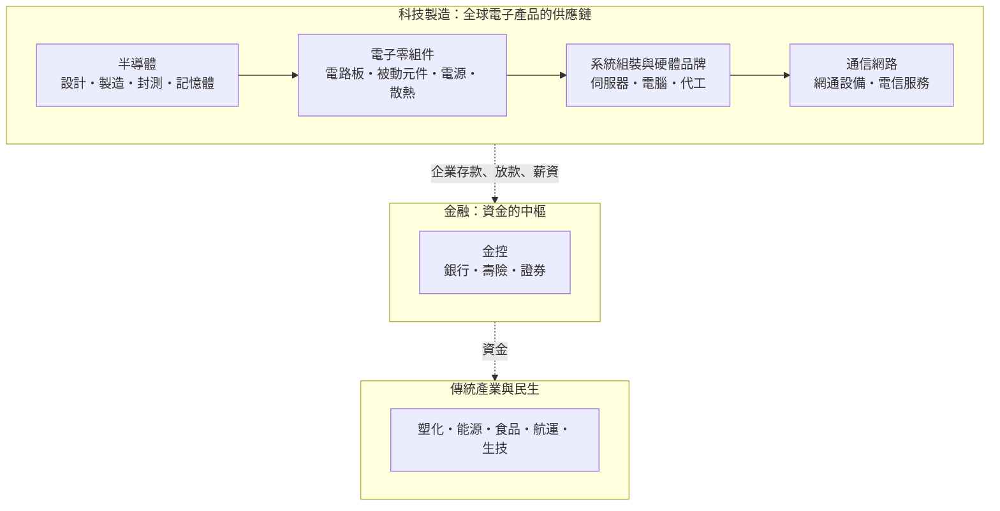

# 一張地圖看懂台灣產業：從 0050 讀台灣經濟的骨架

0050 是台灣市值最大的 50 家公司組成的一籃子股票。把這 50 家公司依產業攤開，就是一張台灣經濟的地圖：哪些產業撐起這個國家，它們彼此怎麼分工，各自靠什麼賺錢。

這篇文章不談短期漲跌，也不追最新一季的數字。它想回答的是一個十年後回頭看仍然成立的問題：**台灣的大公司在全球經濟裡扮演什麼角色？** 讀懂這張地圖，之後看到任何一家公司的新聞，你都能先問：它在地圖的哪個位置？

## 一、先弄懂 0050 是什麼

0050 追蹤「臺灣 50 指數」，成分股是台灣上市公司中市值最大的 50 家，並定期審核、汰換。這帶來兩個重要特性：

1. **它是一張會自己更新的地圖。** 公司會換，名單會變，但「依市值選出最大的 50 家」這條規則不變。十年後的成分股一定和今天不同，可是它永遠反映當時台灣最大的產業是誰。
2. **權重依市值分配。** 市值越大的公司占比越高。所以 0050 的組成，本身就是「市場認為台灣哪些產業最有分量」的結果，而不是任何人主觀挑選。

換句話說，學會讀 0050，不是記住 50 家公司的名字，而是學會一套看台灣產業的方法。

## 二、全景圖：台灣經濟的三層結構

把 50 家公司依產業歸類，可以看到三個層次：

- **科技製造**是主體。台灣在全球電子產業裡的角色，是「把別人設計的東西做出來，而且做得比任何人都好」，從最上游的晶片一路到最下游的伺服器組裝。
- **金融**是第二大塊。台灣的金控家數多、規模大，承接了整個經濟體的存款、放款與保險。
- **傳統產業與民生**占比小，但提供了不同的景氣節奏：石化、食品、航運、電信，各自跟著不同的需求循環。

以下依序拆開每一塊。

## 三、半導體：整張地圖的中心

半導體是 0050 最重要的產業，原因不只是權重最大，而是台灣在這個產業裡找到了一個全球幾乎無可取代的位置。

### 產業怎麼分工

一顆晶片從無到有，大致經過四個環節：

| 環節 | 做什麼 | 台灣代表公司（0050 成分股） | 核心競爭力 |
|---|---|---|---|
| IC 設計 | 畫出晶片的電路藍圖，不擁有工廠 | 聯發科 | 工程師人才、產品定義能力 |
| 設計服務 | 協助客戶把設計交給晶圓廠量產 | 創意 | 與晶圓廠的緊密合作 |
| 晶圓代工 | 依客戶設計在矽晶圓上製造電路 | 台積電、聯電 | 製程技術、良率、龐大資本支出 |
| 封裝測試 | 把晶片切割、封裝並測試 | 日月光投控、京元電子 | 規模、先進封裝技術 |
| 記憶體 | 生產儲存資料的晶片 | 南亞科、華邦電 | 製程與成本控制，景氣循環明顯 |

### 十年不變的核心概念

- **專業分工模式。** 台積電開創的「晶圓代工」讓晶片設計公司不必自己蓋工廠。全世界的設計公司把製造交給台灣，台灣因此站在幾乎所有先進電子產品的必經之路上。
- **規模與資本門檻。** 先進製程的工廠動輒需要極高的投資，領先者賺到的錢可以再投入下一代技術，追趕者則越來越難跟上。這種「贏家持續領先」的結構，是理解台灣半導體的關鍵。
- **需求會換主角，但都需要晶片。** 過去的成長來自個人電腦，後來是智慧型手機，近年是資料中心與人工智慧。下一個主角是什麼無法預知，但幾乎可以確定它需要更先進的晶片。
- **記憶體是例外。** 記憶體比較接近標準化商品，價格隨供需大幅波動，景氣循環的特性比晶圓代工明顯得多。

## 四、電子零組件與硬體：把晶片變成產品

晶片本身無法運作，它需要電路板承載、需要電源供電、需要散熱、需要被組裝成一台機器。這一大塊產業，是台灣電子供應鏈的「肌肉」。

| 次產業 | 做什麼 | 0050 代表公司 |
|---|---|---|
| 電路板與材料 | 承載晶片與零件的板子，以及上游的銅箔基板、載板 | 台光電、欣興、臻鼎-KY、金像電、南電 |
| 被動元件 | 電阻、電容等每台電子產品都需要的基本元件 | 國巨 |
| 電源與能源管理 | 把電力穩定、有效率地送進設備 | 台達電、光寶科 |
| 散熱與機構 | 讓高效能晶片不過熱，以及伺服器滑軌等機構件 | 奇鋐、健策、川湖 |
| 連接線材 | 設備內部與設備之間的訊號、電力連接 | 貿聯-KY |
| 系統組裝 | 把所有零件組成伺服器、電腦等完整產品 | 鴻海、廣達、緯穎、緯創 |
| 自有品牌與工業電腦 | 以自己的品牌銷售電腦或工業用設備 | 華碩、研華 |
| 檢測設備 | 為電子產品與半導體提供測試設備 | 致茂 |

### 十年不變的核心概念

- **跟著終端產品的世代更替。** 這些公司的命運，取決於它們能不能跟上下一個主流產品。從桌機、筆電、手機到伺服器，能存活下來的公司都完成過轉型。
- **規格升級帶來價值。** 晶片越強，電路板層數越多、耗電越大、散熱越難。零組件公司的機會往往來自「規格變難了」，而不只是「出貨變多了」。
- **組裝毛利薄，靠的是規模與工程能力。** 系統組裝廠的毛利率通常遠低於晶片公司，它們的護城河是龐大的製造規模、全球布局與跟大客戶長年磨合的工程能力。

## 五、通信網路：兩種完全不同的生意

同樣歸在通信網路業，這裡其實有兩種性質相反的公司：

- **電信服務**（中華電、台灣大、遠傳）：收的是每個月的通訊費，需求穩定、受景氣影響小，比較像公用事業。它們的挑戰是成長有限，以及不斷需要投資新一代網路。
- **網通設備**（智邦）：替資料中心製造交換器等網路設備，跟著雲端與資料中心的建置週期成長，性質更接近前面的電子硬體。

這是讀產業地圖的第一個提醒：**同一個產業分類，底下的商業模式可能完全不同。**

## 六、金融：家數最多的一塊

在 0050 裡，金融保險業的公司家數最多，主要是金控公司（富邦金、國泰金、中信金、兆豐金、玉山金等）。

金控的獲利來源大致有三種：

1. **銀行**：吸收存款、放出貸款，賺取利率差。
2. **壽險**：收取保費、長期投資，賺取投資收益與保險本業的差額。
3. **證券與資產管理**：賺取交易手續費與管理費，跟股市熱度高度相關。

### 十年不變的核心概念

- **金融業是整體經濟的鏡子。** 企業賺錢、薪資成長、資金充沛，金融業就跟著受惠；反之亦然。
- **利率是關鍵變數。** 利率環境改變會同時影響銀行的利差與壽險的投資收益，而且方向未必相同。
- **各家金控的差異，在於業務組合。** 以壽險為主的金控與以銀行為主的金控，對同一個經濟事件的反應可能截然不同。

## 七、傳統產業與民生：不同的景氣節奏

這一塊在 0050 的占比不高，但每家都是各自領域的代表：

| 產業 | 0050 代表公司 | 景氣特性 |
|---|---|---|
| 塑化 | 南亞 | 隨全球石化原料供需循環，波動大 |
| 油電燃氣 | 台塑化 | 煉油利差與油價影響大 |
| 食品 | 統一 | 民生必需，需求穩定 |
| 航運 | 長榮 | 運價隨全球貿易與運力供需大幅波動 |
| 生技醫療 | 藥華藥 | 取決於新藥開發與銷售進度 |
| 光電 | 大立光 | 手機鏡頭等光學元件，跟著手機規格升級 |

它們提醒我們一件事：**台灣經濟不只有電子業。** 而這些公司的景氣循環，往往和科技業不在同一個節拍上。

## 八、讀地圖時必須知道的事：集中度

0050 有一個很特別的結構：**台積電一家公司就占了一半以上的權重，半導體業合計約占七成。** 這是依市值分配的自然結果，不是誰刻意安排的。

這代表什麼？

- 0050 很大程度反映的是台灣半導體產業，尤其是台積電本身的表現。
- 其他 49 家公司加起來的影響力，可能還不如台積電一家。
- 當你想理解 0050，最划算的第一步就是先理解台積電與晶圓代工這門生意。

這個集中度未來可能升高也可能下降，但「先看最大權重的公司與產業」這個讀法永遠適用。

## 九、一套十年都用得上的提問框架

看到任何一家台灣公司，可以先問這五個問題：

1. **它在供應鏈的哪一層？** 上游材料、晶片、零組件、組裝，還是終端服務？
2. **誰付錢給它？** 客戶是少數大廠，還是成千上萬的消費者？
3. **它靠什麼守住生意？** 技術、規模、客戶關係、品牌，還是執照與網路？
4. **它的景氣循環長什麼樣？** 穩定的民生需求，還是隨供需大起大落？
5. **它需要多少資本才能維持競爭力？** 每年必須大量投資的公司，和不太需要投資的公司，是完全不同的生意。

這五個問題不會因為市場漲跌而失效。新聞會過時，數字會更新，但這套框架可以一直用下去。

## 十、接下來的系列怎麼讀

這篇是整個系列的地圖。接下來會依序介紹：

1. **台積電**：整張地圖的中心，也是 0050 最大的成分股。
2. **各產業的龍頭公司**：每個產業權重最大的公司，作為理解該產業的入口。
3. **其餘成分股**：依權重由大到小，逐一拆解每家公司在地圖上的位置。

每篇個股文章都會回到這張地圖：這家公司在哪一層、靠什麼賺錢、跟誰是上下游。

---

## 附錄：0050 產業組成快照

以下是單一時點的持股快照，會隨成分股調整與股價變動而改變，僅供對照本文的產業分類。

資料來源：元大投信 0050 持股明細，持股日期 2026/10/20（股票部位 99.76%，期貨部位另計）。產業別依各公司所屬的上市產業分類。

| 產業 | 權重合計 | 家數 | 成分股（依權重由大到小） |
|---|---|---|---|
| 半導體業 | 68.77% | 9 | 台積電、聯發科、日月光投控、聯電、創意、南亞科、華邦電、京元電子、鴻勁 |
| 金融保險業 | 8.87% | 12 | 富邦金、中信金、國泰金、台新新光金、元大金、玉山金、兆豐金、凱基金、永豐金、第一金、華南金、合庫金 |
| 電子零組件業 | 8.80% | 9 | 台達電、台光電、欣興、國巨、健策、川湖、臻鼎-KY、金像電、南電 |
| 電腦及週邊設備業 | 4.43% | 7 | 奇鋐、廣達、華碩、緯穎、緯創、光寶科、研華 |
| 其他電子業 | 3.91% | 3 | 鴻海、致茂、貿聯-KY |
| 通信網路業 | 1.89% | 4 | 智邦、中華電、遠傳、台灣大 |
| 塑膠工業 | 1.42% | 1 | 南亞 |
| 光電業 | 0.55% | 1 | 大立光 |
| 食品工業 | 0.38% | 1 | 統一 |
| 生技醫療業 | 0.35% | 1 | 藥華藥 |
| 航運業 | 0.27% | 1 | 長榮 |
| 油電燃氣業 | 0.12% | 1 | 台塑化 |

注意：官方產業分類和本文的「三層結構」不完全一致。例如鴻海在官方分類屬於其他電子業，台達電屬於電子零組件業，奇鋐屬於電腦及週邊設備業；本文依實際業務歸到對應的次產業。

---

## 免責聲明

本文為產業結構的研究整理，屬於一般性教育資訊，不構成對任何證券、ETF 或金融商品的投資建議。文中持股比例以標示的資料日期為準，之後可能已經變動。撰寫過程使用了 AI 協助整理。作者持有 0050，相關部位不代表任何投資意見。投資有風險，決策及其結果由讀者自行承擔。
