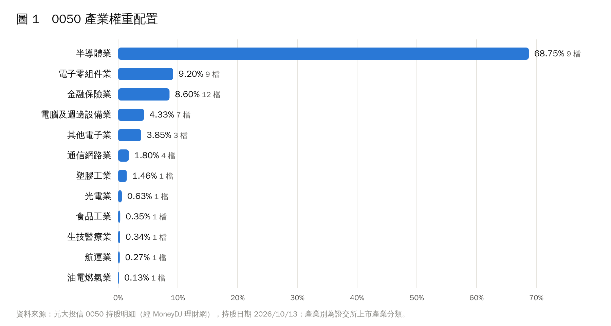
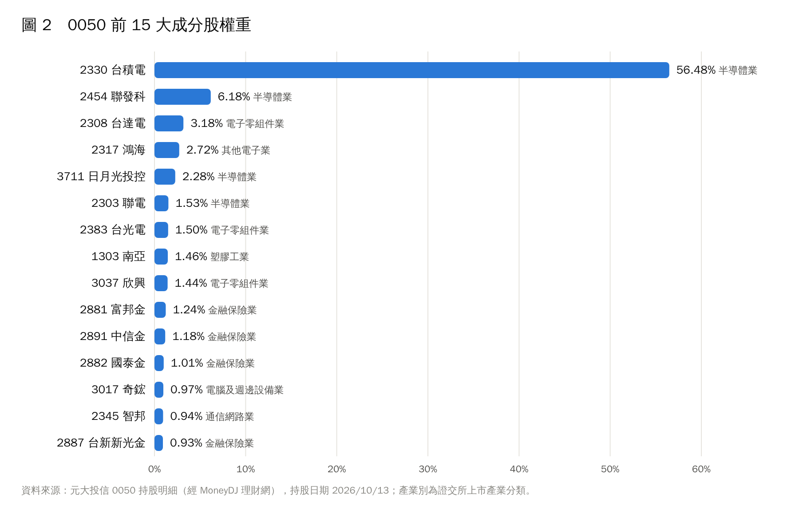
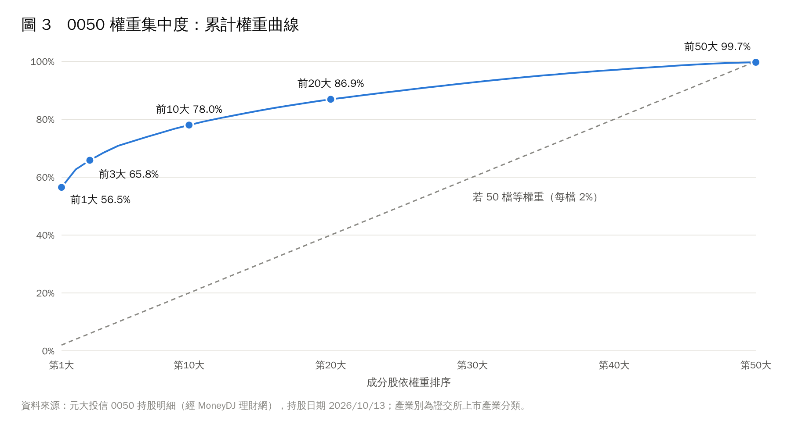
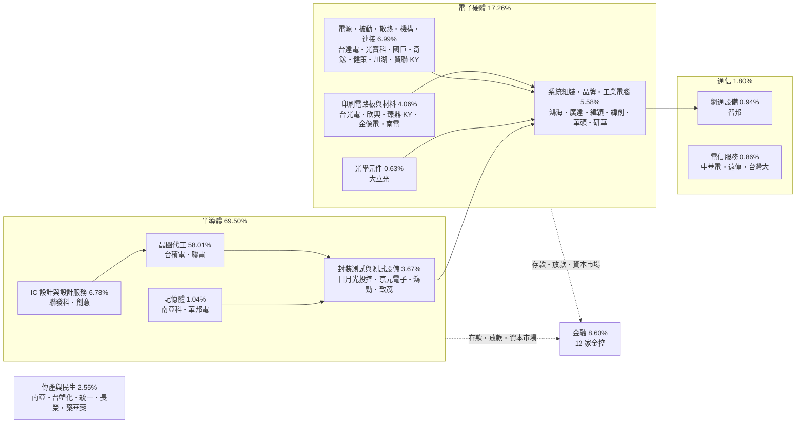
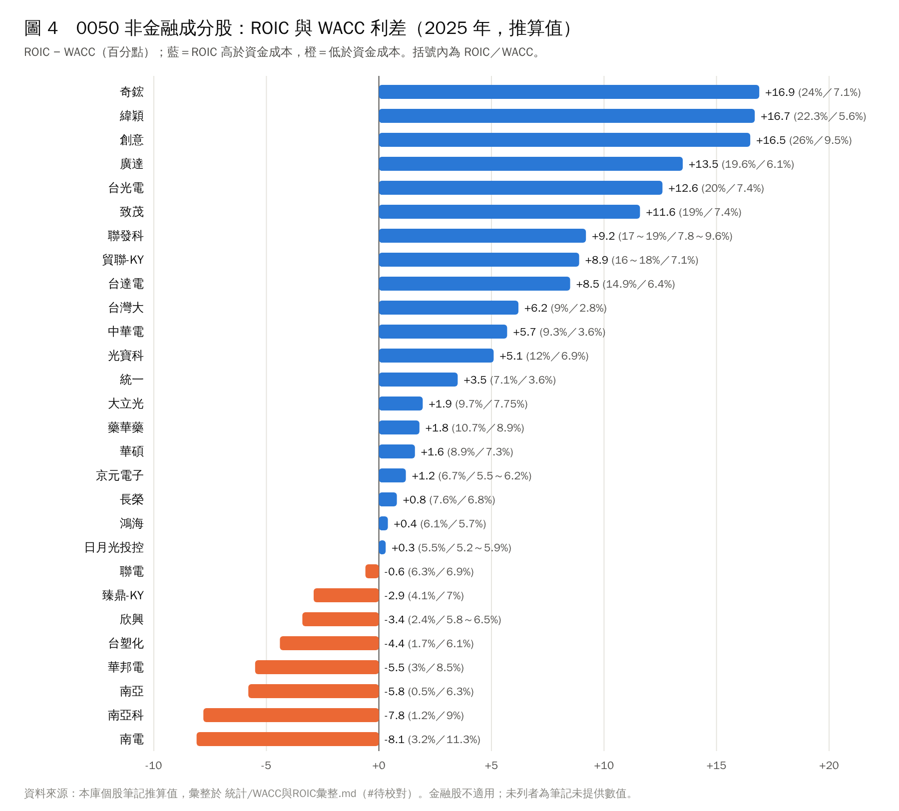

# 元大台灣50（0050）總覽：產業配置、權重集中度與資本效率分析

> **資料基準日**
> - 成分股與權重：2026/10/13 全部持股明細〔1〕；前十大另對照 2026/10/22〔2〕。
> - 官方產業分布：2026/09/30〔2〕。
> - 指數規則：FTSE TWSE Taiwan Index Series Ground Rules v5.2（2026 年 8 月）〔6〕。
> - ROIC／WACC：2025 年度，為本資料庫個股筆記的推算值〔11〕 #待校對
>
> 正文的結構性分析以長期適用為目標；所有會隨時間變動的數字都標明日期，更新時以附錄與圖表為準。

## 重點摘要

1. **0050 是一檔半導體主導的市值型 ETF。** 依證交所產業分類，半導體業占股票部位 68.75%，前三大產業（半導體、電子零組件、金融保險）合計 86.55%〔1〕。
2. **權重高度集中於單一公司。** 台積電權重 56.48%（2026/10/22 為 57.00%）〔1〕〔2〕；前 10 大合計 78.01%。以赫芬達指數（HHI）換算的「有效持股檔數」只有 3.0 檔，名目上的 50 檔分散效果遠低於直覺。
3. **扣除台積電後，其餘 49 檔相當分散。** 剩餘部位的有效持股檔數為 21.9 檔，產業橫跨電子零組件、系統組裝、金融、電信與傳產。
4. **以價值鏈重新歸類，「晶圓代工」單一環節就占 58.01%，電子硬體供應鏈（不含晶圓代工）合計 29.69%，金融 8.60%，傳產與民生 2.55%。**
5. **資本效率呈現兩極。** 在 28 檔有 ROIC／WACC 推算值的非金融成分股中，20 檔 2025 年 ROIC 高於 WACC；正利差集中在 AI 伺服器供應鏈與高規格零組件，負利差集中在記憶體、石化與載板等景氣循環型產業〔11〕 #待校對
6. **成分股依「全市值排名」每季審核，並設 40／61 名緩衝區。** 最近一次（2026 年 9 月）審核納入藥華藥、刪除世芯-KY〔6〕〔7〕。

## 一、商品與指數架構

### 1.1 基本資料

| 項目 | 內容 | 來源 |
|---|---|---|
| 基金名稱 | 元大台灣卓越50證券投資信託基金（元大台灣50，0050） | 〔3〕 |
| 成立日 | 2003/06/25 | 〔3〕 |
| 追蹤指數 | 臺灣50指數（FTSE TWSE Taiwan 50 Index），由臺灣證券交易所與 FTSE Russell 合作編製 | 〔3〕〔6〕 |
| 經理費 | 分級計費：1,000 億元以下 0.15%、1,000 億至 5,000 億元 0.10%、5,000 億至 1 兆元 0.08%、逾 1 兆元 0.05%；2026/10/22 換算約 0.0683% | 〔3〕〔9〕 |
| 保管費 | 1 兆元以下 0.03%、逾 1 兆元 0.025% | 〔3〕 |
| 基金規模 | 約 24,641 億元（證交所 ETF 頁面，未標資料日期） #待校對 | 〔5〕 |
| 受益人數 | 約 367.8 萬人（同上） #待校對 | 〔5〕 |
| 收益分配 | 半年配（近兩年發放月份為 2 月、8 月） | 〔5〕 |
| 分割 | 2025 年 6 月 1 拆 4，6/18 恢復交易 | 〔10〕 |

規模數字的交叉檢查：以元大投信公布的分級費率反推，綜合經理費 0.0683% 對應的規模約為 2.46 兆元，與證交所頁面的 24,641 億元一致〔3〕〔5〕。經理費級距自 2025/01/24 起由單一 0.32% 改為分級制〔9〕，規模越大、綜合費率越低，這是 0050 的長期結構性成本優勢。

### 1.2 選股與調整規則

臺灣50指數的編製規則可歸納為四點〔6〕：

1. **母體與排序。** 以臺灣證券交易所上市股票為母體，依「全市值」（未經流通量調整）排序，取最大的 50 家公司。上櫃公司不在母體內。
2. **可投資性篩選。** 自由流通比例 5% 以下者不納入；5% 至 15% 之間者須達 25 億美元以上市值。另有流動性門檻，每年 3 月檢驗。
3. **定期審核與緩衝。** 每季（3、6、9、12 月）審核，於審核月第三個星期五收盤後生效。排名升至第 40 名以內者納入，跌至第 61 名以下者刪除，以降低邊緣成分股反覆進出造成的周轉。
4. **權重與上限。** 權重以經流通量調整後的市值計算，基礎版臺灣50指數沒有單一個股權重上限；另有「30% 上限版」指數（FTSE TWSE Taiwan 50 30% Capped Index），成分股相同、單一成分股權重不超過 30%，但 0050 追蹤的是未設上限的版本。

第 4 點是理解 0050 的關鍵：**0050 的權重分布，就是台灣上市市場最大型公司市值分布的直接投影**，沒有任何主動判斷，也沒有為了分散而人為壓低龍頭權重。

## 二、產業配置

| 證交所產業別 | 權重（2026/10/13） | 家數 | 成分股（依權重排序） |
|---|---:|---:|---|
| 半導體業 | 68.75% | 9 | 台積電、聯發科、日月光投控、聯電、創意、南亞科、華邦電、鴻勁、京元電子 |
| 電子零組件業 | 9.20% | 9 | 台達電、台光電、欣興、國巨、健策、川湖、臻鼎-KY、金像電、南電 |
| 金融保險業 | 8.60% | 12 | 富邦金、中信金、國泰金、台新新光金、元大金、玉山金、凱基金、兆豐金、永豐金、華南金、第一金、合庫金 |
| 電腦及週邊設備業 | 4.33% | 7 | 奇鋐、廣達、緯穎、華碩、緯創、光寶科、研華 |
| 其他電子業 | 3.85% | 3 | 鴻海、致茂、貿聯-KY |
| 通信網路業 | 1.80% | 4 | 智邦、中華電、遠傳、台灣大 |
| 塑膠工業 | 1.46% | 1 | 南亞 |
| 光電業 | 0.63% | 1 | 大立光 |
| 食品工業 | 0.35% | 1 | 統一 |
| 生技醫療業 | 0.34% | 1 | 藥華藥 |
| 航運業 | 0.27% | 1 | 長榮 |
| 油電燃氣業 | 0.13% | 1 | 台塑化 |
| **股票合計** | **99.71%** | **50** | 其餘為臺股期貨等期貨部位與現金 |

資料來源：〔1〕；產業別為各公司的證交所上市產業分類。MoneyDJ 公布的 2026/09/30 產業分布（半導體 69.44%、電子零組件 9.19%、金融保險 8.31%）與上表的差異在 1 個百分點以內，主要來自兩個基準日之間的股價變動〔2〕。

兩個結構性觀察：

- **權重與家數的落差。** 金融保險業家數最多（12 家），權重卻只有 8.60%，平均每家 0.72%；半導體業 9 家占 68.75%。家數不代表影響力，判讀 0050 必須看權重，不能看名單長度。
- **電子業合計近九成。** 半導體、電子零組件、電腦及週邊、其他電子、通信網路、光電六類合計 88.56%。0050 的長期表現，本質上取決於全球電子產品需求與台灣在電子供應鏈中的地位。

## 三、權重集中度

| 集中度指標（2026/10/13） | 數值 |
|---|---:|
| 第 1 大（台積電） | 56.48% |
| 前 3 大 | 65.84% |
| 前 5 大 | 70.84% |
| 前 10 大 | 78.01% |
| 前 20 大 | 86.90% |
| 赫芬達指數 HHI（以股票部位重新加總為 100%） | 0.329 |
| 有效持股檔數（1／HHI） | 3.0 |
| 扣除台積電後 49 檔的有效持股檔數 | 21.9 |

計算方式：HHI ＝ Σ（個股權重²），權重以股票部位合計重新標準化；有效持股檔數為 1／HHI，代表「風險上相當於幾檔等權重持股」。資料來源：〔1〕，本文計算。

**判讀。** 有效持股檔數 3.0 的意思是：就權重分布而言，0050 的分散程度大約等同於平均持有 3 檔股票，而不是 50 檔。圖 3 的累計權重曲線一開始就從 56% 起跳，與等權重的虛線落差極大，這就是集中度的視覺呈現。

**這是規則的結果，不是設計缺陷。** 臺灣50指數以市值加權且基礎版不設上限〔6〕，台積電市值占台灣上市市場的比重越高，0050 的集中度就越高。因此投資人理解 0050 的優先順序很清楚：先理解台積電與晶圓代工產業，再理解其餘 49 檔構成的「電子供應鏈＋金融」組合。若需要降低單一公司曝險，市場上另有追蹤 30% 上限版指數或其他加權方式的產品可對照，屬於商品選擇問題，不在本文範圍。

## 四、價值鏈總覽圖

證交所產業分類以「公司登記的主要業務」劃分，不一定反映實際在產業鏈中的位置。例如鴻海屬「其他電子業」、台達電屬「電子零組件業」、奇鋐屬「電腦及週邊設備業」。下圖依實際業務重新歸類，箭頭代表主要的產品或資金流向，括號內為 2026/10/13 權重合計。

| 價值鏈環節 | 權重 | 家數 |
|---|---:|---:|
| 晶圓代工 | 58.01% | 2 |
| IC 設計與設計服務 | 6.78% | 2 |
| 電源、被動元件、散熱、機構與連接 | 6.99% | 7 |
| 系統組裝、品牌與工業電腦 | 5.58% | 6 |
| 印刷電路板與材料 | 4.06% | 5 |
| 封裝測試與測試設備 | 3.67% | 4 |
| 記憶體 | 1.04% | 2 |
| 網通設備 | 0.94% | 1 |
| 電信服務 | 0.86% | 3 |
| 光學元件 | 0.63% | 1 |
| 金融 | 8.60% | 12 |
| 傳產與民生 | 2.55% | 5 |
| **合計** | **99.71%** | **50** |

歸類方式為本文判斷（致茂歸入測試設備，鴻勁為 IC 測試分選設備），權重來源〔1〕。

## 五、各產業的長期結構

### 5.1 半導體：專業分工下的晶圓代工核心

半導體業依價值鏈可分為 IC 設計、晶圓製造、封裝測試三段，另有記憶體這類整合元件廠（IDM）。台灣在全球的位置由「專業晶圓代工」模式奠定：設計公司不必自建晶圓廠，製造集中到少數具規模的代工廠。這個模式有三個長期成立的經濟特性：

- **規模報酬與技術領先互相強化。** 先進製程的研發與建廠支出極高，領先者以較高的獲利支應下一代投資，追趕者的單位成本與技術落差則可能擴大。0050 中晶圓代工權重高達 58%，正是這種「贏家集中」結構在資本市場的反映。
- **終端需求輪替，但對先進晶片的需求持續。** 半導體需求的主要驅動力歷經個人電腦、智慧型手機到資料中心與人工智慧；主角會換，但幾乎每一代新應用都需要更高效能的晶片。
- **記憶體是例外。** 記憶體產品標準化程度高，價格由供需決定，獲利波動遠大於晶圓代工。2025 年南亞科、華邦電的 ROIC 推算值分別為 1.2% 與 3%，皆低於 WACC〔11〕，正是景氣循環下行階段的典型樣貌。

### 5.2 電子硬體：把晶片變成系統

晶片必須搭配電路板、電源、散熱、機構與連接元件，再由組裝廠整合成伺服器、電腦或網通設備。這一段占 0050 約 17%（價值鏈口徑，不含封測與測試設備），可分為兩種商業模式：

- **零組件：價值來自規格升級。** 晶片效能提升會帶動電路板層數、材料等級、供電功率與散熱需求同步上升。2025 年台光電（銅箔基板）、奇鋐（散熱）、台達電（電源）的 ROIC 推算值均明顯高於 WACC〔11〕，反映「規格變難」帶來的定價能力。但同屬電路板供應鏈的載板廠（南電）與部分 PCB 廠（欣興、臻鼎-KY）在 2025 年仍為負利差，說明同一產業內不同產品線的景氣位置可以完全不同。
- **系統組裝：薄利多銷，護城河在規模與工程能力。** 組裝廠毛利率結構性低於晶片公司，其長期競爭力來自全球產能布局、供應鏈管理與和大型雲端客戶的協同設計能力。廣達、緯穎 2025 年 ROIC 推算值約 20%，高於鴻海的 6.1%〔11〕，差異可能與產品組合中雲端伺服器的比重有關 #待校對

### 5.3 通信網路：同一分類下的兩種生意

通信網路業在 0050 中包含兩種性質相反的公司。**電信服務**（中華電、台灣大、遠傳）收取月租型收入，需求穩定、受特許執照保護，現金流特性接近公用事業；其 WACC 推算值僅 2.8%～3.6%，為 0050 中最低的一群〔11〕。**網通設備**（智邦）則隨資料中心建置週期成長，性質接近電子硬體。這是判讀產業分類時的通則：**分類相同，不代表商業模式、風險與資金成本相同。**

### 5.4 金融：家數最多、權重有限

12 家金控合計 8.60%。金控獲利來源可拆為三塊：銀行的存放款利差與手續費、壽險的保費與投資收益、證券與資產管理的交易與管理費。長期判讀重點有二：

- **利率是共同變數，但影響方向不一。** 利率上升通常擴大銀行利差，對壽險則同時影響投資收益與資產評價，以壽險為主與以銀行為主的金控對同一利率事件的反應可能相反。
- **金融業的資本效率應以 ROE 對照權益成本衡量。** 金融業的負債是營業原料而非單純的融資來源，ROIC／WACC 框架不適用，因此本文第六節的圖 4 不納入金融股〔11〕。

### 5.5 傳產與民生：不同的景氣節奏

南亞（塑化）、台塑化（煉油）、統一（食品）、長榮（貨櫃航運）、藥華藥（生技）合計 2.55%。這些公司的景氣循環與電子業不同步：石化與航運隨全球供需與運價大幅波動，食品屬必需消費、需求穩定，生技則取決於藥品銷售與新適應症進度。2025 年南亞、台塑化的 ROIC 推算值分別為 0.5% 與 1.7%，低於 WACC〔11〕，與石化產業供給過剩的循環位置一致。

## 六、資本效率：ROIC 與 WACC

投入資本報酬率（ROIC）高於加權平均資金成本（WACC），代表公司每投入一元資本所創造的報酬超過資金提供者要求的報酬，即創造經濟價值。下表與圖 4 為 2025 年度的推算值，來自本資料庫各成分股筆記〔11〕 #待校對

| 分組 | 檔數 | 公司（利差，百分點） |
|---|---:|---|
| 利差 ≥ +8 | 9 | 奇鋐 +16.9、緯穎 +16.7、創意 +16.5、廣達 +13.5、台光電 +12.6、致茂 +11.6、聯發科 +9.2、貿聯-KY +8.9、台達電 +8.5 |
| 利差 0 ～ +8 | 11 | 台灣大 +6.2、中華電 +5.7、光寶科 +5.1、統一 +3.5、大立光 +1.9、藥華藥 +1.8、華碩 +1.6、京元電子 +1.2、長榮 +0.8、鴻海 +0.4、日月光投控 +0.3 |
| 利差 < 0 | 8 | 聯電 −0.6、臻鼎-KY −2.9、欣興 −3.4、台塑化 −4.4、華邦電 −5.5、南亞 −5.8、南亞科 −7.8、南電 −8.1 |
| 無推算數值 | 10 | 台積電、國巨、智邦、川湖、健策、緯創、研華、金像電、鴻勁、遠傳 |
| 不適用（金融） | 12 | 12 家金控 |

註：筆記寫成區間者取下緣計算利差。

**判讀。**

1. **正利差集中在 AI 伺服器與高規格零組件。** 利差前 9 名多數與資料中心建置相關（散熱、伺服器組裝、銅箔基板、ASIC 設計服務、電源、連接線材）。這是 2025 年單一年度的景氣位置，未必代表長期常態，應搭配多年度數據判讀。
2. **負利差集中在商品化程度高的產業。** 記憶體、石化、載板與部分 PCB 的利差為負，與其產品價格由供需決定的特性一致；這類公司的 ROIC 在景氣循環中可大幅擺盪，單一年度為負不等於長期無法創造價值。
3. **最大權重缺少數值是本節的主要限制。** 台積電占 0050 逾五成，但本資料庫的台積電筆記為使用者自撰版本，尚未寫入 ROIC／WACC 數值。後續補上台積電與上表 10 檔的推算值後，可計算「以權重加權的 0050 整體 ROIC 與 WACC」，這是本文下一版的優先更新項目。

## 七、成分股變動機制與近期調整

2026 年 9 月定期審核結果：**納入藥華藥（6446）、刪除世芯-KY（3661）**，2026/09/18 收盤後生效、09/21 起實施；世芯-KY 移入臺灣中型100指數〔7〕〔8〕。審核同時公布的備選名單依序為台塑（1301）、群創（3481）、景碩（3189）、瑞昱（2379）、萬海（2615），若下次定期審核前有成分股因故刪除，依序遞補〔7〕。

這次調整呈現了指數規則的兩個特性：其一，成分股完全由市值排名機械式決定，生技公司（藥華藥）與 IC 設計服務公司（世芯-KY）的進出，只反映兩者市值排名的相對變化；其二，40／61 名緩衝區使邊緣公司不會因短期股價波動頻繁進出，降低基金的周轉成本〔6〕。

## 八、判讀任一成分股的分析框架

以下五個問題可套用到 0050 的任一成分股，也是本系列後續個股文章的共同結構：

| 面向 | 問題 | 對應指標 |
|---|---|---|
| 價值鏈位置 | 公司位於上游材料、晶片、零組件、組裝，還是終端服務？ | 本文第四節價值鏈歸類 |
| 客戶結構 | 營收來自少數大客戶，還是大量分散的消費者？ | 前五大客戶占比 |
| 競爭優勢 | 優勢來自技術、規模、客戶黏著度、品牌，還是特許執照？ | 毛利率穩定度、市占率 |
| 景氣特性 | 需求穩定，還是隨供需與價格大幅波動？ | 營收與毛利率的歷史波動 |
| 資本強度與效率 | 維持競爭力需要多少資本支出？投入資本是否賺到超過資金成本的報酬？ | 資本支出／營收、ROIC − WACC |

## 九、研究限制

1. **時點性。** 權重、規模與受益人數均為單一時點快照，會隨股價與審核變動。正文結論以結構性特徵為主，數字以附錄與標示日期為準。
2. **資料取得管道。** 持股明細取自 MoneyDJ 理財網轉載的元大投信資料〔1〕〔2〕；基金規模與受益人數取自證交所 ETF 頁面，頁面未標資料日期〔5〕。引用前建議回元大投信官網核對當日持股。
3. **ROIC／WACC 為推算值。** 數值來自本資料庫個股筆記依公開財報推算，未經第三方驗證，並有 10 檔非金融成分股尚無數值〔11〕。
4. **價值鏈歸類為本文判斷。** 多角化經營的公司（如鴻海、台達電）僅歸入其最主要的業務環節。

---

## 附錄 A：0050 全部成分股（持股日期 2026/10/13）

| 排名 | 代號 | 名稱 | 證交所產業別 | 權重 |
|---:|---|---|---|---:|
| 1 | 2330 | 台積電 | 半導體業 | 56.48% |
| 2 | 2454 | 聯發科 | 半導體業 | 6.18% |
| 3 | 2308 | 台達電 | 電子零組件業 | 3.18% |
| 4 | 2317 | 鴻海 | 其他電子業 | 2.72% |
| 5 | 3711 | 日月光投控 | 半導體業 | 2.28% |
| 6 | 2303 | 聯電 | 半導體業 | 1.53% |
| 7 | 2383 | 台光電 | 電子零組件業 | 1.50% |
| 8 | 1303 | 南亞 | 塑膠工業 | 1.46% |
| 9 | 3037 | 欣興 | 電子零組件業 | 1.44% |
| 10 | 2881 | 富邦金 | 金融保險業 | 1.24% |
| 11 | 2891 | 中信金 | 金融保險業 | 1.18% |
| 12 | 2882 | 國泰金 | 金融保險業 | 1.01% |
| 13 | 3017 | 奇鋐 | 電腦及週邊設備業 | 0.97% |
| 14 | 2345 | 智邦 | 通信網路業 | 0.94% |
| 15 | 2887 | 台新新光金 | 金融保險業 | 0.93% |
| 16 | 2327 | 國巨 | 電子零組件業 | 0.88% |
| 17 | 2382 | 廣達 | 電腦及週邊設備業 | 0.79% |
| 18 | 2885 | 元大金 | 金融保險業 | 0.75% |
| 19 | 2360 | 致茂 | 其他電子業 | 0.75% |
| 20 | 2884 | 玉山金 | 金融保險業 | 0.69% |
| 21 | 3008 | 大立光 | 光電業 | 0.63% |
| 22 | 6669 | 緯穎 | 電腦及週邊設備業 | 0.63% |
| 23 | 2357 | 華碩 | 電腦及週邊設備業 | 0.61% |
| 24 | 3443 | 創意 | 半導體業 | 0.60% |
| 25 | 2408 | 南亞科 | 半導體業 | 0.58% |
| 26 | 2883 | 凱基金 | 金融保險業 | 0.57% |
| 27 | 3653 | 健策 | 電子零組件業 | 0.57% |
| 28 | 2886 | 兆豐金 | 金融保險業 | 0.56% |
| 29 | 2890 | 永豐金 | 金融保險業 | 0.55% |
| 30 | 2412 | 中華電 | 通信網路業 | 0.52% |
| 31 | 3231 | 緯創 | 電腦及週邊設備業 | 0.52% |
| 32 | 2059 | 川湖 | 電子零組件業 | 0.51% |
| 33 | 2301 | 光寶科 | 電腦及週邊設備業 | 0.50% |
| 34 | 2344 | 華邦電 | 半導體業 | 0.46% |
| 35 | 2880 | 華南金 | 金融保險業 | 0.43% |
| 36 | 2892 | 第一金 | 金融保險業 | 0.42% |
| 37 | 4958 | 臻鼎-KY | 電子零組件業 | 0.40% |
| 38 | 3665 | 貿聯-KY | 其他電子業 | 0.38% |
| 39 | 2368 | 金像電 | 電子零組件業 | 0.38% |
| 40 | 1216 | 統一 | 食品工業 | 0.35% |
| 41 | 6446 | 藥華藥 | 生技醫療業 | 0.34% |
| 42 | 8046 | 南電 | 電子零組件業 | 0.34% |
| 43 | 7769 | 鴻勁 | 半導體業 | 0.32% |
| 44 | 2449 | 京元電子 | 半導體業 | 0.32% |
| 45 | 2395 | 研華 | 電腦及週邊設備業 | 0.31% |
| 46 | 2603 | 長榮 | 航運業 | 0.27% |
| 47 | 5880 | 合庫金 | 金融保險業 | 0.27% |
| 48 | 4904 | 遠傳 | 通信網路業 | 0.18% |
| 49 | 3045 | 台灣大 | 通信網路業 | 0.16% |
| 50 | 6505 | 台塑化 | 油電燃氣業 | 0.13% |

另持有臺股期貨（2026 年 10 月契約）0.24%、台灣50ETF股票期貨 0.03%〔1〕。2026/10/22 前十大依序為台積電 57.00%、聯發科 5.77%、台達電 2.94%、鴻海 2.92%、日月光投控 2.12%、南亞 1.45%、台光電 1.44%、聯電 1.43%、欣興 1.40%、中信金 1.30%〔2〕。

原始數據：`_data/0050持股明細_2026-10-13.csv`；圖表以 `scripts/0050總覽/make_charts.py` 產生，更新持股後重跑即可。

## 附錄 B：資料來源

1. MoneyDJ 理財網，〈元大台灣50（0050.TW）全部持股〉，持股日期 2026/10/13。https://www.moneydj.com/etf/x/basic/Basic0007B.xdjhtm?etfid=0050.TW
2. MoneyDJ 理財網，〈元大台灣50－ETF持股狀況〉，前十大持股 2026/10/22、產業分布 2026/09/30。https://www.moneydj.com/etf/x/basic/basic0007.xdjhtm?etfid=0050.tw
3. 元大投信，〈元大台灣50（0050）基本資料〉，經理費資料日期 2026/10/22。https://www.yuantaetfs.com/product/detail/0050/Basic_information
4. 元大投信，〈元大台灣50（0050）商品頁〉，指數審核生效時點與最近一次調整。https://www.yuantaetfs.com/product/detail/0050/
5. 臺灣證券交易所，〈ETF e 添富：0050 商品資訊〉，基金規模、受益人數、收益分配紀錄。https://www.twse.com.tw/zh/ETFortune/etfInfo/0050
6. FTSE Russell，*FTSE TWSE Taiwan Index Series Ground Rules*, v5.2, August 2026。https://www.lseg.com/content/dam/ftse-russell/en_us/documents/ground-rules/ftse-twse-taiwan-index-series-ground-rules.pdf
7. 經理人月刊（MoneyDJ 新聞），〈0050 換股！臺灣 50 指數成分股刪除世芯-KY、新增藥華藥〉，2026/09/04。https://www.managertoday.com.tw/articles/view/72869
8. 新光證券，〈0050 要換股了：9/18 生效前，354 萬受益人該知道的三件事〉，2026/09/07。https://www.skis.com.tw/Report/education/KNW20260907.html
9. 科技新報，〈元大 0050 調降經理費至 0.11%、保管費至 0.03%〉，2025/01/23。https://technews.tw/?p=1336386
10. 科技新報，〈0050 一拆四〉，2025/06/10。https://finance.technews.tw/2025/06/10/one-split-into-four/
11. 本資料庫，`統計/WACC與ROIC彙整.md`（2026/10/21 彙整，數值為各個股筆記的推算值）。

---

## 免責聲明

本文為產業結構與指數組成的研究整理，屬一般性教育資訊，不構成對任何證券、ETF 或金融商品的投資建議。文中數據以標示的資料日期為準，之後可能已經變動。撰寫過程使用 AI 協助整理與計算。作者持有 0050，相關部位不代表任何投資意見。投資有風險，決策及其結果由讀者自行承擔。
