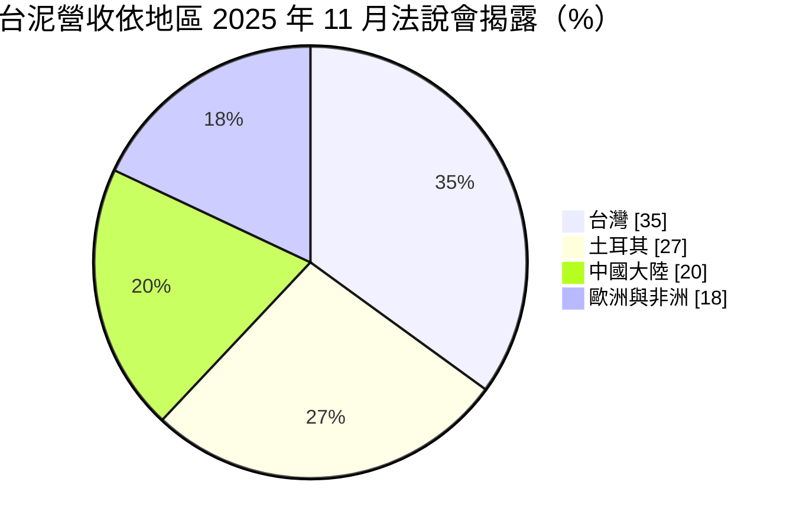
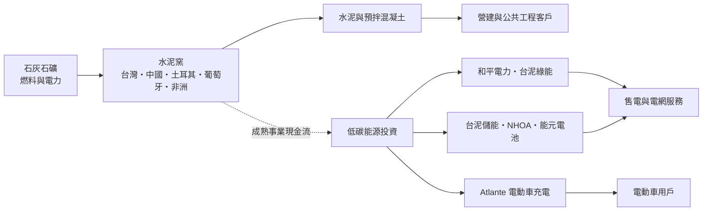
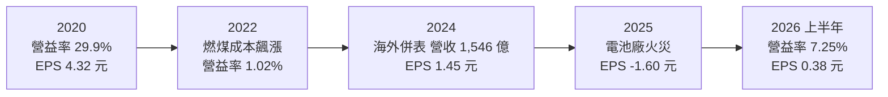
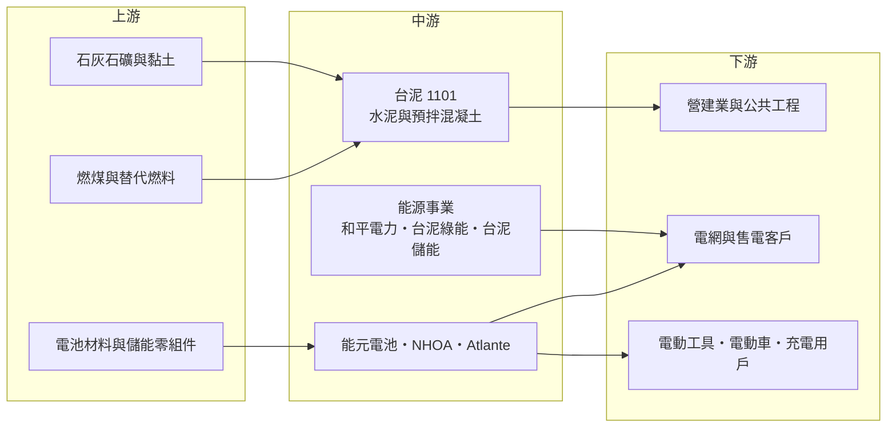

# 1101 台泥

> 上市｜[[產業索引-水泥工業|水泥工業]]｜上市（櫃）日期 1962/02/09

# 第一章：企業模式與商業藍圖

> [!info] 撰寫說明
> 本文由 Claude 依公開資料整理，架構比照 [[2330台積電]] 的四章研究，資料截至 2026-10-08。財務數字來源：證交所開放資料快照（基本資料、2026 年第二季資產負債與綜合損益、股利）、Goodinfo 經營績效頁與股利政策頁（2016 至 2025 年）、MoneyDJ 季資產負債表（2026 年第二季借款科目）、優分析 2025 年 11 月法說會報導（區域營收與毛利率）、股感 2025 年財報整理（現金流）；OYAK Cimpor 併入時點、NHOA 收購年份與和平電力規模係憑記憶整理，尚未逐條比對原始文件。#待校對

在評估一家公司的長期投資價值時，第一步是看懂它靠什麼賺錢、為什麼能一直賺下去。本章針對台灣水泥（股票代號：1101，以下簡稱台泥）的商業模式進行定性分析，說明這家台灣歷史最悠久的上市公司之一，如何從島內的水泥龍頭，變成橫跨台灣、中國、土耳其、葡萄牙與非洲的跨國水泥集團，又為什麼選擇把水泥賺來的現金投入電池、儲能與充電等低碳能源事業。

## 一、核心定位：跨國水泥集團，正在轉型為低碳能源平台

台泥成立於 1950 年，1962 年上市，是台灣最大的水泥與[[預拌混凝土]]製造商。水泥是一種「在地化」極強的產品：每噸售價不高，但重量大、運費貴，通常只能賣到工廠周邊數百公里的範圍，因此各地區的水泥市場往往由少數幾家握有石灰石礦權與窯爐的廠商把持。這個特性決定了台泥的成長方式，它不能靠出口把台灣工廠的產品賣到全世界，只能用併購或合資的方式，直接取得海外市場裡的工廠。

台泥的定位可以拆成兩層來理解。第一層是基本盤的水泥事業，2025 年約占合併營收八成。台泥除了台灣東部的和平廠與花蓮礦區，也在中國華南與西南設有大型水泥廠，並透過與土耳其 OYAK 集團合作的 OYAK Cimpor 取得土耳其、葡萄牙與非洲的水泥資產（合作與合併時點待校對）。2024 年營收由前一年的 1,093 億元跳升到 1,546 億元，主要就是海外水泥資產併入合併報表的結果（推估）。

第二層是成長引擎的低碳能源事業，包括和平電力、台泥綠能（太陽能、風電、地熱）、台泥儲能、電池廠能元科技（品牌 Molicel）、在歐洲經營[[儲能]]系統整合的 NHOA，以及在南歐建置[[電動車充電]]網路的 Atlante。這些事業目前占營收比重不到兩成，但吃掉了台泥近年相當大比例的資本支出。換句話說，台泥今天是一家「用成熟水泥事業的現金流，去養一個還在投入期的能源事業」的公司，投資人看它的時候必須同時看兩本帳。

## 二、終端應用板塊：四大區域的水泥市場

依 2025 年 11 月法說會揭露的資料，台泥的營收與毛利率在四大區域之間差異很大：

- **台灣（約 35%）：** 台灣事業包括水泥、預拌混凝土與和平電力，同場法說會揭露的毛利率約 31%。台灣水泥需求與住宅、公共工程的週期高度連動，近年又面對越南等地的進口水泥競爭，因此價格調整的空間有限。和平電力的售電收入相對穩定，替台灣事業提供了一塊與營建景氣無關的底盤。
- **土耳其（約 27%）：** 土耳其毛利率約 35%，是目前獲利能力最好的區域。土耳其的基礎建設與重建需求龐大，但當地通膨高、貨幣長期貶值，換算成新台幣後的營收與獲利會受到匯率明顯影響。
- **中國大陸（約 20%）：** 中國水泥市場隨房地產長期調整而供過於求，同場法說會揭露的毛利率僅約 6%。台泥已縮減中國產能約 14%、精簡人力約 20%，管理層的目標是讓中國事業的毛利率回到雙位數、營業利益轉正。
- **歐洲與非洲（約 18%）：** 以葡萄牙為核心，延伸到喀麥隆、莫三比克等非洲市場，毛利率約 28%。葡萄牙是寡占市場，非洲則有長期的城市化與基礎建設需求，是台泥海外布局中最具成長性的區塊之一。

依事業別，水泥約占八成，能源相關事業合計不到兩成。能源事業之中，台泥綠能的毛利率約 38%、台泥儲能約 29%、Atlante 約 58%（皆為 2025 年 11 月法說會揭露），但多數仍處於規模擴張期，對整體獲利的貢獻有限。

## 三、資本轉化邏輯：水泥現金流養能源新事業

- **水泥是長壽命的重資產：** 石灰石礦場與水泥窯一旦建成，可以運轉數十年，折舊攤提完後的現金成本主要是燃料、電力與人工。在需求穩定的市場，這種資產能長期產生可預期的現金流，這也是台泥過去能維持高配息的基礎。
- **能源事業是資本密集的長期押注：** 台泥把水泥現金流投入電池、儲能、充電與再生能源，短期會拉低整體獲利率，並讓資產負債表的負債增加。管理層押注的是電力系統走向再生能源後，儲能與電網服務會成為新的基礎設施。2025 年能元高雄電池廠發生火災，造成約 139.6 億元的損失，是這條轉型路線上最大的一次挫折，也提醒投資人新事業的營運風險與水泥完全不同。
- **把碳成本變成競爭工具：** 水泥生產過程中，石灰石在窯中燒成[[熟料]]時會釋放大量二氧化碳，因此水泥是碳排放最集中的產業之一。台泥以[[低碳水泥]]（降低熟料比例）、替代燃料、協同處理廢棄物與[[碳捕捉]]試驗，把未來的[[碳費]]與碳稅壓力，轉化為相對於高碳排同業的成本優勢。

## 四、企業長期藍圖：海外水泥獨立估值與能源平台化

- **海外水泥分拆上市：** 2026 年 8 月董事會通過把土耳其、葡萄牙與非洲的水泥及混凝土事業整合到新子公司 Cimpor International Holdings，規劃到倫敦或泛歐交易所上市，公開發行比例至少 10%。這項安排讓海外水泥資產取得獨立估值與當地籌資管道，也可能讓市場重新評價台泥目前偏低的資產報酬。管理層在 2025 年法說會中提到，Cimpor 體系的營收目標是 2030 年達到 35 億歐元。
- **中國持續瘦身：** 台泥沒有選擇在中國加碼，而是關閉或縮減效率較差的產能，把中國定位為「止血、回到正常獲利」的市場。這代表中國事業未來的角色，是貢獻穩定現金流，而不是成長來源。
- **能源事業走向損益兩平：** 能元在 2025 年 10 月單月 [[EBITDA]] 轉正，Atlante 營收年增 129%。能源事業能否在重建電池產能後，轉為穩定獲利並開始回收投資，是判斷台泥轉型成敗的核心指標。

# 第二章：護城河深度與競爭優勢

在長期價值投資中，「護城河」指企業抵禦競爭、長期維持超額利潤的保護機制。本章分析台泥的護城河由哪些要素構成、在各區域面對哪些主要對手，以及這些優勢在房市週期與能源轉型的雙重變化下能守住多少。

## 一、台泥護城河的核心組成要素

台泥的護城河集中在水泥本業，屬於「區域型的窄護城河」。能源事業目前還看不到明確的護城河，主要由以下三個要素構成：

- **1. 礦權與運輸半徑形成的在地寡占：** 新建一座水泥廠，必須取得石灰石礦權、通過環評、興建窯爐與港口或鐵路，從規劃到投產往往需要多年，資本額動輒上百億元。再加上運輸成本限制了水泥的銷售半徑，各地市場通常只容得下少數幾家廠商。台泥在台灣與葡萄牙都具有區域領導地位，這是它最穩固的優勢。
- **2. 跨區布局分散單一市場風險：** 水泥需求跟著各國的房地產與公共工程走，景氣週期並不同步。台泥在台灣、中國、土耳其、歐非四大區域都有產能，當中國需求萎縮時，土耳其與葡萄牙的獲利可以補位。這種分散不會讓台泥賺得特別多，但能降低單一市場崩跌時的衝擊。
- **3. 減碳能力與能源資產：** 碳費、碳稅與歐盟[[CBAM]]上路後，碳排放成本會成為水泥業的主要成本之一。台泥在替代燃料、低碳水泥與再生能源上的投入較早，若能持續降低單位碳排，未來在成本與出口市場都會比高碳排同業更有競爭力。和平電力與綠能資產則提供與營建景氣不同步的收入。

## 二、全球主要競爭對手格局

| 對手 | 定位 | 對台泥的影響 |
|---|---|---|
| [[1102亞泥]] | 台灣第二大水泥廠，也有中國產能 | 在台灣與中國市場直接競爭，同時同屬寡占結構的受益者 |
| [[1104環泥]]、[[1103嘉泥]]、[[1110東泥]] | 台灣中小型水泥與預拌混凝土業者 | 在區域預拌混凝土市場競爭 |
| 海螺水泥、中國建材 | 中國最大的水泥集團 | 主導中國水泥價格，產能過剩時的價格戰對台泥中國事業衝擊最大 |
| 海德堡材料、Holcim | 全球水泥龍頭 | 在歐洲與非洲市場競爭，減碳技術與規模領先 |
| 越南、中國等進口水泥 | 低價進口料 | 壓縮台灣水泥的價格調整空間 |
| 寧德時代、比亞迪、LG 新能源等 | 全球電池與儲能大廠 | 能源事業面對規模大得多的對手 |

## 三、優勢轉化：哪些守得住、哪些守不住

- **守得住：** 台灣與葡萄牙的區域領導地位，以及土耳其的高毛利水泥業務。這些市場的進入門檻高、供給相對穩定，只要營建需求不出現長期萎縮，台泥都能維持合理的價格與利潤。和平電力這類受管制的電力資產，也屬於可預期的現金流。
- **守不住：** 中國水泥市場與一般化的電池業務。中國的問題是需求長期萎縮加上產能過剩，即使台泥有成本優勢，也只能靠減產止血。電池事業則要和全球規模最大的廠商競爭，能元以高功率圓柱電池為利基，但利基市場能否撐起龐大的投資，仍需要時間證明。
- **觀察重點：** 長期而言，可以追蹤三件事。第一是 Cimpor 上市後海外水泥資產的估值與台泥持股價值；第二是中國事業能否穩定回到雙位數毛利率；第三是能源事業的整體營業利益何時轉正。這三點決定台泥的資本報酬能否回到 2018 至 2020 年的水準。

# 第三章：財務體質與盈利規模

資料日期：2026-10-08。數字取自 Goodinfo 經營績效頁與股利政策頁、證交所開放資料快照與 MoneyDJ 季資產負債表，表格是撰寫當時的快照；最新月營收、毛利率、累計 EPS 由自動排程寫在本筆記的屬性欄位（月營收、毛利率、累計EPS 等）。#待校對

財務報表是檢驗護城河是否真實存在的最終標準。本章用多年度的三率、ROE、現金流與資本報酬，檢視台泥在水泥週期與能源轉型下的獲利品質。

## 一、獲利能力的基石：三率

| 年度 | 營收（億元） | [[毛利率]] | [[營業利益率]] | EPS（元） | [[ROE]] |
|---|---|---|---|---|---|
| 2019 | 1,228 | 29.2% | 24.6% | 4.43 | 12.5% |
| 2020 | 1,059 | 35.3% | 29.9% | 4.32 | 13.1% |
| 2021 | 1,070 | 24.9% | 18.5% | 3.30 | 9.54% |
| 2022 | 1,139 | 8.9% | 1.02% | 0.74 | 1.79% |
| 2023 | 1,093 | 18.8% | 9.18% | 1.06 | 4.07% |
| 2024 | 1,546 | 21.2% | 11.1% | 1.45 | 5.56% |
| 2025 | 1,498 | 18.4% | 6.73% | -1.60 | -3.95% |

（來源：Goodinfo 經營績效頁，合併報表。2026 年上半年依證交所資料，營收 712.9 億元、毛利率 18.22%、營業利益率 7.25%、EPS 0.38 元。）

- **毛利率的兩個時代：** 2018 至 2020 年台泥營業利益率在 22% 至 30% 之間，是中國水泥價格高檔、燃煤成本相對低的黃金期。2022 年燃煤價格飆漲、中國需求轉弱，營業利益率一度跌到 1%，之後回升但再也沒有回到 20% 以上。這代表台泥的獲利結構已經改變：中國不再是利潤中心，能源新事業又還在投入期。
- **營收成長主要靠併購：** 2020 至 2025 年營收年複合成長率約 7.2%（推算），但成長幾乎集中在 2024 年海外水泥資產併表那一年，有機成長有限。併購帶來的營收規模，必須能在之後幾年轉化成穩定的利潤，否則只是把資產負債表變大。
- **一次性損失：** 2025 年的虧損主要來自能元電池廠火災約 139.6 億元與中國水泥事業優化約 49.7 億元等[[非經常性損失]]，其中大部分屬於非現金減損。評估本業時應把這些項目分開看，但它們也確實代表過去投入的資本被永久減少。

## 二、[[ROE]]：資本效率

台泥 2021 至 2025 年平均 ROE 約 3.4%（推算），遠低於 2018 至 2020 年的 12% 至 13%。ROE 下降的原因有三個：中國水泥獲利崩落、能源事業投入大量資本卻尚未獲利，以及併購與增資讓股東權益基數變大。依 2026 年第二季資料，台泥權益總計約 2,993 億元（其中歸屬母公司約 2,374 億元），每股淨值約 30.86 元。要讓 ROE 回到雙位數，需要能源事業轉盈，或把低報酬資產處分、分拆以縮小權益基數。

## 三、資本支出、自由現金流與股利

- **[[自由現金流]]：** 依股感整理，2025 年營業活動現金流約 331.92 億元，自由現金流約 89.06 億元。即使帳面虧損，水泥本業仍能產生正的現金流，這是台泥能撐住轉型投資的底氣。
- **[[CapEx]]：** 能元重建、儲能案場、Atlante 充電站與減碳設備，都需要持續投入。2026 年第二季資產總計約 5,960 億元、負債約 2,967 億元，負債比約 49.8%，比過去以水泥為主的時期明顯升高。
- **股利穩定度：** 2016 至 2020 年度台泥每年配發 1.45 至 3.37 元現金股利，2022 年度起降到 0.5 至 1 元。2025 年度雖然虧損，仍以資本公積發放每股 0.8 元現金（證交所股利資料）。公司章程規定現金股利不低於股利總額的 20%，顯示管理層把配息彈性留給轉型投資，股利已不像過去那樣穩定。

## 四、[[ROIC]] 與 [[WACC]]：價值創造利差

- **ROIC（推算）：** 以 2025 年營收 1,498 億元乘以營業利益率 6.73%，營業利益約 100.8 億元，扣除 20% 稅率後稅後營業利益約 80.7 億元。投入資本以 2026 年第二季權益總計約 2,993 億元，加上有息負債約 2,131 億元（短期借款 58.5 億、應付商業本票 8.8 億、一年內到期長期負債 518.3 億、應付公司債 933.8 億、長期銀行借款 541.5 億、租賃負債 70.1 億），合計約 5,124 億元，ROIC 約 1.6%（推算）。以 2026 年上半年營業利益 51.7 億元年化計算，結果也接近 1.6%。
- **WACC（推算）：** 以 [[CAPM]] 估算股東權益成本：無風險利率取台灣 10 年期公債約 1.75%，市場風險溢酬 6%，β 假設 0.7（水泥股同業常見值，未查得台泥實際數字），權益成本約 5.95%。稅前負債成本假設 2.5%、稅率 20%，稅後約 2.0%。以帳面價值計算，負債占投入資本約 42%、權益約 58%，WACC 約 4.3%（推算）。
- **價值創造判斷：** 目前台泥的 ROIC 約 1.6%，低於約 4.3% 的資金成本，代表整體資本在這段期間沒有創造超額價值。以 2020 年營業利益 316.6 億元粗估，當時的資本報酬明顯高於 WACC。台泥的問題不是水泥本業失去競爭力，而是大量資本被鎖在低報酬的中國產能與尚未獲利的能源新事業裡。海外水泥分拆、中國瘦身與能源轉盈，是讓 ROIC 重新超過 WACC 的三個槓桿。

# 第四章：總體風險與地緣政治

任何企業都無法脫離宏觀環境獨立存在。本章分析台泥未來必須面對的地緣政治、產業週期、營運與法規風險。

## 一、地緣政治風險

- **中國市場：** 中國營收約占兩成，台泥同時面對中國房地產長期調整與兩岸關係變化。台泥選擇持續縮減中國產能，這能降低曝險，但若兩岸關係惡化或中國對台資企業的政策改變，中國資產的價值與股利匯回都可能受影響。
- **土耳其的通膨與匯率：** 土耳其是台泥獲利最好的地區，但長期高通膨與貨幣貶值，使當地獲利換算成新台幣時經常出現匯兌損失。土耳其所在的區域地緣政治複雜，政策與匯率的波動是這塊業務的固有風險。
- **歐洲能源政策：** Atlante 與 NHOA 的營運依賴歐洲的電動車推廣、電網政策與補貼。若歐洲放緩電動車與再生能源政策，能源事業的成長速度會受影響。

## 二、產業週期與市場結構風險

- **營建與公共工程週期：** 水泥需求與房地產、公共工程高度連動。台灣住宅市場受信用管制與利率影響時，水泥出貨量會隨之下滑；台泥只能靠區域分散降低衝擊，無法完全避開。
- **中國產能過剩：** 中國水泥需求在房地產調整後長期萎縮，而產能退場速度慢，價格戰可能延續多年。中國政府的產能調控政策能否落實，是中國事業回到正常獲利的前提。
- **電池與儲能價格下跌：** 鋰電池與儲能系統的價格隨中國大規模擴產持續下降，台泥的能源事業如果沒有足夠的規模或技術差異，毛利率可能被壓縮。

## 三、營運環境的隱性風險

- **工安與火災：** 2025 年能元電池廠火災是台泥近年最大的單一損失。電池製造涉及高能量材料，安全管理的要求與水泥窯完全不同，新事業的營運風險需要用不同的標準評估。
- **轉型執行與管理複雜度：** 能源事業分散在台灣與歐洲多家公司，業務橫跨發電、儲能、電池與充電。若多項新事業同時不如預期，資本將長期被鎖住，也可能拖累水泥本業的再投資與配息。
- **燃料與電價：** 水泥窯需要大量燃煤與電力，2022 年燃煤價格飆漲讓營業利益率跌到 1% 就是例子。能源價格的劇烈波動，是水泥業最直接的成本風險。

## 四、法規與技術演進風險

- **碳費與碳稅：** 台灣碳費已經上路，歐盟 CBAM 逐步實施，中國也有碳交易市場。台泥估計 2030 年後中國開徵碳稅的機率相當高。水泥屬於高碳排產業，碳成本上升是長期風險，但也是台泥減碳投資能轉化為優勢的地方。
- **低碳建材與替代技術：** 若低碳水泥、替代膠結材料或碳捕捉技術的突破來自國際大廠，台泥可能在技術上落後；反之，若台泥能領先量產低碳產品，就能把碳成本轉嫁給高碳排同業。
- **電池技術演進：** 電池化學體系變化快，能元的高功率圓柱電池若被新技術或新規格取代，重建產能的投資回收期會拉長。

# 專有名詞解析

## 應用

- **[[電動車充電]]**：為電動車提供電力的充電樁與營運服務，台泥透過 Atlante 在南歐經營快充網路。

## 金融

- **[[EBITDA]]**：稅前息前折舊攤銷前利潤，常用來衡量資本密集事業在扣除非現金成本前的營運獲利能力。
- **[[非經常性損失]]**：火災、資產減損、重組等不會每年重複發生的損失，評估本業時常會另外拆開看。
- **[[自由現金流]]**：營業活動現金流減去資本支出，代表企業可自由用於配息、還債或併購的現金。
- **[[ROIC]]**：投入資本報酬率，稅後營業利益除以股東權益加有息負債，衡量本業運用資本的效率。
- **[[WACC]]**：加權平均資金成本，依股東權益與負債的比重，加權計算公司取得資金的平均成本。
- **[[CAPM]]**：資本資產定價模型，以無風險利率加上 β 乘以市場風險溢酬估算股東要求報酬率。

## 產業

- **[[預拌混凝土]]**：在工廠依比例拌好水泥、砂石與水，再以攪拌車運到工地的混凝土，是水泥最主要的下游產品。
- **[[熟料]]**：石灰石與黏土在水泥窯高溫燒成的中間產品，是水泥碳排放的主要來源。
- **[[低碳水泥]]**：以減少熟料比例、添加爐石或飛灰等替代材料生產的水泥，生產過程碳排放比傳統水泥低。
- **[[碳捕捉]]**：從工廠廢氣中分離並收集二氧化碳，再加以封存或再利用的技術，水泥業是主要應用對象之一。
- **[[碳費]]**：台灣依氣候變遷因應法向大型排放源徵收的費用，以每噸二氧化碳當量計價。
- **[[CBAM]]**：歐盟碳邊境調整機制，對進口到歐盟的鋼鐵、水泥、鋁等高碳排產品課徵碳成本。
- **[[儲能]]**：以電池等設備儲存電力，在電網需要時釋放，用於調頻、削峰填谷與搭配再生能源。

# 核心供應鏈

## 1. 上游：原料與燃料
- 石灰石礦場（花蓮和平等自有礦區）、黏土與砂石
- 燃煤、替代燃料與協同處理的廢棄物
- 電池材料與儲能系統零組件供應商

## 2. 中游：台泥本身與同業
- 水泥事業：台灣、中國大陸、土耳其、葡萄牙與非洲各廠
- 能源事業：和平電力、台泥綠能、台泥儲能、能元科技（Molicel）、NHOA、Atlante
- 台灣水泥同業：[[1102亞泥]]、[[1104環泥]]、[[1103嘉泥]]、[[1110東泥]]
- 國際同業：海螺水泥、中國建材、海德堡材料、Holcim

## 3. 下游：營建與公共工程
- 營建業者、預拌混凝土客戶與各國公共工程

## 4. 下游：能源與電池客戶
- 台電與電網服務、再生能源購電客戶
- 電動工具與電動車電池客戶、歐洲電動車充電用戶

## 最新新聞
<!-- news:start（自動產生，請勿手動編輯此範圍） -->
- 2026-10-14 📰 媒體 18:38｜台泥文山新焚化廠動土預計2030年完工 發電能力提升助AI發展｜[鉅亨網](https://news.cnyes.com/news/id/6630352)
- 2026-10-14 📰 媒體 18:38｜台泥文山焚化廠汰舊換新工程動土 發電能力升級助AI發展｜[鉅亨網](https://news.cnyes.com/news/id/6630352)
- 2026-10-13 🏛️ 重訊 14:01｜本公司115年第一次股東臨時會重要決議事項｜[觀測站](https://mops.twse.com.tw/mops/#/web/t05st01)
- 2026-10-13 📰 媒體 13:12｜台泥股臨會通過歐洲子公司上市案 張安平：為集團增加一隻腿｜[鉅亨網](https://news.cnyes.com/news/id/6629318)
- 2026-10-12 📰 媒體 13:30｜聯華林德富氧燃燒技術獲台泥等業者導入 HaaS串聯氫氣產能可提升50%｜[鉅亨網](https://news.cnyes.com/news/id/6627988)

完整紀錄：[[1101台泥 新聞]]
<!-- news:end -->

## 相關連結
- [公開資訊觀測站](https://mopsov.twse.com.tw/mops/web/t05st03?step=1&firstin=1&co_id=1101)
- [Goodinfo](https://goodinfo.tw/tw/StockDetail.asp?STOCK_ID=1101)
- [Yahoo 股市](https://tw.stock.yahoo.com/quote/1101)
- [鉅亨網新聞](https://www.cnyes.com/twstock/1101/news)
