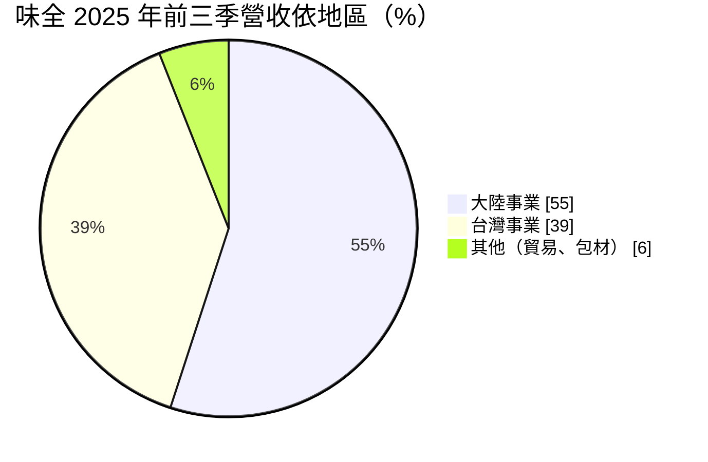
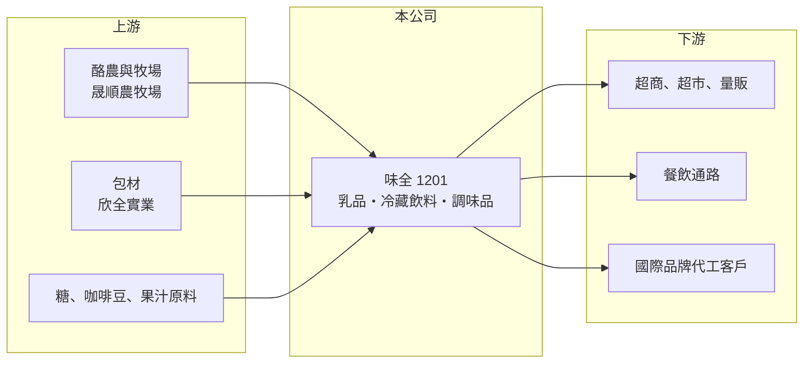

# 1201 味全

> 上市｜[[產業索引-食品工業|食品工業]]｜上市（櫃）日期 1962/02/09

# 第一章：企業模式與商業藍圖

> [!info] 撰寫說明
> 精簡版，由 Claude 依公開資料整理，架構比照 [[2330台積電]]，資料截至 2026-10-08。來源：證交所開放資料快照（基本資料、2026 年第二季資產負債與損益、股利）、Goodinfo 經營績效頁、富果 2025 年 11 月法說會備忘錄。#待校對

味全食品（以下簡稱味全）是台灣老牌食品公司，理解它的關鍵在於：它最有價值的資產是乳品、冷藏飲料品牌與[[冷鏈]]通路，但營收有一半以上來自中國，而中國事業的起伏決定了整體獲利。

- **核心業務：** 味全成立於 1953 年，1962 年上市，是台灣最早的上市食品公司之一。台灣產品以冷藏乳品（林鳳營、味全鮮乳）、冷藏咖啡（貝納頌）、果汁（每日C、農榨）、蛋品（木崗）與調味品（健康廚房、淬釀）為主。冷藏產品保存期短、需要全程低溫配送，因此品牌與冷鏈必須一起經營，這是味全和一般常溫食品公司最大的差別。
- **營收結構：** 依 2025 年前三季資料，大陸事業約占 55%、台灣事業約 39%，其他（國際貿易康合、包材欣全等）約 6%。同期台灣營收年增 6.8%，大陸年減 13.7%，顯示兩邊走勢分歧。中國事業除了每日C果汁，也替星巴克、德芙等國際品牌代工冷藏產品，屬於OEM/ODM業務。
- **營運據點：** 台灣有台中、高雄、斗六三座工廠，中國有杭州、廊坊、蘇州三座工廠。上游另有晟順農牧場（牧場）、欣全實業（包材）與康合（國際貿易），讓公司從原料乳、包材到配送都有一定掌握。這種[[垂直整合]]有助於品質管控，但也提高了固定資產比重。
- **長期方向：** 公司的中長期戰略是「深耕臺灣、發展大陸、放眼國際」，經營方針包括大原料、大單品、大通路、調整產品結構與導入 AI。對長期投資人而言，最關鍵的是台灣的乳品與冷藏飲料能否持續提高附加價值，以及中國事業能否止跌並改善利潤率。味全與頂新集團的關係是理解其經營決策的重要背景（待校對）。

# 第二章：護城河深度與競爭優勢

味全的護城河在於台灣的冷藏品牌與冷鏈配送，但這個優勢尚未轉化成高利潤率。

- **競爭優勢：** 冷藏乳品與鮮乳需要牧場合作、低溫工廠與每天配送到超商的冷鏈網路，新進者很難在短時間建立。林鳳營、貝納頌等品牌在超商冷藏櫃有穩定的陳列位置，這是長期累積的通路資產。冷鏈的固定成本高，但一旦建好，可以同時配送多個品類，形成規模經濟。
- **主要對手：** 台灣乳品與冷藏飲料的主要對手是 [[1216統一]]（瑞穗、統一陽光等）與光泉，咖啡與茶飲則還有 [[1227佳格]]、1218泰山 等。統一的規模與通路（[[2912統一超]]）明顯大於味全，因此味全多採品牌差異化與高端化策略。中國市場則面對當地大型乳品與飲料集團的競爭。
- **觀察重點：** 長期最值得追蹤的是營業利益率能否從 2% 左右回到 3% 以上，以及中國事業的營收與利潤趨勢。另一個重點是公司把大量資本投入冷鏈與工廠，這些投資能否換來更高的 ROE。

# 第三章：財務體質與盈利規模

資料日期：2026-10-08，表格是撰寫當時的快照；最新月營收、毛利率、累計 EPS 由自動排程寫在本筆記的屬性欄位（月營收、毛利率、累計EPS 等）。#待校對

味全的財務呈現「營收大、毛利率不低、但營業利益率很薄」的特徵，冷鏈與行銷費用吃掉了大部分毛利。

| 年度 | 營收（億元） | [[毛利率]] | [[營業利益率]] | EPS（元） | [[ROE]] |
|---|---|---|---|---|---|
| 2020 | 187 | 29.2% | 3.19% | 1.06 | 7.77% |
| 2021 | 198 | 29.2% | 3.25% | 1.00 | 7.30% |
| 2022 | 200 | 27.5% | 1.67% | 0.47 | 3.38% |
| 2023 | 215 | 27.0% | 1.49% | 0.53 | 3.71% |
| 2024 | 235 | 27.4% | 2.50% | 0.87 | 5.91% |
| 2025 | 218 | 27.2% | 1.68% | 0.40 | 2.65% |

（來源：Goodinfo 經營績效頁；2026 年上半年營收 104.5 億元、毛利率約 26.6%、營業利益率約 -0.4%、EPS 0.48 元，依證交所開放資料計算。）

- **營收規模：** 2020 至 2025 年營收由 187 億元增至 218 億元，年複合成長率約 3.1%（推算），2024 年曾達 235 億元，2025 年因中國事業下滑而回落。成長幅度與食品業整體相近，屬於成熟產業的溫和成長。
- **獲利：** 2021 至 2025 年平均 ROE 約 4.6%（推算），偏低。毛利率長期穩定在 27% 至 29%，但營業費用率約 25%，使營業利益率只剩 1.5% 至 3%。2026 年上半年本業小幅虧損，EPS 0.48 元主要來自約 2.4 億元的[[業外收入]]，評估本業時應以營業利益為準。
- **財務特色：** 依 2026 年第二季資料，總資產約 190 億元、權益約 80 億元、負債約 111 億元，非流動資產約 119 億元，反映工廠、牧場與冷鏈的重資產特性。2025 年度每股現金股利 0.21 元，[[配息率]]約 52%（推算），公司章程規定以不低於當期淨利 50% 分派股利。自由現金流是否長期為正未查得。
- **[[ROIC]] 與 [[WACC]]：** 以 2025 年營業利益約 3.66 億元（218 億元 × 1.68%）、稅率 20% 計算，稅後營業利益約 2.93 億元。有息負債未查得，投入資本以權益 80 億元到總資產 190 億元為區間，ROIC 約 1.5% 至 3.7%（推算）。WACC 以 [[CAPM]] 推估：無風險利率 1.75%、市場風險溢酬 6%、β 假設 0.6（食品股常見值），權益成本約 5.4%；稅後負債成本假設 2%、有息負債占四成，WACC 約 4.0%（推算）。ROIC 低於 WACC，代表近年本業並未賺回資金成本，品牌與冷鏈的價值需要靠更高的營業利益率才能顯現。

# 第四章：總體風險與地緣政治

味全的風險主要來自中國市場、食品安全與原物料成本。

- **產業週期：** 食品需求本身穩定，但中國消費景氣與通路變化會直接影響過半營收，2025 年大陸事業年減 13.7% 就是例子。台灣市場人口結構老化、少子化，乳品飲用人口長期面臨成長天花板。
- **營運風險：** 冷藏產品保存期短，銷售不如預期時報廢成本高；冷鏈與工廠的固定成本使獲利對營收變化很敏感。食品業一旦發生[[食安事件]]，品牌信任受損的影響往往長達數年，台灣食品業在油品、原料等事件中有過多次教訓。
- **其他風險：** 原料乳、糖、咖啡豆與包材價格波動會壓縮毛利；人民幣匯率影響中國事業換算為台幣的獲利；兩岸關係與中國法規變化也是長期風險。

# 專有名詞解析

## 金融

- **[[業外收入]]**：本業營運以外的收入，例如利息、投資收益、處分資產利益，持續性通常低於本業獲利。
- **[[配息率]]**：現金股利占當年度每股盈餘的比例，反映公司把獲利分給股東的程度。

## 產業

- **[[冷鏈]]**：從產地、工廠、倉儲到門市全程維持低溫的物流系統，是鮮乳、冷藏飲料與生鮮食品的必要基礎設施。
- **[[OEM ODM]]**：OEM 是依客戶設計代工生產，ODM 是由代工廠負責設計並生產，兩者都以客戶品牌出貨。
- **[[垂直整合]]**：把上游零件與加工製程納入自家工廠，以降低成本、掌握品質與交期。
- **[[食安事件]]**：食品原料或製程出現污染、摻偽或標示不實，導致產品下架與品牌信任受損的事件。

# 核心供應鏈

- 上游：契作酪農與自有牧場、包材（欣全實業）、糖與咖啡豆等大宗原料；飲料瓶與瓶蓋可對照 [[9939宏全]]（是否為供應商未確認，#待校對）。
- 下游／客戶：便利商店如 [[2912統一超]]、[[5903全家]]，以及超市、量販、餐飲通路與中國的電商平台；中國另有星巴克、德芙等國際品牌的代工訂單。
- 同業：[[1216統一]]、[[1227佳格]]、1218泰山、光泉（未上市）。

## 最新新聞
<!-- news:start -->
<!-- news:end -->

## 相關連結
- [公開資訊觀測站](https://mopsov.twse.com.tw/mops/web/t05st03?step=1&firstin=1&co_id=1201)
- [Goodinfo](https://goodinfo.tw/tw/StockDetail.asp?STOCK_ID=1201)
- [Yahoo 股市](https://tw.stock.yahoo.com/quote/1201)
- [鉅亨網新聞](https://www.cnyes.com/twstock/1201/news)
