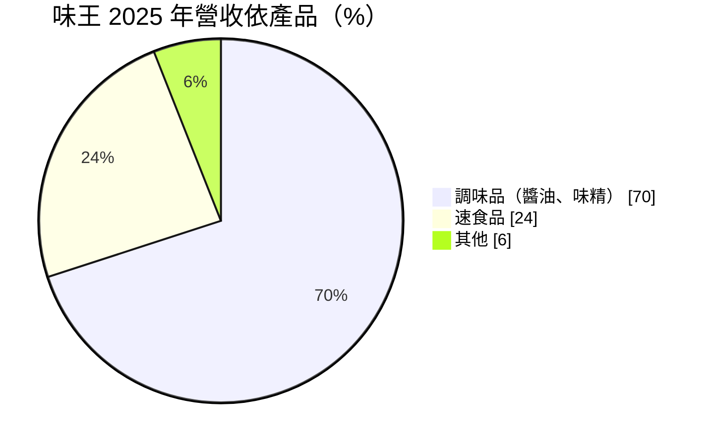
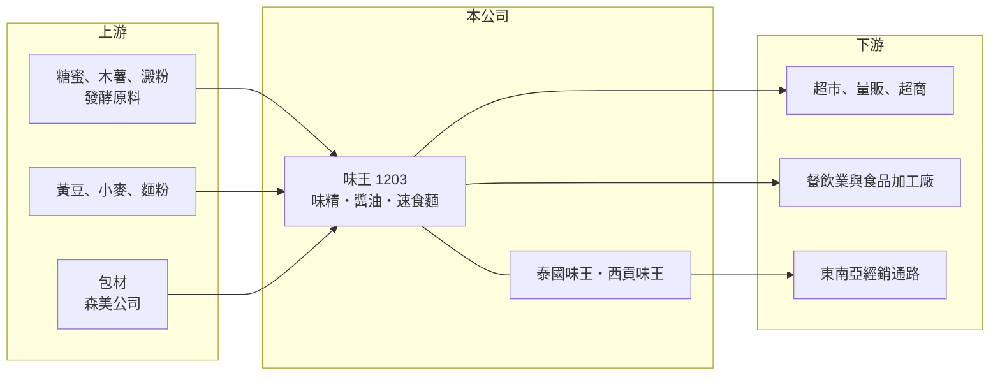

# 1203 味王

> 上市｜[[產業索引-食品工業|食品工業]]｜上市（櫃）日期 1964/08/24

# 第一章：企業模式與商業藍圖

> [!info] 撰寫說明
> 精簡版，由 Claude 依公開資料整理，架構比照 [[2330台積電]]，資料截至 2026-10-08。來源：證交所開放資料快照（基本資料、2026 年第二季資產負債與損益、股利）、Goodinfo 經營績效頁、富果 2026 年 10 月法說會備忘錄。#待校對

味王（以下簡稱味王）是以[[味精]]起家的調味品與速食麵公司，理解它的關鍵在於：它的獲利主力其實是台灣、泰國、越南三地的味精與醬油，而不是一般人熟悉的泡麵；東南亞的味精事業讓它在食品股中擁有相對穩定的利潤率。

- **核心業務：** 味王成立於 1959 年，1964 年上市，產品包括味精、醬油、速食麵與調理包。2025 年調味品約占營收 70%、速食品約 24%、其他約 6%。味精屬於發酵工業，生產規模越大、成本越低，因此味王在東南亞建立的味精產能是公司長期的獲利基礎。
- **營收結構：** 2025 年合併營收 56.54 億元，其中台灣 25.68 億元、泰國 19.56 億元、越南 11.3 億元，海外合計超過一半。泰國味王以味精為主，味王持股 48.66% 並納入合併；西貢味王（越南）由味王 100% 持有，產品包括味精、速食麵與湯粉。這代表味王的成長與東南亞的人口與飲食消費高度相關。
- **營運據點：** 台灣生產速食麵、味精、醬油與調理包，近年新建的醬油廠調配棟與麵廠「小王子」產線已投入生產；另有森美公司生產食品、電子與環保包材，味王綜合持股 100%。泰國與越南各有生產基地，供應當地與周邊市場。
- **長期方向：** 公司的策略是以研發推出新品項，尤其是速食麵，並採「少量多樣」與「輕量化」回應分眾需求，以「小王子」品牌跨品項延伸到杯麵、聯名零食與餅乾。長期而言，台灣速食麵市場成熟，味王的價值更取決於東南亞調味品事業能否持續成長、以及醬油新產能能否提升台灣的利潤率。

# 第二章：護城河深度與競爭優勢

味王的護城河主要來自調味品的規模與品牌，以及東南亞長期經營的在地基礎。

- **競爭優勢：** 味精與醬油是家庭與餐飲業每天使用的基礎調味品，消費者對品牌與口味的習慣一旦建立，不容易被替換。味王在泰國、越南經營數十年，擁有在地產能與通路，新進者要建立同樣的發酵產能與經銷網路需要大量資本與時間。毛利率能長期維持在 29% 至 35%，正是這種品牌與規模優勢的結果。
- **主要對手：** 味精市場的主要國際對手是日本味之素，以及韓國、中國的大型發酵廠；台灣速食麵市場則由 [[1216統一]] 居領先地位，還有維力等品牌；醬油則有金蘭、萬家香等。速食麵的競爭最為激烈，味王的速食麵業務在後疫情時期表現下滑。
- **觀察重點：** 長期要看東南亞（泰國、越南）營收占比與利潤是否穩定成長、台灣醬油新廠能否提高產品組合，以及速食麵能否靠新品維持份額。也要留意泰國子公司持股不到五成，合併營收中有一部分獲利屬於[[非控制權益]]。

# 第三章：財務體質與盈利規模

資料日期：2026-10-08，表格是撰寫當時的快照；最新月營收、毛利率、累計 EPS 由自動排程寫在本筆記的屬性欄位（月營收、毛利率、累計EPS 等）。#待校對

味王的財務在食品股中屬於利潤率較高、波動較小的類型，營收成長平緩，但獲利穩定。

| 年度 | 營收（億元） | [[毛利率]] | [[營業利益率]] | EPS（元） | [[ROE]] |
|---|---|---|---|---|---|
| 2020 | 60.4 | 33.8% | 16.1% | 1.81 | 11.1% |
| 2021 | 58.2 | 32.6% | 14.9% | 1.88 | 11.1% |
| 2022 | 63.9 | 28.6% | 13.0% | 2.63 | 13.9% |
| 2023 | 64.0 | 29.1% | 13.4% | 1.80 | 9.86% |
| 2024 | 62.9 | 33.8% | 17.1% | 2.36 | 12.4% |
| 2025 | 56.5 | 34.7% | 16.5% | 1.81 | 9.42% |

（來源：Goodinfo 經營績效頁；2026 年上半年營收 26.3 億元、毛利率約 34.3%、營業利益率約 15.1%、EPS 0.93 元，依證交所開放資料計算。）

- **營收規模：** 2020 至 2025 年營收由 60.4 億元降至 56.5 億元，年複合成長率約 -1.3%（推算），2025 年營收下滑約一成。營收長期在 56 億至 64 億元之間，顯示調味品需求穩定但成長有限，匯率與東南亞售價也會影響換算後的營收。
- **獲利：** 2021 至 2025 年平均 ROE 約 11.3%（推算），在食品股中屬於中上水準。營業利益率長期維持在 13% 至 17%，遠高於多數台灣食品公司的個位數，說明調味品的利潤結構優於飲料與冷藏食品。毛利率受玉米、木薯、黃豆等原料價格影響，2022 年原料上漲時曾降到 28.6%。
- **財務特色：** 依 2026 年第二季資料，總資產約 107 億元、權益總計約 73.6 億元（其中非控制權益約 8.6 億元）、負債僅約 33.6 億元，財務結構保守。2025 年度每股現金股利 1.0 元，[[配息率]]約 55%（推算）。另外，子公司持有母公司股票約 229 萬股，屬交叉持股。自由現金流是否長期為正未查得。
- **[[ROIC]] 與 [[WACC]]：** 以 2025 年營業利益約 9.32 億元（56.5 億元 × 16.5%）、稅率 20% 計算，稅後營業利益約 7.46 億元。有息負債未查得，投入資本以權益 73.6 億元到總資產 107 億元為區間，ROIC 約 7.0% 至 10.1%（推算）。WACC 以 [[CAPM]] 推估：無風險利率 1.75%、市場風險溢酬 6%、β 假設 0.6（食品股常見值），權益成本約 5.4%；負債比重低，稅後負債成本假設 2%、負債占一成五，WACC 約 4.9%（推算）。ROIC 穩定高於 WACC，代表味王長期在創造經濟價值，只是利差不大、成長也慢，屬於穩健型的價值創造。

# 第四章：總體風險與地緣政治

味王的風險主要是原物料成本、東南亞的匯率與政治環境，以及台灣速食麵市場的競爭。

- **產業週期：** 調味品需求穩定，景氣循環對銷量影響不大，但原物料（糖蜜、木薯、黃豆、小麥）價格會有週期性波動，直接反映在毛利率。速食麵需求在疫情期間暴增後回落，2026 年上半年速食麵業務已因後疫情因素下滑。
- **營運風險：** 泰國子公司持股 48.66%，雖然合併報表，但部分獲利歸屬少數股東，母公司實際分到的獲利低於合併數字。台灣新產線投產後的折舊會增加，若銷量不如預期，利潤率可能下降。食品業的[[食安事件]]風險也不可忽略。
- **其他風險：** 泰銖、越南盾對新台幣的匯率會影響換算後的營收與獲利；東南亞國家的政策、勞工與環保法規變化，可能提高當地營運成本。

# 專有名詞解析

## 金融

- **[[非控制權益]]**：子公司股權中不屬於母公司的部分，其對應的淨利與權益在合併報表中單獨列示。
- **[[配息率]]**：現金股利占當年度每股盈餘的比例，反映公司把獲利分給股東的程度。

## 產業

- **[[味精]]**：以糖蜜或澱粉經微生物發酵製成的麩胺酸鈉調味料，屬規模經濟明顯的發酵工業。
- **[[食安事件]]**：食品原料或製程出現污染、摻偽或標示不實，導致產品下架與品牌信任受損的事件。

# 核心供應鏈

- 上游：發酵用糖蜜、木薯與澱粉，醬油用黃豆與小麥，速食麵用麵粉與油脂；包材由子公司森美供應。
- 下游／客戶：台灣的超市、量販與超商通路（例如 [[2912統一超]]、[[5903全家]]），以及餐飲業與食品加工廠；泰國、越南的在地經銷通路。
- 同業：[[1216統一]]（速食麵）、日本味之素（味精，未在台上市）、金蘭與萬家香（醬油，未上市）。

## 最新新聞
<!-- news:start（自動產生，請勿手動編輯此範圍） -->
- 2026-10-13 🏛️ 重訊 14:13｜公告本公司召開法人說明會相關資訊｜[觀測站](https://mops.twse.com.tw/mops/#/web/t05st01)

完整紀錄：[[1203味王 新聞]]
<!-- news:end -->

## 相關連結
- [公開資訊觀測站](https://mopsov.twse.com.tw/mops/web/t05st03?step=1&firstin=1&co_id=1203)
- [Goodinfo](https://goodinfo.tw/tw/StockDetail.asp?STOCK_ID=1203)
- [Yahoo 股市](https://tw.stock.yahoo.com/quote/1203)
- [鉅亨網新聞](https://www.cnyes.com/twstock/1203/news)
