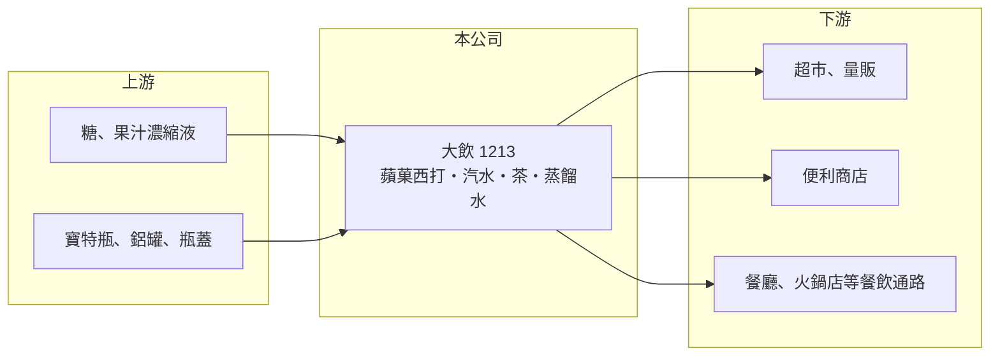

# 1213 大飲

> 上市｜[[產業索引-食品工業|食品工業]]｜上市（櫃）日期 1981/04/10

# 第一章：企業模式與商業藍圖

> [!info] 撰寫說明
> 精簡版，由 Claude 依公開資料整理，架構比照 [[2330台積電]]，資料截至 2026-10-08。來源：證交所開放資料快照（基本資料、2026 年第二季資產負債與損益、股利）、Goodinfo 經營績效頁、大飲 2025 年 12 月法人說明會簡報、ETtoday 財經新聞標題。公開資料有限。#待校對

大西洋飲料（以下簡稱大飲）是「蘋菓西打」的品牌公司，理解它的關鍵在於：這是一個知名度很高的老品牌，但公司本業多年處於毛損狀態，近年靠處分資產清償負債，正在嘗試讓生產與銷售恢復正常。

- **核心業務：** 大飲成立於 1965 年，1981 年上市，核心品牌是果汁汽水「蘋菓西打」，屬於[[碳酸飲料]]，產品線涵蓋汽水、茶、果汁與蒸餾水。依 2025 年 12 月法說會簡報，蘋菓西打 PET600、CAN330 已全面正常生產，PET1250 已恢復上市，蒸餾水 600ml 預計 2025 年底至 2026 年初恢復上市。這些「恢復」的用語說明公司過去一段時間的產品供應並不完整，2023 年營收只剩 1.21 億元即反映這個狀況。
- **營收結構：** 各產品營收比重未公開，推估以蘋菓西打為主（推估）。依簡報引用的市場資料，超市與量販約占[[開放性通路]]飲料市場 75%、便利商店約 20%，餐飲通路如餐廳、火鍋店也陸續恢復。對大飲而言，能否重新進入這些通路的貨架，是營收回升的前提。
- **營運據點：** 工廠位置與產能公開資料未查得。依財報變化推估，公司在 2024 年處分土地並以資金清償銀行欠款（推估，依 2024 年 EPS 8.71 元與 2025 年 9 月負債大幅下降判斷；ETtoday 報導標題為「賣地資金入帳 銀行欠款全清償」）。2025 年 9 月底負債總額約 1.26 億元，占資產 15%，前一年同期為 7.71 億元、占 81%。
- **長期方向：** 公司的長期方向是朝「健康機能、自然樂活」發展，推動天然製成的產品研發，並以季節、節慶行銷與縣市政府異業合作提升品牌曝光。清償負債後，公司不再有立即的財務壓力，但要真正翻身，必須讓本業恢復毛利，而不是只靠一次性資產處分。

# 第二章：護城河深度與競爭優勢

大飲的護城河幾乎只剩品牌知名度，生產規模與通路地位都明顯落後大型飲料集團。

- **競爭優勢：** 蘋菓西打是台灣家喻戶曉的老品牌，在餐飲通路（例如熱炒、火鍋店）有一定的消費者記憶，這是新品牌很難用短期行銷建立的資產。品牌知名度讓公司在恢復生產後，仍有機會重新被通路接受。不過品牌若長時間缺貨，消費者習慣會被其他飲料取代。
- **主要對手：** 台灣汽水與即飲飲料市場的主要業者包括 [[1234黑松]]、[[1216統一]]、1218泰山 與國際可樂品牌的在台裝瓶廠。這些對手擁有大規模產線與通路議價力，大飲在成本與鋪貨上都處於劣勢。
- **觀察重點：** 長期最關鍵的是毛利率能否由負轉正，這代表產線利用率與售價足以覆蓋生產成本。其次是營收能否回到 2020 至 2022 年約 4 億元的水準，以及蒸餾水等產品線恢復後的通路接受度。

# 第三章：財務體質與盈利規模

資料日期：2026-10-08，表格是撰寫當時的快照；最新月營收、毛利率、累計 EPS 由自動排程寫在本筆記的屬性欄位（月營收、毛利率、累計EPS 等）。#待校對

大飲的財務呈現長期本業虧損、2024 年因資產處分出現一次性大額獲利的特殊樣貌，判讀時必須把一次性收益與本業分開。

| 年度 | 營收（億元） | [[毛利率]] | [[營業利益率]] | EPS（元） | [[ROE]] |
|---|---|---|---|---|---|
| 2020 | 4.10 | 1.35% | -12.8% | -0.48 | -4.96% |
| 2021 | 4.28 | -2.34% | -15.3% | -1.67 | -19.3% |
| 2022 | 3.94 | -3.01% | -17.1% | -1.34 | -18.8% |
| 2023 | 1.21 | -78.3% | -118% | -2.45 | -46.8% |
| 2024 | 1.91 | -22.3% | -44.8% | 8.71 | 104% |
| 2025 | 2.97 | -2.49% | -16.2% | -0.85 | -7.05% |

（來源：Goodinfo 經營績效頁；2026 年上半年營收 1.51 億元、毛利率約 -1.8%、營業利益率約 -15.3%、EPS -0.56 元，依證交所開放資料計算。）

- **營收規模：** 2020 至 2022 年營收約 4 億元，2023 年驟降至 1.21 億元，之後逐步回升到 2025 年的 2.97 億元。營收的大起大落反映的是生產與供貨中斷後的恢復過程，而不是市場需求的變化。年複合成長率在這種情況下沒有參考意義。
- **獲利：** 六年中只有 2024 年有盈餘，而且來自一次性的資產處分[[業外收入]]，本業營業利益率每年都是負值。毛利率長期接近零甚至為負，代表產品售價連生產成本都無法覆蓋，這是產能利用率太低時固定成本無法攤提的結果。2021 至 2025 年的平均 ROE 受 2024 年一次性收益扭曲，不具參考價值。
- **財務特色：** 依 2026 年第二季資料，總資產約 7.40 億元、權益約 6.22 億元、負債僅約 1.19 億元，財務結構因清償借款而大幅改善。股本 5.66 億元、每股淨值約 10.98 元。2025 年度未配發股利，公司章程表明若無重大擴充計畫，以配發股票股利為原則。
- **[[ROIC]] 與 [[WACC]]：** 2025 年營業損失約 0.48 億元（2.97 億元 × -16.2%），虧損年度不計稅盾，以權益 6.22 億元到總資產 7.40 億元為投入資本區間，ROIC 約 -6.5% 至 -7.7%（推算），為負值。WACC 以 [[CAPM]] 推估：無風險利率 1.75%、市場風險溢酬 6%、β 假設 0.7（食品股常見值偏高調整），權益成本約 6.0%；有息負債已清償，WACC 約 6.0%（推算）。ROIC 長期為負、明顯低於 WACC，代表本業持續消耗資本；資產處分解決了負債，但沒有解決本業的獲利能力。

# 第四章：總體風險與地緣政治

大飲的風險在於本業能否自立、規模太小與飲料市場的激烈競爭。

- **產業週期：** 飲料需求有明顯的季節性，夏季是旺季，冬季銷量下滑；氣候與節慶會影響當年銷售。台灣汽水市場整體成熟，消費者偏好轉向無糖茶與機能飲料，含糖碳酸飲料的長期需求面臨壓力。
- **營運風險：** 營收規模只有約 3 億元，產線利用率不足時毛利為負，這是公司最根本的問題。可處分的資產有限，若本業無法轉正，未來可能再次面臨資金壓力；品牌長時間缺貨也會流失通路與消費者。
- **其他風險：** 糖、果汁原料、寶特瓶與鋁罐價格波動會影響成本；台灣對含糖飲料的健康政策與標示規範可能趨嚴；公司治理與經營團隊變動的資訊需持續追蹤。

# 專有名詞解析

## 金融

- **[[業外收入]]**：本業營運以外的收入，例如利息、投資收益、處分資產利益，持續性通常低於本業獲利。

## 產業

- **[[碳酸飲料]]**：在飲料中充入二氧化碳產生氣泡的飲料，例如汽水、可樂，需要專用充填產線。
- **[[開放性通路]]**：超市、量販、便利商店等消費者可自行選購的零售通路，相對於餐廳、火鍋店等餐飲通路。

# 核心供應鏈

- 上游：糖與果汁濃縮液等原料，寶特瓶、鋁罐與瓶蓋等包材，例如 [[9939宏全]]（是否為供應商未確認，#待校對）。
- 下游／客戶：超市與量販、便利商店（例如 [[2912統一超]]、[[5903全家]]），以及熱炒、火鍋等餐飲通路。
- 同業：[[1234黑松]]、[[1216統一]]、1218泰山。

## 最新新聞
<!-- news:start -->
<!-- news:end -->

## 相關連結
- [公開資訊觀測站](https://mopsov.twse.com.tw/mops/web/t05st03?step=1&firstin=1&co_id=1213)
- [Goodinfo](https://goodinfo.tw/tw/StockDetail.asp?STOCK_ID=1213)
- [Yahoo 股市](https://tw.stock.yahoo.com/quote/1213)
- [鉅亨網新聞](https://www.cnyes.com/twstock/1213/news)
