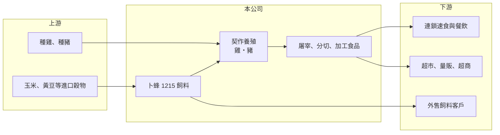

# 1215 卜蜂

> 上市｜[[產業索引-食品工業|食品工業]]｜上市（櫃）日期 1987/07/27

# 第一章：企業模式與商業藍圖

> [!info] 撰寫說明
> 精簡版，由 Claude 依公開資料整理，架構比照 [[2330台積電]]，資料截至 2026-10-08。來源：證交所開放資料快照（基本資料、2026 年第二季資產負債與損益、股利）、Goodinfo 經營績效頁、富果 2026 年 9 月法說會備忘錄。#待校對

卜蜂企業（以下簡稱卜蜂）是台灣規模最大的畜禽[[垂直整合]]業者之一，理解它的關鍵在於：它把飼料、種畜、契作養殖、屠宰到加工食品串成一條龍，用規模與成本控制在雞肉與豬肉市場取得穩定利潤。

- **核心業務：** 卜蜂成立於 1977 年，1987 年上市，業務包括飼料、雞肉、豬肉、蛋品與加工食品。公司從種雞、種豬與飼料開始，透過[[契作養殖]]讓農民負責飼養，再由卜蜂收購、屠宰、分切並銷售給通路與餐飲業。這種模式讓公司掌握品質與供貨節奏，同時不必自己擁有所有養殖場。一般認為卜蜂屬於泰國正大（CP）集團體系（待校對）。
- **營收結構：** 各事業營收比重公開資料未查得。飼料約 46% 供內部使用，其餘外售，代表飼料既是成本來源也是獨立的利潤中心。雞肉每週屠宰量自 2023 年以來由約 500 萬隻增加到約 600 萬隻，部分是為了替代減少的進口雞肉。
- **營運據點：** 公司採分散式契作養殖，並把母豬場與肥育場分開設置，以降低疫病集中爆發的風險。新建的桃園分切加工廠已取得使用執照，預計 2026 年底試產，取得 CAS 與 HACCP 認證後，最快 2027 年第三或第四季全面量產。其他工廠與屠宰場的分布公開資料未逐一列出。
- **長期方向：** 卜蜂的長期重點是擴大養豬規模，目標 2026 年底達 70 萬頭、長期達 120 萬頭，約占台灣市場兩成。同時強化雞肉與加工食品，並計畫維持或縮減價格波動大、由少數蛋商主導的蛋品事業。這代表公司正把資本集中在可以規模化、可以自主定價的品項上。

# 第二章：護城河深度與競爭優勢

卜蜂的護城河來自垂直整合的成本優勢與供應穩定性，這在講求食安與穩定供貨的通路與餐飲客戶眼中特別重要。

- **競爭優勢：** 從飼料、種畜到屠宰加工一手掌握，讓卜蜂可以在飼料原料上漲時把成本轉嫁給終端，或在肉價下跌時靠飼料與加工利潤平衡。大型連鎖速食、超市與團膳客戶需要穩定量能與可追溯的食安體系，這類訂單很難轉給小規模業者。2025 年營業利益率 13.2%，在肉品產業中相當突出。
- **主要對手：** 台灣的同業包括 [[1210大成]]（飼料與雞肉一條龍）、[[1219福壽]]（飼料）、[[1220台榮]]（飼料）等，以及大量進口雞肉與豬肉。大成在雞肉與飼料規模上與卜蜂直接競爭；進口肉品則在價格上構成壓力，尤其當台灣開放或調整進口政策時。
- **觀察重點：** 長期要看養豬規模能否如期擴張到 70 萬頭以上並維持低疫病損失、桃園加工廠能否在 2027 年後帶動加工食品成長，以及毛利率能否維持在 2025 年約 21% 的水準。若擴產遇上豬價或雞價下行，固定成本增加會壓縮獲利。

# 第三章：財務體質與盈利規模

資料日期：2026-10-08，表格是撰寫當時的快照；最新月營收、毛利率、累計 EPS 由自動排程寫在本筆記的屬性欄位（月營收、毛利率、累計EPS 等）。#待校對

卜蜂的財務在食品股中屬於高 ROE、高配息的類型，但獲利會隨飼料原料與肉價週期起伏。

| 年度 | 營收（億元） | [[毛利率]] | [[營業利益率]] | EPS（元） | [[ROE]] |
|---|---|---|---|---|---|
| 2020 | 222 | 15.9% | 8.56% | 6.18 | 18.9% |
| 2021 | 248 | 13.7% | 6.41% | 5.06 | 15.2% |
| 2022 | 290 | 13.4% | 6.92% | 5.28 | 17.1% |
| 2023 | 292 | 17.2% | 10.0% | 7.70 | 22.9% |
| 2024 | 280 | 16.4% | 8.20% | 6.55 | 17.8% |
| 2025 | 284 | 21.2% | 13.2% | 10.39 | 25.6% |

（來源：Goodinfo 經營績效頁；2026 年上半年營收 144.0 億元、毛利率約 18.3%、營業利益率約 9.3%、EPS 3.24 元，依證交所開放資料計算。）

- **營收規模：** 2020 至 2025 年營收由 222 億元增至 284 億元，年複合成長率約 5.0%（推算），2022 年大增主要反映飼料原料漲價後的售價調整。營收規模與原料價格高度相關，因此看成長時要同時看量（屠宰頭數、隻數）與價。
- **獲利：** 2021 至 2025 年平均 ROE 約 19.7%（推算），在台灣食品股中屬於頂尖水準。2021 至 2022 年玉米、黃豆價格高漲時毛利率降到 13% 左右，2025 年原料回落、肉價穩定時升到 21.2%，說明飼料原料是獲利最大的變數。2026 年上半年 EPS 3.24 元，低於前一年同期的 4.95 元，原因包括原料回升與預防性下架 56 項產品造成的逾 3,000 萬元存貨損失。
- **財務特色：** 依 2026 年第二季資料，總資產約 328 億元、權益總計約 113.6 億元、負債約 214 億元，負債增加主要來自支應擴產與營運資金的銀行借款。2025 年度每股現金股利 7 元，[[配息率]]約 67%（推算），高配息與高資本支出同時進行，代表公司以借款支應部分擴產。自由現金流是否長期為正未查得。
- **[[ROIC]] 與 [[WACC]]：** 以 2025 年營業利益約 37.5 億元（284 億元 × 13.2%）、稅率 20% 計算，稅後營業利益約 30.0 億元。有息負債未查得，投入資本以權益 113.6 億元到總資產 328 億元為區間，ROIC 約 9% 至 26%（推算）；若有息負債約占負債一半（推估），ROIC 約 14%（推算）。WACC 以 [[CAPM]] 推估：無風險利率 1.75%、市場風險溢酬 6%、β 假設 0.7（食品股常見值），權益成本約 6.0%；稅後負債成本假設 2%、有息負債占四成五，WACC 約 4.2%（推算）。ROIC 明顯高於 WACC，代表卜蜂長期在創造經濟價值；擴產期間投入資本增加，利差能否維持是觀察重點。

# 第四章：總體風險與地緣政治

卜蜂的風險集中在原物料、疫病、進口競爭與食品安全。

- **產業週期：** 玉米與黃豆占飼料成本的大宗，國際穀物價格受氣候、戰爭與運費影響，具有明顯週期；肉價也有供需循環，2026 年上半年台灣雞肉供給量大增就壓抑了價格。兩個週期同時不利時，毛利率會快速下滑。
- **營運風險：** 禽流感、[[非洲豬瘟]]等疫病一旦爆發，可能造成撲殺與停止出貨，這是擴大養豬規模後更需要面對的風險。食品安全事件也會牽連整條供應鏈，2026 年因上游油品問題主動下架 56 項產品，就是外部原料造成的[[食安事件]]影響。
- **其他風險：** 政府對進口肉品的開放與關稅政策會改變國產肉品的競爭環境；原料以美元計價進口，匯率變動影響成本；環保法規對畜牧廢水與氣味的要求日益嚴格。

# 專有名詞解析

## 金融

- **[[配息率]]**：現金股利占當年度每股盈餘的比例，反映公司把獲利分給股東的程度。

## 產業

- **[[垂直整合]]**：把上游零件與加工製程納入自家工廠，以降低成本、掌握品質與交期。
- **[[契作養殖]]**：由企業提供種畜、飼料與技術，農民負責飼養，成長後由企業依約收購的合作模式。
- **[[非洲豬瘟]]**：豬隻的高致死率病毒性傳染病，目前沒有有效疫苗，一旦發生通常需大規模撲殺並限制豬肉出口。
- **[[食安事件]]**：食品原料或製程出現污染、摻偽或標示不實，導致產品下架與品牌信任受損的事件。

# 核心供應鏈

- 上游：進口玉米、黃豆等飼料原料，以及種雞、種豬；飼料油脂等原料來自 1225福懋油、1232大統益 等黃豆加工業者（是否為實際供應商未確認，#待校對）。
- 下游／客戶：連鎖速食與餐飲、團膳，超市與超商通路（例如 [[2912統一超]]），以及向卜蜂購買飼料的養殖戶。
- 同業：[[1210大成]]、[[1219福壽]]、[[1220台榮]]。

## 最新新聞
<!-- news:start -->
<!-- news:end -->

## 相關連結
- [公開資訊觀測站](https://mopsov.twse.com.tw/mops/web/t05st03?step=1&firstin=1&co_id=1215)
- [Goodinfo](https://goodinfo.tw/tw/StockDetail.asp?STOCK_ID=1215)
- [Yahoo 股市](https://tw.stock.yahoo.com/quote/1215)
- [鉅亨網新聞](https://www.cnyes.com/twstock/1215/news)
