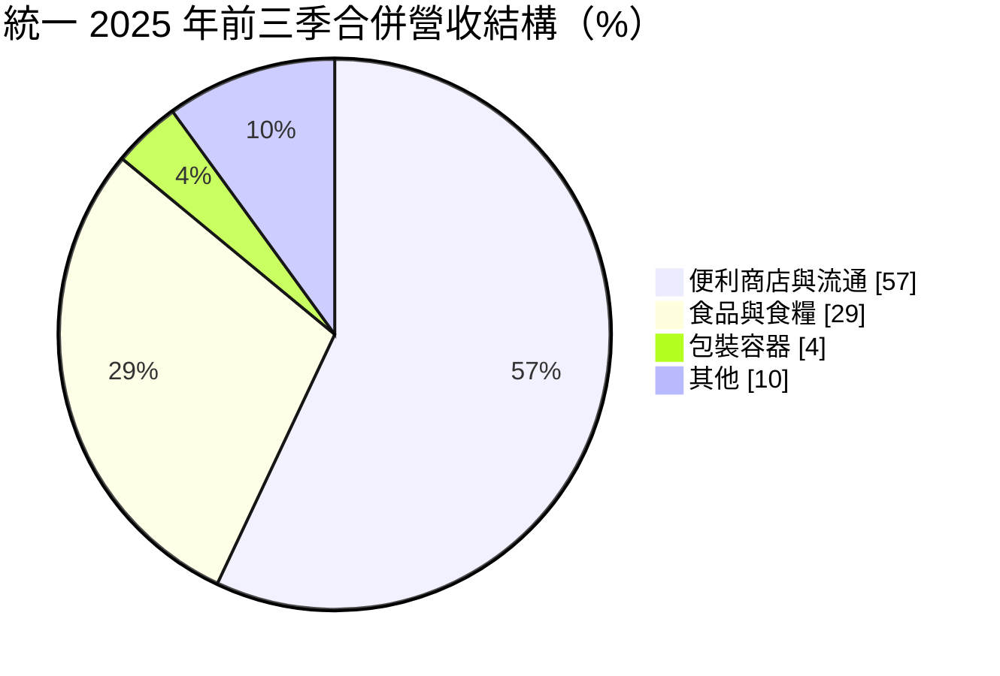
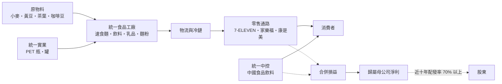
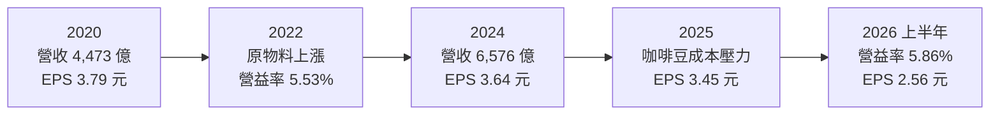
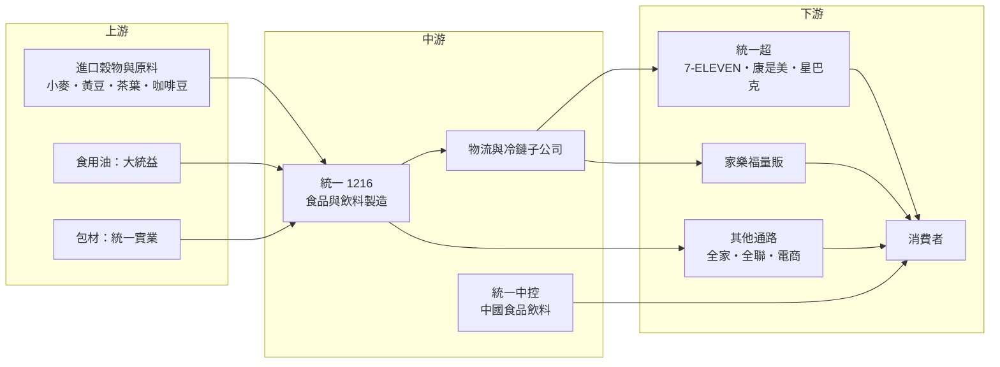

# 1216 統一

> 上市｜[[產業索引-食品工業|食品工業]]｜上市（櫃）日期 1987/12/28

# 第一章：企業模式與商業藍圖

> [!info] 撰寫說明
> 本文由 Claude 依公開資料整理，架構比照 [[2330台積電]] 的四章研究，資料截至 2026-10-08。財務數字來源：證交所開放資料快照（基本資料、2026 年第二季資產負債與綜合損益、股利）、Goodinfo 經營績效頁與股利政策頁（2017 至 2025 年）、MoneyDJ 季資產負債表（2026 年第二季借款科目）、富果研究 2025 年 11 月法說會整理（營收結構、現金流、股利政策）、優分析 2025 年財報報導；統一對統一超與統一中控的持股比例、家樂福併購時點係憑記憶整理，尚未逐條比對原始文件。#待校對

在評估一家公司的長期投資價值時，第一步是看懂它靠什麼賺錢、為什麼能一直賺下去。本章針對統一企業（股票代號：1216，以下簡稱統一）的商業模式進行定性分析，說明它如何從一家台南的麵粉與飼料廠，發展成橫跨食品製造、便利商店、量販、物流與包材的「生產加通路」集團，以及為什麼它的合併營收雖然龐大，真正決定股東報酬的卻是幾家關鍵轉投資。

## 一、核心定位：從工廠到貨架的垂直整合集團

統一成立於 1967 年，1987 年上市，總部位於台南永康。公司起家於麵粉與飼料，之後陸續擴展到速食麵、茶飲、乳品等加工食品，再於 1978 年引進 7-ELEVEN 成立統一超商（年份待校對），並逐步建立物流、包材與金融事業，形成從原料、製造、包裝、物流一路到零售貨架的[[垂直整合]]體系。

主要轉投資包括 [[2912統一超]]（台灣與菲律賓 7-ELEVEN、康是美、統一星巴克、家樂福等）、在香港上市的統一企業中國控股（以下簡稱統一中控）、[[9907統一實]]（包裝容器）與 [[2855統一證]]。統一對統一超持股約四成五、對統一中控持股約七成（皆待校對），兩者都併入統一的合併報表，但有相當比例的獲利屬於其他股東。

理解統一有兩個基本特徵：

- **營收大、利潤率薄：** 2025 年合併營收 6,729 億元，是台灣營收最大的民生消費集團，但營業利益率只有約 5%。原因是合併營收有一半以上來自便利商店與流通，這類業務的毛利率不低，卻要負擔門市租金、人力與物流費用，營業費用率很高。用營收規模評估統一，會高估它真正屬於股東的獲利能力。
- **母公司是控股平台：** 統一本身的台灣食品事業規模有限，股東報酬高度取決於統一超、統一中控等轉投資的獲利與股利。2026 年上半年合併稅後淨利約 210.2 億元，其中歸屬母公司約 145.5 億元，其餘約 64.7 億元屬於非控制權益（證交所資料），這個比例清楚說明了控股結構的影響。

## 二、終端應用板塊：流通占大半、食品是根本

依富果研究整理的 2025 年 11 月法說會資料，2025 年前三季合併營收結構如下：

- **便利商店與流通（約 57%）：** 以統一超為核心，涵蓋台灣與菲律賓的 7-ELEVEN、康是美藥妝、統一星巴克與家樂福量販等。便利商店是統一最重要的通路資產，台灣門市數超過 7,000 家，形成全台最密集的實體零售網路。這個事業的獲利來自高周轉與高密度，而不是高利潤率。同場法說會揭露，2025 年前三季流通事業營業利益年減約 10%，主因新併入的電商業務仍在虧損。
- **食品與食糧（約 29%）：** 包括台灣的速食麵、茶飲、乳品、麵粉與飼料，以及中國的統一中控。這是統一的根本事業，2025 年前三季營業利益年增約 12%，是集團主要的獲利來源。統一中控以方便麵與茶飲為主，在中國市場採取「不參與價格戰」的策略，以品牌與產品差異化經營。
- **包裝容器（約 4%）：** 由統一實業生產 PET 瓶、馬口鐵罐等包材，主要供應集團內外的飲料與食品廠。這個事業規模小，但讓統一能掌握飲料包材的供應與成本。
- **其他：** 包括物流、休閒開發、投資與證券等，其中統一證券的獲利會隨台股成交量起伏。

## 三、資本轉化邏輯：生產、通路與轉投資的三層結構

- **通路帶動製造：** 7-ELEVEN 與家樂福提供穩定的上架與銷售管道，統一的食品與飲料能優先進入貨架。自有通路也讓統一能收集大量消費數據，快速判斷新品的成敗並調整產品組合，這是單純食品製造商很難取得的優勢。
- **製造支撐通路：** 便利商店的差異化越來越依賴[[鮮食]]與現煮咖啡，這些商品需要穩定的工廠、精密的需求預測與[[冷鏈物流]]。統一的食品工廠與物流子公司，就是通路差異化的後盾，競爭對手若要複製，必須同時建立製造與配送能力。
- **轉投資的現金回流：** 統一超、統一中控都定期配發股利，這些股利是統一母公司現金流的重要來源。母公司再把現金用於配息、物流中心與新事業投資，形成「子公司賺錢、母公司配置資本」的控股結構。

## 四、企業長期藍圖：亞洲流通生活平台

- **四大支柱：** 統一在 2025 年法說會中提出「亞洲流通生活平台」的目標，以製造研發、貿易流通、體驗零售、聯盟整合四大支柱，把營運網絡從台灣延伸到中國、菲律賓、越南等地。這代表統一把自己定位為通路平台，而不只是食品公司。
- **海外通路擴張：** 菲律賓 7-ELEVEN 是集團最明確的海外成長引擎。菲律賓人口年輕、便利商店密度仍低，展店空間比已經飽和的台灣大得多，長期是統一超營收成長的主要來源。
- **物流基礎建設：** 台南新市物流園區於 2025 年下半年啟用，物流中心的建置是支撐門市鮮食與電商配送的關鍵投資，也是近年付息負債增加的主要原因之一。
- **電商與量販整合：** 統一超在 2022 至 2023 年間取得台灣家樂福（時點待校對），2025 年又新增電商相關投資。這些併購擴大了流通版圖，但整合期間的虧損與費用，是近年流通事業獲利下滑的原因，能否轉虧為盈是觀察重點。

# 第二章：護城河深度與競爭優勢

在長期價值投資中，「護城河」指企業抵禦競爭、長期維持超額利潤的保護機制。本章分析統一的護城河由哪些要素構成、在食品與通路兩條戰線上的主要對手，以及這些優勢能守住多少。

## 一、統一護城河的核心組成要素

統一的護城河屬於「寬護城河」，核心在通路與品牌組合，而不是單一產品，主要由四個要素構成：

- **1. 便利商店通路密度：** 台灣 7-ELEVEN 超過 7,000 家門市，在人口密集區幾乎每個街角都有一家。門市密度帶來選址優勢、物流規模經濟與廣告效益，競爭者即使資金充足，也很難在短期內取得同等的好地點。這是統一最難被複製的資產。
- **2. 生產與通路垂直整合：** 從原料、製造、包材、物流到門市都在集團內，能控制品質、成本與上架速度。新品可以先在自家門市測試，再決定是否擴大生產，降低了失敗成本。
- **3. 長青品牌組合：** 統一麵、茶裏王、統一布丁、瑞穗鮮乳、CITY CAFE 等品牌經營數十年，消費者熟悉度高。民生消費品的品牌忠誠度雖然不如奢侈品，但在大量重複購買的品項上，熟悉的品牌能降低消費者的選擇成本。
- **4. 鮮食與冷鏈能力：** 便利商店鮮食要求每天多次配送、準確預測各門市需求並控制報廢率，背後是多年累積的數據與物流系統。這是新進者最難在短時間內建立的能力。

## 二、主要競爭對手格局

| 對手 | 定位 | 對統一的影響 |
|---|---|---|
| [[5903全家]] | 台灣第二大便利商店 | 在門市、鮮食、咖啡與會員經營上直接競爭 |
| 全聯 | 台灣最大超市連鎖 | 在日常民生與生鮮搶家庭消費 |
| 好市多 | 會員制量販 | 在量販與大包裝商品與家樂福競爭 |
| [[1201味全]]、[[1227佳格]]、[[1210大成]] | 台灣食品與食糧業者 | 在乳品、飲料、食用油與飼料競爭 |
| 康師傅 | 中國方便麵與茶飲龍頭 | 在中國市場與統一中控直接競爭 |
| 電商與外送平台 | 線上零售 | 分食生活用品與量販需求，改變購物習慣 |

## 三、優勢轉化：哪些守得住、哪些守不住

- **守得住：** 便利商店通路與鮮食。統一超的門市網絡與物流系統已經形成規模經濟，即使全家等對手持續展店，統一的龍頭地位在可預見的未來仍相當穩固。食品事業中的長青品牌也有穩定的回購需求。
- **守不住：** 原物料成本的完全轉嫁，以及部分新事業。2025 年咖啡豆價格飆漲直接壓縮獲利，顯示通路龍頭也無法立刻把成本轉嫁給消費者。電商與量販整合仍在虧損期，說明並不是每個新事業都能沿用便利商店的護城河。
- **觀察重點：** 長期可以追蹤菲律賓 7-ELEVEN 的展店速度與獲利、統一中控在中國的營收與利潤率、家樂福與電商事業何時轉盈。這三點決定統一能否在台灣市場飽和後，繼續維持獲利成長。

# 第三章：財務體質與盈利規模

資料日期：2026-10-08。數字取自 Goodinfo 經營績效頁與股利政策頁、證交所開放資料快照、MoneyDJ 季資產負債表與富果研究法說會整理，表格是撰寫當時的快照；最新月營收、毛利率、累計 EPS 由自動排程寫在本筆記的屬性欄位（月營收、毛利率、累計EPS 等）。#待校對

財務報表是檢驗護城河是否真實存在的最終標準。本章用多年度的三率、ROE、現金流與資本報酬，檢視統一這個通路型集團的獲利品質。

## 一、獲利能力的基石：三率

| 年度 | 營收（億元） | [[毛利率]] | [[營業利益率]] | EPS（元） | [[ROE]] |
|---|---|---|---|---|---|
| 2020 | 4,473 | 34.4% | 6.66% | 3.79 | 17.4% |
| 2021 | 4,735 | 33.0% | 6.00% | 3.50 | 15.9% |
| 2022 | 5,248 | 31.9% | 5.53% | 3.02 | 14.2% |
| 2023 | 5,811 | 32.3% | 4.93% | 3.23 | 15.6% |
| 2024 | 6,576 | 32.7% | 5.14% | 3.64 | 16.0% |
| 2025 | 6,729 | 33.1% | 5.18% | 3.45 | 14.9% |

（來源：Goodinfo 經營績效頁，合併報表。2026 年上半年依證交所資料，營收 3,499.4 億元、毛利率 33.88%、營業利益率 5.86%、EPS 2.56 元。）

- **毛利率極度穩定：** 2017 至 2025 年統一的毛利率都落在 32% 至 34% 之間，變動幅度不到 3 個百分點。這是通路型集團的典型特徵：通路業務的毛利率由商品組合與議價能力決定，不像純食品廠那樣隨小麥、黃豆價格劇烈起伏。
- **營業利益率緩慢下滑：** 營業利益率由 2020 年的 6.66% 降到 2025 年的 5.18%。主要原因是人力、租金與物流成本上升，以及量販、電商等新事業的整合費用。這說明營收規模的擴大，並沒有等比例轉化成營業利益。
- **營收穩定成長：** 2020 至 2025 年營收年複合成長率約 8.5%（推算），成長來源包括門市擴張、菲律賓市場與併購。對一家民生消費集團而言，這是相當穩健的成長速度。

## 二、[[ROE]]：資本效率

統一 2021 至 2025 年平均 ROE 約 15.3%（推算），每年都在 14% 至 16% 之間，在台灣大型傳產股中屬於資本效率高且穩定的一家。高 ROE 的來源不是高利潤率，而是高資產周轉率與適度的財務槓桿：便利商店的商品周轉快，消費者付現、供應商月結，營運資金需求低。需要注意的是，依 2026 年第二季資料，統一負債總計約 5,511 億元、權益總計約 2,117 億元，負債對權益約 2.6 倍，其中包含大量門市[[租賃負債]]，財務槓桿是 ROE 偏高的原因之一。

## 三、資本支出、自由現金流與股利

- **[[自由現金流]]：** 依富果研究整理，2025 年前三季營業活動現金流入約 584 億元，資本支出約 291 億元，自由現金流為正。通路事業的現金流入穩定，足以同時支應展店、物流中心與配息。
- **付息負債：** 同場法說會揭露，2025 年第三季付息負債約 1,793 億元，較前一年增加約 96 億元，主要用於物流中心建置與電商投資。依 MoneyDJ 資料，2026 年第二季銀行借款、商業本票與公司債合計約 1,835 億元，另有租賃負債約 1,317 億元。
- **股利穩定度：** 2018 至 2025 年度統一每年配發 2.5 至 3.15 元現金股利，2025 年度配發 3 元，以 EPS 3.45 元計算配發率約 87%（推算）。公司已連續超過 40 年發放股利，近 10 年配發率維持在 70% 以上、近三年超過 88%，章程規定股東紅利不低於可分配盈餘的 50%。統一的股利屬於台股中最穩定的一類。

## 四、[[ROIC]] 與 [[WACC]]：價值創造利差

- **ROIC（推算）：** 以 2025 年營收 6,729 億元乘以營業利益率 5.18%，營業利益約 348.6 億元，扣除 20% 稅率後稅後營業利益約 278.9 億元。投入資本以 2026 年第二季權益總計約 2,117 億元，加上有息負債約 1,835 億元（短期借款 538.8 億、應付商業本票 279.9 億、一年內到期長期負債 87.1 億、應付公司債 544.0 億、長期銀行借款 385.4 億），合計約 3,953 億元，ROIC 約 7.1%（推算）。若把租賃負債約 1,317 億元也算進投入資本，ROIC 約 5.3%（推算）。
- **WACC（推算）：** 以 [[CAPM]] 估算股東權益成本：無風險利率取台灣 10 年期公債約 1.75%，市場風險溢酬 6%，β 假設 0.6（民生必需品同業常見值，未查得統一實際數字），權益成本約 5.35%。稅前負債成本假設 2.0%、稅率 20%，稅後約 1.6%。以帳面價值計算，負債約占 46%、權益約 54%，WACC 約 3.6%；若權益改以市值計算（股價淨值比約 3 倍），權益比重升到約七成，WACC 約 4.3%（推算）。
- **價值創造判斷：** 統一的 ROIC 約 5.3% 至 7.1%，高於約 3.6% 至 4.3% 的資金成本，代表它長期在創造價值，只是利差不算寬。這個利差的來源是高周轉的通路業務，而不是高利潤率。未來 ROIC 能否擴大，取決於量販與電商轉盈，以及物流中心投資能否轉化為更低的配送成本。

# 第四章：總體風險與地緣政治

任何企業都無法脫離宏觀環境獨立存在。本章分析統一未來必須面對的地緣政治、產業週期、營運與法規風險。

## 一、地緣政治風險

- **中國市場：** 統一中控是集團重要的獲利來源，中國消費力道、食品法規、價格競爭與兩岸關係，都會影響其營運與股利匯回。統一中控採取不打價格戰的策略，在中國消費降級時可能面臨市占壓力。
- **菲律賓與東南亞：** 菲律賓 7-ELEVEN 是成長引擎，但當地政治、匯率與通膨變化會影響展店速度與門市獲利。海外通路的經營環境與台灣差異很大，管理能力需要在地化。
- **進口原料與航運：** 小麥、黃豆、玉米、咖啡豆等原料多仰賴進口，國際貿易摩擦、產地氣候異常與航運中斷，都會推高成本。

## 二、產業週期與市場結構風險

- **原物料價格：** 2025 年咖啡豆成本飆漲就曾直接壓縮獲利，穀物、乳品與包材價格波動也會影響食品事業毛利。統一通常需要一段時間才能把成本調漲反映到售價上，期間獲利會被壓縮。
- **消費景氣：** 便利商店屬民生消費，相對抗景氣，但量販的大額採購與高單價商品對景氣較敏感。整體而言，統一的獲利波動遠小於石化、電子等循環產業。
- **台灣市場飽和：** 台灣便利商店密度已經是全球最高之一，展店空間有限，未來成長需要依靠海外市場、新業態與商品組合升級。

## 三、營運環境的隱性風險

- **勞動成本與缺工：** 基本工資調升與服務業缺工，直接推高門市與物流的人力成本，這是營業利益率緩慢下滑的主要原因之一。自動化與數位化能否抵銷人力成本上升，是長期課題。
- **新事業整合：** 量販與電商的整合需要時間，若虧損持續擴大，會拖累流通事業的整體獲利。過去併購的成果，要看幾年後能否轉化成穩定的利潤。
- **轉投資依賴：** 母公司獲利高度依賴統一超與統一中控，任一子公司出現經營問題，都會明顯影響統一的 EPS 與股利。

## 四、科技或法規演進風險

- **食品安全：** 食品業受嚴格法規監管，任何食安事件都可能重創品牌信任，而統一的品牌組合橫跨多個品項，事件的影響範圍可能擴大到整個集團。
- **減塑與包材法規：** 一次性塑膠限制與包材回收要求，會增加統一實業與飲料包裝的成本，也可能改變飲料的包裝形式。
- **零售數位化：** 電商、外送平台與會員經濟持續改變購物習慣。便利商店的優勢在於「近」，若數位通路讓距離不再重要，門市密度的價值可能下降，因此統一需要持續投入會員經營與數位服務。

# 專有名詞解析

## 金融

- **[[非控制權益]]**：合併報表中不屬於母公司股東的那一部分子公司權益與損益，子公司持股越低，這部分越大。
- **[[租賃負債]]**：企業承租門市、倉庫等資產時，依會計準則把未來租金折現後列為負債，零售業金額特別大。
- **[[自由現金流]]**：營業活動現金流減去資本支出，代表企業可自由用於配息、還債或併購的現金。
- **[[ROIC]]**：投入資本報酬率，稅後營業利益除以股東權益加有息負債，衡量本業運用資本的效率。
- **[[WACC]]**：加權平均資金成本，依股東權益與負債的比重，加權計算公司取得資金的平均成本。
- **[[CAPM]]**：資本資產定價模型，以無風險利率加上 β 乘以市場風險溢酬估算股東要求報酬率。

## 產業

- **[[垂直整合]]**：同一集團同時掌握上游原料、中游製造與下游通路，以控制成本、品質與上架速度。
- **[[鮮食]]**：便利商店販售的便當、飯糰、沙拉等短保存期即食食品，需要精密的冷鏈與需求預測。
- **[[冷鏈物流]]**：全程維持低溫的倉儲與運輸系統，用來配送鮮食、乳品與冷凍食品。
- **[[流通事業]]**：把商品從製造商送到消費者手上的批發、物流與零售業務，便利商店與量販店都屬此類。
- **[[量販店]]**：以大面積賣場、大包裝與低價為主的零售業態，例如家樂福、好市多。
- **[[食糧]]**：麵粉、飼料、食用油等民生大宗食品原料，統一起家的事業。
- **[[包裝容器]]**：PET 瓶、鐵罐、鋁罐等食品飲料包裝材料，由統一實業生產。

# 核心供應鏈

## 1. 上游：原料與包材
- 進口小麥、黃豆、玉米、茶葉與咖啡豆
- 食用油：[[1232大統益]]
- 包裝容器：[[9907統一實]]

## 2. 中游：統一本身與轉投資
- 台灣食品與飲料工廠（速食麵、茶飲、乳品、麵粉、飼料）
- 中國：統一企業中國控股（統一中控）
- 物流與冷鏈子公司
- 金融轉投資：[[2855統一證]]

## 3. 下游：零售通路
- [[2912統一超]]：台灣與菲律賓 7-ELEVEN、康是美、統一星巴克
- 家樂福量販（統一超旗下）
- 其他通路：[[5903全家]]、全聯、電商平台

## 4. 同業比較
- 台灣食品業：[[1201味全]]、[[1227佳格]]、[[1210大成]]
- 中國食品飲料：康師傅

## 最新新聞
<!-- news:start（自動產生，請勿手動編輯此範圍） -->
- 2026-10-16 🏛️ 重訊 15:28｜代子公司統一企業(中國)投資有限公司公告取得理財產品｜[觀測站](https://mops.twse.com.tw/mops/#/web/t05st01)
- 2026-10-14 🏛️ 重訊 15:31｜補充說明本公司於114年11月6日公告發行無擔保普通公司債 之主要發行條件｜[觀測站](https://mops.twse.com.tw/mops/#/web/t05st01)

完整紀錄：[[1216統一 新聞]]
<!-- news:end -->

## 相關連結
- [公開資訊觀測站](https://mopsov.twse.com.tw/mops/web/t05st03?step=1&firstin=1&co_id=1216)
- [Goodinfo](https://goodinfo.tw/tw/StockDetail.asp?STOCK_ID=1216)
- [Yahoo 股市](https://tw.stock.yahoo.com/quote/1216)
- [鉅亨網新聞](https://www.cnyes.com/twstock/1216/news)
