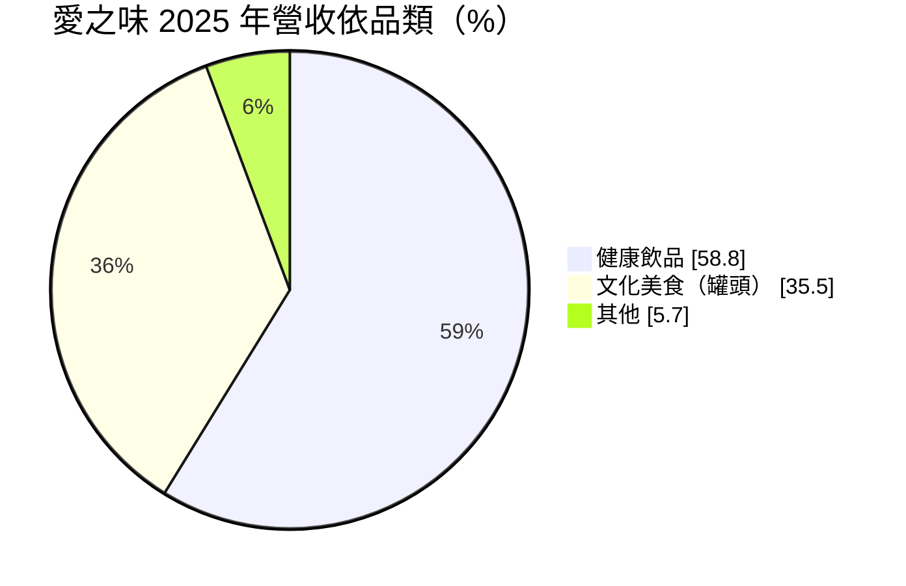
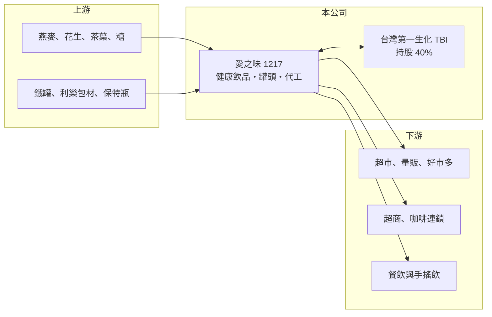

# 1217 愛之味

> 上市｜[[產業索引-食品工業|食品工業]]｜上市（櫃）日期 1989/10/28

# 第一章：企業模式與商業藍圖

> [!info] 撰寫說明
> 精簡版，由 Claude 依公開資料整理，架構比照 [[2330台積電]]，資料截至 2026-10-08。來源：證交所開放資料快照（基本資料、2026 年第二季資產負債與損益、股利）、Goodinfo 經營績效頁、富果 2026 年 9 月法說會備忘錄。#待校對

愛之味（以下簡稱愛之味）是以罐頭與健康飲品聞名的食品公司，理解它的關鍵在於：它在幾個利基品類擁有領先市占，本業利潤率卻很薄，獲利有相當比例來自轉投資的台灣第一生化科技（TBI）。

- **核心業務：** 愛之味成立於 1971 年，1989 年上市，產品分為兩大類：健康飲品（純濃燕麥、分解茶、麥仔茶）與文化美食（素食罐頭、牛奶花生等甜罐點心、魚罐頭）。依 2025 年資料，健康飲品約占營收 58.8%、文化美食約 35.5%。罐頭產品保存期長、口味固定，屬於家庭與節慶的長期消費習慣；健康飲品則跟著機能、植物奶等健康趨勢成長。
- **營收結構：** 公司在多個品類居領先地位：牛奶花生為市場第一，分解茶市占約三至四成，麥仔茶在中式茶飲市占第一（加計餐飲通路超過五成），燕麥奶與 [[1227佳格]] 的桂格並列兩大品牌。通路方面，除超市與超商，也供應燕麥奶給路易莎、全家、萊爾富等 B2B 客戶，並提供濃縮液給連鎖餐廳與飯店飲料機。
- **營運據點：** 愛之味自有利樂鑽（TPA）與鐵罐產線，鐵罐產線稼動率八成以上，利樂鑽已增設第二條；自有工廠地點公開資料未查得。持股 40% 的 TBI 擁有保特瓶產線，並在嘉義大埔美園區興建約 40 億元的新廠，導入無菌冷充填產線，年產能約 2,400 萬打，預計 2027 年第四季完工。
- **長期方向：** 公司採「雙引擎」策略：以自有品牌為基礎，以[[OEM]]代工為第二成長引擎，代工營收近兩年年增約 40%。整合利樂包、鐵罐、保特瓶三種包裝，提供從研發配方到量產的一站式服務，目標是讓既有產線利用率提高、攤低固定成本。研發方向集中在植物奶與高蛋白產品。

# 第二章：護城河深度與競爭優勢

愛之味的護城河來自利基品類的品牌與口味記憶，但品類規模有限，難以支撐高利潤率。

- **競爭優勢：** 牛奶花生、麥仔茶、分解茶這類產品已經有數十年的消費習慣，品牌名稱幾乎等於品類名稱，競爭者很難用相同產品取代。罐頭與利樂包產線投資大、良率與殺菌技術需要經驗，這讓新進者不易切入。加上 TBI 的保特瓶產能，公司可以替其他品牌代工，把產線能力變成另一個收入來源。
- **主要對手：** 健康飲品與茶飲的主要對手包括 [[1216統一]]、[[1218泰山]]、[[1234黑松]]、[[1227佳格]]（燕麥奶），罐頭市場則有泰山與多家中小型食品廠。大型對手的通路與廣告資源遠多於愛之味，因此愛之味多集中在自己有領先地位的利基品類。
- **觀察重點：** 長期要看代工業務能否持續成長並提高產線利用率、TBI 新廠在 2027 年完工後的貢獻，以及本業營業利益率能否由 1% 至 3% 往上提升。若本業持續偏弱，股東報酬將更依賴轉投資。

# 第三章：財務體質與盈利規模

資料日期：2026-10-08，表格是撰寫當時的快照；最新月營收、毛利率、累計 EPS 由自動排程寫在本筆記的屬性欄位（月營收、毛利率、累計EPS 等）。#待校對

愛之味的財務特徵是毛利率接近三成、但營業利益率只有 1% 至 5%，淨利有相當部分來自轉投資收益。

| 年度 | 營收（億元） | [[毛利率]] | [[營業利益率]] | EPS（元） | [[ROE]] |
|---|---|---|---|---|---|
| 2020 | 46.1 | 32.9% | 4.68% | 0.47 | 3.75% |
| 2021 | 47.1 | 31.0% | 3.64% | 0.41 | 3.05% |
| 2022 | 48.0 | 29.9% | 3.57% | 0.56 | 3.86% |
| 2023 | 49.0 | 28.9% | 2.63% | 0.41 | 2.89% |
| 2024 | 51.2 | 28.4% | 2.82% | 0.58 | 3.82% |
| 2025 | 50.4 | 27.6% | 1.47% | 0.42 | 2.59% |

（來源：Goodinfo 經營績效頁；2026 年上半年營收 23.5 億元、毛利率約 26.3%、營業利益率約 0.8%、EPS 0.19 元，依證交所開放資料計算。）

- **營收規模：** 2020 至 2025 年營收由 46.1 億元增至 50.4 億元，年複合成長率約 1.8%（推算），成長緩慢但穩定。罐頭與茶飲屬成熟品類，成長主要來自燕麥奶、機能茶與代工。
- **獲利：** 2021 至 2025 年平均 ROE 約 3.2%（推算），偏低。毛利率由 2020 年的 32.9% 逐年降到 2025 年的 27.6%，營業利益率也從 4.7% 降到 1.5%，顯示原物料與費用上升的壓力沒有完全轉嫁。2025 年營業利益約 0.74 億元，淨利卻有 2.19 億元，差額主要來自 TBI 等[[轉投資收益]]與其他業外收入。
- **財務特色：** 依 2026 年第二季資料，總資產約 157 億元、權益總計約 84.6 億元、負債約 72.4 億元，非流動資產高達約 128 億元，比重遠高於一般食品製造商，反映長期股權投資與不動產等資產。2025 年度每股現金股利 0.25 元，[[配息率]]約 60%（推算），公司章程以可分配盈餘 50% 以上分派為原則。自由現金流是否長期為正未查得。
- **[[ROIC]] 與 [[WACC]]：** 以 2025 年營業利益約 0.74 億元、稅率 20% 計算，稅後營業利益約 0.59 億元。有息負債未查得，投入資本以權益 84.6 億元到總資產 157 億元為區間，ROIC 約 0.4% 至 0.7%（推算）。WACC 以 [[CAPM]] 推估：無風險利率 1.75%、市場風險溢酬 6%、β 假設 0.6（食品股常見值），權益成本約 5.4%；稅後負債成本假設 2%、有息負債占四成，WACC 約 4.0%（推算）。本業 ROIC 遠低於 WACC，代表龐大的資產沒有產生相應的營業利益；若把轉投資收益計入，整體報酬仍只接近資金成本。

# 第四章：總體風險與地緣政治

愛之味的風險集中在本業利潤率、原物料成本與對轉投資的依賴。

- **產業週期：** 食品需求穩定，但燕麥、花生、茶葉、糖與鐵罐等原物料價格有週期性波動，愛之味的毛利率在近五年持續下滑，顯示成本轉嫁能力有限。健康飲品市場變化快，新品若無法持續推出，市占容易被大廠追上。
- **營運風險：** 獲利依賴 TBI 的權益法收益，TBI 本身又以愛之味為最大客戶，兩者的營運高度連動；TBI 新廠約 40 億元的投資若產能利用不如預期，折舊會壓抑其獲利。食品業的[[食安事件]]風險也需要留意。
- **其他風險：** 原物料多仰賴進口，匯率變動會影響成本；人口老化與少子化讓傳統罐頭的消費人口逐漸縮小；資產中長期投資比重高，金融市場波動也會影響帳面淨值與綜合損益。

# 專有名詞解析

## 金融

- **[[轉投資收益]]**：公司持有其他公司股權所認列的獲利或股利，屬業外收入，波動取決於被投資公司的表現。
- **[[配息率]]**：現金股利占當年度每股盈餘的比例，反映公司把獲利分給股東的程度。

## 產業

- **[[OEM]]**：原廠委託製造，代工廠依品牌客戶的設計生產，產品掛客戶品牌，毛利率通常低於自有品牌。
- **[[無菌冷充填]]**：在無菌環境下以常溫或低溫把飲料灌入容器的技術，可減少高溫殺菌對風味與營養的影響。
- **[[食安事件]]**：食品原料或製程出現污染、摻偽或標示不實，導致產品下架與品牌信任受損的事件。

# 核心供應鏈

- 上游：燕麥、花生、茶葉、糖等農產原料，鐵罐、利樂包材與保特瓶包材，例如 [[9939宏全]]（是否為供應商未確認，#待校對）。
- 下游／客戶：超市、量販與好市多，便利商店 [[5903全家]]、萊爾富，咖啡連鎖路易莎，以及連鎖餐廳、飯店與手搖飲品牌。
- 同業：[[1216統一]]、[[1218泰山]]、[[1234黑松]]、[[1227佳格]]。

## 最新新聞
<!-- news:start -->
<!-- news:end -->

## 相關連結
- [公開資訊觀測站](https://mopsov.twse.com.tw/mops/web/t05st03?step=1&firstin=1&co_id=1217)
- [Goodinfo](https://goodinfo.tw/tw/StockDetail.asp?STOCK_ID=1217)
- [Yahoo 股市](https://tw.stock.yahoo.com/quote/1217)
- [鉅亨網新聞](https://www.cnyes.com/twstock/1217/news)
