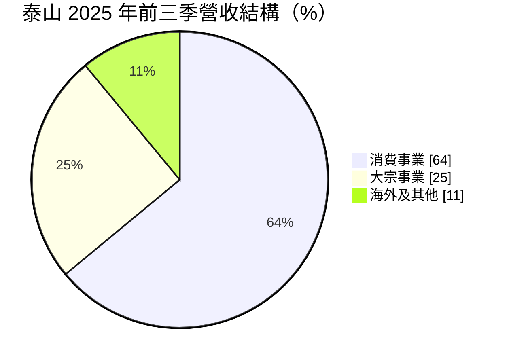
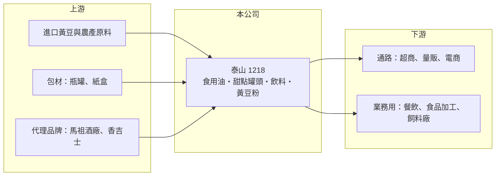

# 1218 泰山

> 上市｜[[產業索引-食品工業|食品工業]]｜上市（櫃）日期 1989/11/11

# 第一章：企業模式與商業藍圖

> [!info] 撰寫說明
> 精簡版，由 Claude 依公開資料整理，架構比照 [[2330台積電]]，資料截至 2026-10-08。來源：證交所開放資料快照（基本資料、2026 年第二季資產負債與綜合損益、股利）、Goodinfo 經營績效頁、富果研究 2025 年 12 月法說會摘要；品牌與通路細節部分依記憶整理。#待校對

泰山企業是台灣老牌的民生食品公司，同時經營品牌消費品與黃豆大宗物資兩條差異很大的事業線。理解泰山，要先看懂「品牌賺溢價、大宗賺規模」這兩種獲利邏輯如何並存。

- **核心業務：** 泰山 1950 年在彰化田中成立，1989 年上市，主要產品是家用與業務用食用油、八寶粥與仙草蜜等甜點罐頭、礦泉水與氣泡水等飲料，以及黃豆與黃豆粉。依富果整理的 2025 年法說資料，泰山家用油市占排名第二、玄米油排名第一，罐裝甜點與氣泡水排名第一（市占排名依公司說法，待校對）。這些品牌產品是泰山長期毛利的主要來源，也是它和單純原料商最大的不同。
- **營收結構：** 2025 年前三季，消費事業占營收 64%，大宗事業（業務用油、黃豆、黃豆粉）占 25%，海外及其他占 11%。消費事業靠品牌與通路賺取較穩定的毛利，大宗事業則跟著國際黃豆與豆粕價格波動，營收高低不一定代表獲利高低。「其他」包含[[總代理]]馬祖高粱酒與香吉士果汁等代理業務，讓泰山的通路能同時銷售自有與代理產品。
- **營運據點：** 生產基地以台灣彰化田中為主，海外主要據點在中國漳州。漳州營運近年受中國內需疲弱影響，2025 年前三季營收減少約 1 億元。泰山產品透過量販店、超商與電商等超過 3 萬個銷售點銷售，綿密的通路是消費品牌能長期存在的基礎。
- **長期方向：** 公司策略是往健康、高價、無添加的產品組合移動，例如機能飲品、高價油品與特色零食，並與馬祖酒廠合作推出高價烈酒系列。2025 年起停止生產銷售水產飼料，減少約 2.35 億元營收，代表公司主動收斂低毛利業務。這個方向若持續，營收規模可能不再成長，但毛利結構會更偏向品牌消費品。

# 第二章：護城河深度與競爭優勢

泰山的護城河來自品牌與通路，而不是技術或規模。本章說明這些優勢守得住哪些市場，以及它在大宗物資上為何難有定價權。

- **競爭優勢：** 泰山經營民生食品超過 70 年，八寶粥、仙草蜜、食用油等品牌在台灣家庭的辨識度很高，消費者在超商與量販店貨架上有固定的購買習慣。品牌食品的轉換成本雖然不高，但新進者要取得同等的貨架位置與消費者信任，需要長時間的行銷投入，這是泰山消費事業毛利能維持在一定水準的原因。
- **大宗事業的限制：** 黃豆、豆粕與業務用油屬於[[大宗物資]]，價格由國際黃豆行情與進口成本決定，泰山與同業主要比的是採購時點、[[黃豆壓榨]]效率與運輸成本。這類業務能帶來營收規模與工廠稼動，但很難靠品牌提高售價。2024 年起豆粕價格下跌，就讓泰山出貨量增加、營收卻下滑。
- **主要對手：** 食用油市場有 [[1225福懋油]]、[[1210大成]]、[[1227佳格]] 與 [[1216統一]] 等；甜點罐頭與飲料市場有 [[1217愛之味]]、[[1234黑松]]、[[1201味全]] 與統一集團。超商通路本身也推出自有品牌商品，與泰山爭奪同一個貨架。
- **觀察重點：** 長期要觀察消費事業占比能否持續提高、新品（例如泡泡果茶與高價油品）能否成為長銷商品，以及代理酒類業務的規模。另一個重點是公司治理：泰山過去經歷經營權之爭，處分全家股權的交易至今仍有訴訟，這些事項會影響管理層的資源配置與投資人對公司的信任（經營權爭議細節依記憶，待校對）。

# 第三章：財務體質與盈利規模

資料日期：2026-10-08，表格是撰寫當時的快照；最新月營收、毛利率、累計 EPS 由自動排程寫在本筆記的屬性欄位（月營收、毛利率、累計EPS 等）。#待校對

泰山的財務特色是低負債、本業獲利薄，損益常被業外事件放大。本章用多年度數字區分本業與業外，再檢視資本報酬。

| 年度 | 營收（億元） | [[毛利率]] | [[營業利益率]] | EPS（元） | [[ROE]] |
|---|---|---|---|---|---|
| 2019 | 80.0 | 18.2% | 2.00% | 1.20 | 8.95% |
| 2020 | 83.6 | 19.6% | 3.79% | 1.75 | 12.5% |
| 2021 | 99.4 | 15.4% | 2.11% | 1.22 | 8.44% |
| 2022 | 111 | 13.1% | -3.54% | 12.17 | 60.5% |
| 2023 | 112 | 13.9% | -0.56% | -0.17 | -0.65% |
| 2024 | 107 | 17.7% | 5.78% | 1.53 | 5.96% |
| 2025 | 101 | 17.6% | 4.15% | 1.59 | 6.03% |

（來源：Goodinfo 經營績效頁）

- **營收規模：** 2019 至 2025 年營收由 80 億元增加到 101 億元，年複合成長率約 4%（推算）。成長主要出現在 2021 至 2023 年的大宗物資漲價期，2024 年後隨黃豆價格回落與停售水產飼料而縮小。2026 年上半年營收約 50.3 億元，營收規模仍在下滑。
- **獲利：** 本業的[[營業利益率]]長期只有 0% 至 6%，是典型的薄利民生食品公司，毛利率在原物料高漲的 2022 至 2023 年降到 13% 左右，2024 年回到 17% 以上。2022 年 EPS 高達 12.17 元，是因為處分全家股權認列約 66 億元的[[業外收益]]，屬一次性收益，不能當作本業獲利能力。2026 年上半年則出現營業外損失約 6.8 億元與其他費損約 2.7 億元，每股虧損 1.62 元，原因本次未查得。
- **財務特色：** 2026 年第二季資產總計 143.4 億元、負債 28.1 億元，負債比約 20%，母公司業主權益 115.2 億元，每股淨值 23.7 元。2025 年第三季約 12 億元因街口相關訴訟提存法院擔保金，列在其他非流動資產。2025 年度配發現金股利 1.32 元，以當年 EPS 1.59 元計算配息率約 83%（推算）；股利政策章程規定現金股利不低於股利總額的 30%。
- **長期指標：** 2021 至 2025 年平均 ROE 約 16%，但若扣除 2022 年的處分收益，平均只有約 5%（推算）。這說明泰山的帳上權益很大一部分是過去處分資產留下的資金，而不是本業持續創造的獲利。

**[[ROIC]] 與 [[WACC]]：** 以 2025 年營收 101 億元、營業利益率 4.15% 計算，營業利益約 4.19 億元，稅後營業利益約 3.35 億元（稅率 20%）；投入資本以 2026 年第二季母公司業主權益 115.2 億元加上有息負債（未查得，負債多為流動負債，推估不超過 5 億元）計算，約 115 億至 120 億元，ROIC 約 2.8% 至 2.9%（推算）。WACC 以 CAPM 推估：無風險利率 1.75%、市場風險溢酬 6%、β 取食品同業常見值 0.5（推算），股權成本約 4.75%；公司幾乎沒有負債，WACC 約 4.5% 至 4.8%（推算）。ROIC 低於 WACC，代表泰山目前的資本整體沒有創造超額價值，主因是權益中有大量處分資產後保留的資金與轉投資，並未投入高報酬的本業。若只看營運所需資本，本業報酬會高一些，但仍取決於公司能否把閒置資金用於更有效率的地方或回饋股東。

# 第四章：總體風險與地緣政治

泰山的風險一部分來自原物料與消費市場，另一部分來自公司治理與訴訟這類較少見的因素。

- **產業週期：** 黃豆與食用油價格隨國際農產品、氣候與美中貿易而波動，原料漲價時品牌產品需要時間才能轉嫁，毛利率會先被壓縮，2022 至 2023 年就是例子。民生食品需求穩定，但台灣人口老化、少子化，總量成長有限，成長必須靠產品升級與通路拓展。
- **營運風險：** 2026 年起營收規模明顯縮小，上半年並出現大額業外損失與其他費損，原因本次未查得，需要追蹤是否有事業結束、代理權變動或訴訟結果認列。中國漳州營運受中國內需影響，2025 年已見衰退。
- **訴訟與治理：** 處分全家股權的交易至今仍有訴訟，公司已提存約 12 億元擔保金，訴訟結果可能影響帳上權益與現金。過去的經營權爭議與經營團隊變動，也會影響策略延續性（細節待校對）。
- **其他風險：** 黃豆與包材多需進口，美元匯率與海運成本影響原料成本；食品安全事件會直接衝擊品牌信任，這是所有品牌食品公司共同面對的長期風險。

# 專有名詞解析

## 金融

- **[[業外收益]]**：本業以外的收益，例如處分投資或資產的利益，通常不會每年重複出現。
- **[[ROIC]]**：投入資本報酬率，稅後營業利益除以股東權益加有息負債，用來衡量本業運用資本的效率。
- **[[WACC]]**：加權平均資金成本，依股權與負債比重加權計算的資金成本，ROIC 高於它才算創造價值。

## 產業

- **[[大宗物資]]**：黃豆、小麥、玉米等國際標準化農產原料，價格由全球供需決定，廠商主要賺加工與貿易價差。
- **[[黃豆壓榨]]**：將黃豆壓榨成黃豆油與黃豆粉（豆粕），油供食用、豆粕多作為飼料原料。
- **[[總代理]]**：取得品牌在特定地區的獨家經銷權，負責進口、行銷與通路配銷。

# 核心供應鏈

- 上游：國際黃豆與穀物供應商（多為美國、巴西產地）、瓶罐與紙盒包材供應商；代理業務的品牌方包括馬祖酒廠與香吉士果汁。
- 下游／客戶：超商 [[2912統一超]]、[[5903全家]]，以及量販店、超市與電商；業務用油與黃豆粉賣給餐飲業、食品加工廠與飼料廠。
- 同業：食用油 [[1225福懋油]]、[[1210大成]]、[[1227佳格]]、[[1216統一]]；甜點與飲料 [[1217愛之味]]、[[1234黑松]]、[[1201味全]]、[[1203味王]]。

## 最新新聞
<!-- news:start（自動產生，請勿手動編輯此範圍） -->
- 2026-10-08 🏛️ 重訊 19:55｜說明本公司總經理經臺中地方法院裁定具保後停止羈押事宜｜[觀測站](https://mops.twse.com.tw/mops/#/web/t05st01)

完整紀錄：[[1218泰山 新聞]]
<!-- news:end -->

## 相關連結
- [公開資訊觀測站](https://mopsov.twse.com.tw/mops/web/t05st03?step=1&firstin=1&co_id=1218)
- [Goodinfo](https://goodinfo.tw/tw/StockDetail.asp?STOCK_ID=1218)
- [Yahoo 股市](https://tw.stock.yahoo.com/quote/1218)
- [鉅亨網新聞](https://www.cnyes.com/twstock/1218/news)
