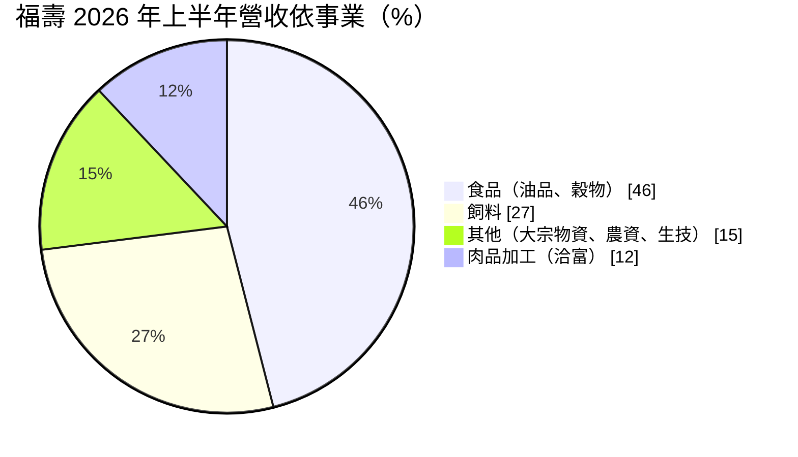
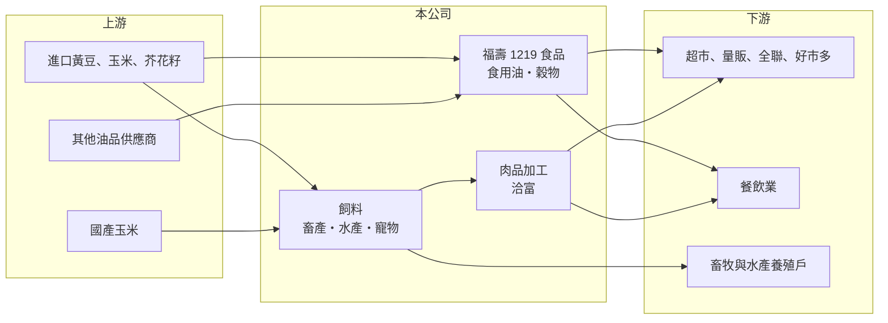

# 1219 福壽

> 上市｜[[產業索引-食品工業|食品工業]]｜上市（櫃）日期 1990/12/01

# 第一章：企業模式與商業藍圖

> [!info] 撰寫說明
> 精簡版，由 Claude 依公開資料整理，架構比照 [[2330台積電]]，資料截至 2026-10-08。來源：證交所開放資料快照（基本資料、2026 年第二季資產負債與損益、股利）、Goodinfo 經營績效頁、富果 2026 年 9 月法說會備忘錄。#待校對

福壽實業（以下簡稱福壽）是以食用油與飼料為主的農產加工公司，理解它的關鍵在於：它處理的是黃豆、玉米等[[大宗物資]]，營收大但毛利率只有一成上下，獲利對原料價格與食安管理都非常敏感。

- **核心業務：** 福壽成立於 1955 年，1990 年上市，事業分為食品、飼料、肉品加工與其他四大部門。食品事業以食用油品與穀物產品為主，是公司的核心；飼料事業生產畜產、水產飼料與寵物食品；肉品加工以「洽富」品牌經營雞肉，年營業額約 16 億至 18 億元。這種組合讓福壽同時站在食品原料與畜牧業兩條供應鏈上。
- **營收結構：** 依 2026 年上半年資料，食品約占 46%、飼料約 27%、其他（大宗物資、農資與生技）約 15%、肉品加工約 12%。油品與飼料的原料都來自進口黃豆與玉米，因此不同事業的成本其實由同一組國際穀物價格決定。肉品加工在 2026 年上半年因台灣雞肉供給增加約 15% 而出現虧損。
- **營運據點：** 公司總部與主要工廠在台灣，生產據點的完整清單公開資料未查得。福壽重視在地採購，2025 年國產玉米採購量約占全台產量的 11.5%。2026 年上半年資本支出 1.5 億元，其中約六成用於提升產能、其餘投入環保污水處理與廠房自動化。
- **長期方向：** 公司的產品策略是從大宗日常用品轉向差異化、高附加價值品項，例如芥花油基底的調合油與生飲油系列；肉品方面則拓展餐飲、全聯與好市多等通路，目標讓每日屠宰量九成以上以鮮品售出。經過 2026 年的油品事件後，食品安全的源頭管理與追溯系統成為公司最重要的長期課題。

# 第二章：護城河深度與競爭優勢

福壽的護城河主要是長期經營的品牌與通路，但產品同質性高，議價力有限。

- **競爭優勢：** 「福壽」品牌在台灣家用食用油市場有長期知名度，加上飼料與肉品的上下游整合，讓公司能把同一批原料分配到不同產品，提高原料採購規模。在地玉米採購與多元事業部門也讓公司比單一產品廠商更能分散風險。不過大宗油品與飼料的價格透明，品牌溢價並不高。
- **主要對手：** 食用油市場的主要對手包括 1218泰山、1232大統益、1225福懋油、[[1216統一]] 等；飼料市場則有 [[1215卜蜂]]、[[1210大成]]、[[1220台榮]]。這些對手中有不少規模大於福壽，大統益更是台灣最大的黃豆壓榨廠之一。
- **觀察重點：** 長期要看油品事件後的品牌信任與通路回補速度、高附加價值油品占比能否提升，以及肉品加工能否穩定獲利。營業利益率若無法回到 2% 以上，公司的資本報酬將持續偏低。

# 第三章：財務體質與盈利規模

資料日期：2026-10-08，表格是撰寫當時的快照；最新月營收、毛利率、累計 EPS 由自動排程寫在本筆記的屬性欄位（月營收、毛利率、累計EPS 等）。#待校對

福壽的財務是典型大宗物資加工業：營收規模百億以上、毛利率一成左右、營業利益率個位數，獲利波動主要由原料價格與一次性事件決定。

| 年度 | 營收（億元） | [[毛利率]] | [[營業利益率]] | EPS（元） | [[ROE]] |
|---|---|---|---|---|---|
| 2020 | 123 | 11.0% | 2.69% | 1.91 | 13.5% |
| 2021 | 148 | 9.21% | 2.05% | 1.00 | 6.31% |
| 2022 | 170 | 8.56% | 1.82% | 1.00 | 6.86% |
| 2023 | 163 | 9.16% | 2.19% | 0.94 | 7.32% |
| 2024 | 143 | 9.42% | 0.78% | 0.53 | 2.33% |
| 2025 | 144 | 8.53% | 0.02% | 0.45 | 約 3.8%（推算） |

（來源：Goodinfo 經營績效頁；2025 年 ROE 來源顯示為 -0.01%，與當年 EPS 0.45 元不一致，改以淨利約 1.55 億元 ÷ 權益約 40 億元推算。2026 年上半年營收 69.7 億元、毛利率約 5.3%、營業利益率約 -2.9%、EPS -0.90 元，依證交所開放資料計算。）

- **營收規模：** 2020 至 2025 年營收由 123 億元增至 144 億元，年複合成長率約 3.2%（推算），2022 年的 170 億元高峰主要反映穀物漲價。營收變化多半是「價」而非「量」，原料價格上漲時營收增加，但利潤不一定跟著增加。
- **獲利：** 2021 至 2025 年平均 ROE 約 5.3%（推算），且逐年下滑。營業利益率由 2020 年的 2.7% 降到 2025 年接近零，代表本業幾乎不賺錢，2025 年 EPS 0.45 元主要靠[[業外收入]]。2026 年上半年受油品事件影響，估列約 2.1 億元損失（銷貨退回約 1 億元、存貨跌價與成本約 1 億元，另加罰款），歸屬母公司淨損 3.08 億元。
- **財務特色：** 依 2026 年第二季資料，總資產約 96.4 億元、權益約 40.1 億元、負債約 56.3 億元，負債比約 58%，流動資產比重高，反映大宗原料庫存與應收帳款的營運資金需求。2025 年度每股現金股利 0.5 元，高於當年 EPS 0.45 元，[[配息率]]超過 100%（推算）。章程規定以可分配盈餘 40% 至 90% 分派股利。
- **[[ROIC]] 與 [[WACC]]：** 2025 年營業利益僅約 0.03 億元（144 億元 × 0.02%），ROIC 接近 0%（推算）；2024 年營業利益約 1.12 億元，稅後約 0.89 億元，以權益約 40 億元到總資產約 96 億元為區間，ROIC 約 0.9% 至 2.2%（推算）；2026 年上半年營業虧損，ROIC 為負。WACC 以 [[CAPM]] 推估：無風險利率 1.75%、市場風險溢酬 6%、β 假設 0.6（食品股常見值），權益成本約 5.4%；稅後負債成本假設 2%、有息負債占四成五，WACC 約 3.9%（推算）。近年 ROIC 持續低於 WACC，代表本業未能賺回資金成本，改善的關鍵在提高產品附加價值與控制原料風險。

# 第四章：總體風險與地緣政治

福壽的風險集中在食品安全、原物料價格與肉品市場供需。

- **產業週期：** 黃豆、玉米等穀物價格受美國與南美收成、氣候與國際局勢影響，價格上漲時成本轉嫁會有落差，下跌時又可能有庫存跌價損失。雞肉市場的供需也有循環，2026 年上半年台灣雞肉供給大增就造成肉品部門虧損。
- **營運風險：** 2026 年的油品事件涉及大豆沙拉油，屬於嚴重的[[食安事件]]，除了直接損失，也影響品牌信任與通路關係。依法說會資料，泰山已對相關供應公司提起求償並進入司法程序，福壽也在研議向中聯求償，後續訴訟結果仍有不確定性。這類事件提醒投資人，大宗原料加工業者的食安管理與供應商管理是長期核心能力。
- **其他風險：** 原料以美元計價進口，新台幣貶值會推升成本；台灣對食品安全與標示的法規趨嚴，罰款與合規成本可能上升；飼料需求也受畜牧業疫病（禽流感、豬瘟）影響。

# 專有名詞解析

## 金融

- **[[業外收入]]**：本業營運以外的收入，例如利息、投資收益、處分資產利益，持續性通常低於本業獲利。
- **[[配息率]]**：現金股利占當年度每股盈餘的比例，反映公司把獲利分給股東的程度。

## 產業

- **[[大宗物資]]**：黃豆、玉米、小麥等以國際期貨市場定價、交易量大的農產原料，價格透明且波動大。
- **[[食安事件]]**：食品原料或製程出現污染、摻偽或標示不實，導致產品下架與品牌信任受損的事件。

# 核心供應鏈

- 上游：進口黃豆、玉米與芥花籽等大宗物資，國產玉米契作，以及其他油品供應商。
- 下游／客戶：超市、量販、全聯與好市多等零售通路，餐飲業，以及購買飼料的畜牧與水產養殖戶。
- 同業：1218泰山、1232大統益、1225福懋油、[[1215卜蜂]]、[[1210大成]]、[[1220台榮]]。

## 最新新聞
<!-- news:start（自動產生，請勿手動編輯此範圍） -->
- 2026-10-06 🏛️ 重訊 18:31｜(補充115年8月24日重大訊息發生原委) 本公司於8月24日接獲臺灣臺中地方檢察署檢察官起訴書， 另接獲臺灣基隆地方檢察署移送併辦意旨書｜[觀測站](https://mops.twse.com.tw/mops/#/web/t05st01)

完整紀錄：[[1219福壽 新聞]]
<!-- news:end -->

## 相關連結
- [公開資訊觀測站](https://mopsov.twse.com.tw/mops/web/t05st03?step=1&firstin=1&co_id=1219)
- [Goodinfo](https://goodinfo.tw/tw/StockDetail.asp?STOCK_ID=1219)
- [Yahoo 股市](https://tw.stock.yahoo.com/quote/1219)
- [鉅亨網新聞](https://www.cnyes.com/twstock/1219/news)
