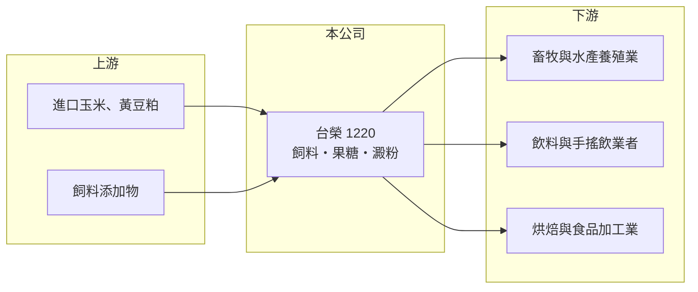

# 1220 台榮

> 上市｜[[產業索引-食品工業|食品工業]]｜上市（櫃）日期 1991/11/20

# 第一章：企業模式與商業藍圖

> [!info] 撰寫說明
> 精簡版，由 Claude 依公開資料整理，架構比照 [[2330台積電]]，資料截至 2026-10-08。來源：證交所開放資料快照（基本資料、2026 年第二季資產負債與損益、股利）、Goodinfo 經營績效頁、nStock 公司概況頁。公開資料有限，產品營收比重、子公司與生產據點均未查得。#待校對

台榮產業（以下簡稱台榮）是生產飼料、果糖與澱粉的農產加工公司，理解它的關鍵在於：三項產品都以玉米等[[大宗物資]]為原料，公司賺的是原料與成品之間的加工價差，利潤率薄、受原料價格影響大。

- **核心業務：** 台榮成立於 1969 年，1991 年上市，業務為高品質飼料、[[果糖]]與澱粉的生產與買賣。飼料供應畜牧與水產養殖業；果糖與澱粉則是飲料、烘焙與食品加工業的基本原料。三者都從玉米等穀物加工而來，可以共用採購與部分製程，形成一定的原料綜效。
- **營收結構：** 各產品營收比重公開資料未查得。2025 年營收約 33.3 億元（Goodinfo；nStock 列為 34.17 億元，口徑差異待校對），規模在台灣飼料與糖類加工業中屬中型。果糖的下游以手搖飲與包裝飲料為大宗（推估），因此台灣飲料市場的消費變化也會影響公司。
- **營運據點：** 公司登記地址在台北，生產工廠的位置與產能公開資料未查得。合併報表含子公司，非控制權益約 2.07 億元，代表有部分子公司並非全資持有，子公司名稱與業務待校對。
- **長期方向：** 公開資料未查得公司明確的長期策略。以產業結構看，飼料業的成長取決於台灣畜牧業規模，果糖則取決於飲料業需求，兩者在台灣都屬成熟市場；公司要提升價值，可能需要在產品組合、成本效率或下游客戶上找到突破（推估）。董事長由法人倍安利投資有限公司擔任，經營權結構的細節待校對。

# 第二章：護城河深度與競爭優勢

台榮的護城河有限，主要來自長期經營的客戶關係與在地產能，而不是品牌或技術獨占。

- **競爭優勢：** 飼料與果糖都是重量大、單價低的產品，運輸成本占比高，在地工廠對附近客戶有天然的成本優勢。長期供貨的畜牧場與飲料廠重視品質穩定與交期，一旦建立合作，通常不會頻繁更換供應商。不過產品同質性高，價格仍是競爭主軸。
- **主要對手：** 飼料市場的主要對手包括 [[1215卜蜂]]、[[1210大成]]、[[1219福壽]] 等，其中卜蜂與大成具有從飼料到肉品的垂直整合，規模與議價力都高於台榮。果糖與澱粉市場則有台糖等業者與進口產品競爭。
- **觀察重點：** 長期要看營業利益率能否回到 2020 至 2021 年約 7% 的水準，以及 2022 年、2025 年那種毛利率大幅下滑的情況能否降低頻率。毛利率在 8.7% 至 16% 之間擺動，說明原料避險與定價能力是公司最需要強化的地方。

# 第三章：財務體質與盈利規模

資料日期：2026-10-08，表格是撰寫當時的快照；最新月營收、毛利率、累計 EPS 由自動排程寫在本筆記的屬性欄位（月營收、毛利率、累計EPS 等）。#待校對

台榮的財務呈現典型農產加工業的特徵：營收穩定、利潤率薄而波動，財務結構保守。

| 年度 | 營收（億元） | [[毛利率]] | [[營業利益率]] | EPS（元） | [[ROE]] |
|---|---|---|---|---|---|
| 2020 | 27.8 | 16.1% | 7.87% | 1.02 | 6.07% |
| 2021 | 32.2 | 14.5% | 7.01% | 1.00 | 6.51% |
| 2022 | 35.4 | 8.73% | 1.76% | 0.26 | 2.21% |
| 2023 | 32.9 | 13.3% | 4.93% | 0.76 | 4.93% |
| 2024 | 34.8 | 16.0% | 7.25% | 1.18 | 7.07% |
| 2025 | 33.3 | 10.5% | 1.01% | 0.08 | 1.23% |

（來源：Goodinfo 經營績效頁；2026 年上半年營收 15.1 億元、毛利率約 8.7%、營業利益率約 -1.7%、EPS -0.12 元，依證交所開放資料計算。）

- **營收規模：** 2020 至 2025 年營收由 27.8 億元增至 33.3 億元，年複合成長率約 3.7%（推算），2022 年的高點主要反映穀物漲價後的售價調整。營收變化多來自價格，而非銷量的大幅成長。
- **獲利：** 2021 至 2025 年平均 ROE 約 4.4%（推算），偏低。2022 年與 2025 年毛利率都跌到一成左右，營業利益率接近零，說明原料成本上升時公司難以即時轉嫁；原料回落的年份（2020、2024）營業利益率則可達 7% 以上。這種「價差型」獲利模式，讓 EPS 在 0.08 元到 1.18 元之間大幅擺動。
- **財務特色：** 依 2026 年第二季資料，總資產約 34.8 億元、權益總計約 24.9 億元、負債僅約 9.9 億元，負債比約 28%，流動資產約 21.5 億元，財務結構保守。2025 年度每股現金股利 0.2 元，高於當年 EPS 0.08 元，[[配息率]]超過 100%（推算），代表公司動用保留盈餘維持配息。子公司持有母公司股票約 68 萬股。
- **[[ROIC]] 與 [[WACC]]：** 以 2025 年營業利益約 0.34 億元（33.3 億元 × 1.01%）、稅率 20% 計算，稅後營業利益約 0.27 億元，以權益 24.9 億元到總資產 34.8 億元為投入資本區間，ROIC 約 0.8% 至 1.1%（推算）；原料條件較好的 2024 年同法約 5.8% 至 8.1%（推算）。WACC 以 [[CAPM]] 推估：無風險利率 1.75%、市場風險溢酬 6%、β 假設 0.6（食品股常見值），權益成本約 5.4%；稅後負債成本假設 2%、有息負債占兩成，WACC 約 4.7%（推算）。ROIC 在好年度高於 WACC、壞年度遠低於 WACC，長期平均大致與資金成本相當或略低，屬於難以穩定創造價值的類型。

# 第四章：總體風險與地緣政治

台榮的風險集中在原物料價格、下游需求與產業競爭。

- **產業週期：** 玉米等穀物價格受國際收成、氣候、能源（生質燃料）與戰爭影響，具有明顯週期；原料快速上漲時，飼料與果糖售價調整常落後，2022 年與 2025 年的獲利下滑都與此有關。畜牧業的疫病（如禽流感、[[非洲豬瘟]]）也會影響飼料需求。
- **營運風險：** 公司規模中等，在飼料市場面對有垂直整合優勢的大型同業，議價力有限。果糖需求與台灣飲料市場高度相關，若健康意識提升、減糖政策推行，含糖飲料用量可能長期下降。
- **其他風險：** 原料以美元計價進口，匯率變動直接影響成本；食品原料業者也需要面對[[食安事件]]與法規趨嚴的風險，2026 年台灣的油品事件即顯示上游原料問題可能牽連整條供應鏈。

# 專有名詞解析

## 金融

- **[[配息率]]**：現金股利占當年度每股盈餘的比例，反映公司把獲利分給股東的程度。

## 產業

- **[[大宗物資]]**：黃豆、玉米、小麥等以國際期貨市場定價、交易量大的農產原料，價格透明且波動大。
- **[[果糖]]**：以玉米澱粉經酵素轉化製成的液態糖漿，甜度高、易溶解，大量用於手搖飲與包裝飲料。
- **[[非洲豬瘟]]**：豬隻的高致死率病毒性傳染病，目前沒有有效疫苗，一旦發生通常需大規模撲殺並限制豬肉出口。
- **[[食安事件]]**：食品原料或製程出現污染、摻偽或標示不實，導致產品下架與品牌信任受損的事件。

# 核心供應鏈

- 上游：進口玉米、黃豆粕等飼料與澱粉原料，以及飼料添加物供應商；黃豆粕可對照 1232大統益、1225福懋油 等壓榨業者（是否為實際供應商未確認，#待校對）。
- 下游／客戶：畜牧與水產養殖業者，飲料與手搖飲業者，以及烘焙與食品加工業；具體客戶名單公開資料未查得。
- 同業：[[1215卜蜂]]、[[1210大成]]、[[1219福壽]]。

## 最新新聞
<!-- news:start -->
<!-- news:end -->

## 相關連結
- [公開資訊觀測站](https://mopsov.twse.com.tw/mops/web/t05st03?step=1&firstin=1&co_id=1220)
- [Goodinfo](https://goodinfo.tw/tw/StockDetail.asp?STOCK_ID=1220)
- [Yahoo 股市](https://tw.stock.yahoo.com/quote/1220)
- [鉅亨網新聞](https://www.cnyes.com/twstock/1220/news)
