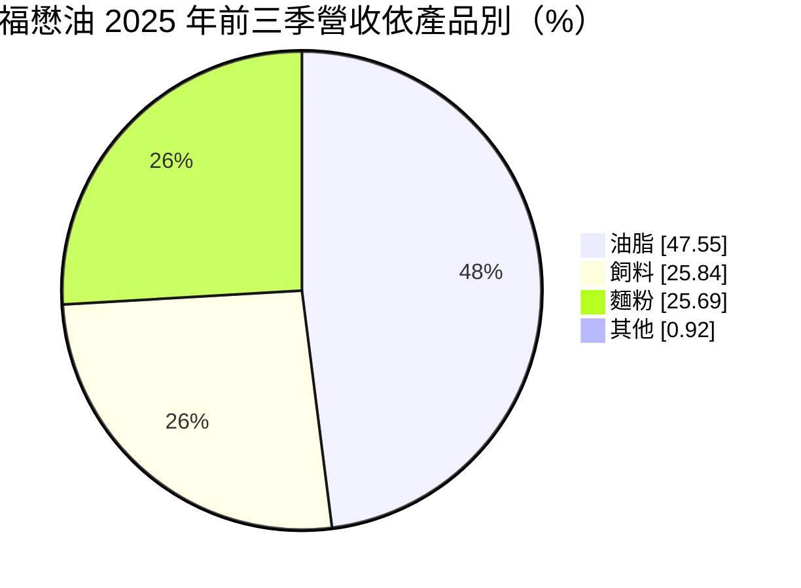
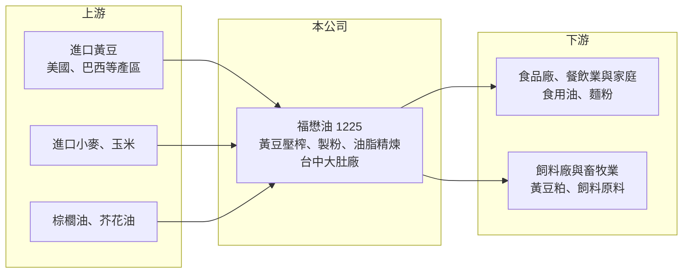

# 1225 福懋油

> 上市｜[[產業索引-食品工業|食品工業]]｜上市（櫃）日期 1993/09/27

# 第一章：企業模式與商業藍圖

> [!info] 撰寫說明
> 精簡版，由 Claude 依公開資料整理，架構比照 [[2330台積電]] 的四章研究，資料截至 2026-10-08。來源：證交所開放資料（基本資料、2026 年第二季綜合損益與資產負債、股利、每月營收、本益比殖利率）、MoneyDJ 理財網年度財務比率表、富果投研平台 2025 年 11 月法說會摘要。生產流程、原料來源、同業與客戶描述部分憑一般產業知識整理，尚未逐條比對原始文件；公開資料有限。#待校對

福懋油脂是台灣少數同時經營黃豆壓榨、飼料原料與麵粉的[[大宗物資]]加工廠，1986 年成立、1993 年上市，工廠位於台中大肚、鄰近台中港。本章說明它的產品如何從進口穀物轉成食用油、飼料與麵粉，以及收入來自哪裡。

- **核心業務：** 公司從國外進口黃豆、小麥與玉米等穀物，經[[黃豆壓榨]]產出食用油與黃豆粕，再把小麥磨成麵粉。黃豆壓榨的特性是一份原料同時產出兩種產品：約兩成成為黃豆油，約八成成為黃豆粕，前者賣給食品廠與家庭，後者是豬、雞[[飼料]]最主要的蛋白質來源（比例為產業常識，待校對）。因此福懋油的獲利不只看油價，也看豆粕價格，兩者的合計價值和黃豆成本之間的差距，就是壓榨廠的加工利潤。
- **營收結構：** 依 2025 年前三季法說資料，油脂（黃豆油、棕櫚油、芥花油）占營收 47.55%，飼料類（飼料原料、大麥片、玉米粉及一般進出口貿易）占 25.84%，麵粉（含麩皮、麵粉頭、小麥胚芽等副產品）占 25.69%。同期總銷售量約 57.5 萬公噸，其中油脂 19.5 萬公噸、飼料 21.9 萬公噸、麵粉 15.9 萬公噸，內銷量增加、外銷量明顯下滑。三大產品的平均售價都比前一年下降約 5% 至 6%，反映國際穀物價格回落。
- **營運據點：** 公司登記地址與主要工廠在台中市大肚區，靠近台中港，方便散裝穀物船直接卸貨進廠，這是穀物加工廠控制物流成本的關鍵（工廠與港口的關係為推估，待校對）。財報中有非控制權益，代表集團內有部分持股的子公司，其業務內容未查得。
- **長期方向：** 福懋油屬於成熟的民生產業，長期策略重點不在擴張，而在控制原料成本、降低負債與維持穩定的內銷通路。2025 年前三季公司償還約 10.6 億元銀行借款，籌資活動淨流出 21.8 億元，顯示管理層把去槓桿放在優先位置。外銷市場受全球需求疲弱影響，未來成長主要仰賴國內食品與畜牧業的穩定需求。

# 第二章：護城河深度與競爭優勢

大宗物資加工業的產品高度同質，很難靠品牌或技術拉開差距。本章分析福懋油在這種產業裡能依靠的優勢，以及它面對的競爭格局。

- **競爭優勢：** 福懋油的優勢主要是規模、地點與產品組合。黃豆壓榨與麵粉廠需要大型筒倉、碼頭物流與連續式產線，投資金額高、建廠審批不易，國內已經形成少數業者的寡占結構，新進者很難進入。工廠鄰近台中港可以降低進口穀物的內陸運費。同時經營油、粕、麵粉三種產品，讓公司在單一產品價格下跌時有一定的分散效果。這些條件構成的是窄護城河：它能保護市場地位，但無法讓公司長期享有高毛利。
- **主要對手：** 國內食用油與壓榨同業包括 [[1210大成]]、[[1219福壽]]、泰山企業，品牌油商則有 [[1227佳格]]、[[1216統一]] 等；麵粉同業包括 [[1229聯華]]、[[1210大成]] 等製粉廠；飼料領域則與 [[1215卜蜂]]、[[1220台榮]] 等飼料廠既競爭又互為客戶（同業名單憑產業常識整理，待校對）。此外，進口成品油與國外豆粕也會在價格上形成競爭。
- **觀察重點：** 長期而言，壓榨利潤（油與粕的價值減去黃豆成本）與[[原物料]]採購時點的掌握，決定了福懋油每年的獲利高低。觀察重點有三：一是毛利率能否維持在 2024 至 2025 年的 8% 至 10% 水準，而不是回到 2022 年的 6% 左右；二是外銷量能否止跌；三是負債比能否持續下降，讓公司在穀物價格大幅波動時有更多緩衝。

# 第三章：財務體質與盈利規模

資料日期：2026-10-08，表格是撰寫當時的快照；最新月營收、毛利率、累計 EPS 由自動排程寫在本筆記的屬性欄位（月營收、毛利率、累計EPS 等）。#待校對

大宗物資加工廠的財報特徵是營收大、毛利薄、受原料價格影響深。本章用 2020 年以來的資料，檢視福懋油在穀物價格起伏中的獲利穩定度與資本報酬。

| 年度 | 營收（新台幣） | [[毛利率]] | [[營業利益率]] | EPS（元） | [[ROE]] |
|---|---|---|---|---|---|
| 2020 | 約 113.1 億（推算） | 10.90% | 4.98% | 1.72 | 11.32% |
| 2021 | 約 145.2 億（推算） | 8.83% | 4.05% | 2.07 | 12.80% |
| 2022 | 約 169.2 億（推算） | 6.55% | 2.36% | 1.69 | 8.99% |
| 2023 | 約 153.4 億（推算） | 7.59% | 3.18% | 1.60 | 10.51% |
| 2024 | 約 135.7 億（推算） | 8.69% | 3.69% | 1.50 | 9.91% |
| 2025 | 約 120.6 億（推算） | 9.70% | 4.37% | 1.62 | 11.20% |
| 2026 上半年 | 62.28 億 | 6.72% | 1.63% | -0.65 | 未查得 |

註：年度營收以 MoneyDJ 每股營業額乘以股本 24.23 億元推算，與各年營收成長率互相吻合；2025 年前三季法說揭露營收 89.98 億元，與推算的全年數字一致。

- **營收規模：** 福懋油的營收主要由穀物價格決定，而不是銷售量。2021 至 2022 年國際黃豆與小麥價格大漲，營收從約 113 億元衝到約 169 億元；2023 年以後穀物價格回落，營收逐年下降到 2025 年的約 121 億元。2020 至 2025 年營收年複合成長率約 1.3%（推算），代表長期來看公司規模大致持平，營收的起伏多半是價格效果。
- **獲利：** 有趣的是，營收最高的 2022 年毛利率反而最低（6.55%），因為原料成本飆漲時售價調整有時間落差；穀物價格回落的 2025 年毛利率回升到 9.70%。EPS 長期穩定在每年 1.5 至 2.1 元之間，近 5 年（2021 至 2025）平均 ROE 約 10.7%（推算），對低毛利的加工業而言算是穩定。2026 年上半年則出現明顯變化：營業利益仍有 1.01 億元，但營業外損失約 2.05 億元，使稅前轉為虧損 1.03 億元、歸屬母公司淨損 1.58 億元，EPS -0.65 元；業外損失的具體原因未查得。
- **財務特色：** 2026 年第二季底總資產約 85.9 億元、總負債 43.2 億元、股東權益 42.7 億元（其中非控制權益 5.1 億元），負債比約 50%。負債比已從 2022 年的 59% 降到 2025 年的 46%，與公司償還銀行借款的方向一致。股利方面，公司章程規定每年以可供分配盈餘的 50% 以上分配股東紅利，但 2025 年度（EPS 1.62 元）董事會於 2026 年 9 月決議不配發現金股利，加上 2026 年上半年虧損，股利穩定度出現變數；過去年度的配息紀錄未查得。

**[[ROIC]] 與 [[WACC]]：** 以 2025 年營業利益率 4.37% 乘以營收約 120.6 億元，得營業利益約 5.27 億元，扣除 20% 稅率後稅後營業利益約 4.22 億元（推算）。有息負債金額未查得，若投入資本只算股東權益 42.7 億元，ROIC 約 9.9%；若把總負債 43.2 億元全部算入，投入資本 85.9 億元，ROIC 約 4.9%，因此 2025 年 ROIC 約在 5% 至 10%（推算）。WACC 用 CAPM 推估：無風險利率 1.75%、市場風險溢酬 6%、β 取食品業常見值 0.6，股東權益成本約 5.35%；負債成本假設 2.5%、稅後 2.0%，負債占資本約四成，WACC 約 4.0%（推算）。2025 年 ROIC 高於 WACC，代表在正常的穀物價格環境下，福懋油能為股東創造小幅的經濟價值；但 2026 年上半年營業利益年化僅約 2 億元，ROIC 降到約 2% 至 4%（推算），已接近或低於資金成本。低毛利產業的價值創造空間很窄，原料與匯率一有不利變動，利差就可能消失。

# 第四章：總體風險與地緣政治

福懋油的成本幾乎全部來自進口穀物，因此國際農產品市場、匯率與地緣政治是它最主要的風險來源。本章整理這些長期風險。

- **產業週期：** 黃豆、小麥與玉米價格受美國、巴西、阿根廷等主要產區的天氣、種植面積與全球需求影響，常出現一年內大漲大跌的情況。壓榨廠通常要提前數個月採購原料，如果採購後價格下跌，產品售價跟著下調，就會產生存貨跌價或毛利壓縮，2022 年的低毛利就是一例。這種週期無法消除，只能靠採購時點、避險操作與產品組合降低衝擊。
- **營運風險：** 第一是獲利波動與財務操作風險，2026 年上半年本業仍賺錢、卻因業外損失轉為虧損，顯示公司損益容易受到本業以外的因素影響，投資人需要持續追蹤業外項目的來源。第二是內需市場成熟，國內人口與肉品消費成長有限，食用油與麵粉需求很難大幅增加，外銷又受國際競爭影響。第三是股利政策的不確定性，2025 年度不配息與章程的配發原則不一致，原因需要以公司公告確認。
- **其他風險：** 匯率方面，原料以美元計價進口、產品多在國內以台幣銷售，新台幣貶值會直接推高成本。地緣政治與貿易政策方面，台美農產品採購承諾、美中貿易戰導致的黃豆流向變化，以及運輸航線（例如巴拿馬運河水位、紅海航運）受阻，都會影響原料取得成本與交期。法規方面，食品安全規範與食用油標示要求日趨嚴格，也會增加品管與合規成本。

# 專有名詞解析

## 產業

- **[[大宗物資]]**：以大量標準化方式交易的原物料，例如金屬、穀物與能源，價格隨國際行情波動。
- **[[黃豆壓榨]]**：把黃豆加熱、壓碎並萃取出油脂的加工程序，一份黃豆同時產出黃豆油與黃豆粕，兩者價值減去黃豆成本就是壓榨利潤。
- **[[飼料]]**：供畜禽與水產養殖使用的配合飼料，主要原料是玉米與黃豆粕，成本隨穀物行情變動。
- **[[原物料]]**：企業生產所需的基本材料，例如穀物、金屬、石化原料，價格波動會直接影響下游的成本與毛利。

# 核心供應鏈

- 上游：國際穀物貿易商與產地，主要原料為美國、巴西等地的黃豆，以及小麥、玉米、棕櫚油與芥花油；具體採購對象未查得，產地為產業常識，待校對。
- 下游／客戶：食用油與麵粉賣給食品加工廠、烘焙與餐飲業及一般家庭，代表性的國內食品業者有 [[1216統一]]、[[1201味全]]、[[1203味王]]、[[1702南僑]]；黃豆粕與飼料原料賣給飼料廠與畜牧業者，例如 [[1215卜蜂]]、[[1220台榮]]。上述公司是否為福懋油的直接客戶未查得。
- 同業：[[1210大成]]、[[1219福壽]]、[[1227佳格]]、[[1229聯華]]、泰山企業。

## 最新新聞
<!-- news:start（自動產生，請勿手動編輯此範圍） -->
- 2026-10-19 🏛️ 重訊 17:02｜公告本公司董事會決議召開一一五年股東常會事宜 (修正召集事由二)｜[觀測站](https://mops.twse.com.tw/mops/#/web/t05st01)
- 2026-10-19 🏛️ 重訊 17:02｜公告本公司資金貸與達 「公開發行公司資金貸與及背書保證處理準則」 第22條第1項第3款標準｜[觀測站](https://mops.twse.com.tw/mops/#/web/t05st01)
- 2026-10-07 🏛️ 重訊 17:18｜更正115年度第二季合併財務報表附表四｜[觀測站](https://mops.twse.com.tw/mops/#/web/t05st01)

完整紀錄：[[1225福懋油 新聞]]
<!-- news:end -->

## 相關連結
- [公開資訊觀測站](https://mopsov.twse.com.tw/mops/web/t05st03?step=1&firstin=1&co_id=1225)
- [Goodinfo](https://goodinfo.tw/tw/StockDetail.asp?STOCK_ID=1225)
- [Yahoo 股市](https://tw.stock.yahoo.com/quote/1225)
- [鉅亨網新聞](https://www.cnyes.com/twstock/1225/news)
