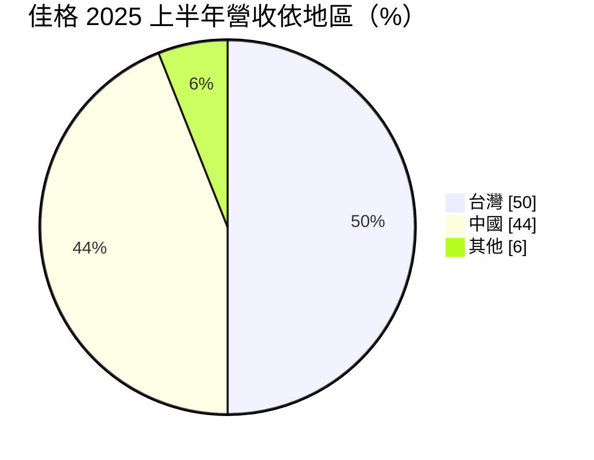
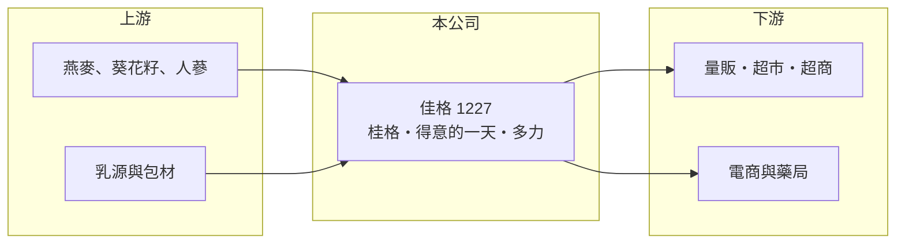

# 1227 佳格

> 上市｜[[產業索引-食品工業|食品工業]]｜上市（櫃）日期 1994/04/09

# 第一章：企業模式與商業藍圖

> [!info] 撰寫說明
> 精簡版，由 Claude 依公開資料整理，架構比照 [[2330台積電]]，資料截至 2026-10-08。來源：證交所開放資料（基本資料、2026 年上半年財報、股利）、Goodinfo 經營績效、富果 2025 年 10 月法說會備忘錄。#待校對

佳格是以「桂格」燕麥與「得意的一天」食用油起家的品牌食品公司，本章說明它的品牌組合與兩岸雙引擎的營收結構。

- **核心業務：** 佳格在台灣經營桂格（燕麥穀物、保健飲品）、得意的一天（食用油）、福樂（乳品）、天地合補與桂格康研家等品牌，在中國以多力食用油與樂奔拓營養品為主力。它的商業模式是[[品牌食品]]：把燕麥、葵花油、人蔘這類大宗原料加工成有品牌溢價的消費品，透過量販、超市與超商等[[通路]]銷售。
- **營收結構：** 依富果整理的 2025 年上半年資料，台灣（含佳乳）約占 50%、中國（上海佳格）約 44%、其他約 6%。這代表佳格的獲利同時受台灣保健食品需求與中國食用油價格戰影響，兩地景氣不同步時可以互相抵銷，但也讓管理難度較高。

- **營運據點：** 總部在台北內湖，實收資本額約 91.5 億元。台灣以保健食品與乳品為主，中國以上海佳格經營食用油與營養品，工廠與產能細節在本次來源中未查得。
- **長期方向：** 公司把策略分成三層：大宗原料（葵花、燕麥、人蔘）做[[垂直整合]]，健康食品作為獲利根基，再以機能食品與特殊營養、特醫食品爭取更高毛利。這條路線的意義在於把營收重心從價格競爭激烈的食用油，逐步移向較不易被比價的保健產品。

# 第二章：護城河深度與競爭優勢

佳格的護城河主要來自品牌認知與通路地位，但食用油這塊屬於同質化商品，護城河較淺。

- **競爭優勢：** 桂格在台灣燕麥與保健飲品類別經營數十年，消費者心中的品類代名詞地位很難被新品牌取代。品牌帶來貨架位置與議價力，也讓公司推出新的機能產品時較容易被接受。
- **主要對手：** 台灣保健與乳飲市場有 [[1216統一]]、[[1201味全]]、[[1707葡萄王]] 等；食用油有 1225福懋油、1232大統益 與泰山等，中國食用油則面對金龍魚、魯花等大型集團。中國油品市場規模大但集中度高，佳格屬於區域性品牌，在價格戰中較吃虧。
- **觀察重點：** 長期要看的是機能保健產品占比能否提高，以及中國食用油業務能否守住毛利。2021 年後營收從 343 億元降到 2025 年的 279 億元，代表規模擴張已停滯，品牌升級是否有效要從[[營業利益率]]能否回到 2021 年的 8% 以上來檢驗。

# 第三章：財務體質與盈利規模

資料日期：2026-10-08，表格是撰寫當時的快照；最新月營收、毛利率、累計 EPS 由自動排程寫在本筆記的屬性欄位（月營收、毛利率、累計EPS 等）。#待校對

佳格屬於營收大、利潤率薄的消費品公司，本章用五年數據檢視它的獲利品質與資本報酬。

| 年度 | 營收（億元） | [[毛利率]] | [[營業利益率]] | EPS（元） | [[ROE]] |
|---|---|---|---|---|---|
| 2021 | 343 | 24.0% | 8.69% | 2.70 | 13.7% |
| 2022 | 289 | 22.0% | 4.99% | 1.34 | 6.85% |
| 2023 | 278 | 22.6% | 4.89% | 1.35 | 7.14% |
| 2024 | 290 | 24.7% | 6.59% | 1.91 | 9.90% |
| 2025 | 279 | 24.6% | 4.72% | 1.33 | 6.56% |
| 2026 上半年 | 139.3 | 23.34% | 4.15% | 0.80 | 未查得 |

- **營收規模：** 2021 至 2025 年營收年複合成長率約 -5.0%（推算），主要是 2021 年高基期後回落。2026 年上半年營收 139.3 億元，與前幾年同期規模相近。
- **獲利：** 毛利率長期穩在 22% 至 25%，但營業利益率只有 5% 上下，代表行銷與通路費用吃掉大部分毛利，這是品牌食品的典型結構。近 5 年平均 ROE 約 8.8%（推算）。
- **財務特色：** 2025 年配發現金股利 1.34 元，幾乎等於當年 EPS 1.33 元，配息率接近 100%。2026 年第二季底股東權益約 185.8 億元、負債約 124.3 億元，負債以流動負債為主。
- **[[ROIC]] 與 [[WACC]]：** 以 2025 年營業利益約 13.2 億元（279 億元 × 4.72%）、稅率 20% 計，稅後營業利益約 10.5 億元；有息負債未查得，若假設為 0 至 60 億元，投入資本 186 億至 246 億元，ROIC 約 4% 至 6%（推算）。WACC 以無風險利率 1.75%、市場風險溢酬 6%、β 0.6（食品同業常見值）、稅後負債成本 1.6% 推估約 5%（推算）。ROIC 與 WACC 大致相當，代表近年本業只能勉強賺回資金成本，價值創造要靠利潤率回升。

# 第四章：總體風險與地緣政治

佳格的風險主要來自原物料價格、中國市場競爭與品牌老化，以下分項說明。

- **產業週期：** 食品需求本身穩定，但油脂、燕麥、乳品原料屬於國際大宗商品，價格波動會先反映在毛利率。食用油的售價調整通常落後成本，原料急漲時獲利會被壓縮。
- **營運風險：** 中國業務約占四成營收，當地食用油價格競爭激烈，且人民幣匯率變動會影響換算後的獲利。保健食品則面臨新品牌與電商通路的分流，品牌若無法持續創新，溢價會被侵蝕。
- **其他風險：** 保健食品宣稱受食品安全與健康食品法規規範，標示或成分爭議會直接傷害品牌信任。兩岸關係變化也可能影響中國子公司的營運與資金匯回。

# 專有名詞解析

## 產業

- **[[品牌食品]]**：以自有品牌銷售的加工食品，靠品牌認知換取高於代工的售價與毛利。
- **[[通路]]**：商品送到消費者手上的銷售管道，例如量販店、超市、便利商店與電商。
- **[[垂直整合]]**：企業同時掌握上游原料與下游製造、銷售，以降低成本或確保品質。
- **[[特醫食品]]**：特殊醫療用途配方食品，供特定疾病或營養需求者使用，須經主管機關查驗登記。

# 核心供應鏈

- 上游：燕麥、葵花籽、人蔘與乳源等農產原料，多數仰賴進口或契作。
- 下游／客戶：量販店、超市、便利商店（[[2912統一超]]、[[5903全家]]）與電商，中國則透過當地經銷與商超。
- 同業：[[1216統一]]、[[1201味全]]、[[1707葡萄王]]、1225福懋油、1232大統益。

## 最新新聞
<!-- news:start -->
<!-- news:end -->

## 相關連結
- [公開資訊觀測站](https://mopsov.twse.com.tw/mops/web/t05st03?step=1&firstin=1&co_id=1227)
- [Goodinfo](https://goodinfo.tw/tw/StockDetail.asp?STOCK_ID=1227)
- [Yahoo 股市](https://tw.stock.yahoo.com/quote/1227)
- [鉅亨網新聞](https://www.cnyes.com/twstock/1227/news)
