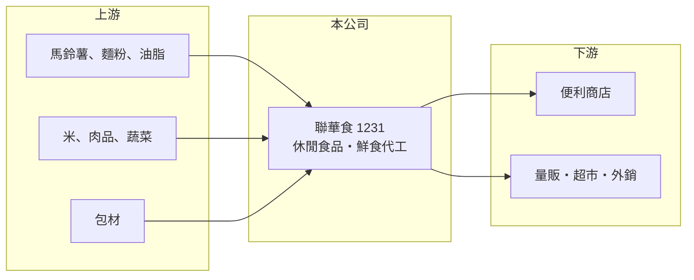

# 1231 聯華食

> 上市｜[[產業索引-食品工業|食品工業]]｜上市（櫃）日期 1995/11/02

# 第一章：企業模式與商業藍圖

> [!info] 撰寫說明
> 精簡版，由 Claude 依公開資料整理，架構比照 [[2330台積電]]，資料截至 2026-10-08。來源：證交所開放資料（基本資料、2026 年上半年財報、股利）、Goodinfo 經營績效、富果 2025 年 12 月法說會備忘錄。#待校對

聯華食品同時經營「可樂果、萬歲牌」等休閒零食品牌與便利商店鮮食代工，本章拆解這兩條業務線的商業邏輯。

- **核心業務：** 休閒食品事業部經營可樂果、萬歲牌、卡迪那、元本山、滿天星等自有品牌，屬於[[品牌食品]]模式。鮮食事業部替便利商店生產便當、飯糰等[[鮮食]]，屬於[[OEM]]代工模式，主要客戶是 [[2912統一超]]。
- **營收結構：** 2025 年前三季休閒食品約 44.4 億元、鮮食約 50.4 億元，鮮食規模已略大於零食。兩條線性質互補：零食毛利較高、可以長期累積品牌，鮮食量大、跟著超商展店與外食需求成長，但議價力在客戶手上。
- **營運據點：** 生產基地在台灣，法說資料提到嘉義與中壢廠區，休閒食品的觀音智慧化新廠預計 2026 年底完工，另規劃新型態鮮食廠。新廠代表公司在未來數年仍處於擴產期，產能足以支撐內銷與外銷需求。
- **長期方向：** 公司訂出「成長、精實、永續」三大策略，並推出自有冷凍調理品牌「荷卡廚坊料理所」。這一步的意義在於降低對單一超商客戶的依賴，把鮮食製造能力轉成自有品牌的產品。

# 第二章：護城河深度與競爭優勢

聯華食的護城河由經典品牌與超商供應鏈地位兩部分組成，但兩者的強度不同。

- **競爭優勢：** 可樂果、萬歲牌等品牌已有數十年歷史，在零食貨架上屬於消費者熟悉的老品牌，新品牌很難在短期內複製這種認知。鮮食方面，便利商店需要每日多次配送與嚴格的食安管理，能穩定供應的工廠不多，一旦進入供應體系就不容易被替換。
- **主要對手：** 零食市場有 [[1216統一]]、[[1201味全]] 旗下產品，以及樂事（百事）、華元、乖乖等品牌；鮮食代工則與其他超商協力廠競爭。進口零食與自有品牌（超商 PB 商品）也持續分食貨架。
- **觀察重點：** 長期要看自有冷凍品牌與外銷能否成長，讓鮮食業務不只依賴一家超商；以及觀音新廠完工後，折舊增加能否被產能利用率提升抵銷。ROE 長期維持在 16% 至 19%，若新廠後仍能守住，就代表護城河有效。

# 第三章：財務體質與盈利規模

資料日期：2026-10-08，表格是撰寫當時的快照；最新月營收、毛利率、累計 EPS 由自動排程寫在本筆記的屬性欄位（月營收、毛利率、累計EPS 等）。#待校對

聯華食是食品股中少數營收穩定成長、ROE 長期偏高的公司，本章用多年度數據說明。

| 年度 | 營收（億元） | [[毛利率]] | [[營業利益率]] | EPS（元） | [[ROE]] |
|---|---|---|---|---|---|
| 2021 | 95.2 | 23.1% | 9.94% | 4.03 | 18.8% |
| 2022 | 108 | 23.2% | 10.9% | 3.89 | 17.9% |
| 2023 | 109 | 21.0% | 8.38% | 3.93 | 17.7% |
| 2024 | 122 | 20.8% | 8.55% | 4.22 | 18.6% |
| 2025 | 129 | 20.4% | 8.86% | 3.81 | 16.5% |
| 2026 上半年 | 63.3 | 20.10% | 7.50% | 2.31 | 未查得 |

- **營收規模：** 2021 至 2025 年營收由 95.2 億元成長到 129 億元，年複合成長率約 7.9%（推算），主要由鮮食帶動。2026 年上半年營收 63.3 億元，延續成長。
- **獲利：** 毛利率從 23% 降到 20% 左右，反映毛利較低的鮮食比重上升；營業利益率仍維持在 8% 至 11%。近 5 年平均 ROE 約 17.9%（推算），在食品業屬於高水準。2026 年上半年業外收益約 3.0 億元，高於本業常態，評估時應以營業利益為準。
- **財務特色：** 2025 年度配發現金股利 1.5 元與股票股利 1 元，股本持續膨脹。2026 年第二季底股東權益約 75.2 億元、負債約 88.0 億元，其中非流動負債約 39.1 億元，推估與新廠建設融資有關。
- **[[ROIC]] 與 [[WACC]]：** 2025 年營業利益約 11.4 億元（129 億元 × 8.86%），稅後約 9.1 億元；有息負債未查得，假設 20 億至 40 億元，投入資本約 95 億至 115 億元，ROIC 約 8% 至 10%（推算）。WACC 以無風險利率 1.75%、市場風險溢酬 6%、β 0.6（食品同業常見值）、稅後負債成本 1.6%、負債占資本約兩至三成推估約 4.5% 至 5%（推算）。ROIC 明顯高於 WACC，代表公司長期在創造價值。

# 第四章：總體風險與地緣政治

聯華食的風險集中在客戶集中、原物料與擴產執行三方面。

- **產業週期：** 零食與鮮食屬於民生消費，景氣循環影響較小，但外食與超商來客數會隨就業與消費信心起伏。鮮食業務也受季節與天氣影響，炎熱或連假期間需求波動較大。
- **營運風險：** 鮮食高度依賴單一超商客戶，代工價格與合約條件由客戶主導，若客戶調整供應商分配，營收會立即受影響。觀音新廠與鮮食新廠若投產進度落後或稼動不足，折舊會壓低利潤率。
- **其他風險：** 馬鈴薯、麵粉、油脂與包材等原料價格上漲會壓縮毛利，基本工資調升也會推高鮮食這種勞力密集業務的成本。食安事件對品牌與代工資格都有連帶衝擊。

# 專有名詞解析

## 產業

- **[[品牌食品]]**：以自有品牌銷售的加工食品，靠品牌認知換取高於代工的售價與毛利。
- **[[鮮食]]**：便利商店販售的便當、飯糰、三明治等短效期即食食品，需要每日配送與冷鏈管理。
- **[[OEM]]**：原廠委託製造，代工廠依客戶規格生產並掛客戶品牌，自身不經營品牌。
- **[[自有品牌]]**：零售通路以自己名義推出的商品（PB），會與製造商品牌爭奪貨架。

# 核心供應鏈

- 上游：馬鈴薯、麵粉、油脂、米、肉品與包材，部分仰賴進口。
- 下游／客戶：[[2912統一超]]（鮮食代工主要客戶）、量販超市與外銷通路。
- 同業：[[1216統一]]、[[1201味全]]、[[1236宏亞]]，以及樂事、華元、乖乖等未上市品牌。

## 最新新聞
<!-- news:start -->
<!-- news:end -->

## 相關連結
- [公開資訊觀測站](https://mopsov.twse.com.tw/mops/web/t05st03?step=1&firstin=1&co_id=1231)
- [Goodinfo](https://goodinfo.tw/tw/StockDetail.asp?STOCK_ID=1231)
- [Yahoo 股市](https://tw.stock.yahoo.com/quote/1231)
- [鉅亨網新聞](https://www.cnyes.com/twstock/1231/news)
