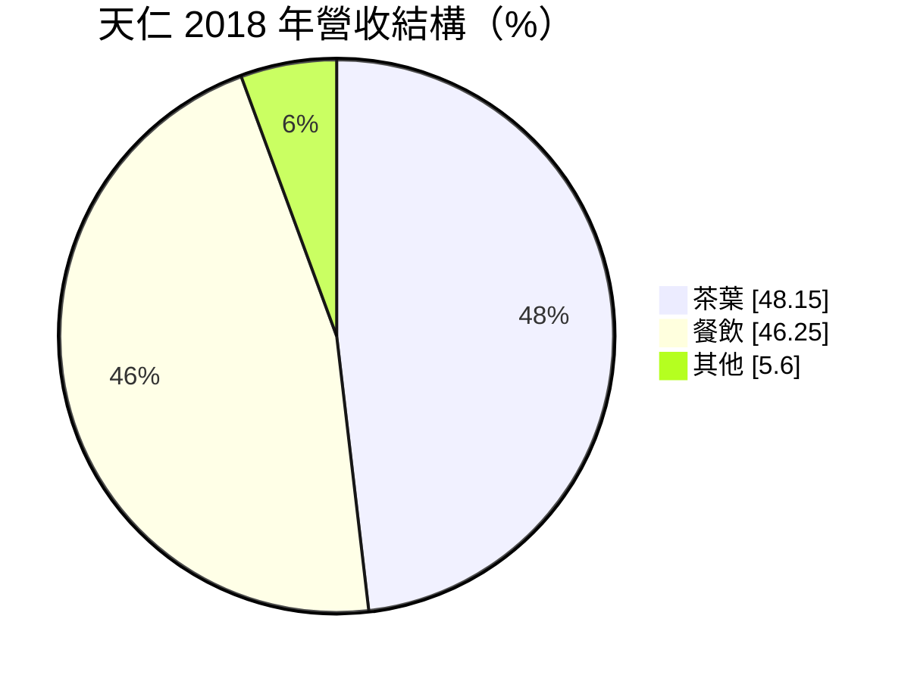
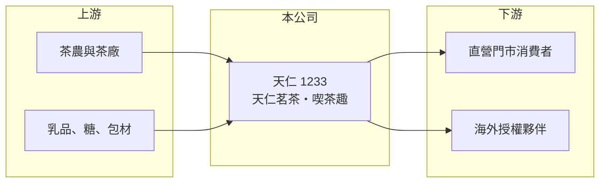

# 1233 天仁

> 上市｜[[產業索引-食品工業|食品工業]]｜上市（櫃）日期 1999/01/20

# 第一章：企業模式與商業藍圖

> [!info] 撰寫說明
> 精簡版，由 Claude 依公開資料整理，架構比照 [[2330台積電]]，資料截至 2026-10-08。來源：證交所開放資料（基本資料、2026 年上半年財報、股利）、Goodinfo 經營績效、StockFeel 公司介紹（2019 年資料）。公開資料有限，營收比重與門市數為舊資料。#待校對

天仁是台灣老字號的茶葉品牌公司，同時經營喫茶趣茶飲門市，本章說明它「賣茶葉加賣茶飲」的雙軌模式。

- **核心業務：** 天仁以天仁茗茶販售茶葉、茶食品與茶具，2000 年起發展喫茶趣茶飲品牌，後續再推出外帶型 ToGo 與搭配輕食的 CHAFFEE。它整合了茶葉的加工、品牌與零售，屬於[[品牌食品]]加[[連鎖加盟]]的混合模式。
- **營收結構：** 依 2018 年資料，茶葉約占 48%、餐飲約占 46%、其他約 6%，海外營收約占兩成。這個比重已是數年前的資料，近年餐飲比重可能更高（推估）。

- **營運據點：** 第一家門市 1961 年在台南開設，2018 年 7 月底國內門市 104 家、海外 130 家，海外自 2017 年起超過國內。海外以[[品牌授權]]為主，天仁收取授權金與原料銷售收入，不承擔當地門市的經營成本。
- **長期方向：** 台灣茶葉市場成熟後，公司把成長重心放在海外授權展店與餐飲業務。授權模式資本需求低，能讓品牌在國外擴張，但收入規模也受限於授權費率。

# 第二章：護城河深度與競爭優勢

天仁的護城河主要是品牌歷史與茶葉採購加工的經驗，但茶飲市場進入門檻低，競爭激烈。

- **競爭優勢：** 天仁經營茶葉超過一甲子，在禮盒茶與觀光客市場有高知名度，品牌本身就是取得授權合作的籌碼。毛利率長期接近 60%，顯示品牌與茶葉加工仍能維持溢價。
- **主要對手：** 茶葉市場分散，多為中小茶廠與個人茶行，上市公司中只有 [[2913農林]] 也賣茶。茶飲方面則面對 50嵐、清心福全、春水堂等大量手搖飲品牌，以及超商現煮茶飲。
- **觀察重點：** 毛利率雖高，營業利益率只有 1% 至 5%，代表門市人事與租金費用沉重。長期要看海外授權能否成為主要獲利來源，以及餐飲業務能否提升坪效與人效。

# 第三章：財務體質與盈利規模

資料日期：2026-10-08，表格是撰寫當時的快照；最新月營收、毛利率、累計 EPS 由自動排程寫在本筆記的屬性欄位（月營收、毛利率、累計EPS 等）。#待校對

天仁是「高毛利、低淨利」的典型零售型公司，本章用五年數據說明費用結構對獲利的影響。

| 年度 | 營收（億元） | [[毛利率]] | [[營業利益率]] | EPS（元） | [[ROE]] |
|---|---|---|---|---|---|
| 2021 | 17.7 | 55.9% | 0.84% | 0.48 | 2.93% |
| 2022 | 18.4 | 56.0% | 1.07% | 0.57 | 3.50% |
| 2023 | 21.1 | 57.9% | 4.83% | 1.06 | 6.44% |
| 2024 | 22.0 | 58.7% | 3.76% | 0.97 | 5.93% |
| 2025 | 21.6 | 59.8% | 3.27% | 0.75 | 4.81% |
| 2026 上半年 | 11.17 | 60.54% | 4.85% | 0.59 | 未查得 |

- **營收規模：** 營收由 2021 年 17.7 億元增加到 2025 年 21.6 億元，年複合成長率約 5.1%（推算），主要是疫情後門市來客回升。
- **獲利：** 毛利率逐年走高到 60% 上下，但營業費用（門市人事、租金、行銷）占營收五成以上，營業利益率僅 1% 至 5%。近 5 年平均 ROE 約 4.7%（推算），資本效率偏低。
- **財務特色：** 2025 年度配發盈餘現金股利 0.06 元，加上資本公積發放 0.14 元，合計 0.20 元，相對 EPS 0.75 元配發率不高。2026 年第二季底股東權益約 14.1 億元、負債約 7.9 億元，負債中可能有相當部分為門市[[租賃負債]]（推估）。
- **[[ROIC]] 與 [[WACC]]：** 2025 年營業利益約 0.71 億元（21.6 億元 × 3.27%），稅後約 0.57 億元；以股東權益 14.1 億元加上 0 至 4 億元有息負債計，ROIC 約 3% 至 4%（推算）。WACC 以無風險利率 1.75%、市場風險溢酬 6%、β 0.6（食品同業常見值）推估約 5%（推算）。ROIC 低於 WACC，代表目前本業報酬未能覆蓋資金成本，需要提高門市效率才能創造價值。

# 第四章：總體風險與地緣政治

天仁的風險主要來自零售業的成本壓力與茶飲市場的競爭。

- **產業週期：** 茶葉禮盒需求與觀光客流量、節慶送禮習慣相關，觀光客減少時門市銷售會明顯下滑。手搖飲市場則有流行週期，消費者口味轉換快。
- **營運風險：** 門市營運高度依賴人力，基本工資調升與店面租金上漲會直接壓縮利潤。海外授權門市的經營品質不在公司直接掌控內，加盟主經營不善可能傷害品牌。
- **其他風險：** 茶葉產量受氣候影響，台灣高山茶產量減少時採購成本上升。茶飲的農藥殘留與食安檢驗也是品牌型公司必須持續管理的項目。

# 專有名詞解析

## 金融

- **[[租賃負債]]**：企業租用店面等資產時，依會計準則把未來租金折現認列的負債。

## 產業

- **[[品牌食品]]**：以自有品牌銷售的加工食品，靠品牌認知換取高於代工的售價與毛利。
- **[[連鎖加盟]]**：品牌總部提供商標、配方與管理制度，由加盟主出資開店並支付加盟金或權利金。
- **[[品牌授權]]**：品牌方授權他人使用商標經營，收取授權金，本身不承擔當地營運成本。

# 核心供應鏈

- 上游：台灣與海外的茶農、茶廠，以及乳品、糖與包材供應商。
- 下游／客戶：國內直營門市的消費者與觀光客、海外授權合作夥伴。
- 同業：[[2913農林]]，以及 50嵐、春水堂等未上市茶飲品牌。

## 最新新聞
<!-- news:start -->
<!-- news:end -->

## 相關連結
- [公開資訊觀測站](https://mopsov.twse.com.tw/mops/web/t05st03?step=1&firstin=1&co_id=1233)
- [Goodinfo](https://goodinfo.tw/tw/StockDetail.asp?STOCK_ID=1233)
- [Yahoo 股市](https://tw.stock.yahoo.com/quote/1233)
- [鉅亨網新聞](https://www.cnyes.com/twstock/1233/news)
