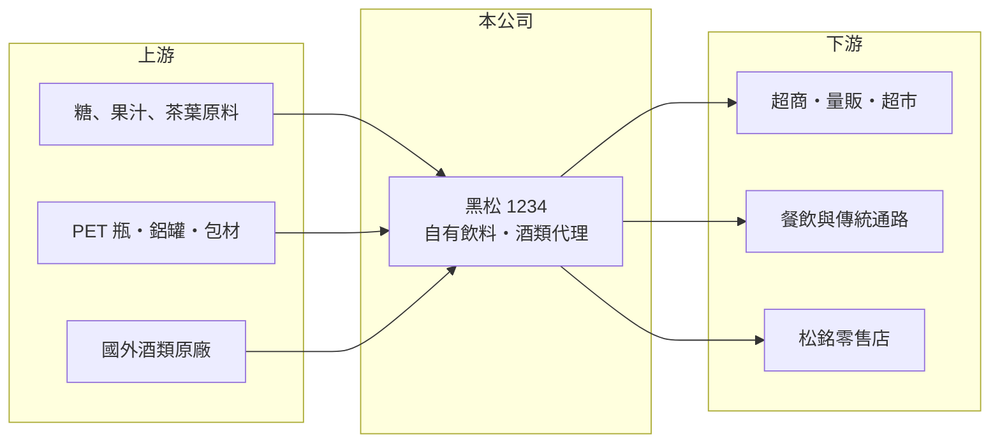

# 1234 黑松

> 上市｜[[產業索引-食品工業|食品工業]]｜上市（櫃）日期 1999/03/12

# 第一章：企業模式與商業藍圖

> [!info] 撰寫說明
> 精簡版，由 Claude 依公開資料整理，架構比照 [[2330台積電]]，資料截至 2026-10-08。來源：證交所開放資料（基本資料、2026 年上半年財報、股利）、Goodinfo 經營績效、富果 2026 年 6 月法說會備忘錄。產品別營收比重本次未查得。#待校對

黑松是台灣歷史最久的飲料品牌之一，同時代理酒類並持有大量不動產，本章說明這三塊資產如何構成它的商業模式。

- **核心業務：** 黑松自產黑松沙士、黑松汽水、茶飲與黑松人蔘精等飲料，同時代理立頓茶飲、金門高粱、CHOYA 梅酒等第三方品牌。自有品牌提供製造利潤，[[品牌代理]]則借用通路優勢賺取經銷利潤，兩者共用同一套業務與物流系統。
- **營收結構：** 產品別比重在本次來源中未查得，公司以飲料與酒類兩大類為主。2025 年底成立酒類零售店「松銘」，是公司首次直接面對消費者的零售嘗試。
- **營運據點：** 主要生產基地為中壢廠與斗六廠。2026 年第一季總資產約 240.8 億元，其中不動產與投資性不動產合計約 136.8 億元，超過總資產一半，土地資產是黑松資產負債表的核心。
- **長期方向：** 公司的長期主軸是智慧化生產降低成本、通路多元化，以及 2030 年較 2021 年減碳 20% 的目標。它的成長策略偏保守，重心放在守住既有品牌與提高代理品項的貢獻。

# 第二章：護城河深度與競爭優勢

黑松的護城河在於老品牌與遍及全台的通路網，但飲料市場成熟、成長空間有限。

- **競爭優勢：** 黑松沙士在台灣碳酸飲料類別有很高的品牌辨識度，長年在餐飲、傳統與現代通路都有鋪貨。完整的[[通路]]網讓國外酒類與飲料品牌願意委託代理，形成「通路吸引代理、代理再養通路」的循環。
- **主要對手：** 飲料市場有 [[1216統一]]、[[1201味全]]、[[1218泰山]]、[[1217愛之味]] 與太古可口可樂、金車等；酒類代理則面對眾多進口商與大型集團。超商自有品牌飲料也持續壓縮傳統品牌的貨架空間。
- **觀察重點：** 營業利益率由 2023 年的 6.8% 降到 2025 年的 4.4%，顯示本業獲利在下滑。長期要看代理品項能否補上自有飲料的成長缺口，以及閒置土地能否活化成穩定收入。

# 第三章：財務體質與盈利規模

資料日期：2026-10-08，表格是撰寫當時的快照；最新月營收、毛利率、累計 EPS 由自動排程寫在本筆記的屬性欄位（月營收、毛利率、累計EPS 等）。#待校對

黑松的財務特色是本業穩定、資產龐大而報酬率偏低，本章用五年數據說明。

| 年度 | 營收（億元） | [[毛利率]] | [[營業利益率]] | EPS（元） | [[ROE]] |
|---|---|---|---|---|---|
| 2021 | 92.2 | 27.8% | 6.57% | 1.98 | 4.40% |
| 2022 | 95.6 | 28.0% | 6.22% | 2.21 | 4.86% |
| 2023 | 106 | 28.0% | 6.79% | 2.36 | 5.13% |
| 2024 | 103 | 29.7% | 6.78% | 2.36 | 5.06% |
| 2025 | 95.1 | 29.1% | 4.38% | 2.00 | 4.27% |
| 2026 上半年 | 44.37 | 27.30% | 2.48% | 0.60 | 未查得 |

- **營收規模：** 營收維持在 90 億至 106 億元之間，2021 至 2025 年年複合成長率約 0.8%（推算），屬於成熟型消費品公司。
- **獲利：** 毛利率穩定在 28% 至 30%，營業利益率則從 6% 以上降至 2025 年的 4.4%，2026 年上半年只有 2.5%。近 5 年平均 ROE 約 4.7%（推算），低 ROE 主要是龐大不動產拉高了股東權益。2025 年第一季處分台南土地認列約 1.52 億元一次性利益，屬於非經常性收入。
- **財務特色：** 2025 年度配發現金股利 1.65 元，配息率約八成，股利穩定。2026 年第二季底股東權益約 184.4 億元、負債約 59.2 億元，財務結構保守，每股淨值約 45.9 元。
- **[[ROIC]] 與 [[WACC]]：** 2025 年營業利益約 4.2 億元（95.1 億元 × 4.38%），稅後約 3.3 億元；以股東權益 184.4 億元加上 0 至 20 億元有息負債計，ROIC 約 1.6% 至 1.8%（推算）。WACC 以無風險利率 1.75%、市場風險溢酬 6%、β 0.5（食品同業常見值偏低端）推估約 4.5% 至 5%（推算）。ROIC 明顯低於 WACC，代表大量資本被土地占用、本業報酬不足；股東價值較依賴資產重估與處分，而非經營本身。

# 第四章：總體風險與地緣政治

黑松的風險以本業獲利下滑與資產運用效率為主。

- **產業週期：** 飲料需求受天氣影響明顯，夏季與氣溫是銷量最大的變數；酒類則與節慶送禮與餐飲景氣連動。整體市場已成熟，人口結構老化也限制長期銷量。
- **營運風險：** 代理品牌的合約可能被原廠收回或轉給其他代理商，代理業務的穩定性不如自有品牌。新零售通路松銘需要投入店面與人力，若規模無法擴大，會拖累費用率。
- **其他風險：** 糖、果汁原料、PET 瓶與鋁罐價格波動會影響毛利，含糖飲料相關的健康法規或稅制若收緊，也會衝擊碳酸飲料。不動產價值雖高，但土地處分時點不固定，獲利因此難以預測。

# 專有名詞解析

## 金融

- **[[投資性不動產]]**：企業持有用來收租或等待增值、而非自用的土地與建物，在財報上單獨列示。

## 產業

- **[[品牌代理]]**：取得國外或第三方品牌在特定地區的銷售權，負責進口、行銷與配銷，賺取經銷利潤。
- **[[通路]]**：商品送到消費者手上的銷售管道，例如量販店、超市、便利商店與電商。

# 核心供應鏈

- 上游：糖、果汁與茶葉原料、PET 瓶與鋁罐等包材，以及委託代理的國外酒類與飲料原廠。
- 下游／客戶：[[2912統一超]]、[[5903全家]] 等超商，量販超市、餐飲與傳統通路，以及自營的松銘零售店。
- 同業：[[1216統一]]、[[1201味全]]、[[1218泰山]]、[[1217愛之味]]，以及太古可口可樂、金車等未上市公司。

## 最新新聞
<!-- news:start -->
<!-- news:end -->

## 相關連結
- [公開資訊觀測站](https://mopsov.twse.com.tw/mops/web/t05st03?step=1&firstin=1&co_id=1234)
- [Goodinfo](https://goodinfo.tw/tw/StockDetail.asp?STOCK_ID=1234)
- [Yahoo 股市](https://tw.stock.yahoo.com/quote/1234)
- [鉅亨網新聞](https://www.cnyes.com/twstock/1234/news)
