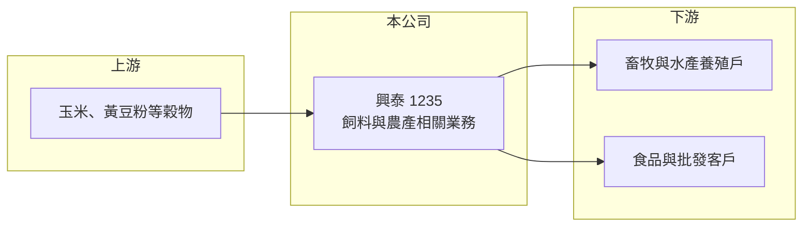

# 1235 興泰

> 上市｜[[產業索引-食品工業|食品工業]]｜上市（櫃）日期 2000/09/11

# 第一章：企業模式與商業藍圖

> [!info] 撰寫說明
> 精簡版，由 Claude 依公開資料整理，架構比照 [[2330台積電]]，資料截至 2026-10-08。來源：證交所開放資料（基本資料、2026 年上半年財報、股利）、Goodinfo 經營績效、nStock 公司簡介。公開資料有限，目前營收的實際組成未查得，內文對業務現況的描述多為推估。#待校對

興泰實業是一家登記以飼料製造為本業、但營收規模已非常小的老牌公司，本章說明它的業務登記與實際營運規模之間的落差。

- **核心業務：** 依公司登記與 nStock 簡介，興泰主要經營禽畜魚類[[飼料]]的製造加工與買賣，並涵蓋飼料原料與農產品採購、食品加工與冷凍冷藏、畜牧與水產養殖、倉儲等項目。實際上近年年營收只有 1 億元上下，規模遠小於一般飼料廠，顯示傳統飼料業務已大幅縮減（推估）。
- **營收結構：** 各業務別比重未查得。年營收從 2021 年約 0.41 億元增加到 2025 年約 1.76 億元，2026 年上半年約 0.93 億元，成長來源本次來源未說明。
- **營運據點：** 註冊地與主要營運據點在高雄市仁武區，1972 年設立，2000 年上市，實收資本額約 18.9 億元（公司基本資料），2025 年度另配發股票股利後股本約 19.8 億元。資本額相對營收很大，代表公司的價值主要在資產而非營業規模（推估）。
- **長期方向：** 公開資料未說明長期策略。觀察重點會是公司如何運用土地與轉投資等資產，以及營收成長是否來自可持續的新業務。

# 第二章：護城河深度與競爭優勢

以目前的營收規模，興泰在飼料市場沒有明顯的規模護城河，價值更接近資產型公司。

- **競爭優勢：** 長期存在的公司通常持有取得成本較低的土地與廠房，這是興泰較可能的價值來源（推估，未查得資產明細）。本業規模小，難以在原料採購與配銷上取得成本優勢。
- **主要對手：** 台灣飼料市場由 [[1210大成]]、[[1215卜蜂]]、[[1219福壽]]、[[1216統一]] 等大型業者主導，具備採購規模與一條龍畜牧整合。小型業者只能做區域或利基市場。
- **觀察重點：** 2026 年上半年營業利益為負，但業外收入約 0.40 億元使稅後轉為獲利，代表獲利主要依賴業外。長期要看本業能否轉正，以及資產活化是否有明確規劃。

# 第三章：財務體質與盈利規模

資料日期：2026-10-08，表格是撰寫當時的快照；最新月營收、毛利率、累計 EPS 由自動排程寫在本筆記的屬性欄位（月營收、毛利率、累計EPS 等）。#待校對

興泰的本業規模很小，EPS 主要受業外損益左右，本章數據需要以這個角度解讀。

| 年度 | 營收（億元） | [[毛利率]] | [[營業利益率]] | EPS（元） | [[ROE]] |
|---|---|---|---|---|---|
| 2021 | 0.41 | 37.5% | -12.6% | 0.81 | 2.48% |
| 2022 | 0.63 | 39.6% | 16.0% | 1.31 | 7.37% |
| 2023 | 0.76 | 27.7% | -6.92% | 1.10 | 4.71% |
| 2024 | 1.13 | 32.8% | -7.83% | 0.08 | -5.79% |
| 2025 | 1.76 | 27.5% | 2.77% | -0.03 | -2.72% |
| 2026 上半年 | 0.93 | 29.18% | -2.58% | 0.29 | 未查得 |

- **營收規模：** 營收 4 年間由 0.41 億元增加到 1.76 億元，年複合成長率約 44%（推算），但基期極低，絕對金額仍小。
- **獲利：** 營業利益率在正負之間擺盪，2021 年本業虧損時 EPS 仍有 0.81 元，顯示獲利主要來自業外（投資收益或資產處分，推估）。表中 2024 年 EPS 為正而 ROE 為負，可能與非控制權益或其他綜合損益有關，數字照 Goodinfo 原樣列出。近 5 年平均 ROE 約 1.2%（推算）。
- **財務特色：** 2025 年度在虧損下仍配發現金股利 0.5 元與股票股利 0.5 元，股利來自累積盈餘而非當年獲利。2026 年第二季底權益總計約 28.6 億元、負債約 22.7 億元，其中流動負債約 18.9 億元，負債相對營收偏高，用途未查得。
- **[[ROIC]] 與 [[WACC]]：** 2025 年營業利益約 0.05 億元（1.76 億元 × 2.77%），稅後約 0.04 億元，相對 28.6 億元以上的投入資本，ROIC 約 0.1%（推算），2026 年上半年本業虧損時則為負。WACC 以無風險利率 1.75%、市場風險溢酬 6%、β 0.6（同業常見值）推估約 4.5% 至 5%（推算）。ROIC 遠低於 WACC，本業並未創造價值，股東價值取決於資產與業外投資。

# 第四章：總體風險與地緣政治

興泰的風險主要在於資訊透明度與獲利來源不穩定。

- **產業週期：** 飼料業的成本由玉米、黃豆粉等國際穀物價格決定，價格大幅波動時小型業者較難轉嫁。若公司仍有畜牧或水產相關業務，也會受禽流感、豬瘟等疫情影響。
- **營運風險：** 本業規模小、獲利仰賴業外，EPS 年度間波動大，難以用本益比評估。負債以流動負債為主，若用途與營運無直接關聯，需要留意短期償債安排。
- **其他風險：** 公開揭露的業務資訊有限，投資人不易掌握營收成長的來源。在虧損年度配發股利，長期可能侵蝕保留盈餘。

# 專有名詞解析

## 金融

- **[[業外收入]]**：營業活動以外的收益，例如投資收益、利息、租金與資產處分利益，持續性通常低於本業。
- **[[非控制權益]]**：子公司中不屬於母公司股東的那部分權益，合併報表中與母公司權益分開列示。

## 產業

- **[[飼料]]**：供禽畜與水產養殖使用的配合飼料，主要原料為玉米與黃豆粉，成本受國際穀價影響。

# 核心供應鏈

- 上游：玉米、黃豆粉等進口穀物與飼料原料（依業務登記推估）。
- 下游／客戶：畜牧與水產養殖戶、食品批發客戶（依業務登記推估，實際客戶未查得）。
- 同業：[[1210大成]]、[[1215卜蜂]]、[[1219福壽]]、[[1216統一]]。

## 最新新聞
<!-- news:start（自動產生，請勿手動編輯此範圍） -->
- 2026-10-14 🏛️ 重訊 19:17｜公告本公司法人董事長代表人辭任｜[觀測站](https://mops.twse.com.tw/mops/#/web/t05st01)

完整紀錄：[[1235興泰 新聞]]
<!-- news:end -->

## 相關連結
- [公開資訊觀測站](https://mopsov.twse.com.tw/mops/web/t05st03?step=1&firstin=1&co_id=1235)
- [Goodinfo](https://goodinfo.tw/tw/StockDetail.asp?STOCK_ID=1235)
- [Yahoo 股市](https://tw.stock.yahoo.com/quote/1235)
- [鉅亨網新聞](https://www.cnyes.com/twstock/1235/news)
