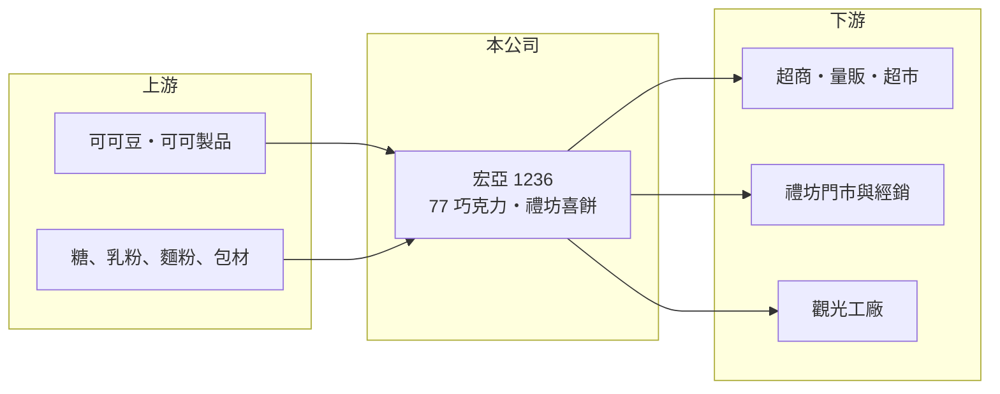

# 1236 宏亞

> 上市｜[[產業索引-食品工業|食品工業]]｜上市（櫃）日期 2001/09/17

# 第一章：企業模式與商業藍圖

> [!info] 撰寫說明
> 精簡版，由 Claude 依公開資料整理，架構比照 [[2330台積電]]，資料截至 2026-10-08。來源：證交所開放資料（基本資料、2026 年上半年財報、股利）、Goodinfo 經營績效、StockFeel 公司介紹（2019 年資料）。營收比重與門市數為舊資料。#待校對

宏亞是「77 乳加巧克力」與「新貴派」的品牌公司，旗下另有禮坊喜餅，本章說明它以國產巧克力品牌為核心的商業模式。

- **核心業務：** 宏亞以 77 乳加、新貴派、蜜蘭諾鬆塔、歐維氏等巧克力與餅乾產品為主力，屬於內銷型的[[品牌食品]]公司。1985 年設立禮坊跨入訂婚喜餅，2012 年成立巧克力觀光工廠，形成「零食品牌、喜餅、觀光」三條業務線。
- **營收結構：** 依 2019 年前後的資料，77 巧克力系列約占近七成銷售，禮坊次之，觀光服務最低，具體百分比未查得。近年公司也透過烘焙代工擴大產品類型（依新聞標題，年度未載，待校對）。
- **營運據點：** 總部位於新北市新店區，以內銷為主，通路涵蓋百貨、超市、便利商店與量販店。禮坊有直營門市與經銷商，2019 年資料為 19 家直營門市。
- **長期方向：** 公司策略偏向深耕既有品牌，而非大舉開發新市場，主要手法是與 [[2912統一超]]、[[5903全家]] 合作推出季節限定口味。喜餅市場隨結婚對數下降而萎縮，禮坊因此轉向生日、彌月與節慶零售。

# 第二章：護城河深度與競爭優勢

宏亞的護城河在於國產巧克力的品牌懷舊感與通路鋪貨，但在高價與送禮市場面對進口品牌強力競爭。

- **競爭優勢：** 77 乳加與新貴派在台灣有數十年的品牌記憶，屬於平價巧克力類別中辨識度最高的國產品牌之一。依舊資料，台灣巧克力市場約八成仰賴進口，其餘國產市場中 77 系列占大部分。
- **主要對手：** 進口品牌有金莎（Ferrero）、GODIVA、M&M's 等，在包裝質感與送禮市場較有優勢；喜餅則有郭元益、大黑松小倆口等。超商自有品牌與進口零食也持續分食平價市場。
- **觀察重點：** 營業利益率 2021 年後多為負值，顯示品牌溢價不足以覆蓋可可成本與營業費用。長期要看產品能否往高單價升級，以及代工業務能否提升工廠稼動率。

# 第三章：財務體質與盈利規模

資料日期：2026-10-08，表格是撰寫當時的快照；最新月營收、毛利率、累計 EPS 由自動排程寫在本筆記的屬性欄位（月營收、毛利率、累計EPS 等）。#待校對

宏亞近年本業多在損益兩平附近，本章用五年數據說明它的獲利困境。

| 年度 | 營收（億元） | [[毛利率]] | [[營業利益率]] | EPS（元） | [[ROE]] |
|---|---|---|---|---|---|
| 2021 | 17.6 | 25.8% | -2.77% | -0.25 | -1.46% |
| 2022 | 21.1 | 27.0% | 0.21% | 3.91 | 16.8% |
| 2023 | 19.3 | 27.8% | 0.68% | 0.16 | 0.59% |
| 2024 | 19.8 | 25.7% | -2.67% | -0.28 | -0.97% |
| 2025 | 18.1 | 25.3% | -2.35% | -0.43 | -1.45% |
| 2026 上半年 | 8.85 | 23.93% | -3.64% | -0.16 | 未查得 |

- **營收規模：** 營收在 17 億至 21 億元間波動，2021 至 2025 年年複合成長率約 0.7%（推算），屬於成熟停滯的規模。
- **獲利：** 毛利率約 25% 至 28%，但營業利益率多在 -3% 至 1% 之間，本業接近打平或虧損。2022 年 EPS 3.91 元、ROE 16.8% 明顯偏離本業水準，應來自業外一次性收益（推估，來源未說明）。近 5 年平均 ROE 約 2.7%（推算），扣除 2022 年則接近零。
- **財務特色：** 2025 年度在虧損下仍配發現金股利 1.65 元，股利來自過去的保留盈餘，長期不可持續。2026 年第二季底股東權益約 26.1 億元、負債約 9.6 億元，財務結構保守、沒有償債壓力。
- **[[ROIC]] 與 [[WACC]]：** 2025 年營業損失約 0.43 億元（18.1 億元 × -2.35%），投入資本約 26 億至 30 億元，ROIC 約 -1.4% 至 -1.6%（推算，虧損年度不計所得稅節省）。WACC 以無風險利率 1.75%、市場風險溢酬 6%、β 0.6（食品同業常見值）推估約 5%（推算）。ROIC 為負且遠低於 WACC，代表本業目前在消耗股東價值，扭轉關鍵在於成本轉嫁與產品升級。

# 第四章：總體風險與地緣政治

宏亞的風險集中在原料價格與內需市場萎縮兩方面。

- **產業週期：** 可可豆屬於國際大宗商品，價格受西非產區氣候與病害影響，波動幅度大，平價品牌很難快速漲價轉嫁。2018 年可可價格上漲近三成時，公司就需要靠新品與產品組合吸收成本。
- **營運風險：** 喜餅需求隨結婚對數減少而長期下滑，禮坊轉型零售的成效仍待觀察。觀光工廠與直營門市需要固定的人事與租金支出，營收不足時會放大虧損。
- **其他風險：** 糖、乳粉與包材價格上漲，以及基本工資調升，都會壓縮本來就偏低的利潤率。長期在虧損下配息，會逐步降低公司的保留盈餘緩衝。

# 專有名詞解析

## 產業

- **[[品牌食品]]**：以自有品牌銷售的加工食品，靠品牌認知換取高於代工的售價與毛利。
- **[[可可豆]]**：巧克力的主要原料，產地集中在西非，價格受氣候與病害影響波動劇烈。
- **[[觀光工廠]]**：開放參觀並結合體驗、販售的工廠，兼具品牌行銷與門市銷售功能。

# 核心供應鏈

- 上游：可可豆與可可製品、糖、乳粉、麵粉與包材。
- 下游／客戶：[[2912統一超]]、[[5903全家]] 等超商與量販超市，禮坊門市與經銷商，觀光工廠遊客。
- 同業：[[1231聯華食]]、[[1216統一]]，以及金莎、GODIVA、郭元益等未在台上市品牌。

## 最新新聞
<!-- news:start（自動產生，請勿手動編輯此範圍） -->
- 2026-10-16 🏛️ 重訊 17:00｜代子公司可頌食品股份有限公司公告處分觀音廠之土地及廠房｜[觀測站](https://mops.twse.com.tw/mops/#/web/t05st01)

完整紀錄：[[1236宏亞 新聞]]
<!-- news:end -->

## 相關連結
- [公開資訊觀測站](https://mopsov.twse.com.tw/mops/web/t05st03?step=1&firstin=1&co_id=1236)
- [Goodinfo](https://goodinfo.tw/tw/StockDetail.asp?STOCK_ID=1236)
- [Yahoo 股市](https://tw.stock.yahoo.com/quote/1236)
- [鉅亨網新聞](https://www.cnyes.com/twstock/1236/news)
