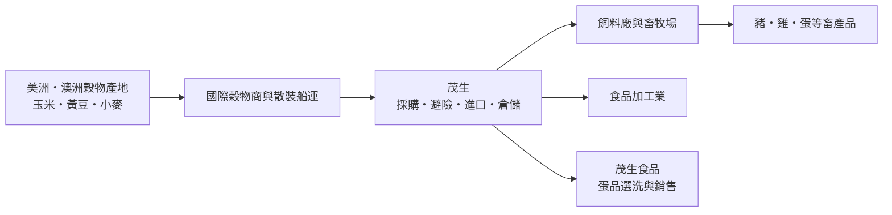
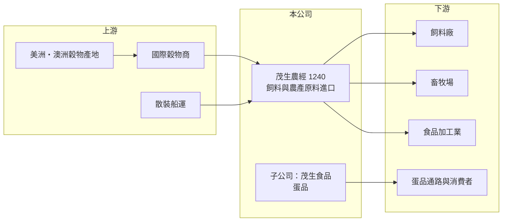

# 1240 茂生農經

> 上櫃｜[[產業索引-農業科技業|農業科技業]]｜上市（櫃）日期 2018/08/08

# 第一章：企業模式與商業藍圖

> [!info] 撰寫說明
> 本文由 Claude 依公開資料整理，架構比照 [[2330台積電]] 的四章研究，資料截至 2026-10-08。財務數字來源：Goodinfo 年度經營績效頁、nStock 公司簡介、櫃買中心開放資料（基本資料、2026 年第二季資產負債與綜合損益、本益比殖利率）；產品線比重與產能未查得，業務描述部分憑記憶整理。公開資料有限。#待校對

茂生農經（股票代號：1240，以下簡稱茂生）是一家把穀物從美洲、澳洲運到台灣飼料廠的公司。本章說明這種[[大宗物資]]貿易如何賺錢，以及為什麼它的獲利會隨穀物價格與航運大起大落。

## 一、核心定位：飼料原料與農產原料的進口商

茂生成立於 1967 年，原名茂生飼料，2016 年 12 月更名為茂生農經，2018 年 8 月在櫃買中心上櫃，實收資本額約 4.64 億元，董事長兼總經理為吳清德。登記的主要業務包括各項[[飼料]]及其原料的製造、加工與買賣並提供運輸服務；米穀、麵粉、黃豆、大小麥、什糧等農產原料的買賣；以及家畜禽飼育。

依記憶，茂生的核心是替台灣的飼料廠與畜牧業者進口玉米、黃豆粉、小麥等飼料原料，扮演採購、融資、船運與倉儲的中間角色（待校對）。台灣的飼料原料幾乎全部仰賴進口，飼料廠需要有人在國際市場找貨源、安排船期、處理避險與通關，這就是茂生的商業價值。

## 二、產品線與事業延伸

公開資料未查得茂生的營收比重與產能。依登記業務與公司沿革，可分為：

* **飼料原料貿易：** 進口玉米、黃豆粉、小麥、什糧等，銷售給飼料廠與畜牧場，是營收主體（推估）。
* **農產原料：** 米穀、麵粉、黃豆等食品加工原料的買賣。
* **蛋品事業：** 2019 年 8 月設立子公司茂生食品，拓展家畜禽飼育、農畜產品與蛋類選洗包裝銷售。這是茂生從「賣原料給畜牧業」往下游延伸到「自己生產與銷售農產品」的布局，2026 年第二季底合併報表中有約 0.62 億元的非控制權益，反映子公司有其他股東參與。

## 三、資本轉化邏輯

* **低毛利、高周轉：** 大宗物資貿易的[[毛利率]]通常只有一成上下，茂生 2018 至 2025 年毛利率在 8% 至 15% 之間。獲利來自交易量、價差管理與周轉速度。
* **營運資金密集：** 進口一船穀物需要先付款、後收款，需要大量短期融資。2026 年第二季底流動負債約 7.0 億元，推估包含進口融資的短期借款。
* **業外收益重要：** 茂生的稅後淨利常高於營業利益，2025 年營業利益 1.33 億元、稅後淨利 2.15 億元，2026 上半年業外收入約 0.54 億元，推估來自投資收益或匯兌與避險損益（具體來源未查得）。

## 四、長期方向

台灣人口與肉品消費大致穩定，飼料原料的總需求成長有限，茂生的長期價值在於：一是維持穩定的貿易量與客戶關係，二是往蛋品等下游延伸以提高附加價值，三是透過避險與物流管理降低價格波動的衝擊。2026 年 1 至 9 月累計營收約 22.18 億元、年增約 8%（nStock），顯示貿易量仍有成長。

# 第二章：護城河深度與競爭優勢

大宗物資貿易商的護城河不深，競爭力來自客戶關係、物流效率與風險管理。本章分析茂生的競爭位置。

## 一、護城河的組成

* **長期客戶關係與信用：** 飼料廠需要穩定、準時的原料供應，長期往來的進口商熟悉客戶的配方需求與付款習慣，彼此互信。茂生近六十年的歷史累積了這種關係。
* **物流與倉儲能力：** 散裝穀物的船期安排、港口卸貨與倉儲，需要經驗與設施，新進業者難以短期建立。
* **風險管理：** 穀物價格、運費與匯率每天波動，能否透過期貨與遠期外匯避險、控制庫存，決定貿易商能否在波動中活下來。

## 二、主要競爭對手

| 對手 | 定位 | 與茂生的比較 |
|---|---|---|
| [[1210大成]]、[[1215卜蜂]]、[[1219福壽]]、[[1220台榮]] | 一條龍飼料與畜產公司 | 規模大，自行進口原料，也是潛在客戶 |
| 1232大統益 | 黃豆壓榨與黃豆粉 | 國產黃豆粉的主要供應者，在黃豆粉市場互相替代 |
| 國際穀物商（如 ADM、Bunge、Cargill） | 全球穀物貿易 | 掌握產地與船運，可直接賣給大型飼料廠 |
| 其他台灣穀物進口商與聯合採購組織 | 飼料原料進口 | 在中小型飼料廠市場競爭 |

## 三、守得住與守不住

* **守得住：** 中小型飼料廠與畜牧業者的穩定供應關係，以及蛋品等下游事業的在地市場。
* **守不住：** 價差。穀物價格由國際市場決定，茂生無法掌控，只能管理風險。
* **觀察重點：** 毛利率能否穩定在 13% 以上、蛋品事業的獲利貢獻，以及業外收益的穩定性。

# 第三章：財務體質與盈利規模

資料日期：2026-10-08，表格是撰寫當時的快照；最新月營收、毛利率、累計 EPS 由自動排程寫在本筆記的屬性欄位（月營收、毛利率、累計EPS 等）。#待校對

大宗物資貿易商的財報要特別注意兩件事：營收受穀物價格影響而大起大落，以及獲利中本業與業外的比重。

## 一、多年度財務表

| 年度 | 營收（新台幣） | [[毛利率]] | [[營業利益率]] | EPS（元） | [[ROE]] |
|---|---|---|---|---|---|
| 2021 | 30.0 億 | 10.7% | 2.93% | 3.57 | 8.27% |
| 2022 | 33.7 億 | 8.24% | 0.79% | 0.14 | -1.41% |
| 2023 | 29.1 億 | 11.9% | 4.31% | 4.12 | 9.95% |
| 2024 | 28.6 億 | 13.9% | 5.38% | 4.34 | 11.4% |
| 2025 | 27.4 億 | 14.3% | 4.83% | 4.86 | 13.6% |
| 2026 上半年 | 14.41 億 | 15.2% | 6.1% | 2.85 | 未查得 |

資料來源：Goodinfo；2026 上半年為櫃買中心開放資料。2022 年 ROE 為負但 EPS 為正，依 Goodinfo 原始數字照列，可能與合併範圍或其他綜合損益有關，以年報為準。

* **2022 年的教訓：** 2022 年俄烏戰爭推升穀物價格與運費，營收創新高到 33.7 億元，但毛利率跌到 8.24%、營業利益率只剩 0.79%，EPS 只有 0.14 元。這說明營收高不代表賺錢，價格劇烈波動時貿易商反而承受最大壓力。
* **2023 年後回穩：** 穀物價格回落後，毛利率逐年回升到 14% 以上，EPS 回到 4 元以上。
* **營收長期持平：** 2020 至 2025 年營收年複合成長率約 3.7%（推算），主要反映穀物價格變動，而非交易量的大幅成長。
* **配息：** Goodinfo 統計 2017 至 2026 年一般平均現金股利約 2.14 元，配息穩定。

## 二、ROE 與長期指標

2021 至 2025 年平均 ROE 約 8.4%（推算），2025 年回升到 13.6%。茂生的 ROE 有相當部分來自業外收益，評估本業時應以營業利益為準。2026 年第二季底權益總計約 15.6 億元、負債約 7.5 億元，負債比約 33%，財務結構穩健。

## 三、[[ROIC]] 與 [[WACC]]

**ROIC 推算：** 2025 年營業利益 1.33 億元，扣除 20% 稅率後約 1.06 億元。2026 年第二季底權益總計約 15.62 億元；有息負債未查得，假設流動負債中約 4 億至 6 億元為進口融資借款（推估），投入資本約 19.6 億至 21.6 億元，ROIC 約 5%（推算）。若把業外收益計入報酬，整體資本報酬接近 ROE 的 10% 至 13%（推估）。

**WACC 推算：** 台灣 10 年期公債殖利率假設 1.75%、市場風險溢酬 6%、β 取食品與大宗物資業常見值 0.7（同業估計值），股東權益成本約 5.95%；負債成本假設 2.5%、稅後 2.0%，權益約占 72% 至 80%，WACC 約 4.8% 至 5.2%（推算）。

**結論：** 只看本業，茂生的 ROIC 約與 WACC 打平；把業外收益計入後則高於資金成本。這代表茂生的本業屬於「維持價值」的貿易生意，股東報酬有一部分仰賴業外收益與穩定配息。

# 第四章：總體風險與地緣政治

大宗物資貿易商的風險主要來自價格、運費與匯率三者同時波動。本章整理茂生的長期風險。

## 一、產業週期

* **穀物價格循環：** 玉米、黃豆、小麥價格受天候、產地政策與能源價格影響，劇烈上漲時貿易商的毛利與資金需求同時承壓，2022 年即是例子。
* **畜牧業景氣：** 豬價、雞價、蛋價與禽流感、非洲豬瘟等疫情，會影響飼料需求與客戶的付款能力。

## 二、營運風險

* **價格與庫存風險：** 穀物從下單到抵台需要數週，期間價格變動若未避險，可能產生庫存損失。
* **客戶信用：** 中小型飼料廠與畜牧場的財務體質不一，景氣差時應收帳款風險上升。
* **蛋品事業：** 蛋價受季節、疫情與政府政策影響大，下游延伸可能帶來新的波動來源。

## 三、其他風險

* **匯率：** 進口以美元計價，新台幣貶值會提高進口成本，若無法即時轉嫁會壓縮毛利。
* **運費：** 散裝船運價波動劇烈，影響到岸成本。
* **地緣政治與貿易政策：** 美中貿易爭端、產地國出口限制與台灣農產品進口政策，可能改變貨源與價格。
* **氣候變遷：** 主要產地的乾旱或洪水，會讓穀物價格出現更頻繁的劇烈波動。

# 專有名詞解析

## 金融

- **[[毛利率]]**：營業毛利占營收的比例，反映產品定價能力與生產成本控制。
- **[[營業利益率]]**：扣除營業費用後的營業利益占營收的比例，衡量本業整體獲利能力。
- **[[ROE]]**：股東權益報酬率，稅後淨利除以股東權益，衡量公司運用股東資金的效率。
- **[[ROIC]]**：投入資本報酬率，稅後營業利益除以股東權益與有息負債的合計，衡量本業對所有資金提供者的報酬。
- **[[WACC]]**：加權平均資金成本，依股東權益與負債的比重加權計算的資金成本，ROIC 高於它才代表創造價值。

## 產業

- **[[大宗物資]]**：玉米、黃豆、小麥等以大量、標準化方式交易的原物料，價格由國際市場決定。
- **[[飼料]]**：供畜禽與水產養殖的食物，台灣的飼料原料玉米與黃豆粉幾乎全部仰賴進口。
- **[[黃豆粉]]**：黃豆榨油後剩下的粕，蛋白質含量高，是畜禽飼料的主要蛋白質來源。
- **[[散裝航運]]**：以散裝船運送穀物、鐵礦、煤炭等不需包裝貨物的海運，運價波動大。

# 核心供應鏈

## 1. 上游：產地與物流
- 美國、巴西、阿根廷、澳洲等穀物產地與國際穀物商
- 散裝船運業者

## 2. 中游：茂生與同業
- 飼料與畜產一條龍同業（亦為潛在客戶）：[[1210大成]]、[[1215卜蜂]]、[[1219福壽]]、[[1220台榮]]
- 黃豆壓榨：1232大統益

## 3. 下游：客戶
- 飼料廠、畜牧場與食品加工業者
- 蛋品通路與消費者（茂生食品）

## 最新新聞
<!-- news:start -->
<!-- news:end -->

## 相關連結
- [公開資訊觀測站](https://mopsov.twse.com.tw/mops/web/t05st03?step=1&firstin=1&co_id=1240)
- [Goodinfo](https://goodinfo.tw/tw/StockDetail.asp?STOCK_ID=1240)
- [Yahoo 股市](https://tw.stock.yahoo.com/quote/1240)
- [鉅亨網新聞](https://www.cnyes.com/twstock/1240/news)
