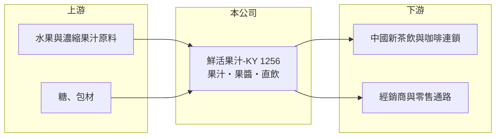

# 1256 鮮活果汁-KY

> 上市｜[[產業索引-食品工業|食品工業]]｜上市（櫃）日期 2016/03/17

# 第一章：企業模式與商業藍圖

> [!info] 撰寫說明
> 精簡版，由 Claude 依公開資料整理，架構比照 [[2330台積電]]，資料截至 2026-10-08。來源：證交所開放資料（基本資料、2026 年上半年財報、股利）、Goodinfo 經營績效、優分析 2026 年 9 月營收報導。產品別營收比重與主要客戶名單本次未查得，業務描述部分依記憶整理。#待校對

鮮活果汁-KY 是替中國[[新茶飲]]連鎖品牌供應果汁、果醬等原料的食品廠，本章說明它在手搖飲供應鏈中的位置。

- **核心業務：** 鮮活果汁生產濃縮果汁、果漿、果醬與糖漿等飲品原料，主要賣給茶飲、咖啡與餐飲連鎖店，屬於 B2B 的[[餐飲原物料]]供應商（依記憶，待校對）。近年再推出可直接飲用的預包裝[[直飲]]產品，成為新的成長動能。
- **營收結構：** 產品別比重未查得。依優分析報導，2026 年直飲產品占營收比重提高，並透過經銷商擴大銷售，代表公司正從單純的原料供應延伸到終端消費品。
- **營運據點：** 為開曼註冊的 KY 公司，主要生產基地在中國江蘇昆山（依記憶，待校對）。2026 年昆山二期智能廠投產，新增年產能 2 萬噸，配合自動化產線、智能倉儲與物流系統。
- **長期方向：** 公司跟著中國新茶飲市場朝細分化、多元化與健康化發展，主打客製化、小批量、多品項與 3 至 5 天快速出貨。這套模式的價值在於茶飲品牌更新菜單快，需要能快速開發新口味的原料夥伴。

# 第二章：護城河深度與競爭優勢

鮮活果汁的護城河在於研發配方與快速交貨能力，但它的成長高度綁定中國茶飲連鎖的展店週期。

- **競爭優勢：** 茶飲品牌每年推出大量季節限定口味，原料供應商需要同時具備配方開發、小批量生產與穩定品質，能做到的廠商有限。新廠的自動化與倉儲物流讓交期縮短，客戶一旦把配方交給鮮活生產，轉換供應商會牽涉口味重新調整，形成一定的[[轉換成本]]。
- **主要對手：** 主要對手是中國當地的果汁與飲品原料廠，以及大型茶飲品牌自建的供應鏈（例如部分頭部品牌自建果園或工廠）。在台灣上市的同類型公司較少，[[1702南僑]]、[[1264德麥]] 屬於烘焙與餐飲原料，業務部分相近。
- **觀察重點：** 2024 年營業利益率降到 9.3%，2026 年上半年回升到 16.7%，顯示獲利對產能利用率與客戶結構敏感。長期要看直飲產品能否建立自己的品牌，以及頭部茶飲客戶集中度的變化。

# 第三章：財務體質與盈利規模

資料日期：2026-10-08，表格是撰寫當時的快照；最新月營收、毛利率、累計 EPS 由自動排程寫在本筆記的屬性欄位（月營收、毛利率、累計EPS 等）。#待校對

鮮活果汁股本小、獲利率高，EPS 數字因此偏大，本章用五年數據檢視它的獲利循環。

| 年度 | 營收（億元） | [[毛利率]] | [[營業利益率]] | EPS（元） | [[ROE]] |
|---|---|---|---|---|---|
| 2021 | 45.8 | 36.2% | 21.6% | 20.94 | 21.1% |
| 2022 | 41.0 | 28.5% | 13.5% | 11.92 | 11.4% |
| 2023 | 46.3 | 28.1% | 12.2% | 12.41 | 11.4% |
| 2024 | 40.0 | 25.4% | 9.31% | 8.56 | 7.71% |
| 2025 | 41.2 | 27.7% | 11.9% | 11.19 | 10.4% |
| 2026 上半年 | 26.48 | 32.12% | 16.65% | 8.98 | 未查得 |

- **營收規模：** 2021 至 2025 年營收在 40 億至 46 億元間，年複合成長率約 -2.6%（推算）。2026 年上半年營收 26.5 億元，昆山二期新產能投產後營收回到成長軌道。
- **獲利：** 毛利率從 2021 年的 36% 降到 2024 年的 25%，再回升到 2026 年上半年的 32%，反映中國茶飲市場價格競爭與原料成本的變化。近 5 年平均 ROE 約 12.4%（推算）。
- **財務特色：** 2025 年度配發現金股利 6.6 元，配息率約 59%。2026 年第二季底股東權益約 42.1 億元、負債約 15.8 億元，以流動負債為主，財務結構穩健。
- **[[ROIC]] 與 [[WACC]]：** 2025 年營業利益約 4.9 億元（41.2 億元 × 11.9%），以 20% 稅率計稅後約 3.9 億元（中國企業所得稅率 25%，實際會略低）；投入資本以股東權益 42.1 億元加 0 至 8 億元有息負債計，ROIC 約 8% 至 9%（推算）。WACC 以無風險利率 1.75%、市場風險溢酬 6%、β 0.8（考量 KY 股與中國消費曝險，高於一般食品股）推估約 6% 至 6.5%（推算）。ROIC 高於 WACC，屬於溫和創造價值，2026 年獲利回升後差距擴大。

# 第四章：總體風險與地緣政治

鮮活果汁的風險集中在中國消費市場與原料價格。

- **產業週期：** 中國新茶飲經歷高速展店後進入整併期，品牌間價格戰會轉嫁到原料供應商的報價。茶飲需求有明顯季節性，夏季是旺季，冬季營收較低。
- **營運風險：** 營收依賴中國茶飲連鎖品牌，若頭部客戶自建工廠或轉單，會直接影響營收。新產能投產後若需求不如預期，折舊會壓低利潤率。
- **其他風險：** 水果原料受氣候與產季影響，價格與品質波動大。KY 公司的營運資產在中國，需留意兩岸關係、人民幣匯率與資金匯回的限制。

# 專有名詞解析

## 產業

- **[[新茶飲]]**：使用鮮奶、新鮮水果與原葉茶調製的現製茶飲，中國代表品牌有喜茶、蜜雪冰城、霸王茶姬等。
- **[[餐飲原物料]]**：供餐飲店與連鎖品牌使用的原料，例如果醬、糖漿、預拌粉，以 B2B 方式銷售。
- **[[直飲]]**：可直接飲用的預包裝飲品，屬於終端消費品，不需店家再調製。
- **[[轉換成本]]**：客戶更換供應商時需要付出的時間、金錢與風險，轉換成本越高，供應商地位越穩。

# 核心供應鏈

- 上游：各地水果與濃縮果汁原料、糖與包材供應商。
- 下游／客戶：中國新茶飲、咖啡與餐飲連鎖品牌，以及直飲產品的經銷商與零售通路。
- 同業：[[1702南僑]]、[[1264德麥]]（餐飲與烘焙原料），以及中國當地飲品原料廠。

## 最新新聞
<!-- news:start（自動產生，請勿手動編輯此範圍） -->
- 2026-10-12 📰 媒體 18:19｜旺季熱度高+新產能加入 鮮活果汁-KY第3季營收18.3億元登頂｜[鉅亨網](https://news.cnyes.com/news/id/6628198)

完整紀錄：[[1256鮮活果汁-KY 新聞]]
<!-- news:end -->

## 相關連結
- [公開資訊觀測站](https://mopsov.twse.com.tw/mops/web/t05st03?step=1&firstin=1&co_id=1256)
- [Goodinfo](https://goodinfo.tw/tw/StockDetail.asp?STOCK_ID=1256)
- [Yahoo 股市](https://tw.stock.yahoo.com/quote/1256)
- [鉅亨網新聞](https://www.cnyes.com/twstock/1256/news)
