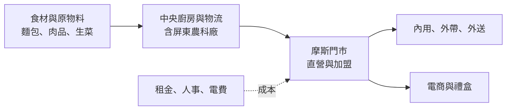
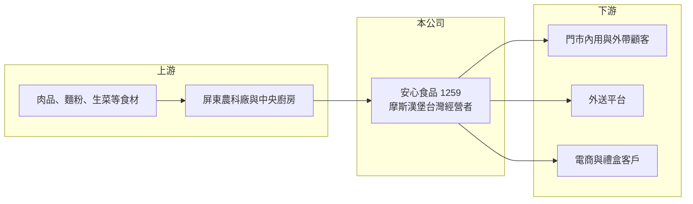

# 1259 安心

> 上櫃｜[[產業索引-觀光餐旅|觀光餐旅]]｜上市（櫃）日期 2011/12/15

# 第一章：企業模式與商業藍圖

> [!info] 撰寫說明
> 精簡版，由 Claude 依公開資料整理，架構比照 [[2330台積電]] 的四章研究，資料截至 2026-10-08。來源：Goodinfo 年度經營績效頁、工商時報 2025 年 12 月法說會報導、櫃買中心開放資料（基本資料、2026 年第二季資產負債與綜合損益、每月營收、本益比殖利率）；與東元集團、日本摩斯的合資關係與門市經營型態依記憶整理，標示待校對。#待校對

安心食品是台灣摩斯漢堡的經營者，本章說明它的品牌授權模式、門市網絡，以及近年從單純經營門市走向整合上游供應鏈的「安心 2.0」策略。

## 一、核心定位：摩斯漢堡在台灣的經營者

安心食品成立於 1990 年，2011 年上櫃，董事長為黃茂雄，實收資本額約 3.24 億元（櫃買中心開放資料）。公司由 [[1504東元]] 集團與日本摩斯食品合資成立（待校對），取得摩斯漢堡在台灣的經營權。摩斯的定位是「現點現做」的日式速食，價格略高於一般美式速食，主打米漢堡、在地食材與較舒適的用餐環境。

* **門市網絡：** 截至 2025 年底共 298 家門店，2026 年目標店數雙位數成長，展店重點放在話題商場、科學園區與交通要道，例如台北大巨蛋店、南港 LaLaport 店、屏東轉運站店、台積電 F7 店與台南、嘉義的車道店（工商時報）。門市以直營與[[加盟]]並行（比例未查得，待校對）。
* **海外：** 在新加坡與廈門經營摩斯門市，2025 年海外營收減少，拖累整體表現（工商時報）。

## 二、商業模式：股本小、門市多的連鎖餐飲

連鎖速食的獲利來自「單店營收 × 門市數 − 食材、人事與租金」。安心的營收約 60 億元，但實收資本額只有 3.24 億元，因此每股淨值高達約 86.6 元（櫃買中心資產負債），每股盈餘的金額看起來較大，但以 ROE 衡量的資本效率其實不高。

## 三、長期藍圖：安心 2.0

2026 年的策略主軸稱為「安心 2.0」（工商時報）：

* **向上整合供應鏈：** 從 B2C 餐飲延伸到 B2B 供應鏈，推動「從產地到餐桌」的一條龍模式，屏東農科廠先以自給自足為優先，未來再開發其他產品線。
* **O2O 雙軌經營：** 摩斯電商銷售農漁會水果禮盒、即食料理與生菜盒，讓門市以外的通路也能貢獻營收。
* **角色 IP：** 推出自創角色「MOS Friends」周邊商品，切入角色經濟。

這些策略的長期意義在於，速食本業的利潤率已被成本上升壓到接近零，公司需要找到門市以外、毛利較高的收入來源。

# 第二章：護城河深度與競爭優勢

速食市場競爭激烈，本章分析摩斯在台灣的品牌定位、護城河與主要對手。

## 一、護城河的核心組成要素

* **品牌定位：** 摩斯在台灣經營超過 30 年，以日式、健康、現做的形象與美式速食區隔，在中價位速食市場有穩定的客群。
* **門市網絡與選址：** 近 300 家門市涵蓋主要城市與交通節點，新開的科學園區、商場與車道店，鎖定上班族與自駕客群，好地點本身就是競爭優勢。
* **供應鏈整合：** 中央廚房與屏東農科廠讓食材品質與成本較能掌控，若 B2B 業務成功，也能把供應鏈能力變成另一個收入來源。

## 二、主要競爭對手

| 對手 | 定位 | 與摩斯的比較 |
|---|---|---|
| 麥當勞、肯德基 | 國際美式速食 | 規模與行銷資源大，價格較低 |
| [[2753八方雲集]] | 平價鍋貼與早午餐 | 加盟展店快，搶平價外食預算 |
| [[2723美食-KY]] | 85 度 C 咖啡烘焙 | 搶早餐與下午茶時段 |
| [[2912統一超]]等便利商店 | 鮮食與咖啡 | 早餐與輕食的最大替代品 |
| 早餐店與手搖飲連鎖 | 在地小型業者 | 價格低、密度高 |

## 三、守得住與守不住

* **守得住：** 中價位日式速食的品牌定位與忠誠客群，以及科學園區、交通節點等特色門市帶來的流量。
* **守不住：** 本業利潤率。原物料、電費與基本工資連年調漲，營業利益率由 2020 年的 2.38% 降到 2025 年的 -0.22%（Goodinfo），價格調整的速度追不上成本上升。
* **觀察重點：** 新型態門市的單店營收、B2B 與電商能否帶來實質獲利，以及海外門市能否止跌。

# 第三章：財務體質與盈利規模

資料日期：2026-10-08，表格是撰寫當時的快照；最新月營收、毛利率、累計 EPS 由自動排程寫在本筆記的屬性欄位（月營收、毛利率、累計EPS 等）。#待校對

本章用多年度數據檢視安心食品本業與業外的獲利結構，以及資本報酬的長期趨勢。

## 一、多年度三率與 ROE

| 年度 | 營收（新台幣） | [[毛利率]] | [[營業利益率]] | EPS（元） | [[ROE]] |
|---|---|---|---|---|---|
| 2020 | 53.4 億 | 26.1% | 2.38% | 4.96 | 7.91% |
| 2021 | 50.3 億 | 24.6% | -0.15% | 3.07 | 4.41% |
| 2022 | 57.3 億 | 25.4% | 2.10% | 4.02 | 5.76% |
| 2023 | 59.9 億 | 23.9% | 1.09% | 5.17 | 7.43% |
| 2024 | 60.5 億 | 22.5% | 0.19% | 2.05 | 2.31% |
| 2025 | 60.6 億 | 22.5% | -0.22% | 2.45 | 2.98% |
| 2026 上半年 | 30.9 億 | 23.21% | 0.20% | 2.02 | 未查得 |

註：2020 至 2025 年取自 Goodinfo；2026 上半年依櫃買中心綜合損益推算。

* **毛利率長期下滑：** 毛利率由 2020 年的 26.1% 降到 2025 年的 22.5%，主因是原物料、電費與工資上漲（工商時報）。
* **本業接近損益兩平：** 營業利益率近三年都在 0% 上下，2026 年上半年營業利益只有約 0.06 億元，稅前淨利約 0.68 億元主要來自營業外收入約 0.61 億元（櫃買中心綜合損益）。換句話說，目前的 EPS 主要由[[業外收益]]撐起。
* **營收成長緩慢：** 2020 至 2025 年營收年複合成長率約 2.6%（推算）。2026 年 1 至 8 月累計營收約 42.0 億元、年增約 4.2%（櫃買中心每月營收）。
* **ROE：** 2021 至 2025 年平均 ROE 約 4.6%（推算），呈下降趨勢。

## 二、股利與財務結構

最近一次現金股利為 1.2 元（櫃買中心本益比殖利率資料），以 2025 年 EPS 2.45 元計算配發率約 49%（推算）。2026 年第二季底權益總計約 28.1 億元、總負債約 43.7 億元（櫃買中心資產負債），負債中有相當比例應為門市租約的[[租賃負債]]（推估）。同期其他綜合損益為約 -2.3 億元，顯示公司持有的金融資產價格波動，會影響股東權益。

## 三、[[ROIC]] 與 [[WACC]]

**ROIC 推算：** 2025 年營業利益約 60.6 億元 × -0.22% ≈ -0.13 億元，稅後營業利益為負，ROIC 約 0% 至 -0.5%（推算）。即使以 2023 年營業利益率 1.09% 計算，稅後營業利益約 0.52 億元，相對於權益約 28 億元加租賃負債約 20 億元（推估）的投入資本，ROIC 也只有約 1%（推算）。

**WACC 推算：** 公債殖利率 1.75%、市場風險溢酬 6%、β 取餐飲股常見值 0.6，權益成本約 5.35%；租賃負債成本假設 3%、稅後 2.4%，以權益約 58%、負債約 42% 加權，WACC 約 4.1%（推算）。

**結論：** 本業 ROIC 接近零、明顯低於 WACC，代表摩斯門市本身近年沒有創造經濟價值，獲利主要依賴業外。安心 2.0 的供應鏈整合與電商，若能把營業利益率拉回 2% 以上，才有機會讓 ROIC 接近資金成本。

# 第四章：總體風險與地緣政治

本章整理安心食品長期面對的成本、市場與營運風險。

## 一、成本結構

* **工資與電費：** 餐飲業是勞力密集產業，台灣基本工資連年調漲、電價上升，直接壓縮門市利潤。
* **原物料：** 肉品、麵粉、生菜與咖啡豆的價格受國際行情與氣候影響，進口食材也受匯率影響。

## 二、市場與競爭

* **外食市場分散化：** 便利商店鮮食、外送平台與平價連鎖品牌持續瓜分速食市場，摩斯的中價位定位需要持續以產品與服務維持差異。
* **海外事業：** 新加坡與廈門門市規模小，2025 年營收減少，海外市場若持續虧損可能需要調整或收縮。

## 三、營運與財務

* **展店與關店：** 新型態門市投資較大，若選址失誤，租約與裝潢成本難以回收。
* **業外收益波動：** 目前獲利高度依賴業外收益，金融資產價格下跌時，EPS 與股東權益都會受影響。
* **食品安全：** 連鎖餐飲一旦發生食安事件，品牌形象的損害會擴及所有門市。

# 專有名詞解析

## 金融

- **[[業外收益]]**：本業以外的收入，例如投資收益、股利、利息與資產處分利得，波動通常較大。
- **[[租賃負債]]**：企業以租賃方式取得資產（如飛機、店面）時，依會計準則認列的未來租金現值負債。
- **[[ROIC]]**：投入資本報酬率，衡量企業用股東與債權人投入的資本，每年能產生多少稅後營業利益。
- **[[WACC]]**：加權平均資金成本，股東要求報酬與負債利息依資本結構加權後的平均值，是判斷是否創造價值的門檻。

## 產業

- **[[加盟]]**：品牌總部授權加盟主使用商標與營運模式，加盟主負擔開店成本並支付加盟金或權利金。

# 核心供應鏈

- 上游：肉品與食材供應商，如 [[1215卜蜂]]、[[1210大成]]（產業代表，非指名供應商）；屏東農科廠與中央廚房；品牌授權方日本摩斯食品。
- 下游／客戶：門市消費者、外送平台、電商與禮盒客戶。
- 同業：[[2753八方雲集]]、[[2723美食-KY]]、[[2912統一超]]、[[2727王品]]，以及麥當勞、肯德基等國際速食品牌。

## 最新新聞
<!-- news:start -->
<!-- news:end -->

## 相關連結
- [公開資訊觀測站](https://mopsov.twse.com.tw/mops/web/t05st03?step=1&firstin=1&co_id=1259)
- [Goodinfo](https://goodinfo.tw/tw/StockDetail.asp?STOCK_ID=1259)
- [Yahoo 股市](https://tw.stock.yahoo.com/quote/1259)
- [鉅亨網新聞](https://www.cnyes.com/twstock/1259/news)
