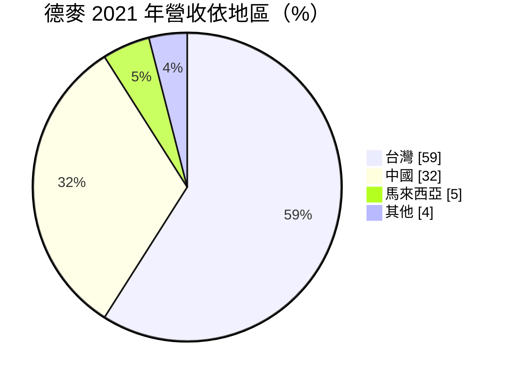
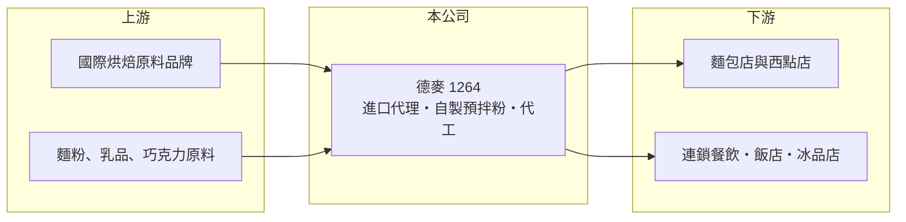

# 1264 德麥

> 上櫃｜[[產業索引-食品工業|食品工業]]｜上市（櫃）日期 2015/04/09

# 第一章：企業模式與商業藍圖

> [!info] 撰寫說明
> 精簡版，由 Claude 依公開資料整理，架構比照 [[2330台積電]]，資料截至 2026-10-08。來源：櫃買中心開放資料（基本資料、2026 年上半年財報、本益比殖利率）、Goodinfo 經營績效、CMoney 公司筆記（2022 年前後資料）。#待校對

德麥是台灣最大的烘焙原料進口與通路商之一，本章說明它「賣原料、送技術」的商業模式。

- **核心業務：** 德麥進口並銷售麵包、西點、中點與巧克力等烘焙原料，代理超過 70 個國際品牌，並自製預拌粉與水果餡，品項約 3,000 至 4,000 項。它的角色是烘焙業的[[餐飲原物料]]通路商，替上千家麵包店解決採購、技術與配送問題。
- **營收結構：** 2021 年營收地區比重為台灣 59%、中國 32%、馬來西亞 5%，其餘約 4%。2019 年產品別為烘焙原料 71%、烘焙乳品 25%、器具包材與其他約 5%，2020 年起公司改以「烘焙原物料」單一類別揭露。

- **營運據點：** 總部在新北市五股，2014 年收購芝蘭雅 50% 股權進入中國市場，並在馬來西亞設點。合併報表中非控制權益約 8.5 億元，反映中國子公司並非全資持有。
- **長期方向：** 公司從 2022 年起跨入餐飲產品（橄欖油、義大利麵、咖啡）與烘焙成品代工（鳳梨酥、餅乾、貝果），目標提高自製品比重。五股新廠原訂 2025 年上半年完工（依 2022 年報導，實際進度待校對），是往下游延伸的重要產能。

# 第二章：護城河深度與競爭優勢

德麥的護城河建立在代理權、技術服務與高度分散的客戶群上，是食品業中少數 ROE 長期超過 20% 的公司。

- **競爭優勢：** 德麥擁有約 50 位兩岸烘焙師傅組成的研發團隊，用「買產品、送技術」的方式教客戶做新品，客戶學會配方後就會持續採購同一套原料，形成[[轉換成本]]。自有業務與物流配送系統能把數千種小品項準時送到上萬家小店，這種[[通路]]能力不易複製。
- **主要對手：** 台灣烘焙原料市場有 [[1702南僑]]（油脂與烘焙原料）、[[1210大成]] 與其他進口商；中國市場則面對當地大型原料商與國際集團。進口商之間的競爭主要在代理品牌與技術服務。
- **觀察重點：** 2021 年客戶數超過 1 萬家，每月成交客戶約 7,500 家以上，客戶高度分散、沒有單一大客戶風險。長期要看中國市場成長、自製品比重提升，以及烘焙代工能否維持原本的高毛利。

# 第三章：財務體質與盈利規模

資料日期：2026-10-08，表格是撰寫當時的快照；最新月營收、毛利率、累計 EPS 由自動排程寫在本筆記的屬性欄位（月營收、毛利率、累計EPS 等）。#待校對

德麥的財務表現穩定且資本效率高，本章用五年數據說明。

| 年度 | 營收（億元） | [[毛利率]] | [[營業利益率]] | EPS（元） | [[ROE]] |
|---|---|---|---|---|---|
| 2021 | 49.5 | 36.2% | 19.2% | 16.19 | 22.1% |
| 2022 | 53.4 | 34.5% | 18.1% | 17.09 | 20.8% |
| 2023 | 58.4 | 33.2% | 17.0% | 18.24 | 20.6% |
| 2024 | 68.1 | 32.4% | 16.6% | 20.55 | 21.9% |
| 2025 | 67.8 | 32.2% | 16.8% | 20.47 | 20.1% |
| 2026 上半年 | 35.13 | 33.03% | 16.71% | 11.01 | 未查得 |

- **營收規模：** 營收由 2021 年 49.5 億元成長到 2025 年 67.8 億元，年複合成長率約 8.2%（推算）。2026 年上半年營收 35.1 億元，維持成長。
- **獲利：** 毛利率從 36% 緩降到 32% 至 33%，營業利益率穩定在 16% 至 19%，在食品通路業屬於高水準。近 5 年平均 ROE 約 21.1%（推算），與「連續 10 年 ROE 20% 以上」的報導一致。
- **財務特色：** 2025 年度現金股利 15 元，配息率約 73%，股利長期穩定。2026 年第二季底權益總計約 44.0 億元（母公司業主約 35.5 億元）、負債約 17.9 億元，負債幾乎都是流動負債，推估以應付帳款為主，有息負債不高。
- **[[ROIC]] 與 [[WACC]]：** 2025 年營業利益約 11.4 億元（67.8 億元 × 16.8%），稅後約 9.1 億元；投入資本以權益總計 44.0 億元加 0 至 6 億元有息負債計，ROIC 約 18% 至 21%（推算）。WACC 以無風險利率 1.75%、市場風險溢酬 6%、β 0.6（食品同業常見值）、幾乎無負債推估約 5.5%（推算）。ROIC 遠高於 WACC，差距超過 10 個百分點，代表德麥長期在創造可觀的股東價值。

# 第四章：總體風險與地緣政治

德麥的風險主要來自進口成本、代理權與中國市場。

- **產業週期：** 烘焙需求屬於民生消費，波動不大，但麵粉、奶油、乳製品與巧克力等原料受國際價格與運費影響。原料大漲時，進口商的毛利會先被壓縮，再視轉嫁能力回升。
- **營運風險：** 代理品牌合約若到期未續或被原廠收回，會影響部分品項的營收。往下游做烘焙成品代工，與原有客戶（麵包店）可能出現利益衝突，需要拿捏產品定位。
- **其他風險：** 進口原料以外幣計價，新台幣貶值會推高成本。中國子公司約占三成營收，受當地消費景氣、人民幣匯率與兩岸關係影響。

# 專有名詞解析

## 產業

- **[[餐飲原物料]]**：供餐飲店與連鎖品牌使用的原料，例如果醬、糖漿、預拌粉，以 B2B 方式銷售。
- **[[預拌粉]]**：預先把麵粉、糖、膨脹劑等按比例混合的烘焙原料，讓店家簡化製程並穩定品質。
- **[[轉換成本]]**：客戶更換供應商時需要付出的時間、金錢與風險，轉換成本越高，供應商地位越穩。
- **[[通路]]**：商品送到消費者手上的銷售管道，例如量販店、超市、便利商店與電商。

# 核心供應鏈

- 上游：歐美日等 70 多個國際烘焙原料品牌，以及麵粉、乳品與巧克力原料供應商。
- 下游／客戶：上萬家麵包店、西點店、連鎖餐飲、飯店與冰品店，分布在台灣、中國與馬來西亞。
- 同業：[[1702南僑]]、[[1210大成]]、[[1256鮮活果汁-KY]]（飲品原料）。

## 最新新聞
<!-- news:start（自動產生，請勿手動編輯此範圍） -->
- 2026-10-09 🏛️ 重訊 18:46｜代重要子公司芝蘭雅烘焙原料(無錫)有限公司公告 取得結構性存款｜[觀測站](https://mops.twse.com.tw/mops/#/web/t05st01)
- 2026-10-09 🏛️ 重訊 18:46｜代重要子公司芝蘭雅烘焙原料(無錫)有限公司公告 取得結構性存款(更正)｜[觀測站](https://mops.twse.com.tw/mops/#/web/t05st01)

完整紀錄：[[1264德麥 新聞]]
<!-- news:end -->

## 相關連結
- [公開資訊觀測站](https://mopsov.twse.com.tw/mops/web/t05st03?step=1&firstin=1&co_id=1264)
- [Goodinfo](https://goodinfo.tw/tw/StockDetail.asp?STOCK_ID=1264)
- [Yahoo 股市](https://tw.stock.yahoo.com/quote/1264)
- [鉅亨網新聞](https://www.cnyes.com/twstock/1264/news)
