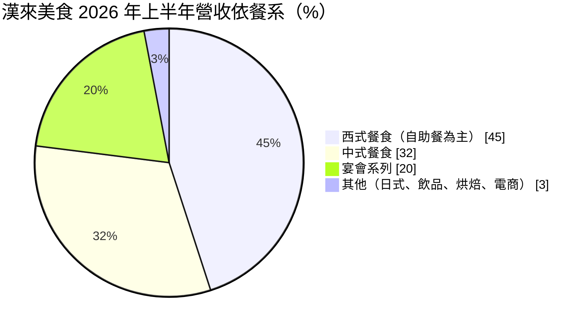
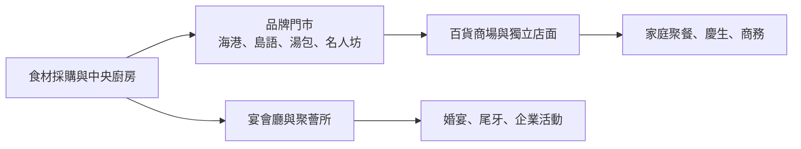
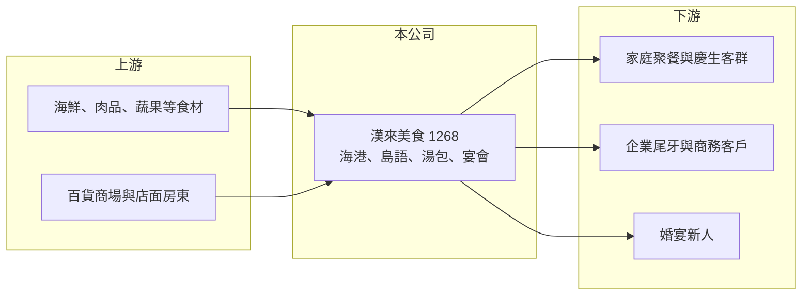

# 1268 漢來美食

> 上櫃｜[[產業索引-觀光餐旅|觀光餐旅]]｜上市（櫃）日期 2017/09/27

# 第一章：企業模式與商業藍圖

> [!info] 撰寫說明
> 精簡版，由 Claude 依公開資料整理，架構比照 [[2330台積電]] 的四章研究，資料截至 2026-10-08。來源：Goodinfo 年度經營績效頁、富果研究 2026 年 9 月法說會整理、櫃買中心開放資料（基本資料、2026 年第二季資產負債與綜合損益、每月營收、本益比殖利率）；與漢來飯店、漢神集團的關係依記憶整理，標示待校對。#待校對

漢來美食是從高雄漢來大飯店餐飲部門發展出來的多品牌餐飲集團，本章說明它以自助餐為主力、中式品牌與宴會為兩翼的經營模式，以及展店節奏如何驅動長期成長。

## 一、核心定位：以飯店級餐飲為基礎的多品牌集團

漢來美食成立於 2003 年，2017 年上櫃，董事長為林淑婷，實收資本額約 4.22 億元（櫃買中心開放資料）。公司源自高雄漢來大飯店的餐飲事業，與漢神百貨同屬高雄在地的漢來、漢神體系（待校對）。它的特色是把飯店等級的菜色與服務，複製到百貨商場與獨立店面，以「飯店級品質、非飯店價格」吸引家庭與聚餐客群。

截至 2026 年上半年，共有 22 個品牌、58 家餐廳（2025 年底為 51 家），營收結構如下（富果研究）：

* **西式自助餐：** 漢來海港（5 家）與島語（4 家）是營收主力，兩者合計超過四成。島語占比由 2025 年的 11% 升到 2026 年上半年的 21%，海港則由 31% 降到 22%，原因是部分海港門市升級改裝為島語。
* **中式餐食：** 12 個品牌、35 家，主力為漢來上海湯包（9 家）、漢來名人坊（6 家）與漢來蔬食（5 家），客單價與門市規模較小，適合在百貨美食街與商場快速展店。
* **宴會系列：** 4 處據點，包含宴會廳與高階商務會所「聚薈所」，承接婚宴、尾牙與企業活動。

## 二、展店節奏

公司規劃 2026 年新增 9 家、2027 年新增 8 家並改裝 5 家、2028 年新增 6 家，三年合計新增 23 家（富果研究）。以 2025 年底 51 家為基礎，代表門市數三年內將增加四成以上，是營收成長最主要的動力。

## 三、資本轉化邏輯：大店型、高翻桌

自助餐品牌的單店面積大、裝潢投資高，但客單價也高，只要維持高來客數，就能攤提租金與人事等固定成本。2026 年上半年毛利率約 48%、營業利益率約 12%（富果研究、櫃買中心綜合損益），顯示規模效益已經顯現。

## 四、企業長期藍圖

長期策略是以海港、島語兩大自助餐品牌鞏固高端聚餐市場，以中式品牌擴大門市密度，並透過宴會與商務會所經營企業客戶。改裝升級舊門市、把高雄起家的品牌推向北部與中部商場，是未來幾年的主軸。

# 第二章：護城河深度與競爭優勢

台灣餐飲市場品牌眾多，本章分析漢來美食的競爭優勢、主要對手與成長限制。

## 一、護城河的核心組成要素

* **飯店級品牌信譽：** 漢來源自五星級飯店，海港自助餐在台灣有很高的知名度，消費者願意為「飯店級」品質支付較高價格，這是新品牌難以短期建立的信任。
* **多品牌組合：** 從高價自助餐到平價湯包，品牌覆蓋不同價位與場合，百貨商場招商時可以一次引進多個品牌，提高談判籌碼。
* **宴會與商務客群：** 宴會廳與聚薈所服務企業與婚宴客戶，收入集中在年節與婚宴旺季，與一般門市互補。

## 二、主要競爭對手

| 對手 | 定位 | 與漢來的比較 |
|---|---|---|
| 饗賓餐旅（饗食天堂、旭集等） | 自助餐龍頭，未上市 | 自助餐市場最直接的對手，門市數較多 |
| [[2727王品]] | 多品牌連鎖餐飲 | 品牌數與門市數遠多於漢來，聚焦套餐與火鍋 |
| [[2729瓦城]] | 東南亞料理與中式品牌 | 在百貨商場搶同一批聚餐客群 |
| [[2707晶華]]、[[2748雲品]] | 飯店集團的餐飲事業 | 飯店自助餐與宴會的直接競爭 |
| [[2754亞洲藏壽司]] | 迴轉壽司 | 搶家庭聚餐預算 |

## 三、守得住與守不住

* **守得住：** 高端自助餐的品牌力。海港與島語的訂位需求穩定，2025 年 EPS 達 10.12 元的歷史高點，證明品牌具有定價能力。
* **守不住：** 展店的邊際報酬。新店多集中在百貨商場，租金與人事成本高，若新開門市的來客數不如既有門市，整體利潤率可能被稀釋。
* **觀察重點：** 2026 至 2028 年新店的營運成效、改裝島語後的單店營收提升幅度，以及宴會業務在婚宴市場萎縮下的表現。

# 第三章：財務體質與盈利規模

資料日期：2026-10-08，表格是撰寫當時的快照；最新月營收、毛利率、累計 EPS 由自動排程寫在本筆記的屬性欄位（月營收、毛利率、累計EPS 等）。#待校對

本章用多年度數據檢視漢來美食在疫情前後的獲利變化，以及展店期的資本報酬。

## 一、多年度三率與 ROE

| 年度 | 營收（新台幣） | [[毛利率]] | [[營業利益率]] | EPS（元） | [[ROE]] |
|---|---|---|---|---|---|
| 2020 | 34.6 億 | 43.3% | 4.67% | 7.51 | 17.0% |
| 2021 | 29.3 億 | 39.9% | -2.26% | 2.01 | 4.04% |
| 2022 | 37.6 億 | 40.6% | 0.78% | 3.08 | 6.76% |
| 2023 | 49.2 億 | 44.6% | 7.49% | 7.61 | 16.0% |
| 2024 | 59.3 億 | 45.8% | 8.98% | 10.06 | 19.2% |
| 2025 | 62.3 億 | 45.8% | 8.57% | 10.12 | 18.7% |
| 2026 上半年 | 36.8 億 | 47.85% | 12.43% | 9.21 | 未查得 |

註：2020 至 2025 年取自 Goodinfo；2026 上半年依櫃買中心綜合損益推算。

* **營運槓桿：** 2021 年疫情禁止內用，營業利益率跌到 -2.26%；2023 年起營收回升，營業利益率回到 7.5% 至 9%，2026 年上半年更達 12.43%。餐飲業的租金與人事屬於固定成本，營收成長時利潤率擴張得更快。
* **營收成長：** 2020 至 2025 年營收年複合成長率約 12.5%（推算）。2026 年 1 至 8 月累計營收約 48.2 億元、年增約 17.4%（櫃買中心每月營收），反映展店與改裝效益。
* **ROE：** 2021 至 2025 年平均 ROE 約 12.9%（推算），2023 年後穩定在 16% 至 19%。

## 二、股利與財務結構

最近一次現金股利為 8 元（櫃買中心本益比殖利率資料），以 2025 年 EPS 10.12 元計算配發率約 79%（推算），屬於高配息政策。2026 年第二季底權益約 24.0 億元、總負債約 51.0 億元（櫃買中心資產負債），負債中應有相當比例為門市租約的[[租賃負債]]（推估），這是連鎖餐飲業在會計準則下的常見結構。高配息加上持續展店，代表營業現金流足以同時支應裝潢投資與股利（推估）。

## 三、[[ROIC]] 與 [[WACC]]

**ROIC 推算：** 2025 年營業利益約 62.3 億元 × 8.57% ≈ 5.34 億元，稅後約 4.27 億元。投入資本以權益 24.0 億元加上租賃負債約 25 億元（推估）計算，約 49 億元，ROIC 約 8.7%（推算）；若不計入租賃負債，ROIC 約 18%（推算）。

**WACC 推算：** 公債殖利率 1.75%、市場風險溢酬 6%、β 取餐飲股常見值 0.8，權益成本約 6.55%；租賃負債成本假設 3%、稅後 2.4%，以權益約 49%、負債約 51% 加權，WACC 約 4.4%（推算）。

**結論：** 不論是否計入租賃負債，ROIC 都高於 WACC，代表漢來美食在疫情後的展店與改裝持續創造價值。未來的關鍵是新店的報酬率能否維持；若新門市的 ROIC 低於既有門市，整體利差會逐步縮小。

# 第四章：總體風險與地緣政治

本章整理漢來美食長期面對的成本、需求與營運風險。

## 一、成本結構

* **食材成本：** 自助餐以海鮮、牛肉等高價食材為主，國際食材價格與匯率波動會直接影響毛利率。
* **人事與租金：** 餐飲業缺工嚴重，基本工資連年調漲；百貨商場的租金多採保底加抽成，營收成長時租金也會增加。

## 二、需求面

* **景氣與消費力：** 高端自助餐與宴會屬於可延後的消費，景氣下滑時家庭與企業會先縮減聚餐預算。
* **婚宴市場萎縮：** 台灣結婚對數長期下降，婚宴規模也趨向小型化，宴會業務的長期成長性有限。
* **公共衛生事件：** 2021 年疫情禁止內用時營業利益率轉負，類似事件會對以內用為主的餐飲業造成嚴重衝擊。

## 三、營運風險

* **展店執行：** 三年新增 23 家的計畫需要大量人力與管理能力，展店過快可能影響服務品質與品牌形象。
* **品牌集中：** 海港與島語合計占營收四成以上，兩大品牌若出現食安事件或客群流失，影響會很大。
* **競爭加劇：** 自助餐市場吸引多家業者投入，價格競爭與新品牌會分散客群。

# 專有名詞解析

## 金融

- **[[租賃負債]]**：企業以租賃方式取得資產（如飛機、店面）時，依會計準則認列的未來租金現值負債。
- **[[ROIC]]**：投入資本報酬率，衡量企業用股東與債權人投入的資本，每年能產生多少稅後營業利益。
- **[[WACC]]**：加權平均資金成本，股東要求報酬與負債利息依資本結構加權後的平均值，是判斷是否創造價值的門檻。

## 產業

- **[[展店]]**：連鎖業者開設新門市以擴大營收規模，展店速度與新店獲利能力是成長的關鍵指標。

# 核心供應鏈

- 上游：海鮮、肉品與蔬果食材供應商；百貨商場與店面房東，如 [[2903遠百]]（產業代表，非指名合作對象）。
- 下游／客戶：家庭聚餐、企業尾牙與商務宴客、婚宴客群。
- 同業：[[2727王品]]、[[2729瓦城]]、[[2707晶華]]、[[2748雲品]]、[[2754亞洲藏壽司]]，以及未上市的饗賓餐旅。

## 最新新聞
<!-- news:start -->
<!-- news:end -->

## 相關連結
- [公開資訊觀測站](https://mopsov.twse.com.tw/mops/web/t05st03?step=1&firstin=1&co_id=1268)
- [Goodinfo](https://goodinfo.tw/tw/StockDetail.asp?STOCK_ID=1268)
- [Yahoo 股市](https://tw.stock.yahoo.com/quote/1268)
- [鉅亨網新聞](https://www.cnyes.com/twstock/1268/news)
