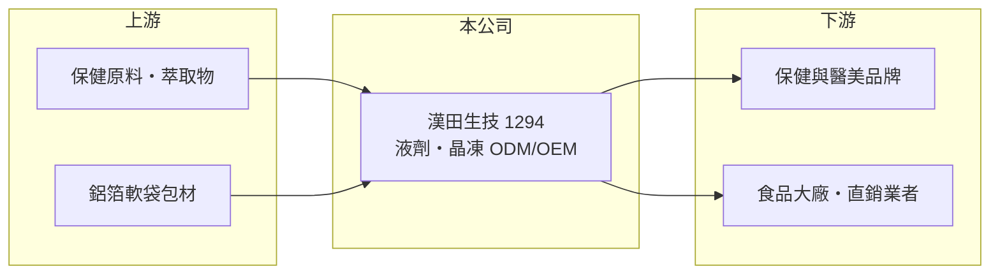

# 1294 漢田生技

> 上櫃｜[[產業索引-食品工業|食品工業]]｜上市（櫃）日期 2024/09/26

# 第一章：企業模式與商業藍圖

> [!info] 撰寫說明
> 精簡版，由 Claude 依公開資料整理，架構比照 [[2330台積電]]，資料截至 2026-10-08。來源：櫃買中心開放資料（基本資料、2026 年上半年財報、本益比殖利率）、Goodinfo 經營績效、工商時報 2024 年 8 月上櫃前報導。#待校對

漢田生技是專做液劑與晶凍型保健食品的代工廠，2024 年 9 月上櫃，本章說明它在保健食品供應鏈中的位置。

- **核心業務：** 漢田提供保健食品的研發、[[ODM]] 與 [[OEM]] 代工，主力是[[殺菌軟袋]]充填的液劑與晶凍產品，從配方設計到充填包裝一站完成。品牌商只需負責行銷與通路，產品開發與製造交給漢田，這是保健食品業常見的輕資產分工。
- **營收結構：** 依 2024 年報導，一站式代工約占營收近 95%，其中 ODM 約占九成。ODM 比重高代表漢田掌握配方開發能力，而不只是依客戶配方加工，議價力與客戶黏著度都較高。
- **營運據點：** 生產基地在彰化，原有員林廠，2024 年啟用溪湖總廠。依 2024 年報導，原廠月產能約 1,800 萬包、全年逾 8,000 萬包，新廠投產後產能進一步擴大。
- **長期方向：** 客戶超過 200 家，以台灣品牌為主，包含醫美品牌與食品大廠；公司正拓展香港、馬來西亞、新加坡、中國與東協客戶，並承接美國直銷業者與韓國漢方大廠的訂單。長期目標是從台灣內需代工轉為區域型保健食品代工平台。

# 第二章：護城河深度與競爭優勢

漢田的護城河來自液劑與晶凍劑型的製程專業，以及 ODM 配方累積的客戶黏著度。

- **競爭優勢：** 液劑與晶凍需要殺菌、充填與包材密封的專業技術，口感與保存期限都會影響品牌商的產品表現，不是一般錠劑膠囊廠能直接跨入。客戶一旦以漢田配方上市，換廠就要重新調整配方與口味，形成[[轉換成本]]。
- **主要對手：** 台灣保健食品代工同業有 [[1707葡萄王]]、[[3205佰研]]、[[7780大研生醫]]、[[8436大江]] 等，但各家主力劑型不同，液劑晶凍是相對利基的市場。中國與東南亞當地代工廠則在價格上具競爭力。
- **觀察重點：** 毛利率由 2023 年的 44.9% 降到 2025 年的 37.1%，ROE 也由 44% 降到 17%，反映新廠折舊與客戶訂單調整。長期要看新廠產能利用率能否提升，以及海外客戶占比能否擴大。

# 第三章：財務體質與盈利規模

資料日期：2026-10-08，表格是撰寫當時的快照；最新月營收、毛利率、累計 EPS 由自動排程寫在本筆記的屬性欄位（月營收、毛利率、累計EPS 等）。#待校對

漢田在 2023 年經歷爆發成長，之後隨新廠投產進入消化期，本章用五年數據說明。

| 年度 | 營收（億元） | [[毛利率]] | [[營業利益率]] | EPS（元） | [[ROE]] |
|---|---|---|---|---|---|
| 2021 | 2.40 | 42.0% | 16.5% | 2.89 | 19.1% |
| 2022 | 3.03 | 41.9% | 18.8% | 3.06 | 20.5% |
| 2023 | 6.25 | 44.9% | 29.7% | 7.66 | 44.0% |
| 2024 | 7.48 | 40.9% | 26.4% | 6.02 | 25.4% |
| 2025 | 7.79 | 37.1% | 22.2% | 4.60 | 16.8% |
| 2026 上半年 | 4.55 | 35.30% | 21.80% | 2.22 | 未查得 |

- **營收規模：** 營收由 2021 年 2.40 億元增加到 2025 年 7.79 億元，年複合成長率約 34%（推算），2023 年單年就成長一倍。2026 年上半年營收 4.55 億元，已超過 2025 年全年營收的一半。
- **獲利：** 營業利益率維持 20% 以上，在食品代工業屬於高水準，但毛利率呈現下滑。2024 年上櫃後股本擴大，EPS 與 ROE 的下降部分來自股數稀釋。近 5 年平均 ROE 約 25.2%（推算）。
- **財務特色：** 2025 年度現金股利 5 元，高於當年 EPS 4.60 元，配息率超過 100%。2026 年第二季底股東權益約 8.2 億元、負債約 4.0 億元，財務結構穩健。
- **[[ROIC]] 與 [[WACC]]：** 2025 年營業利益約 1.73 億元（7.79 億元 × 22.2%），稅後約 1.38 億元；投入資本以股東權益 8.2 億元加 0 至 2 億元有息負債計，ROIC 約 14% 至 17%（推算）。WACC 以無風險利率 1.75%、市場風險溢酬 6%、β 0.8（小型股與代工業務，高於一般食品股）推估約 6.5%（推算）。ROIC 明顯高於 WACC，代表公司仍在創造價值，但差距已比 2023 年縮小。

# 第四章：總體風險與地緣政治

漢田的風險主要在於客戶集中於保健品牌與新產能的消化。

- **產業週期：** 保健食品需求長期受人口老化與健康意識帶動，但個別品牌的熱銷商品有生命週期，爆款退燒時代工訂單會跟著下降。2023 年的高成長與之後的毛利下滑，說明訂單波動會直接反映在利潤率。
- **營運風險：** 溪湖總廠投產後折舊增加，若訂單成長不如預期，產能利用率下降會壓縮毛利。客戶多為台灣品牌，前幾大客戶的訂單變化影響很大（客戶集中度本次未查得）。
- **其他風險：** 保健食品受食品安全與廣告標示法規規範，客戶產品若出現違規宣稱或成分爭議，代工廠也會受波及。拓展海外需要符合各國法規與認證，進度可能慢於預期。

# 專有名詞解析

## 產業

- **[[ODM]]**：原廠委託設計，代工廠負責產品開發與製造，客戶掛自己的品牌銷售。
- **[[OEM]]**：原廠委託製造，代工廠依客戶規格生產並掛客戶品牌，自身不經營品牌。
- **[[殺菌軟袋]]**：以鋁箔等多層材質製成、充填後再加熱殺菌的軟包裝，用於液劑與晶凍產品，可常溫保存。
- **[[轉換成本]]**：客戶更換供應商時需要付出的時間、金錢與風險，轉換成本越高，供應商地位越穩。

# 核心供應鏈

- 上游：膠原蛋白、益生菌、植物萃取等保健原料供應商，以及鋁箔軟袋包材廠。
- 下游／客戶：台灣保健與醫美品牌、食品大廠、美國直銷業者與韓國漢方業者。
- 同業：[[1707葡萄王]]、[[3205佰研]]、[[7780大研生醫]]、[[8436大江]]。

## 最新新聞
<!-- news:start -->
<!-- news:end -->

## 相關連結
- [公開資訊觀測站](https://mopsov.twse.com.tw/mops/web/t05st03?step=1&firstin=1&co_id=1294)
- [Goodinfo](https://goodinfo.tw/tw/StockDetail.asp?STOCK_ID=1294)
- [Yahoo 股市](https://tw.stock.yahoo.com/quote/1294)
- [鉅亨網新聞](https://www.cnyes.com/twstock/1294/news)
