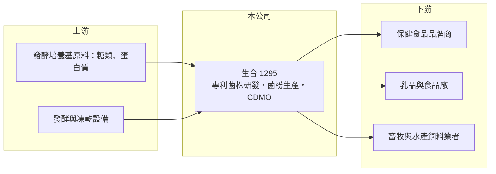

# 1295 生合

> 上櫃｜[[產業索引-食品工業|食品工業]]｜上市（櫃）日期 2025/05/27

# 第一章：企業模式與商業藍圖

> [!info] 撰寫說明
> 精簡版，由 Claude 依公開資料整理，架構比照 [[2330台積電]]，資料截至 2026-10-08。來源：櫃買中心開放資料快照（基本資料、2026 年第二季資產負債與綜合損益、本益比殖利率）、Goodinfo 經營績效頁、永豐金證券法說摘要（2025 年 4 月）、媒體新聞標題；菌株名稱與地區細節依記憶整理。公開資料有限。#待校對

生合生物科技是台灣少數以[[益生菌]]原料為核心的上櫃公司。它的商業模式不是賣自有品牌保健品給消費者，而是當品牌商背後的菌種與配方供應者，這決定了它高毛利、但規模成長較慢的特性。

- **核心業務：** 生合 2000 年成立，總部與工廠位於高雄路竹，專注乳酸菌菌種的研發與生產，2025 年 5 月由興櫃轉上櫃。依永豐金證券的法說整理，公司採 [[CDMO]] 一條龍模式，也就是從菌種篩選、配方開發到製成粉末或成品，都能替客戶代為研發與生產。生合以[[專利菌株]]為差異化核心，例如針對腸道、口腔與代謝等功能開發的特定菌株（菌株名稱與功能宣稱待校對）。
- **營收結構：** 營收主要來自兩類客戶：一是保健食品品牌商，向生合購買[[保健食品原料]]或委託代工成品；二是畜牧與水產業者，購買動物用益生菌作為[[飼料添加物]]。依法說摘要，近年成長動能包括東南亞動物益生菌、台灣代工訂單與中國新品推廣；產品別與內外銷的精確比重本次未查得。
- **營運據點：** 生產集中在高雄路竹，海外市場以中國與東南亞為主，透過當地經銷或子公司銷售（據點細節待校對）。益生菌原料重量輕、單價高，適合從單一工廠出口到多個市場，這是中小型原料商能做國際生意的原因。
- **長期方向：** 公司策略是聚焦特定功能菌種、提高附加價值，並擴大動物益生菌在東南亞的布局。2026 年生合辦理現金增資並首次發行[[可轉換公司債]]（依媒體標題，2026 年市場籌資合計約 5.4 億元），資金用途本次未查得，推估與產能擴充或營運資金有關。以生合目前約 13 億元的股東權益規模，這筆籌資對未來的產能與折舊結構影響不小。

# 第二章：護城河深度與競爭優勢

益生菌原料是門檻在「菌」而不在「工廠」的生意。本章說明生合的護城河來源，以及它和國際大型菌種商之間的位置。

- **競爭優勢：** 益生菌的價值在於特定菌株經過人體或動物試驗證明的功能，這需要長年的菌種庫累積、臨床研究與專利保護。品牌商一旦把某個專利菌株寫進產品配方與行銷宣稱，換供應商就得重新做功效驗證與法規申請，轉換成本因此偏高。生合長期維持 50% 上下的[[毛利率]]，反映的正是這種技術與專利帶來的定價能力。
- **主要對手：** 國際上有科漢森（現併入 Novonesis）、帝斯曼芬美意、IFF 等大型菌種商，規模與研發資源遠大於生合；台灣同業包括 [[1707葡萄王]] 與景岳生技、豐華生技等菌種公司，代工端則有 [[8436大江]] 等保健品 CDMO。生合的策略是不和大廠比通用菌種的價格，而是用特定功能菌株切入利基市場。
- **限制與觀察重點：** 生合的客戶多是品牌商，終端消費者通常看不到生合的名字，議價能力取決於菌株的不可替代性。長期要觀察三點：新專利菌株能否持續推出並取得各國法規許可、動物益生菌在東南亞能否形成穩定的經常性訂單，以及 2026 年籌資後的新產能能否在合理時間內填滿。

# 第三章：財務體質與盈利規模

資料日期：2026-10-08，表格是撰寫當時的快照；最新月營收、毛利率、累計 EPS 由自動排程寫在本筆記的屬性欄位（月營收、毛利率、累計EPS 等）。#待校對

生合的財務特色是高毛利、中等營業利益率、穩定配息，但營收規模仍小。本章用多年度數字檢視它的成長性與資本效率。

| 年度 | 營收（億元） | [[毛利率]] | [[營業利益率]] | EPS（元） | [[ROE]] |
|---|---|---|---|---|---|
| 2021 | 8.56 | 52.1% | 21.8% | 5.30 | 18.5% |
| 2022 | 7.39 | 48.9% | 13.7% | 3.02 | 10.5% |
| 2023 | 8.23 | 50.9% | 17.4% | 3.68 | 12.3% |
| 2024 | 9.89 | 54.7% | 21.2% | 5.43 | 16.8% |
| 2025 | 10.40 | 53.5% | 19.1% | 5.29 | 14.6% |

（來源：Goodinfo 經營績效頁；2019、2020 年未查得）

- **營收規模：** 2021 至 2025 年營收由 8.56 億元成長到 10.40 億元，年複合成長率約 5%（推算），2022 年曾衰退到 7.39 億元後才回升。2026 年上半年營收約 5.1 億元，與前一年大致持平。營收規模仍在十億元上下，代表生合在全球益生菌市場中仍屬利基型供應商。
- **獲利：** 毛利率長期穩定在 49% 至 55%，即使營收衰退的 2022 年也沒有跌破 48%，顯示產品定價有一定韌性。營業利益率則在 14% 至 22% 之間波動，因為研發與業務費用相對固定，營收高低會放大營業利益的變化。2026 年上半年毛利率約 49.8%、營業利益率約 15.0%、EPS 1.97 元（依櫃買中心資料推算）。
- **財務特色：** 2026 年第二季資產總計 32.3 億元、負債 19.2 億元，其中非流動負債 10.8 億元，負債比約 59%，明顯高於一般保健品原料公司，推估與廠房擴充的長期借款有關（有息負債金額未查得）。股東權益 13.1 億元、每股淨值約 38 元。現金股利在 2022 至 2026 年發放期間平均約 2.57 元，2025 年度配發 3 元，以當年 EPS 5.29 元計算配息率約 57%（推算），配息紀錄相對穩定。
- **長期指標：** 2021 至 2025 年平均 ROE 約 14.5%（推算），在食品與保健類公司中屬中上水準。自由現金流是否長期為正本次未查得，但負債快速增加代表近年資本支出偏高，需要觀察擴產後折舊對毛利率的影響。

**[[ROIC]] 與 [[WACC]]：** 以 2025 年營收 10.40 億元、營業利益率 19.1% 計算，營業利益約 1.99 億元，稅後營業利益約 1.59 億元（稅率 20%）。投入資本以 2026 年第二季股東權益 13.1 億元加上有息負債（未查得，以非流動負債 10.8 億元為主推估約 8 億至 12 億元）計算，約 21 億至 25 億元，ROIC 約 6% 至 8%（推算）；若只以股東權益計算則約 12%，差距來自近年新增的借款與擴產資產尚未貢獻營收。WACC 以 CAPM 推估：無風險利率 1.75%、市場風險溢酬 6%、β 取保健食品同業常見值 0.8（推算），股權成本約 6.6%；負債成本假設 2.5%、稅後約 2.0%；資本結構以市值約 17 億至 18 億元、負債約 10 億元計，股權約 63%、負債約 37%，WACC 約 4.8%（推算）。ROIC 高於 WACC，代表生合長期仍在創造價值，但利差已因擴產而縮小；新產能能否帶來營收成長，決定利差能否回到過去 ROE 15% 左右時期的水準。

# 第四章：總體風險與地緣政治

生合的風險集中在客戶集中、法規與擴產執行，而不是一般景氣循環。

- **產業週期：** 保健食品需求長期隨人口老化與健康意識成長，但短期會受消費景氣、品牌商庫存調整與網路行銷熱度影響，2022 年營收衰退就是例子。動物益生菌則與畜牧與水產養殖景氣、飼料價格與禽畜疫情相關。
- **營運風險：** 原料商依賴少數大型品牌商與代理商，單一客戶轉單或產品下架，對十億元規模的公司影響明顯。2026 年的籌資與借款讓負債比升到六成左右，若新產能利用率不如預期，折舊與利息會侵蝕高毛利的優勢。
- **法規與技術風險：** 益生菌在各國的功效宣稱與原料許可規範不同，中國、東南亞與歐美的法規變動會影響新菌株上市時程。國際大廠持續推出新菌株並以規模壓低價格，生合必須持續投入研發才能維持差異化。
- **其他風險：** 外銷收入以外幣計價，新台幣升值會壓縮營收與毛利；中國市場同時受兩岸關係與當地競爭影響。可轉換公司債轉換為股票時，會稀釋既有股東的每股盈餘。

# 專有名詞解析

## 金融

- **[[可轉換公司債]]**：可依約定價格轉換為公司股票的債券，發行公司可降低利息成本，但轉換後會稀釋股權。

## 產業

- **[[益生菌]]**：對人體或動物有益的活性微生物，常見為乳酸菌與比菲德氏菌，用於保健食品、乳品與飼料。
- **[[專利菌株]]**：經篩選、鑑定並取得專利的特定菌種，具備經試驗證明的功能，是益生菌廠商差異化的核心。
- **[[CDMO]]**：委託開發暨製造服務，替客戶從研發、配方到量產一手包辦，客戶多為品牌商。
- **[[保健食品原料]]**：供品牌商製成膠囊、粉包等保健食品的功能性原料，例如菌粉、萃取物與維生素。
- **[[飼料添加物]]**：加入動物飼料中以改善腸道健康、成長或減少抗生素使用的成分，動物益生菌即屬此類。

# 核心供應鏈

- 上游：發酵培養基所需的糖類、蛋白質等食品原料，以及發酵槽、凍乾設備供應商。
- 下游／客戶：台灣、中國與東南亞的保健食品品牌商與代理商、乳品與食品廠，以及東南亞畜牧與水產飼料業者（客戶名稱未查得）。
- 同業：台灣 [[1707葡萄王]]、景岳生技、豐華生技，保健品代工 [[8436大江]]；國際菌種商 Novonesis（科漢森）、帝斯曼芬美意、IFF。

## 最新新聞
<!-- news:start（自動產生，請勿手動編輯此範圍） -->
- 2026-10-06 🏛️ 重訊 15:41｜公告本公司國內第一次無擔保轉換公司債代收價款行庫及存 儲專戶行庫｜[觀測站](https://mops.twse.com.tw/mops/#/web/t05st01)

完整紀錄：[[1295生合 新聞]]
<!-- news:end -->

## 相關連結
- [公開資訊觀測站](https://mopsov.twse.com.tw/mops/web/t05st03?step=1&firstin=1&co_id=1295)
- [Goodinfo](https://goodinfo.tw/tw/StockDetail.asp?STOCK_ID=1295)
- [Yahoo 股市](https://tw.stock.yahoo.com/quote/1295)
- [鉅亨網新聞](https://www.cnyes.com/twstock/1295/news)
