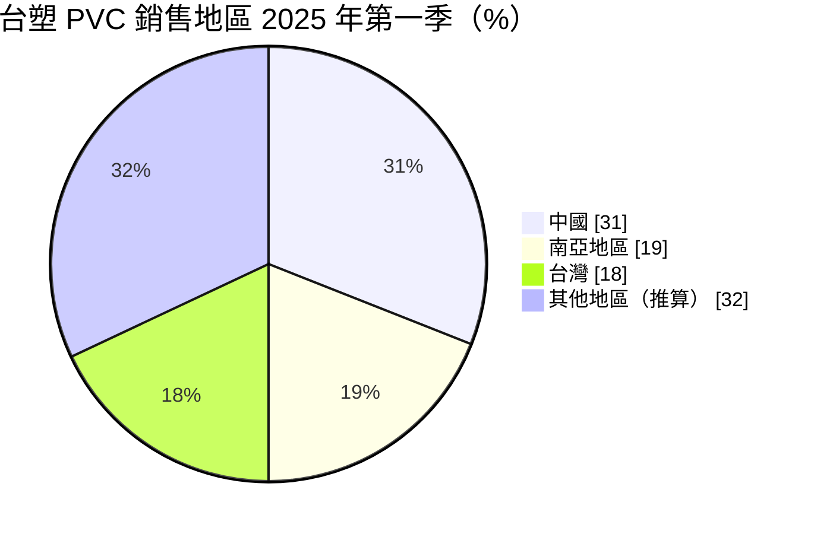
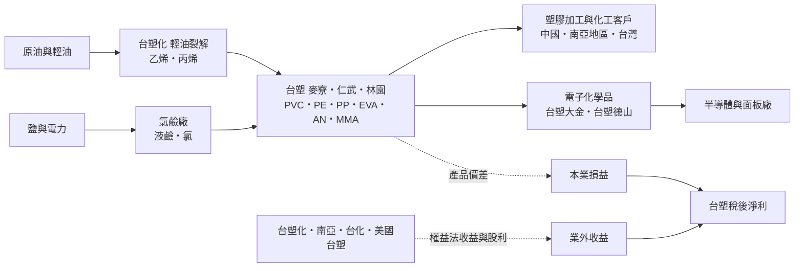
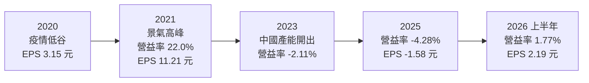
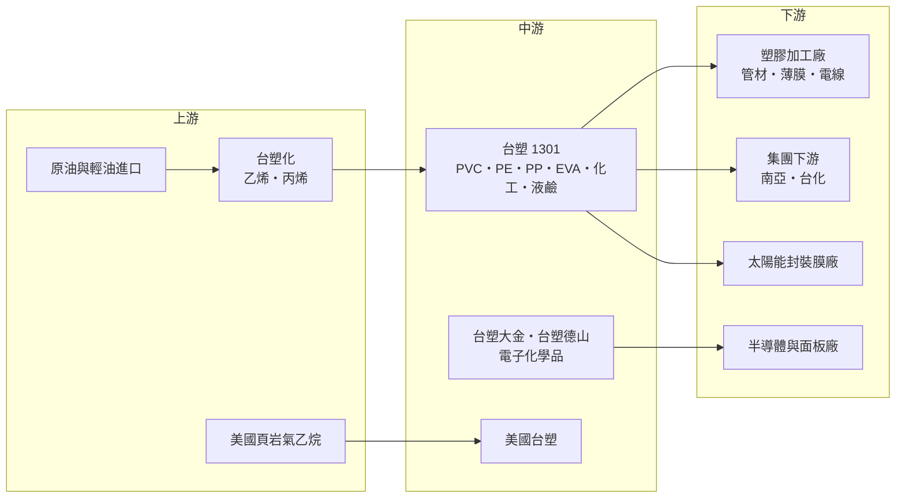

# 1301 台塑

> 上市｜[[產業索引-塑膠工業|塑膠工業]]｜上市（櫃）日期 1964/07/27

# 第一章：企業模式與商業藍圖

> [!info] 撰寫說明
> 本文由 Claude 依公開資料整理，架構比照 [[2330台積電]] 的四章研究，資料截至 2026-10-08。財務數字來源：證交所開放資料快照（基本資料、2026 年第二季資產負債與綜合損益、股利）、Goodinfo 經營績效頁與股利政策頁（2016 至 2025 年）、MoneyDJ 季資產負債表（2026 年第二季借款科目）、富果研究 2025 年 6 月法說會整理（產品開工率、銷售地區、擴產計畫）、經濟日報與科技新報 2025 至 2026 年轉型報導；對台塑化等轉投資的持股比例未逐一查證，產業描述為整理性內容，尚未逐條比對原始文件。#待校對

在評估一家公司的長期投資價值時，第一步是看懂它靠什麼賺錢、為什麼能一直賺下去。本章針對台灣塑膠工業（股票代號：1301，以下簡稱台塑）的商業模式進行定性分析，說明這家台塑集團的創始公司，如何以 PVC、烯烴與化工產品為核心，在石化景氣循環中大起大落，以及它為什麼必須把轉型方向放在電子化學品與利基材料上。

## 一、核心定位：台塑集團的源頭與石化控股平台

台塑成立於 1954 年，1964 年上市，是王永慶創立台塑集團的第一家公司，最早的產品是 [[PVC]] 塑膠粉。今天的台塑同時具有兩種身分，投資人必須分開理解：

- **石化原料製造商：** 台塑在台灣麥寮、仁武、林園等廠區生產 PVC、高密度與線性低密度聚乙烯（PE）、聚丙烯（PP）、[[EVA]]、丙烯酸酯、丙烯腈（AN）、MMA、[[碳纖維]]與[[液鹼]]等產品。主要原料乙烯、丙烯來自集團內的 [[6505台塑化]]，透過麥寮園區內的管線直接輸送。這部分業務的獲利，取決於產品售價與原料成本之間的[[價差]]。
- **轉投資控股平台：** 台塑持有台塑化、[[1303南亞]]、[[1326台化]]與美國台塑等集團公司股權，[[權益法]]投資收益與現金股利是獲利的重要來源。2026 年上半年台塑營業利益約 15.8 億元，但營業外收入約 126.6 億元，稅後淨利約 139.2 億元（證交所資料），轉投資的貢獻遠大於本業。

這兩種身分讓台塑的獲利波動被放大：本業與轉投資都屬於石化循環，景氣好時一起賺，景氣差時一起虧。2021 年台塑 EPS 達 11.21 元，2025 年則為負 1.58 元，五年內從高峰跌到虧損，正是這種結構的寫照。

## 二、終端應用板塊：通用塑膠為主、外銷比重高

台塑未公開各產品的營收比重。依富果研究整理的 2025 年 6 月法說會資料，台塑外銷比重超過六成，以 PVC 為例，銷售地區分布如下：

依產品特性，台塑的業務可以分成三類：

- **通用塑膠（PVC、PE、PP）：** 這是台塑營收的主體，用於水管、電線被覆、建材、包裝薄膜與塑膠製品。通用塑膠同質性高，價格由亞洲供需決定，中國大量新增產能後長期供過於求。2025 年第一季 HDPE 開工率僅 35.5%、LLDPE 約 50%，PE 產品線虧損最嚴重。
- **利基化工與材料（EVA、AN、MMA、液鹼）：** 這些產品技術門檻或供需結構較好。2025 年第一季液鹼營業利益率約 18%，是當季主要獲利來源；EVA 受太陽能封裝膜需求帶動，開工率超過 100% 並由虧轉盈；MMA 營業利益率約 12.6%。這類產品是台塑在景氣低迷時仍能賺錢的部分。
- **電子化學品（轉投資）：** 與日商合資的台塑大金生產電子級氫氟酸，台塑德山生產電子級異丙醇（IPA），主要供應台灣半導體與面板廠。這部分規模仍小，但是台塑長期轉型的核心。

## 三、資本轉化邏輯：原料價差與轉投資的雙重收益

- **價差決定本業：** 台塑的產品多半是把乙烯、丙烯、鹽與電力轉化為塑膠與化學品，賺的是加工價差。當亞洲供過於求時，產品售價跌得比原料快，價差收窄甚至轉負；當供給中斷或需求回升時，價差迅速擴大。這種特性使台塑的本業獲利呈現劇烈的週期性。
- **轉投資放大波動：** 台塑化（煉油與裂解）、南亞（塑膠加工與電子材料）、台化（芳香烴）、美國台塑都是景氣循環型公司，彼此又互相持股、互供原料。集團一起進入景氣高峰或低谷時，權益法收益會同步放大台塑的獲利起伏。
- **台美雙基地：** 美國德州廠以頁岩氣乙烷為原料，成本結構與亞洲以輕油為原料的工廠不同。油價高時，乙烷路線具有明顯的成本優勢，美國台塑的獲利因此成為集團在油價上漲期的重要支撐。

## 四、企業長期藍圖：從通用塑膠轉向電子與利基材料

- **轉型專案：** 台塑規劃超過 50 項轉型專案、總投資約 292 億元，目標每年增加產值約 300 億元，並讓新事業在 2030 年貢獻 20% 至 30% 的獲利。集團層級則有上百項轉型專案。這代表管理層已經承認通用塑膠的長期困境，轉型目標是降低對大宗產品的依賴。
- **電子化學品：** 以台塑大金的電子級氫氟酸、台塑德山的電子級 IPA 切入半導體供應鏈，受惠於台灣先進製程擴產。電子化學品需要極高的純度與穩定性，一旦通過晶圓廠認證，客戶黏著度遠高於通用塑膠。
- **擴產與去瓶頸：** 美國德州新建年產 10 萬噸 [[1-Hexene]] 產能（原規劃 2025 年第四季完成）、仁武擴充年產 1,600 噸碳纖維（原規劃 2026 年第一季完成），PVC 去瓶頸工程在 2027 至 2029 年分階段完成。這些投資以利基產品與成本改善為主，而不是擴大通用塑膠的產能。
- **經營策略調整：** 2025 年法說會揭露，台塑對供過於求的產品採取減產、減少低利潤或虧損訂單，並在南部洲際碼頭新建儲槽，於市場低價時採購進口乙烯、丙烯，同時與台塑化建立 PE 原料利潤共享機制。這些做法顯示台塑從「追求滿載」轉向「追求單位利潤」。

# 第二章：護城河深度與競爭優勢

在長期價值投資中，「護城河」指企業抵禦競爭、長期維持超額利潤的保護機制。石化大宗產品同質性高，護城河通常表現在成本而不是定價權。本章分析台塑的護城河構成、全球主要競爭對手，以及這些優勢在中國產能過剩的環境下能守住多少。

## 一、台塑護城河的核心組成要素

台塑的護城河屬於「窄護城河」，通用塑膠本身幾乎沒有定價權，優勢主要來自集團整合，由三個要素構成：

- **1. 麥寮一貫化園區：** 從台塑化的輕油裂解到台塑、南亞、台化的下游產品，原料以管線直接輸送，並共用港口、電廠、儲槽與公用設施。這種[[垂直整合]]降低了運輸、倉儲與能源成本，是單一石化廠難以複製的規模優勢。
- **2. 台美雙基地與原料彈性：** 美國德州廠的乙烷路線與台灣的輕油路線，讓集團在不同油價環境下都有一個相對有利的生產基地。進口乙烯、丙烯的儲槽則增加了原料採購的彈性。
- **3. 利基與電子化學品：** EVA、AN、MMA、液鹼與電子級化學品的技術門檻與客戶認證要求高於通用塑膠。台塑大金在國內半導體用電子級氫氟酸的市占率超過五成五，是台塑少數具有明確客戶黏著度的業務。

## 二、全球主要競爭對手格局

| 對手 | 定位 | 對台塑的影響 |
|---|---|---|
| 中國石化與民營煉化一體化企業 | 大規模新建 PE、PP、PVC 產能 | 以低價出口壓低亞洲報價，是台塑本業虧損的主因 |
| [[4063信越化學]] | 全球最大 PVC 廠之一，美國有大型產能 | 在 PVC 國際市場直接競爭，成本與規模領先 |
| OxyChem、Westlake 等美國石化廠 | 以頁岩氣為原料的低成本產能 | 在 PVC、PE 與液鹼出口市場競爭 |
| [[1304台聚]]、[[1308亞聚]]、[[1309台達化]]、[[1305華夏]] | 台灣石化同業 | 在 PE、EVA、PVC 等產品國內外競爭 |
| 日本東麗 | 全球碳纖維龍頭 | 在碳纖維技術、認證與規模上領先 |

## 三、優勢轉化：哪些守得住、哪些守不住

- **守得住：** 液鹼、AN、MMA、EVA 等供需較緊或技術門檻較高的產品，以及電子級化學品。這些產品即使在 2025 年的景氣低谷，仍能維持正的營業利益，代表台塑在利基市場有真實的競爭力。
- **守不住：** PVC、PE、PP 等通用塑膠。中國大規模新增產能使亞洲長期供過於求，台塑即使有一貫化的成本優勢，也無法避免價差被壓縮。2023 至 2025 年台塑營業利益率連續三年為負，就是這個結構問題的結果，而不是一時的景氣波動。
- **觀察重點：** 長期可以追蹤三件事。第一是利基與電子化學品占營收與獲利的比重，能否如期在 2030 年前達到兩到三成；第二是中國[[反內卷]]政策是否真的讓過剩產能退場；第三是台塑在虧損年度維持配息的能力。只有通用塑膠的虧損縮小、利基產品比重提高，台塑才有機會走出「景氣好才賺錢」的模式。

# 第三章：財務體質與盈利規模

資料日期：2026-10-08。數字取自 Goodinfo 經營績效頁與股利政策頁、證交所開放資料快照與 MoneyDJ 季資產負債表，表格是撰寫當時的快照；最新月營收、毛利率、累計 EPS 由自動排程寫在本筆記的屬性欄位（月營收、毛利率、累計EPS 等）。#待校對

財務報表是檢驗護城河是否真實存在的最終標準。本章用多年度的三率、ROE、現金流與資本報酬，檢視台塑在石化景氣循環中的獲利品質，並區分本業與轉投資的貢獻。

## 一、獲利能力的基石：三率

| 年度 | 營收（億元） | [[毛利率]] | [[營業利益率]] | EPS（元） | [[ROE]] |
|---|---|---|---|---|---|
| 2020 | 1,858 | 15.6% | 9.20% | 3.15 | 5.88% |
| 2021 | 2,736 | 27.8% | 22.0% | 11.21 | 19.4% |
| 2022 | 2,516 | 16.9% | 10.6% | 5.68 | 9.50% |
| 2023 | 1,991 | 4.93% | -2.11% | 1.15 | 2.08% |
| 2024 | 2,000 | 5.07% | -2.08% | -0.19 | -0.39% |
| 2025 | 1,754 | 3.19% | -4.28% | -1.58 | -3.08% |

（來源：Goodinfo 經營績效頁，合併報表。2026 年上半年依證交所資料，營收 892.4 億元、毛利率 8.44%、營業利益率 1.77%、EPS 2.19 元。2016 至 2019 年營業利益率約 7% 至 11%、EPS 約 5.86 至 7.78 元。）

- **典型的石化循環：** 2021 年全球需求在疫情後反彈、供給受限，台塑毛利率衝上 27.8%、EPS 11.21 元；兩年後中國新產能大量開出，毛利率跌到 5% 以下，營業利益轉為虧損。這種「高峰兩年、低谷三年」的節奏，是通用塑膠業的常態。
- **本業與業外要分開看：** 2023 年本業虧損，但轉投資收益讓 EPS 仍有 1.15 元；2026 年上半年營業利益只有約 15.8 億元，稅後淨利卻有約 139.2 億元。台塑的 EPS 有很大一部分來自集團轉投資，評估本業時應以營業利益率為準。
- **營收長期沒有成長：** 2020 至 2025 年營收年複合成長率約 -1.1%（推算），2025 年營收甚至低於 2016 年的 1,802 億元。這說明台塑過去十年的成長空間被中國產能大幅壓縮，營收規模已經停滯。

## 二、[[ROE]]：資本效率

台塑 2021 至 2025 年平均 ROE 約 5.5%（推算），而且完全由 2021、2022 兩年撐起，2024、2025 年連續為負。依 2026 年第二季資料，台塑權益總計約 5,743 億元、每股淨值約 90.21 元，其中「其他權益」約 2,880 億元，主要是持有集團公司股權的未實現評價（推估）。龐大的權益基數讓台塑即使在景氣好時，ROE 也很難長期維持在 15% 以上。台塑的財務結構相當保守，負債總計約 2,067 億元，負債比僅約 26%。

## 三、資本支出、自由現金流與股利

- **[[CapEx]]：** 主要投入美國德州 1-Hexene、仁武碳纖維擴產、PVC 去瓶頸，以及約 292 億元的轉型專案。管理層已經不再擴充通用塑膠產能，資本支出重心轉向利基產品與成本改善。
- **[[自由現金流]]：** 多年度的營業現金流與自由現金流本次未查得。結構上，台塑的現金流來自本業價差與轉投資股利兩個來源，2025 年法說會預估全年現金股利收入近 10 億元，景氣低谷時股利收入也會同步減少。
- **股利穩定度：** 台塑 2016 至 2019 年度每年配發 4.4 至 5.8 元現金股利，2021 年度高峰達 8.2 元，2023 年度降到 1 元，2024、2025 年度各 0.5 元（證交所與 Goodinfo 資料）。公司章程規定每年至少分配可分配盈餘的 50%、以現金股利為優先，但在 2024、2025 年虧損時仍配發 0.5 元，資金部分來自累積的未分配盈餘與處分持股。台塑的股利高度跟隨景氣循環，並不屬於穩定配息股。

## 四、[[ROIC]] 與 [[WACC]]：價值創造利差

- **ROIC（推算）：** 以 2025 年營收 1,754 億元乘以營業利益率 -4.28%，營業損失約 75.1 億元，稅後營業利益約負 60 億元。投入資本以 2026 年第二季權益總計約 5,743 億元，加上有息負債約 1,600 億元（短期借款 443.2 億、應付商業本票 239.8 億、一年內到期長期負債 128.7 億、應付公司債 368.1 億、長期借款 394.3 億、租賃負債 26.2 億），合計約 7,343 億元，ROIC 約 -0.8%（推算）。以 2021 年高峰的營業利益約 602 億元套用同一資本基礎，ROIC 約 6.6%（推算）。需要注意的是，投入資本中有相當比重是轉投資股權，本業實際使用的資本較小，本業 ROIC 的波動會比這個數字更大。
- **WACC（推算）：** 以 [[CAPM]] 估算股東權益成本：無風險利率取台灣 10 年期公債約 1.75%，市場風險溢酬 6%，β 假設 0.9（石化循環股同業常見值，未查得台塑實際數字），權益成本約 7.15%。稅前負債成本假設 2.0%、稅率 20%，稅後約 1.6%。以帳面價值計算，負債約占 22%、權益約 78%，WACC 約 5.9%（推算）。
- **價值創造判斷：** 台塑只有在 2021 年這種景氣高峰時，ROIC 才明顯高於約 5.9% 的資金成本；2023 至 2025 年 ROIC 為負，屬於價值毀損期。以整個循環平均來看，台塑近年的資本報酬低於資金成本。這也是台塑必須推動轉型的根本原因：只有當電子化學品與利基產品的比重提高，ROIC 才可能在整個循環中平均高於 WACC。

# 第四章：總體風險與地緣政治

任何企業都無法脫離宏觀環境獨立存在，石化業與油價、地緣政治的連動尤其緊密。本章分析台塑未來必須面對的地緣政治、產業週期、營運與法規風險。

## 一、地緣政治風險

- **中東與原油供給：** 原油與烯烴價格受中東局勢影響很大。2026 年中東衝突推升油價與塑化報價，台塑利用低價庫存賺取[[庫存利益]]；但這類利益屬於一次性，供給恢復後報價回落，庫存利益可能轉為庫存損失。投資人不應把地緣衝突帶來的獲利視為常態。
- **中國市場依賴：** 台塑的 PVC 約三成、EVA 超過六成銷往中國，中國需求疲弱、反傾銷調查或貿易政策改變，都會直接影響台塑出貨。中國同時是台塑最大的市場與最大的競爭來源，這是結構性的兩難。
- **美國貿易政策：** 美國台塑是集團重要的獲利來源，美國關稅、能源政策與環保法規的變化，都會影響美國事業的營運。

## 二、產業週期與市場結構風險

- **中國產能過剩：** 中國持續新增 PE、PP、PVC 產能，亞洲報價長期承壓。中國政府推動的反內卷政策若能抑制擴產、淘汰落後產能，對台塑是長期利多；但政策效果與時程都不確定。
- **價差循環：** 石化業典型的「擴產、過剩、虧損、減產、再擴產」循環，使台塑獲利大起大落。由於集團內四家公司處於同一循環，景氣低谷時沒有內部的避險機制。
- **下游需求：** 營建、家電、汽車與太陽能的需求變化，會直接影響 PVC 與 EVA 的訂單。

## 三、營運環境的隱性風險

- **集團連動：** 台塑化、南亞、台化與台塑互相持股、原料互供，任一家發生工安、停產或財務問題，都會牽動其他公司。這種緊密連動在景氣好時是綜效，景氣差時則是共同曝險。
- **工安與歲修：** 麥寮園區規模龐大，工安事故或延長[[歲修]]會造成停產損失，也可能引發更嚴格的環保審查。
- **配息能力：** 虧損年度需要動用累積盈餘或處分持股維持配息，若轉投資股價下跌、未分配盈餘減少，配息空間會縮小。

## 四、科技或法規演進風險

- **碳排與碳成本：** 石化業是高碳排產業，台灣[[碳費]]與歐盟 [[CBAM]] 將提高營運與出口成本。若台塑的減碳進度落後同業，未來可能面臨成本劣勢。
- **電子化學品認證：** 半導體客戶對電子級化學品的純度與穩定性要求極高，驗證時間長，轉型速度可能不如預期。台塑需要在這個領域與日本、歐美的專業化學品公司競爭。
- **減塑趨勢：** 全球限塑與循環經濟法規，長期會壓抑一次性塑膠需求，並提高再生塑膠的比重，通用塑膠的長期需求成長可能放緩。

# 專有名詞解析

## 金融

- **[[權益法]]**：持股約兩成以上的轉投資，依持股比例把被投資公司的損益認列為投資收益的會計方法。
- **[[庫存利益]]**：原料價格上漲時，先前以低價買入的庫存以較高售價賣出所產生的額外利益，屬一次性成分。
- **[[ROIC]]**：投入資本報酬率，稅後營業利益除以股東權益加有息負債，衡量本業運用資本的效率。
- **[[WACC]]**：加權平均資金成本，依股東權益與負債的比重，加權計算公司取得資金的平均成本。
- **[[CAPM]]**：資本資產定價模型，以無風險利率加上 β 乘以市場風險溢酬估算股東要求報酬率。

## 產業

- **[[PVC]]**：聚氯乙烯，用於水管、電線被覆、地板與建材的通用塑膠，台塑起家的產品。
- **[[EVA]]**：乙烯醋酸乙烯酯共聚物，用於太陽能模組封裝膜、鞋材與發泡材料。
- **[[液鹼]]**：即燒鹼（氫氧化鈉）水溶液，電解鹽水的產物，用於造紙、化工、鋁業與水處理。
- **[[碳纖維]]**：以聚丙烯腈為原料碳化而成的高強度輕量纖維，用於航太、風電葉片與運動器材。
- **[[1-Hexene]]**：1-己烯，生產高性能聚乙烯時加入的共聚單體，可提升塑膠的強度與韌性。
- **[[價差]]**：產品售價減去主要原料成本的差額，是石化業獲利的核心指標。
- **[[歲修]]**：工廠定期停機進行年度檢修，期間產量下降、獲利短期受影響。
- **[[垂直整合]]**：同一集團同時掌握上游原料、中游製造與下游產品，以降低成本並確保供應。
- **[[反內卷]]**：中國政府推動遏止企業低價惡性競爭與盲目擴產的政策方向。
- **[[碳費]]**：政府依企業溫室氣體排放量收取的費用，台灣自 2025 年起對大排放源開徵。
- **[[CBAM]]**：歐盟碳邊境調整機制，對進口高碳排產品課徵碳成本。

# 核心供應鏈

## 1. 上游：原料供應
- 乙烯、丙烯等基本原料：[[6505台塑化]]
- 美國德州以頁岩氣乙烷為原料的美國台塑
- 進口乙烯、丙烯（南部洲際碼頭儲槽）

## 2. 中游：台塑本身與合資公司
- 台塑麥寮、仁武、林園廠：PVC、PE、PP、EVA、丙烯酸酯、AN、MMA、碳纖維、液鹼
- 電子化學品合資：台塑大金（電子級氫氟酸）、台塑德山（電子級 IPA）

## 3. 下游：主要客戶
- 集團下游：[[1303南亞]]（塑膠加工與電子材料）、[[1326台化]]
- 塑膠加工、管材、電線電纜與鞋材業者
- 太陽能封裝膜廠（EVA）
- 半導體與面板廠（電子級化學品）

## 4. 同業比較
- 台灣石化同業：[[1304台聚]]、[[1308亞聚]]、[[1309台達化]]、[[1305華夏]]
- 國際同業：[[4063信越化學]]、中國石化、日本東麗（碳纖維）
- 集團轉投資關聯：[[2408南亞科]]

## 最新新聞
<!-- news:start（自動產生，請勿手動編輯此範圍） -->
- 2026-10-21 📰 媒體 12:10｜鉅亨速報 - Factset 最新調查：台塑(1301-TW)目標價調升至80元，幅度約6.67%｜[鉅亨網](https://news.cnyes.com/news/id/6634897)
- 2026-10-14 📰 媒體 20:17｜〈智慧能源週〉台塑新智能攜手綠捷跨足機器狗電池開發 彰濱二期廠力拚2028年Q2量產｜[鉅亨網](https://news.cnyes.com/news/id/6630445)
- 2026-10-14 📰 媒體 12:36｜〈焦點股〉塑化族群紅光滿面 台塑、台化亮燈漲停 南亞寫新天價｜[鉅亨網](https://news.cnyes.com/news/id/6624736)
- 2026-10-12 📰 媒體 20:42｜〈台塑四寶業績〉Q4受惠需求旺季、電子業績攀升 兩公司看好業績優於Q3｜[鉅亨網](https://news.cnyes.com/news/id/6628767)
- 2026-10-12 📰 媒體 20:23｜〈台塑四寶業績〉四寶Q3賺762億元季增18% 南亞前3季賺逾1股本、台塑化同步創高｜[鉅亨網](https://news.cnyes.com/news/id/6628710)

完整紀錄：[[1301台塑 新聞]]
<!-- news:end -->

## 相關連結
- [公開資訊觀測站](https://mopsov.twse.com.tw/mops/web/t05st03?step=1&firstin=1&co_id=1301)
- [Goodinfo](https://goodinfo.tw/tw/StockDetail.asp?STOCK_ID=1301)
- [Yahoo 股市](https://tw.stock.yahoo.com/quote/1301)
- [鉅亨網新聞](https://www.cnyes.com/twstock/1301/news)
