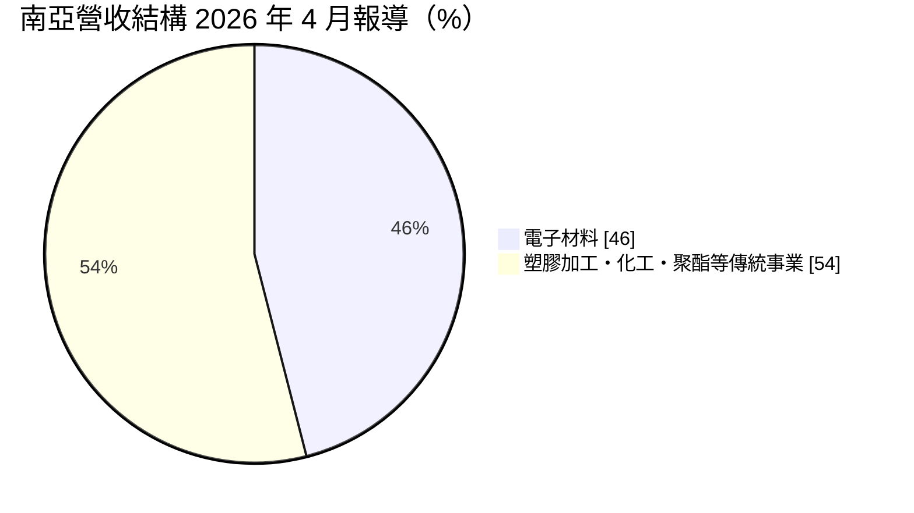
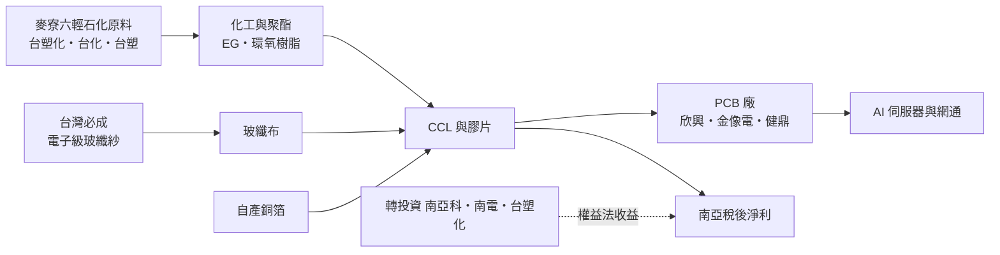
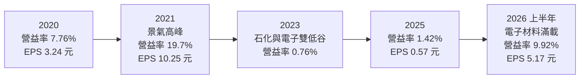
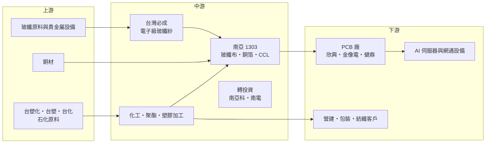

# 1303 南亞

> 上市｜[[產業索引-塑膠工業|塑膠工業]]｜上市（櫃）日期 1967/11/05

# 第一章：企業模式與商業藍圖

> [!info] 撰寫說明
> 本文由 Claude 依公開資料整理，架構比照 [[2330台積電]] 的四章研究，資料截至 2026-10-08。財務數字來源：證交所開放資料快照（基本資料、2026 年第二季資產負債與綜合損益、股利）、Goodinfo 經營績效頁與股利政策頁（2016 至 2025 年）、MoneyDJ 季資產負債表（2026 年第二季借款科目）、優分析 2026 年 4 月營收結構報導、財報狗 2025 年 12 月事業部營收報導（日東紡合作）、科技新報 2026 年 5 月轉型案報導、永豐金證券 AI 投資網公司簡介；對轉投資的持股比例未逐一查證，產業描述為整理性內容，尚未逐條比對原始文件。#待校對

在評估一家公司的長期投資價值時，第一步是看懂它靠什麼賺錢、為什麼能一直賺下去。本章針對南亞塑膠工業（股票代號：1303，以下簡稱南亞）的商業模式進行定性分析，說明這家以塑膠加工起家的傳統公司，如何透過電子材料的[[垂直整合]]，成為 AI 伺服器板材供應鏈的一員，以及轉投資收益為什麼讓它的獲利波動遠大於本業。

## 一、核心定位：台塑集團裡最「電子化」的一員

南亞創立於 1958 年，1967 年上市，是台塑集團「台塑四寶」之一。公司早年以塑膠皮布、膠布、塑膠管材等塑膠加工品起家，後來逐步延伸到聚酯纖維、化工原料，以及印刷電路板（PCB）上游的電子材料。依永豐金證券 AI 投資網的公司簡介，南亞自稱是全球最大的塑膠加工廠，也是全球主要的銅箔基板（[[CCL]]）製造商之一。

南亞的業務可以分成四大事業：電子材料、塑膠加工、化工、聚酯。過去南亞的獲利主軸是石化與聚酯，景氣跟著油價與中國供需起伏；近年電子材料快速成長，依優分析 2026 年 4 月的報導，電子材料營收占比已達 46%，成為最大的事業。這個轉變有兩個長期意義：

- **從大宗商品轉向規格品：** 電子材料需要通過終端品牌與 PCB 廠的認證，規格隨伺服器、網通設備世代升級而改變。產品價格不像石化原料那樣完全由國際行情決定，技術與交期能力會反映在價格上。
- **獲利來源多元但波動大：** 南亞同時持有 [[2408南亞科]]、[[8046南電]]、[[6505台塑化]] 等轉投資。DRAM、IC 載板與煉油都是高度循環的產業，這些公司的損益透過[[權益法]]反映在南亞的稅後獲利，使南亞的 EPS 波動遠大於本業。2026 年上半年南亞營業利益約 151.0 億元，營業外收入約 317.4 億元，稅後淨利約 422.2 億元（證交所資料），轉投資的貢獻是本業的兩倍。

## 二、產品板塊：從玻纖紗一路做到銅箔基板

- **電子材料（約 46%）：** 南亞的電子材料事業特色是一條龍生產，PCB 上游的關鍵材料幾乎都自己做。子公司台灣必成生產電子級玻纖紗，南亞再織成[[玻纖布]]，並自產電解[[銅箔]]與環氧樹脂，最後壓合成 CCL 與膠片，供應 PCB 廠。AI 伺服器與高速網通對 [[Low Dk]]、[[Low CTE]] 玻纖布與低損耗 CCL 的需求大增，是這個事業近年成長的主要動力。
- **塑膠加工：** 包括膠布、硬質膠布、塑膠管、包裝材料與建材，是南亞起家的事業。這類產品客戶分散、應用廣泛，需求跟著營建與消費景氣走，屬於穩定但成長有限的業務。
- **化工：** 生產乙二醇（[[EG]]）、雙酚 A（BPA）、環氧樹脂、可塑劑等，部分產能在美國德州。化工產品是電子材料（環氧樹脂）與聚酯（EG）的上游，也直接外銷。中國大量新增 EG 產能後，這個事業的利差長期受壓。
- **聚酯：** 生產聚酯棉、聚酯絲與瓶用酯粒，在美國南卡羅來納州設有工廠。聚酯同樣面對中國產能過剩，美國廠則受惠於當地的進口替代需求。

南亞也在推動高值化轉型。依科技新報 2026 年 5 月的報導，南亞共有 42 件轉型案，預計投資 124 億元，產品包括晶圓保護膜、光電用電子隔離片、半導體製程用薄膜、電子級雙氧水、電子級二氧化碳與醫療材料，預估創造年產值 426 億元。

## 三、資本轉化邏輯：一條龍材料與轉投資雙引擎

- **自有上游的價值：** 在材料供不應求的時期，自產玻纖紗、玻纖布與銅箔，等於確保了自家 CCL 的供料，也能把上游材料的漲價利潤留在集團內。只做單一環節的同業，在缺貨期要向外採購，成本與交期都較難控制。
- **生產據點：** 台灣主要生產基地包括新港（電子材料、玻纖）、麥寮（化工原料，與六輕連結）、錦興、樹林、林口等廠區；海外在中國設有多個塑膠加工與電子材料廠，在美國設有化工與聚酯廠。多地生產讓南亞能就近服務客戶，也分散了單一地區的風險。
- **擴產與合作：** 2026 年 4 月台灣必成公告投資 40.9 億元，向德國 Heraeus 採購生產設備，擴充電子級玻纖紗產能。另依財報狗 2025 年 12 月的報導，南亞與日本特殊玻纖布大廠日東紡策略合作，預計到 2027 年日東紡供應的特殊玻纖布約有 20% 由南亞織造。這項合作讓南亞切入最高階的玻纖布市場。

## 四、企業長期藍圖：高值化與垂直整合

- **電子材料高階化：** 南亞的長期方向是讓電子材料從中階 CCL 往高階板材延伸，並利用一貫化生產的成本與供料優勢擴大市占。電子材料若能持續占營收一半以上，南亞的獲利結構將從「石化循環」轉向「電子材料循環」。
- **傳統事業轉型：** 透過轉型案把產能轉向半導體與醫療等利基材料，降低對大宗石化產品的依賴。這些新產品規模仍小，但毛利率與客戶黏著度都高於傳統產品。
- **轉投資收益：** 南亞科、南電、台塑化等轉投資的獲利透過權益法回流南亞，景氣好時大幅提高南亞的 EPS 與配息能力，景氣差時則同步拖累。這部分不是南亞能控制的，但它是理解南亞股東報酬不可忽略的一環。

# 第二章：護城河深度與競爭優勢

在長期價值投資中，「護城河」指企業抵禦競爭、長期維持超額利潤的保護機制。本章分析南亞的護城河構成、電子材料與化工兩條戰線上的主要對手，以及這些優勢在材料缺貨潮過後能守住多少。

## 一、南亞護城河的核心組成要素

南亞的護城河屬於「規模加垂直整合」型的窄護城河，主要由三個要素構成：

- **1. 電子材料一條龍：** 從玻纖紗、玻纖布、銅箔、環氧樹脂到 CCL 都自己生產，在材料全面缺貨時確保供料，也比只做單一環節的廠商更能控制成本與交期。這種垂直整合需要長期投資與技術累積，新進者很難在短時間內複製。
- **2. 集團規模與原料取得：** 化工與聚酯的原料多來自麥寮六輕，與台塑化、[[1301台塑]]、[[1326台化]] 互為上下游，具備大宗採購、管線輸送與共用設施的成本優勢。
- **3. 長年累積的客戶認證：** CCL 與玻纖布要打入伺服器、網通板，需要經過終端品牌與 PCB 廠多層認證。一旦進入供應名單，客戶更換材料需要重新驗證，轉換成本較高，客戶黏著度因此提高。

## 二、全球主要競爭對手格局

| 對手 | 定位 | 對南亞的影響 |
|---|---|---|
| [[2383台光電]]、[[6274台燿]]、[[6213聯茂]] | 高階 CCL 專業廠 | 在 AI 伺服器超低損耗 CCL 的配方與認證速度領先 |
| 生益科技、建滔積層板 | 中國與香港 CCL 大廠 | 在中低階 CCL 以規模與價格競爭 |
| [[1802台玻]]、1815富喬、5340建榮、日東紡 | 玻纖布與玻纖紗廠 | 在高階 Low Dk、Low CTE 玻纖布競爭，日東紡同時是合作夥伴 |
| 8358金居、三井金屬 | 高頻高速銅箔 | 在低粗糙度銅箔技術上具優勢 |
| 中國 EG、聚酯新產能 | 大宗化工與聚酯 | 壓低南亞傳統事業的利差 |

## 三、優勢轉化：哪些守得住、哪些守不住

- **守得住：** 在材料缺貨期，垂直整合帶來的供料保障最有價值，南亞能優先滿足自家 CCL 所需，量價齊揚。中高階玻纖布與 CCL 的規模優勢，加上與日東紡的合作，讓南亞在電子材料的地位比過去更穩固。
- **守不住：** 最頂級的 AI 加速器板材與傳統石化產品。在最高階的超低損耗 CCL 上，台光電等專業廠商的配方與認證速度較快，南亞較難取得最高的價格溢價。化工與聚酯則長期受中國產能壓抑，2023 至 2025 年南亞營業利益率都在 2% 以下，主要就是傳統事業拖累。
- **觀察重點：** 長期可以追蹤電子材料占營收比重能否持續超過一半、高階玻纖布與 CCL 的量產與認證進度，以及缺貨潮退去後電子材料價格能否守住。這三點決定南亞能否擺脫「石化股」的評價框架。

# 第三章：財務體質與盈利規模

資料日期：2026-10-08。數字取自 Goodinfo 經營績效頁與股利政策頁、證交所開放資料快照與 MoneyDJ 季資產負債表，表格是撰寫當時的快照；最新月營收、毛利率、累計 EPS 由自動排程寫在本筆記的屬性欄位（月營收、毛利率、累計EPS 等）。#待校對

財務報表是檢驗護城河是否真實存在的最終標準。本章用多年度的三率、ROE、現金流與資本報酬，檢視南亞從傳統塑化轉向電子材料後的獲利品質，並區分本業與轉投資的貢獻。

## 一、獲利能力的基石：三率

| 年度 | 營收（億元） | [[毛利率]] | [[營業利益率]] | EPS（元） | [[ROE]] |
|---|---|---|---|---|---|
| 2020 | 2,734 | 14.5% | 7.76% | 3.24 | 7.55% |
| 2021 | 4,117 | 25.2% | 19.7% | 10.25 | 21.6% |
| 2022 | 3,552 | 15.2% | 9.02% | 4.05 | 9.35% |
| 2023 | 2,598 | 7.40% | 0.76% | 0.80 | 2.10% |
| 2024 | 2,596 | 7.15% | 0.17% | 0.42 | 0.89% |
| 2025 | 2,599 | 8.31% | 1.42% | 0.57 | 1.38% |

（來源：Goodinfo 經營績效頁，合併報表。2026 年上半年依證交所資料，營收 1,522.4 億元、毛利率 15.76%、營業利益率 9.92%、EPS 5.17 元。2016 至 2018 年營業利益率約 4.8% 至 9.8%、EPS 約 6.16 至 6.87 元。）

- **兩種循環疊加：** 2021 年石化與電子同時處於高峰，南亞營業利益率衝上 19.7%；2023 至 2025 年石化產能過剩、電子產業去庫存，營業利益率連續三年不到 2%。2026 年上半年電子材料在 AI 伺服器帶動下滿載，營業利益率回到約 10%。南亞的本業獲利，正在從石化循環轉向電子材料循環。
- **轉投資放大 EPS：** 2026 年上半年營業利益約 151 億元，但營業外收入約 317 億元，主要來自南亞科等轉投資的權益法收益（推估）。南亞的 EPS 在 DRAM 景氣好時會遠高於本業能支撐的水準，評估本業時應以營業利益為準。
- **營收長期持平：** 2020 至 2025 年營收年複合成長率約 -1.0%（推算），2025 年營收甚至低於 2017、2018 年。這說明傳統事業的萎縮抵銷了電子材料的成長，結構轉型仍在進行中。

## 二、[[ROE]]：資本效率

南亞 2021 至 2025 年平均 ROE 約 7.1%（推算），但 2023 至 2025 年連續三年不到 2.5%，資本效率高度依賴景氣高峰。依 2026 年第二季資料，南亞權益總計約 4,977 億元、每股淨值約 60.24 元，負債總計約 2,254 億元，負債比約 31%，財務結構保守。龐大的權益基數中有相當比重是轉投資股權，景氣低迷時這些資產只貢獻少量收益，拉低整體 ROE。

## 三、資本支出、自由現金流與股利

- **[[CapEx]]：** 轉型案預計投資 124 億元，台灣必成 40.9 億元的玻纖紗設備是近期電子材料最明確的擴產項目。資本支出重心已從石化產能轉向電子材料與利基產品。
- **[[自由現金流]]：** 多年度的營業現金流與自由現金流本次未查得。結構上，電子材料滿載期的現金流入會明顯改善，景氣低谷時則主要依賴轉投資股利。
- **股利穩定度：** 南亞 2016 至 2018 年度每年配發 4.5 至 5.1 元現金股利，2021 年度高峰達 7.5 元，2023、2024 年度各 0.7 元，2025 年度 0.8 元（證交所與 Goodinfo 資料），2025 年度配息高於 EPS 0.57 元，動用了累積盈餘。南亞的股利高度跟隨前一年獲利，不屬於穩定配息股。

## 四、[[ROIC]] 與 [[WACC]]：價值創造利差

- **ROIC（推算）：** 以 2025 年營收 2,599 億元乘以營業利益率 1.42%，營業利益約 36.9 億元，扣除 20% 稅率後稅後營業利益約 29.5 億元。投入資本以 2026 年第二季權益總計約 4,977 億元，加上有息負債約 1,497 億元（短期借款 210.6 億、應付商業本票 335.6 億、一年內到期長期負債 121.5 億、應付公司債 483.6 億、長期銀行借款 340.6 億、租賃負債 5.0 億），合計約 6,473 億元，ROIC 約 0.5%（推算）。以 2026 年上半年營業利益約 151 億元年化計算，ROIC 約 3.7%（推算）；以 2021 年高峰營業利益約 811 億元套用同一資本基礎，約 10%（推算）。
- **WACC（推算）：** 以 [[CAPM]] 估算股東權益成本：無風險利率取台灣 10 年期公債約 1.75%，市場風險溢酬 6%，β 假設 1.0（兼具石化與電子材料，未查得南亞實際數字），權益成本約 7.75%。稅前負債成本假設 2.0%、稅率 20%，稅後約 1.6%。以帳面價值計算，負債約占 23%、權益約 77%，WACC 約 6.3%（推算）。
- **價值創造判斷：** 2023 至 2025 年南亞本業 ROIC 不到 1%，明顯低於約 6.3% 的資金成本，龐大的石化資產並未創造價值。即使 2026 年電子材料滿載，年化 ROIC 約 3.7% 仍低於 WACC，只有在 2021 年那種全面高峰時才明顯超過。這說明南亞的電子材料雖然有競爭力，但規模還不足以拉動整體資本報酬。長期而言，電子材料與高值化產品必須占更大比重，或傳統事業的資本被縮減，ROIC 才可能持續高於 WACC。

# 第四章：總體風險與地緣政治

任何企業都無法脫離宏觀環境獨立存在。本章分析南亞未來必須面對的地緣政治、產業週期、營運與技術風險。

## 一、地緣政治風險

- **油價與中東局勢：** 化工與聚酯產品的成本與售價跟隨油價波動，地緣衝突帶來的[[庫存利益]]屬於一次性因素，油價回落時可能反轉為庫存損失。
- **美中貿易與關稅：** 南亞在中國與美國都有生產據點，美國對中國製品的關稅、中國對美國化工品的反制，都可能影響各廠區的接單與定價。美國南卡聚酯廠受惠於進口替代訂單，是多地布局的好處。
- **台灣集中風險：** 電子材料的主要產能集中在台灣，面臨兩岸風險與客戶要求供應鏈分散的壓力。

## 二、產業週期與市場結構風險

- **電子材料循環：** 玻纖布、銅箔、CCL 的需求由伺服器、網通與消費電子帶動。若雲端業者資本支出放緩，或同業擴產到位，供需可能在一兩年內反轉，[[長鞭效應]]會讓上游材料的價格跌幅大於終端。2023 年電子產業去庫存時，南亞的電子材料同樣陷入低谷。
- **傳統石化供過於求：** 中國持續新增 EG、聚酯產能，壓抑南亞化工與聚酯產品的利差，這是結構性問題，短期難以改善。
- **轉投資波動：** 南亞科（DRAM）、南電（IC 載板）與台塑化（煉油）都是高度循環的產業，貢獻大但不穩定，會讓南亞的 EPS 劇烈起伏。

## 三、營運環境的隱性風險

- **工安與環保：** 塑化與化工廠區有工安事故與環保法規風險，麥寮廠區也受空污排放與用水規範約束。
- **擴產執行：** 玻纖紗擴產涉及貴金屬漏板等關鍵設備，若交機或[[良率]]不如預期，可能錯過需求高峰。高階玻纖布的織造技術門檻高，量產爬坡需要時間。
- **匯率與原料：** 化工原料與銅價波動、新台幣匯率都會影響毛利率。銅箔的成本直接跟隨國際銅價，價格轉嫁的速度決定獲利穩定度。

## 四、科技演進風險

AI 伺服器板材規格每一兩代就升級一次，要求更低的訊號損耗與更低的熱膨脹。若南亞在新一代材料的認證速度落後於台光電、日東紡等專業廠商，可能只能分到中階市場，享受不到最高的價格溢價。另一方面，若封裝技術改變使 PCB 板材的角色下降，例如更多功能移到載板或矽中介層上，也會影響 CCL 的長期需求。南亞的轉型案與日東紡合作，就是為了在下一代材料中保持位置。

# 專有名詞解析

## 半導體

- **[[良率]]**：合格產品占總產出的比例，新設備與新製程初期良率通常較低。

## 金融

- **[[權益法]]**：持股約兩成以上的轉投資，依持股比例把被投資公司的損益認列為投資收益的會計方法。
- **[[庫存利益]]**：原料價格上漲時，以較低成本購入的庫存按較高售價出售所產生的額外利潤，屬一次性成分。
- **[[長鞭效應]]**：終端需求的小幅變動，沿供應鏈往上游傳遞時被逐級放大，造成上游庫存與訂單劇烈波動。
- **[[ROIC]]**：投入資本報酬率，稅後營業利益除以股東權益加有息負債，衡量本業運用資本的效率。
- **[[WACC]]**：加權平均資金成本，依股東權益與負債的比重，加權計算公司取得資金的平均成本。
- **[[CAPM]]**：資本資產定價模型，以無風險利率加上 β 乘以市場風險溢酬估算股東要求報酬率。

## 產業

- **[[CCL]]**：銅箔基板，由玻纖布、樹脂與銅箔壓合而成，是印刷電路板的基礎材料。
- **[[玻纖布]]**：以玻璃纖維紗織成的布，作為 CCL 的補強材料，影響電路板的電氣特性與尺寸穩定度。
- **[[銅箔]]**：貼覆在 CCL 表面形成電路的薄銅層，高頻高速應用需要表面更平滑的低粗糙度銅箔。
- **[[Low Dk]]**：低介電常數材料，可減少高速訊號傳輸時的延遲與損耗，是 AI 伺服器板材的關鍵規格。
- **[[Low CTE]]**：低熱膨脹係數材料，受熱時尺寸變化小，可降低大型載板與晶片封裝的翹曲。
- **[[EG]]**：乙二醇，聚酯纖維與寶特瓶的主要原料之一，中國新增產能多，價格波動大。
- **[[垂直整合]]**：同一企業掌握上中下游多個生產環節，可確保供料並控制成本與交期。

# 核心供應鏈

## 1. 上游：原料與設備
- 石化原料：[[6505台塑化]]、[[1301台塑]]、[[1326台化]]
- 玻纖紗生產設備：德國 Heraeus（貴金屬漏板等設備）
- 銅材供應商

## 2. 中游：南亞本身與集團轉投資
- 南亞電子材料：玻纖布、銅箔、CCL 與膠片；子公司台灣必成（電子級玻纖紗）
- 傳統事業：塑膠加工、化工（EG、BPA、環氧樹脂）、聚酯
- 轉投資：[[2408南亞科]]（DRAM）、[[8046南電]]（IC 載板）
- 合作夥伴：日東紡（特殊玻纖布）

## 3. 同業：電子材料競爭者
- CCL：[[2383台光電]]、[[6274台燿]]、[[6213聯茂]]、生益科技、建滔積層板
- 玻纖布：[[1802台玻]]、1815富喬、5340建榮
- 銅箔：8358金居、三井金屬

## 4. 下游：PCB 與終端
- PCB 廠：[[3037欣興]]、[[2368金像電]]、[[3044健鼎]]
- 終端：AI 伺服器、網通設備、消費電子

## 最新新聞
<!-- news:start（自動產生，請勿手動編輯此範圍） -->
- 2026-10-19 📰 媒體 14:10｜鉅亨速報 - Factset 最新調查：南亞(1303-TW)EPS預估上修至15.38元，預估目標價為390元｜[鉅亨網](https://news.cnyes.com/news/id/6633361)
- 2026-10-14 📰 媒體 16:10｜鉅亨速報 - Factset 最新調查：南亞(1303-TW)目標價調升至382.5元，幅度約6.99%｜[鉅亨網](https://news.cnyes.com/news/id/6630261)
- 2026-10-14 📰 媒體 12:36｜〈焦點股〉塑化族群紅光滿面 台塑、台化亮燈漲停 南亞寫新天價｜[鉅亨網](https://news.cnyes.com/news/id/6624736)
- 2026-10-14 📰 媒體 08:10｜鉅亨速報 - Factset 最新調查：南亞(1303-TW)EPS預估上修至15.35元，預估目標價為357.5元｜[鉅亨網](https://news.cnyes.com/news/id/6629905)
- 2026-10-13 📰 媒體 05:10｜〈台股盤前要聞〉南亞科預期DRAM Q4續漲、台達電Q3營收衝1970億元寫新猷｜[鉅亨網](https://news.cnyes.com/news/id/6628856)

完整紀錄：[[1303南亞 新聞]]
<!-- news:end -->

## 相關連結
- [公開資訊觀測站](https://mopsov.twse.com.tw/mops/web/t05st03?step=1&firstin=1&co_id=1303)
- [Goodinfo](https://goodinfo.tw/tw/StockDetail.asp?STOCK_ID=1303)
- [Yahoo 股市](https://tw.stock.yahoo.com/quote/1303)
- [鉅亨網新聞](https://www.cnyes.com/twstock/1303/news)
