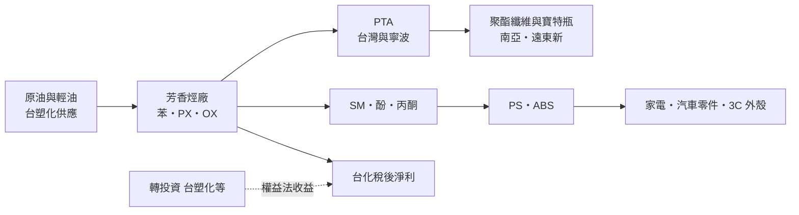
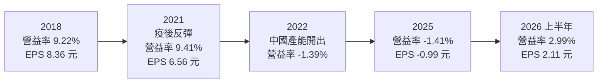
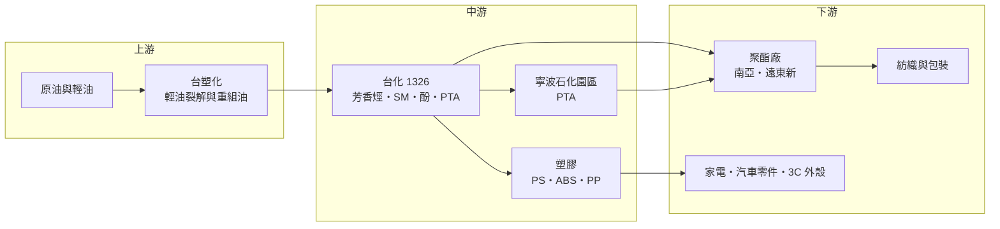

# 1326 台化

> 上市｜[[產業索引-塑膠工業|塑膠工業]]｜上市（櫃）日期 1984/12/20

# 第一章：企業模式與商業藍圖

> [!info] 撰寫說明
> 本文由 Claude 依公開資料整理，架構比照 [[2330台積電]] 的四章研究，資料截至 2026-10-08。財務數字來源：證交所開放資料快照（基本資料、2026 年第二季資產負債與綜合損益、股利）、Goodinfo 經營績效頁與股利政策頁（2016 至 2025 年）、MoneyDJ 季資產負債表（2026 年第二季借款科目）、科技新報 2025 年 6 月股東會報導（產品調整、PIA 市占、轉型目標）、永豐金證券 AI 投資網與 nStock 公司簡介；1987 年進入塑膠產業的年份與對台塑化等轉投資的持股未逐一查證，產業描述為整理性內容，尚未逐條比對原始文件。#待校對

在評估一家公司的長期投資價值時，第一步是看懂它靠什麼賺錢、為什麼能一直賺下去。本章針對台灣化學纖維（股票代號：1326，以下簡稱台化）的商業模式進行定性分析，說明它在台塑集團石化鏈中的位置、為什麼它的獲利取決於產品與原料之間的[[價差]]，以及在中國產能大舉開出後，它如何透過減產與差異化尋找出路。

## 一、核心定位：台塑集團的芳香烴與苯乙烯系主力

台化成立於 1965 年，1984 年上市，總部登記在彰化，是台塑集團「台塑四寶」之一。公司名稱保留了「化學纖維」，因為早年以嫘縈棉、耐隆纖維與紡織起家；之後進入塑膠產業並參與六輕投資，逐步轉型為以石化原料為主的公司（年份待校對）。依永豐金證券 AI 投資網的公司簡介，台化是全球前幾大的苯乙烯（[[SM]]）、[[ABS]] 與合成酚製造商。2024 年台化結束台灣的嫘縈與紡紗生產，紡織起家的色彩已經很淡。

台化的產品鏈從[[芳香烴]]開始：麥寮廠區的芳香烴廠把輕油裂解副產品與重組油轉成苯、對二甲苯（[[PX]]）、鄰二甲苯（OX），再往下做成純對苯二甲酸（[[PTA]]）、苯乙烯、酚與丙酮，以及聚苯乙烯（PS）、ABS、聚丙烯（PP）等塑膠。這個定位有兩個長期意義：

- **價差決定獲利：** 台化的獲利取決於產品與原料之間的價差，而不是單純的銷量。PX 與原油、苯與輕油、PTA 與 PX、SM 與苯之間的價差，是判斷台化獲利的關鍵指標。當亞洲新產能大量開出時，價差會被壓縮到接近零，台化就算滿載生產也賺不到錢。
- **集團中段：** 上游向 [[6505台塑化]] 取得原料，下游供應 [[1303南亞]] 等聚酯與塑膠加工廠，在集團內扮演承上啟下的角色。這讓台化的原料供應穩定，但也讓它和集團其他公司處於同一個景氣循環。

## 二、產品板塊：芳香烴、苯乙烯系、PTA 與塑膠

本次未查得台化依產品別的營收比重，因此不繪製營收結構圖。依 nStock 整理的營業項目與 2025 年股東會資訊，主要產品可以分成四大類：

- **芳香烴：** 苯、PX、OX。PX 是 PTA 的原料，苯則是 SM 與酚的原料，也可作為汽油調和組分。芳香烴是台化產品鏈的源頭，利差直接受原油價格與亞洲 PX 產能影響。
- **苯乙烯系：** SM、合成酚、丙酮，以及下游的 PS、ABS。這一系列和家電、汽車零件、3C 外殼等消費性需求高度相關，景氣好時需求強，消費疲弱時跌幅也大。
- **PTA 與聚酯原料：** PTA 是聚酯纖維與寶特瓶的原料。台化在中國浙江寧波設有大型 PTA 產能，寧波 PTA-6 廠於 2024 年投產，直接服務中國的聚酯客戶。
- **利基與差異化產品：** 依 2025 年股東會報導，台化自行開發的純間苯二甲酸（PIA）兩岸產能利用率超過 100%，全球市占率約 36%，是台化少數具有明顯市場地位的利基產品。公司也推動海洋廢棄尼龍回收等循環材料。

## 三、資本轉化邏輯：一體化產能賺取價差

- **營運據點：** 主要產能集中在雲林麥寮（六輕）與彰化，另在中國寧波設有大型石化園區。寧波廠讓台化能直接服務中國的聚酯與塑膠加工客戶，但也讓公司暴露在中國產能過剩與價格競爭之下。
- **共用設施：** 台化與台塑化、[[1301台塑]]、南亞在麥寮共用港口、電廠、蒸汽、儲槽與原料管線，降低物流與能源成本。這是台塑集團一貫化園區的核心優勢。
- **轉投資：** 台化持有台塑化等集團公司股權，[[權益法]]收益是獲利的重要來源。2026 年上半年台化營業利益約 50.5 億元，營業外收入約 92.9 億元，稅後淨利約 130.5 億元（證交所資料），轉投資的貢獻接近本業的兩倍。

## 四、企業長期藍圖：減產保利、差異化與減碳

- **從追求市占轉為追求單位利潤：** 依 2025 年股東會報導，台化管理層表示將減少產量與銷量、以單位成本優先於市占率，並暫停部分塑膠產線。這是在中國產能過剩下的務實選擇：與其滿載生產賺不到價差，不如縮小規模保住現金流。
- **差異化產品過半：** 台化設定差異化產品占產量超過 50% 的目標，以 PIA 這類具市場地位的利基產品，取代同質性高的大宗產品。公司並表示要在 80 多個國家的貿易關係中「做精、做廣」。
- **能源與管理轉型：** 同場股東會揭露，台化推動太陽能裝置量約 105MW、新港廠燃煤改燃氣，並以 2025 年碳排比 2020 年減少 10% 為目標；管理面則規劃在 2030 年前建立台灣數位孿生工廠，目標每年效益超過 25 億元。這些措施的目的是在碳成本上升的時代降低單位成本。

# 第二章：護城河深度與競爭優勢

在長期價值投資中，「護城河」指企業抵禦競爭、長期維持超額利潤的保護機制。石化大宗產品同質性高，護城河通常表現在成本，而不是定價權。本章分析台化的護城河構成、全球主要競爭對手，以及這些優勢在產能過剩週期中能守住多少。

## 一、台化護城河的核心組成要素

台化的護城河相對有限，屬於「規模與一體化」型的窄護城河：

- **1. 一貫化生產：** 從麥寮的芳香烴一路做到 PX、SM、PTA、ABS，中間產品不需外購，物流與能源成本較低。在原料供應中斷時，一體化產能也能確保穩定開工，這在地緣衝突期間特別有價值。
- **2. 規模優勢：** SM、ABS、合成酚的產能位居全球前段，在亞洲市場有一定的定價參與度。規模讓台化在價格戰中撐得比小廠久，但無法阻止價差被壓縮。
- **3. 集團綜效與利基產品：** 台塑集團共用港口、電廠、蒸汽與儲槽，使單位成本低於單獨建廠的同業。PIA 等利基產品則提供少數具定價能力的業務。

整體而言，石化大宗產品的客戶轉換成本很低，台化的優勢主要是「比別人便宜一點」，而不是「客戶非買它不可」。

## 二、全球主要競爭對手格局

| 對手 | 定位 | 對台化的影響 |
|---|---|---|
| 恆力石化、榮盛石化、浙江石化 | 中國民營煉化一體化企業 | 大量新增 PX、PTA、SM 產能，是台化利差長期受壓的主因 |
| 中石化、中石油體系 | 中國國營石化 | 在中國內需市場具規模與政策優勢 |
| [[1301台塑]]、[[1314中石化]]、[[1304台聚]]、[[1308亞聚]] | 台灣石化同業 | 在部分產品與台化重疊 |
| 奇美實業、LG 化學、樂天化學 | ABS 與苯乙烯系主要業者 | 在 ABS 市場直接競爭 |
| 中東與東南亞新廠 | 以低成本原料建置的大型石化廠 | 搶奪亞洲市場 |

## 三、優勢轉化：哪些守得住、哪些守不住

- **守得住：** 原料供應中斷或油價劇烈波動時，台化的一體化產能能穩定供貨，賺取比非一體化同業更好的價差。PIA 等全球市占高的利基產品，也能在景氣低迷時維持較好的利潤。
- **守不住：** 當中國新產能持續開出、需求疲弱時，台化的大宗產品價差會被壓縮到接近零。2022 至 2025 年台化營業利益率連續四年為負，就是例證。這不是一時的景氣問題，而是亞洲石化產能結構性過剩的結果。
- **觀察重點：** 長期可以追蹤 PX 與苯的價差、SM 與 ABS 的下游需求、寧波 PTA 廠的利潤，以及中國[[反內卷]]政策是否真的讓石化產能退場。差異化產品比重能否如期超過一半，是判斷台化轉型成敗的關鍵。

# 第三章：財務體質與盈利規模

資料日期：2026-10-08。數字取自 Goodinfo 經營績效頁與股利政策頁、證交所開放資料快照與 MoneyDJ 季資產負債表，表格是撰寫當時的快照；最新月營收、毛利率、累計 EPS 由自動排程寫在本筆記的屬性欄位（月營收、毛利率、累計EPS 等）。#待校對

財務報表是檢驗護城河是否真實存在的最終標準。本章用多年度的三率、ROE、現金流與資本報酬，檢視台化在石化產能過剩週期中的獲利品質。

## 一、獲利能力的基石：三率

| 年度 | 營收（億元） | [[毛利率]] | [[營業利益率]] | EPS（元） | [[ROE]] |
|---|---|---|---|---|---|
| 2020 | 2,533 | 11.7% | 6.05% | 3.34 | 5.36% |
| 2021 | 3,658 | 14.6% | 9.41% | 6.56 | 10.2% |
| 2022 | 3,799 | 3.35% | -1.39% | 1.26 | 2.25% |
| 2023 | 3,326 | 3.43% | -0.92% | 1.46 | 2.04% |
| 2024 | 3,486 | 4.03% | -0.45% | 0.06 | 0.33% |
| 2025 | 2,870 | 3.25% | -1.41% | -0.99 | -1.68% |

（來源：Goodinfo 經營績效頁，合併報表。2026 年上半年依證交所資料，營收 1,689.0 億元、毛利率 7.02%、營業利益率 2.99%、EPS 2.11 元。2016 至 2018 年營業利益率約 9.2% 至 10.9%、EPS 約 7.50 至 9.33 元。）

- **從穩定獲利到長期虧損：** 2016 至 2018 年台化營業利益率約 9% 至 11%，EPS 在 7.5 元以上，是集團中獲利最好的公司之一。2022 年起中國 PX、PTA 產能大量開出，台化毛利率跌到 3% 至 4%，營業利益連續四年為負。這種轉變不是單純的景氣低谷，而是競爭結構的改變。
- **稅後獲利依賴轉投資：** 2022 至 2024 年本業虧損，但 EPS 仍為正，主要來自台塑化等轉投資的權益法收益與股利。2026 年上半年也是如此，營業外收入接近營業利益的兩倍。
- **營收規模：** 2020 至 2025 年營收年複合成長率約 2.5%（推算），但 2025 年營收仍低於 2017、2018 年的水準，成長主要反映油價與產品價格的變化，而不是產能擴張。

## 二、[[ROE]]：資本效率

台化 2021 至 2025 年平均 ROE 約 2.6%（推算），2022 年後每年都在 2.3% 以下，資本效率在台股大型股中偏低。依 2026 年第二季資料，台化權益總計約 5,582 億元、每股淨值約 88.71 元，其中「其他權益」約 2,556 億元，主要是持有集團公司股權的未實現評價（推估）。負債總計約 1,699 億元，負債比約 23%，財務結構非常保守。低負債雖然讓台化在景氣低谷中不會出現財務危機，但龐大的權益基數也讓 ROE 很難回到過去的水準。

## 三、資本支出、自由現金流與股利

- **[[CapEx]]：** 本次未查得台化的年度資本支出金額。由於大宗石化產品處在供過於求週期，管理層已明確表示要減產、暫停部分產線，資本支出推估以維修、節能減碳、燃料轉換與差異化產品為主，不會大規模擴充大宗產能。
- **[[自由現金流]]：** 多年度的營業現金流與自由現金流本次未查得。低資本支出加上轉投資股利，推估台化在景氣低谷時仍能維持正的現金流，但金額會明顯縮小。
- **股利穩定度：** 台化 2016 至 2018 年度每年配發 5.6 至 7.0 元現金股利，2021 年度 4.8 元，2022 年度起降到 0.5 至 1.25 元，2025 年度在虧損下仍配發 0.6 元（證交所與 Goodinfo 資料），推估動用了以前年度的累積盈餘。台化的股利已從過去的高殖利率股，轉為隨景氣大幅縮水的循環股。

## 四、[[ROIC]] 與 [[WACC]]：價值創造利差

- **ROIC（推算）：** 以 2025 年營收 2,870 億元乘以營業利益率 -1.41%，營業損失約 40.5 億元，稅後營業利益約負 32 億元。投入資本以 2026 年第二季權益總計約 5,582 億元，加上有息負債約 1,339 億元（短期借款 486.4 億、應付商業本票 246.7 億、一年內到期長期負債 111.1 億、應付公司債 238.0 億、長期銀行借款 247.3 億、租賃負債 9.5 億），合計約 6,921 億元，ROIC 約 -0.5%（推算）。以 2026 年上半年營業利益約 50.5 億元年化計算，ROIC 約 1.2%（推算）；以 2021 年營業利益約 344 億元套用同一資本基礎，約 4.0%（推算）。
- **WACC（推算）：** 以 [[CAPM]] 估算股東權益成本：無風險利率取台灣 10 年期公債約 1.75%，市場風險溢酬 6%，β 假設 0.9（石化循環股同業常見值，未查得台化實際數字），權益成本約 7.15%。稅前負債成本假設 2.0%、稅率 20%，稅後約 1.6%。以帳面價值計算，負債約占 19%、權益約 81%，WACC 約 6.1%（推算）。
- **價值創造判斷：** 即使在 2021 年的景氣高峰，以目前的資本基礎計算的 ROIC 也只有約 4%，低於約 6.1% 的資金成本；2022 至 2025 年更是接近零或為負。這代表台化龐大的石化資產在這段期間沒有創造價值，股價長期低於淨值也反映了這一點。要讓 ROIC 重新超過 WACC，需要中國產能退場讓價差回升，或台化大幅提高差異化產品的比重、縮減低報酬的大宗產能。

# 第四章：總體風險與地緣政治

任何企業都無法脫離宏觀環境獨立存在，石化業與油價、地緣政治的連動尤其緊密。本章分析台化未來必須面對的地緣政治、產業週期、營運與法規風險。

## 一、地緣政治風險

- **中東衝突與油價：** 原油與石化原料價格受中東局勢影響很大。2026 年中東情勢緊張曾推升價差並帶來[[庫存利益]]，但這類利益屬於一次性，局勢緩和、油價下跌時可能轉為庫存損失。投資人不應把地緣衝突期間的獲利當作常態。
- **中國市場：** 寧波廠與大量出口都依賴中國需求，兩岸關係、中國反傾銷調查與關稅政策，都會影響台化在中國的銷售。中國同時是台化最大的市場與最大的競爭來源。
- **美國關稅：** 終端消費品（家電、3C、紡織）若受美國關稅影響而減產或移轉產地，會間接壓抑 ABS、PS、PTA 的需求。

## 二、產業週期與市場結構風險

- **石化產能過剩：** 中國與中東新產能持續開出，是台化 2022 至 2025 年本業虧損的主因。中國的煉化一體化企業規模更大、成本更低，結構性問題短期內難以根除。
- **需求季節性與消費景氣：** 苯乙烯系產品與家電、汽車、3C 需求連動，消費景氣轉弱時，SM、ABS、PS 的價差會快速收縮。
- **原料成本：** 原油、輕油價格的劇烈波動，直接影響芳香烴的利差與庫存評價。

## 三、營運環境的隱性風險

- **工安與環保：** 麥寮六輕歷年發生過多起工安事故，也受到空污排放、用水與用地等環保法規約束。重大工安事件可能導致停產與更嚴格的審查。
- **歲修與停車：** 大型芳香烴廠的定期[[歲修]]會造成單季產量與獲利波動。
- **轉投資依賴：** 稅後獲利有相當比重來自轉投資，台塑化等公司的景氣反轉會直接影響台化，而且台化對此沒有控制力。

## 四、科技與法規演進風險

- **碳費與碳邊境調整：** 台灣[[碳費]]開徵與歐盟 [[CBAM]] 實施，將提高高耗能石化業的成本。台化的燃煤改燃氣與太陽能投資，是降低碳成本的必要措施。
- **減碳與循環經濟：** 品牌客戶越來越要求再生與低碳材料，如果台化無法把產品組合轉向高值化、低碳或再生材料，未來可能長期處於低利差、高碳成本的不利位置。
- **數位化與成本競爭：** 中國大型石化廠的自動化程度高，台化的數位孿生工廠計畫若進度落後，在單位成本上可能逐漸失去優勢。

# 專有名詞解析

## 金融

- **[[權益法]]**：持股約兩成以上的轉投資，依持股比例把被投資公司的損益認列為投資收益的會計方法。
- **[[庫存利益]]**：原料價格上漲時，以較低成本購入的庫存按較高售價出售所產生的額外利潤，屬一次性成分。
- **[[ROIC]]**：投入資本報酬率，稅後營業利益除以股東權益加有息負債，衡量本業運用資本的效率。
- **[[WACC]]**：加權平均資金成本，依股東權益與負債的比重，加權計算公司取得資金的平均成本。
- **[[CAPM]]**：資本資產定價模型，以無風險利率加上 β 乘以市場風險溢酬估算股東要求報酬率。

## 產業

- **[[芳香烴]]**：含苯環結構的石化基本原料，包括苯、甲苯、二甲苯，是塑膠與纖維的上游原料。
- **[[PX]]**：對二甲苯，芳香烴的一種，主要用來生產 PTA，再做成聚酯纖維與寶特瓶。
- **[[PTA]]**：純對苯二甲酸，與乙二醇聚合成聚酯，是紡織與包裝用聚酯的基礎原料。
- **[[SM]]**：苯乙烯單體，用來生產 PS、ABS 等塑膠，台化是全球主要製造商之一。
- **[[ABS]]**：由丙烯腈、丁二烯與苯乙烯聚合的工程塑膠，耐衝擊，常用於家電、3C 外殼與汽車零件。
- **[[價差]]**：產品售價與原料成本之間的差額，是石化業判斷獲利的核心指標，又稱利差。
- **[[反內卷]]**：中國政府抑制產業過度競爭、低價傾銷與重複投資的政策方向，可能促使過剩產能退場。
- **[[歲修]]**：大型石化廠每隔一段期間停機進行的年度檢修，期間產量減少、費用增加。
- **[[碳費]]**：政府依企業碳排放量收取的費用，台灣已開徵，高耗能產業成本將上升。
- **[[CBAM]]**：歐盟碳邊境調整機制，對進口的高碳排產品依碳含量收費。

# 核心供應鏈

## 1. 上游：原料
- 輕油裂解副產品與重組油：[[6505台塑化]]
- 進口原油與輕油

## 2. 中游：台化本身與集團夥伴
- 台化麥寮與彰化廠：芳香烴（苯、PX、OX）、SM、酚、丙酮、PTA、PIA、PS、ABS、PP
- 中國寧波石化園區：PTA 等
- 集團夥伴：[[1301台塑]]、[[1303南亞]]

## 3. 同業競爭者
- 台灣：[[1314中石化]]、[[1304台聚]]、[[1308亞聚]]
- 中國：恆力石化、榮盛石化、浙江石化
- ABS 與苯乙烯系：奇美實業、LG 化學、樂天化學

## 4. 下游：客戶產業
- 聚酯纖維與寶特瓶：[[1303南亞]]、[[1402遠東新]]
- 家電、汽車零件、3C 外殼等塑膠製品廠

## 最新新聞
<!-- news:start（自動產生，請勿手動編輯此範圍） -->
- 2026-10-22 🏛️ 重訊 16:15｜公告本公司獨立董事辭任｜[觀測站](https://mops.twse.com.tw/mops/#/web/t05st01)
- 2026-10-22 🏛️ 重訊 16:15｜公告本公司獨立董事辭任功能性委員會之委員｜[觀測站](https://mops.twse.com.tw/mops/#/web/t05st01)
- 2026-10-21 📰 媒體 12:10｜鉅亨速報 - Factset 最新調查：台化(1326-TW)EPS預估上修至3.76元，預估目標價為84元｜[鉅亨網](https://news.cnyes.com/news/id/6634902)
- 2026-10-16 📰 媒體 12:23｜台化強攻再生能源業務有成 首座小水力發電廠已運轉472天供穩定綠電｜[鉅亨網](https://news.cnyes.com/news/id/6631945)
- 2026-10-14 📰 媒體 12:36｜〈焦點股〉塑化族群紅光滿面 台塑、台化亮燈漲停 南亞寫新天價｜[鉅亨網](https://news.cnyes.com/news/id/6624736)

完整紀錄：[[1326台化 新聞]]
<!-- news:end -->

## 相關連結
- [公開資訊觀測站](https://mopsov.twse.com.tw/mops/web/t05st03?step=1&firstin=1&co_id=1326)
- [Goodinfo](https://goodinfo.tw/tw/StockDetail.asp?STOCK_ID=1326)
- [Yahoo 股市](https://tw.stock.yahoo.com/quote/1326)
- [鉅亨網新聞](https://www.cnyes.com/twstock/1326/news)
