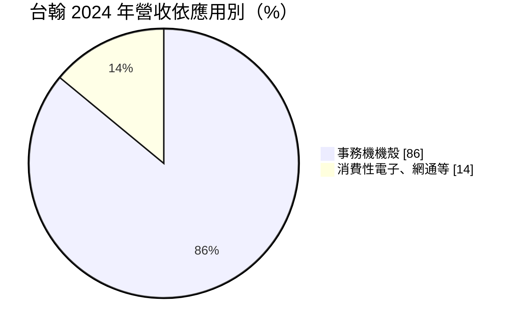
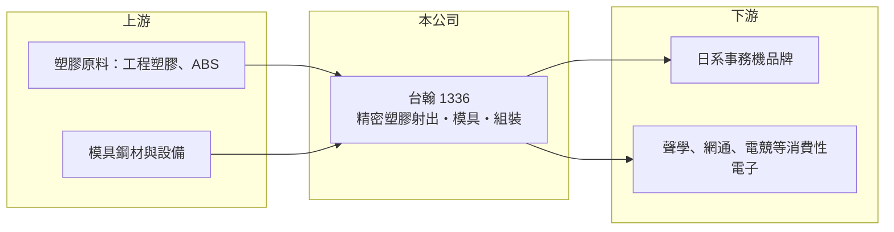

# 1336 台翰

> 上櫃｜[[產業索引-電子零組件業|電子零組件業]]｜上市（櫃）日期 2007/11/02

# 第一章：企業模式與商業藍圖

> [!info] 撰寫說明
> 精簡版，由 Claude 依公開資料整理，架構比照 [[2330台積電]]，資料截至 2026-10-08。來源：櫃買中心開放資料快照（基本資料、2026 年第二季資產負債與損益）、Goodinfo 經營績效頁、自由財經 2025 年 3 月報導。公開資料有限。#待校對

台翰精密（以下簡稱台翰）是一家替國際品牌代工精密塑膠零件的製造商，理解它的關鍵在於：客戶集中在日系[[事務機]]品牌，而公司正試著把同一套模具與成型能力延伸到其他消費性電子產品。

- **核心業務：** 台翰成立於 1987 年，2007 年在櫃買中心掛牌，主力產品是印表機、多功能事務機使用的[[塑膠射出]]機殼與內部精密件。公司的製程從模具設計、射出成型、印刷到組裝一條龍完成，客戶拿到的是可直接上線組裝的半成品，而不只是單一塑膠零件。這種一條龍能力讓台翰能承接外觀與尺寸要求都高的機殼訂單。
- **營收結構：** 依 2025 年 3 月的報導，2024 年事務機機殼約占營收 86%，其他產品約 14%。高度集中在事務機代表公司的成長大致跟著辦公列印市場走，而這個市場在無紙化趨勢下屬於成熟甚至緩慢萎縮的產業。因此公司近年拓展聲學、網通、智慧家電、遊戲與電競產品，目的就是降低對單一終端的依賴。
- **營運據點：** 公司總部位於桃園龜山，生產基地分布在中國、越南與菲律賓。越南海陽省第二廠區占地約 6 萬平方公尺，2025 年落成並自第三季起貢獻營收，第一期只使用約一半面積，保留了日後擴充空間。多地生產讓日系客戶可以依關稅與成本安排出貨地點。
- **長期方向：** 台翰的長期課題是把事務機以外的營收比重拉高，並藉越南新廠承接客戶「中國以外」的產能需求。新廠設有自動噴塗線與組裝線，可做[[次組裝]]，有助提高每件產品的附加價值。這條路能否走通，取決於能否在新領域找到像事務機客戶一樣長期穩定的訂單。

# 第二章：護城河深度與競爭優勢

台翰屬於規模中等的代工零件廠，護城河主要來自客戶認證與製程整合，而不是技術獨占。

- **競爭優勢：** 事務機機殼的模具與外觀品質需經過品牌客戶長時間驗證，一旦導入某個機種，通常會陪著該機種生產數年，形成一定的轉換成本。台翰長年服務日系客戶，熟悉其品質規範與交期要求，這是新進者不容易短期取得的信任。不過這種優勢綁在個別機種上，新機種仍需重新爭取。
- **主要對手：** 同樣做精密塑膠射出的台灣廠商與中國、東南亞的在地成型廠都是競爭者，部分日系品牌也有自家或協力集團的成型廠。塑膠射出本身技術門檻不高，價格競爭激烈，因此台翰的差異化必須建立在一條龍服務與多地產能上。主要對手的具體名單公開資料未查得。
- **觀察重點：** 長期最該追蹤的是事務機以外產品的營收比重是否持續提升，以及越南廠的產能利用率能否把毛利率拉回過去約 17% 的水準。2025 年毛利率降到 15.4%、營業利益率降到 4.38%，顯示新廠初期成本與產品轉換的壓力。若新客戶放量，固定成本攤提改善，獲利才有回升空間。

# 第三章：財務體質與盈利規模

資料日期：2026-10-08，表格是撰寫當時的快照；最新月營收、毛利率、累計 EPS 由自動排程寫在本筆記的屬性欄位（月營收、毛利率、累計EPS 等）。#待校對

台翰的財務呈現典型代工零件廠的樣貌：營收規模在 20 多億元附近、毛利率約一成五到一成八，獲利對產能利用率與匯率相當敏感。

| 年度 | 營收（億元） | [[毛利率]] | [[營業利益率]] | EPS（元） | [[ROE]] |
|---|---|---|---|---|---|
| 2021 | 20.9 | 16.5% | 6.75% | 1.00 | 4.85% |
| 2022 | 26.7 | 17.6% | 9.22% | 2.05 | 9.64% |
| 2023 | 23.2 | 16.8% | 7.00% | 1.39 | 6.15% |
| 2024 | 25.6 | 17.5% | 8.41% | 2.10 | 8.76% |
| 2025 | 25.0 | 15.4% | 4.38% | 0.71 | 2.89% |

（來源：Goodinfo 經營績效頁；2020 年營收 19.1 億元、EPS 2.48 元。）

- **營收規模：** 2020 至 2025 年營收由 19.1 億元增至 25.0 億元，年複合成長率約 5.5%（推算），成長主要來自 2022 年與 2024 年的擴張。營收波動不大，反映事務機訂單相對穩定，但也代表缺乏爆發性成長來源。
- **獲利：** 近五年（2021 至 2025）平均 ROE 約 6.5%（推算），偏低而且起伏明顯。2025 年營業利益率降到 4.38%，EPS 0.71 元，是近年低點。代工廠的毛利率只要掉 2 個百分點，營業利益就可能減半，這是低毛利製造業的營運槓桿特性。
- **財務特色：** 依 2026 年第二季資料，總資產約 33.9 億元，股東權益約 19.0 億元，負債總計約 15.0 億元，非流動資產占比高，反映越南新廠的投資。2025 年度現金股利每股約 0.26 元，Goodinfo 統計的歷年平均現金股利約 0.61 元，配息會隨獲利調整、並不固定。自由現金流是否長期為正未查得。
- **[[ROIC]] 與 [[WACC]]：** 以 2025 年營業利益約 1.10 億元（25.0 億元 × 4.38%）、稅率 20% 計算，稅後營業利益約 0.88 億元。有息負債未查得，投入資本以股東權益 19.0 億元到「權益加全部負債」33.9 億元為區間，ROIC 約 2.6% 至 4.6%（推算）；2024 年同法約 5% 至 9%（推算）。WACC 以 CAPM 推估：無風險利率 1.75%、市場風險溢酬 6%、β 假設 0.8（中小型零件股常見值），權益成本約 6.6%；稅後負債成本假設 2%、負債占三成，WACC 約 5.2%（推算）。2025 年 ROIC 低於 WACC，代表當年未創造經濟價值；景氣較好的 2022、2024 年則大致與資金成本相當，長期看屬於「勉強賺回資金成本」的類型。

# 第四章：總體風險與地緣政治

台翰的風險主要來自終端市場成熟、客戶集中與海外擴廠的執行。

- **產業週期：** 事務機市場受無紙化與遠距辦公影響，長期需求平緩甚至下滑，換機週期決定訂單起伏。公司若無法擴大非事務機營收，營收天花板會相當明顯。消費性電子雖然量大，但產品週期短、價格競爭更激烈。
- **營運風險：** 營收高度集中於少數日系品牌，一旦客戶調整供應鏈或把機種轉給其他代工廠，影響會直接反映在營收。越南新廠初期產能利用率不高，折舊與人力成本會先壓低毛利率，2025 年獲利下滑即與此相關。
- **其他風險：** 主要客戶以日圓或美元計價，匯率波動會影響毛利；塑膠原料價格隨油價波動。美國關稅政策與中國生產據點的地緣政治風險，是公司加速越南布局的主要原因，政策若再變動，產能配置可能還要調整。

# 專有名詞解析

## 應用

- **[[事務機]]**：印表機、影印機與多功能事務機的統稱，主要品牌集中在日本廠商。

## 產業

- **[[塑膠射出]]**：把加熱融化的塑膠注入模具、冷卻成形的製程，用於生產機殼與精密零件，模具品質決定良率與外觀。
- **[[次組裝]]**：在零件廠先把多個零件組成半成品模組再交給客戶，可提高零件廠的附加價值。

# 核心供應鏈

- 上游：工程塑膠與 ABS 等塑膠原料供應商（例如 [[1303南亞]] 等石化業者），以及模具鋼材與射出成型設備廠。
- 下游／客戶：日系印表機與多功能事務機品牌（具體名單公開資料未點名，#待校對），以及聲學、網通、智慧家電、遊戲與電競產品的品牌與代工廠。
- 同業：同樣從事精密塑膠射出與機構件的業者，例如 [[1582信錦]]（以金屬樞紐為主，兼有塑膠射出）。

## 最新新聞
<!-- news:start -->
<!-- news:end -->

## 相關連結
- [公開資訊觀測站](https://mopsov.twse.com.tw/mops/web/t05st03?step=1&firstin=1&co_id=1336)
- [Goodinfo](https://goodinfo.tw/tw/StockDetail.asp?STOCK_ID=1336)
- [Yahoo 股市](https://tw.stock.yahoo.com/quote/1336)
- [鉅亨網新聞](https://www.cnyes.com/twstock/1336/news)
