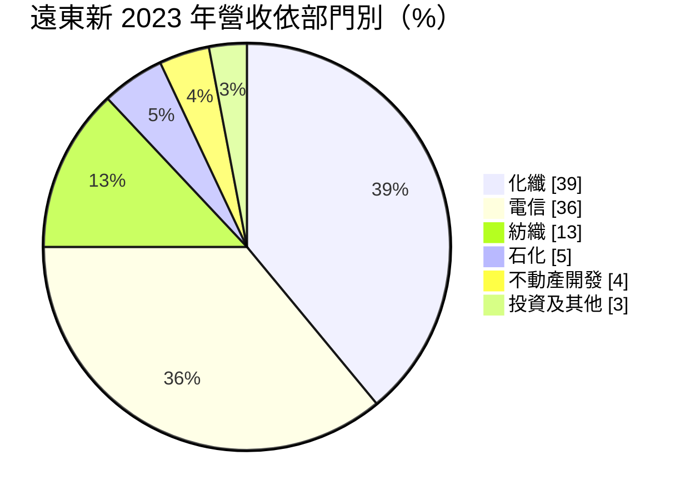
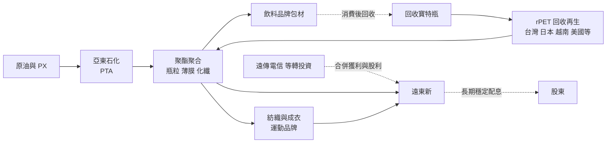
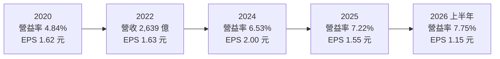
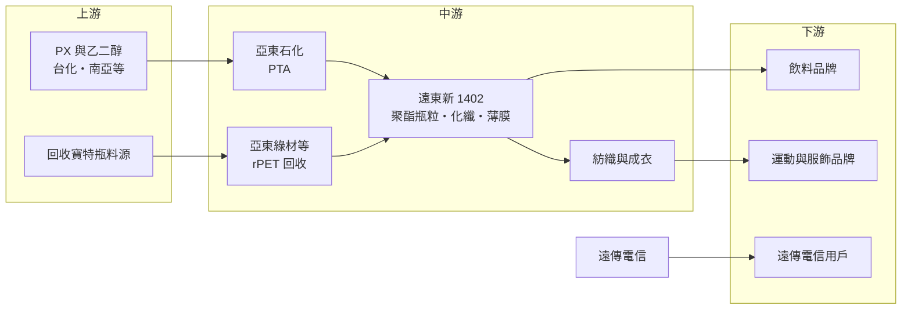

# 1402 遠東新

> 上市｜[[產業索引-紡織纖維|紡織纖維]]｜上市（櫃）日期 1967/04/14

# 第一章：企業模式與商業藍圖

> [!info] 撰寫說明
> 本文由 Claude 依公開資料整理，架構比照 [[2330台積電]] 的四章研究，資料截至 2026-10-08。財務數字來源：證交所開放資料快照（基本資料、2026 年第二季資產負債與綜合損益、股利）、Goodinfo 經營績效頁與股利政策頁（2016 至 2025 年）、MoneyDJ 季資產負債表（2026 年第一季借款科目，頁面編碼有誤、科目對應待校對）、優分析部門營收結構報導（2023 年比重、rPET 產能）、工商時報 2026 年 6 月法說會報導（綠色產品比重、海外回收廠、公司債）；產業描述為整理性內容，尚未逐條比對原始文件。#待校對

在評估一家公司的長期投資價值時，第一步是看懂它靠什麼賺錢、為什麼能一直賺下去。本章針對遠東新世紀（股票代號：1402，以下簡稱遠東新）的商業模式進行定性分析，說明這家遠東集團的核心企業，如何從傳統紡織轉型為聚酯化纖與循環材料廠，同時透過遠傳電信等轉投資取得穩定的現金流，以及這種「工業加電信」的混合結構對股東報酬代表什麼。

## 一、核心定位：聚酯產業鏈加上穩定現金流的控股型企業

遠東新成立於 1954 年，1967 年上市，前身為遠東紡織，是遠東集團的母公司之一。目前業務分成兩大塊：

- **生產事業：** 從上游石化原料 [[PTA]]、中游聚酯瓶粒與化纖，到下游紡織與成衣，形成垂直整合的聚酯產業鏈。遠東新是全球主要的聚酯化纖廠之一，也是全球第二大的回收聚酯（[[rPET]]）製造商，子公司亞東綠材自 1988 年起就投入寶特瓶回收。
- **電信與投資：** 持有 [[4904遠傳]] 約 38% 股權並具控制權，因此合併遠傳的營收；另轉投資 [[1102亞泥]]、[[2903遠百]] 等集團上市公司，以及大量土地資產。

這個雙引擎結構讓遠東新和一般化纖廠不同。聚酯是高度循環的大宗產業，景氣低迷時可能虧損；電信則是成熟、受管制、現金流穩定的事業。兩者合在一起，讓遠東新的獲利波動遠小於台塑四寶，也是公司能長期穩定配息的基礎。但這種結構也有代價：合併報表中有相當比例的獲利屬於遠傳的其他股東。2026 年上半年遠東新合併稅後淨利約 109.4 億元，其中歸屬母公司約 58.3 億元，非控制權益約 51.1 億元（證交所資料）。

## 二、終端應用與產品板塊：化纖與電信各占三成以上

以下為優分析整理的 2023 年部門營收比重，最新年度比重未查得：

- **化纖（約 39%）：** 包括聚酯瓶粒、[[PET]] 薄膜、工業用絲與機能纖維。瓶粒的客戶是全球飲料品牌，也是 rPET 最主要的應用。化纖事業的獲利受原料 PTA 與乙二醇價格、以及中國聚酯產能影響，綠色產品則提供較高的毛利率。
- **電信（約 36%）：** 合併遠傳電信的營收。遠傳在 2023 年與亞太電信合併後，市場地位與規模經濟提升。電信業成長有限，但用戶黏著度高、現金流穩定，是遠東新獲利的壓艙石。
- **紡織（約 13%）：** 聚酯長纖、布料與成衣，替國際運動品牌生產機能布料。紡織業務受運動品牌的庫存週期影響，2023 年品牌去庫存時訂單明顯減少，2024 年產能利用率回升到約八成。
- **石化（約 5%）：** 子公司亞東石化生產 PTA。因中國 PTA 產能嚴重過剩，亞東石化已把產能縮減到約 150 萬噸，並優先供應自家化纖部門，以降低虧損。
- **不動產與投資：** 遠東新持有大量土地，部分開發為商辦與住宅，也會在適當時機處分非核心不動產。這部分收入不穩定，但代表龐大的隱含資產價值。

## 三、資本轉化邏輯：從石油到瓶子，再從瓶子回到瓶子

- **垂直整合：** 從 PTA 到瓶粒、纖維、布料與成衣，遠東新能掌握每一段的品質與成本，並向品牌客戶提供可追溯的材料來源。在品牌要求碳足跡與再生料證明的時代，可追溯性本身就是接單條件。
- **循環經濟：** 回收寶特瓶經清洗、分選、再聚合成 rPET 瓶粒或纖維，重新賣回飲料與運動品牌，形成「瓶到瓶」的循環。依優分析報導，遠東新 rPET 產能由 2023 年的 36.4 萬噸提升到 2024 年的 56.3 萬噸，目標 2030 年達到年產 150 萬噸。依 2026 年 6 月法說會，綠色產品約占生產事業營收 33%，是毛利率較高的產品線。
- **電信現金流：** 遠傳的獲利依持股比例認列，並提供穩定股利。在化纖景氣低迷時，電信撐住遠東新的獲利與配息，也讓公司有能力在低谷期持續投資回收產能。

## 四、企業長期藍圖：綠色材料過半

- **2030 年目標：** 遠東新設定 2030 年綠色產品占營收 50%、碳排放減少 50%，綠色原料與綠色產品比重各達 50%。這代表公司把未來的競爭力押在再生材料，而不是一般聚酯的規模。
- **海外回收據點：** 越南年產約 6 萬噸的回收聚酯廠已於 2025 年完工，馬來西亞回收廠預計 2026 年下半年投產，另在日本、美國、菲律賓等地布局。回收廠需要靠近回收料源，多國布局是取得穩定料源的必要條件。
- **籌資與投資：** 2026 年董事會通過發行最高 100 億元無擔保公司債，用於擴產與綠色投資。綠色轉型需要持續的資本支出，遠東新的財務槓桿因此高於台塑四寶。
- **新材料：** 公司推出以碳固定技術製成的材料，以及由廢棄寶特瓶製成的鞋材與彈性纖維，往附加價值更高的機能材料延伸。

# 第二章：護城河深度與競爭優勢

在長期價值投資中，「護城河」指企業抵禦競爭、長期維持超額利潤的保護機制。本章分析遠東新的護城河構成、全球主要聚酯對手，以及在中國產能過剩下，這些優勢能守住多少。

## 一、遠東新護城河的核心組成要素

一般聚酯是高度標準化的大宗商品，幾乎沒有護城河。遠東新的護城河屬於「窄護城河」，主要來自三個要素：

- **1. rPET 的認證與回收料源：** 國際飲料與運動品牌對再生材料有嚴格的[[食品級認證]]與可追溯要求，取得認證、建立穩定的回收寶特瓶料源，都需要多年經營。遠東新在多國布局回收廠，是全球少數能大量供應食品級 rPET 的廠商。這種能力無法靠一次性投資取得。
- **2. 垂直整合與品牌關係：** 從原料到成衣一條龍，能和運動品牌共同開發機能布料，並提供碳足跡與可追溯資料。長期合作的品牌客戶轉換供應商的成本較高，因為要重新驗證材料與供應鏈。
- **3. 電信與資產的現金流緩衝：** 遠傳與亞泥等轉投資提供穩定股利，加上大量土地資產，讓公司在化纖景氣循環中仍有能力投資與配息。這不是傳統意義的競爭優勢，但讓遠東新能在對手被迫減少投資時繼續擴張。

## 二、全球主要競爭對手格局

| 對手 | 定位 | 對遠東新的影響 |
|---|---|---|
| Indorama Ventures（泰國） | 全球最大聚酯與 rPET 廠 | 規模最大，在全球瓶粒與 rPET 市場直接競爭 |
| 恆力、榮盛、桐昆等中國廠 | PTA 到聚酯一條龍，大量擴產 | 壓低 PTA、聚酯纖維與瓶粒價格 |
| [[1301台塑]]、[[1326台化]] | 台灣石化與化纖 | 在 PTA 與聚酯部分產品重疊 |
| [[1409新纖]]、[[1444力麗]] | 台灣聚酯化纖同業 | 在聚酯纖維與紡織競爭 |
| [[1476儒鴻]]、[[1477聚陽]] | 台灣機能布與成衣廠 | 在運動品牌機能布料與成衣競爭 |

## 三、優勢轉化：哪些市場守得住、哪些守不住

- **守得住：** 食品級 rPET 瓶粒與運動品牌的再生機能布料。這些產品有認證門檻與品牌綁定，毛利率高於一般產品，而且隨著各國再生料法規趨嚴，需求有長期支撐。
- **守不住：** PTA 與一般聚酯纖維。中國產能過剩使 PTA 價格長期低迷，亞東石化只能減產自用。在一般聚酯上，遠東新面對規模更大、成本更低的中國廠，很難取得超額利潤。
- **觀察重點：** 長期可以追蹤綠色產品比重能否從約 33% 往 50% 推進、海外回收廠的利用率與料源成本、歐盟包材再生料法規的實施進度，以及遠傳電信的獲利成長。這四點決定遠東新能否把轉型轉化為更高的資本報酬。

# 第三章：財務體質與盈利規模

資料日期：2026-10-08。數字取自 Goodinfo 經營績效頁與股利政策頁、證交所開放資料快照與 MoneyDJ 季資產負債表，表格是撰寫當時的快照；最新月營收、毛利率、累計 EPS 由自動排程寫在本筆記的屬性欄位（月營收、毛利率、累計EPS 等）。#待校對

財務報表是檢驗護城河是否真實存在的最終標準。本章用多年度的三率、ROE、現金流與資本報酬，檢視遠東新在聚酯景氣循環與綠色轉型期間的獲利品質。

## 一、獲利能力的基石：三率

| 年度 | 營收（億元） | [[毛利率]] | [[營業利益率]] | EPS（元） | [[ROE]] |
|---|---|---|---|---|---|
| 2020 | 2,068 | 19.5% | 4.84% | 1.62 | 4.80% |
| 2021 | 2,388 | 19.5% | 4.90% | 1.94 | 5.51% |
| 2022 | 2,639 | 19.0% | 5.44% | 1.63 | 4.93% |
| 2023 | 2,572 | 18.3% | 5.82% | 1.64 | 5.27% |
| 2024 | 2,710 | 19.9% | 6.53% | 2.00 | 6.03% |
| 2025 | 2,541 | 20.4% | 7.22% | 1.55 | 5.33% |

（來源：Goodinfo 經營績效頁，合併報表。2026 年上半年依證交所資料，營收 1,305.6 億元、毛利率 20.80%、營業利益率 7.75%、EPS 1.15 元。2016 至 2019 年毛利率約 18% 至 24%、EPS 約 1.26 至 2.41 元。）

- **穩定是最大特色：** 2016 至 2025 年遠東新的毛利率都在 18% 至 24% 之間，EPS 在 1.26 至 2.41 元之間，波動遠小於台塑四寶。原因是電信事業約占營收三成多，且毛利率與現金流穩定，抵銷了化纖與紡織的景氣循環。
- **營業利益率緩步提升：** 營業利益率由 2020 年的 4.84% 提升到 2025 年的 7.22%，2026 年上半年約 7.75%。可能的原因包括遠傳合併亞太電信後的綜效，以及綠色產品比重提高（推估）。
- **EPS 與營業利益不同步：** 2025 年營業利益率創近年新高，EPS 卻降到 1.55 元，代表業外損益、資產減損或非控制權益的變化影響了歸屬母公司的獲利。遠東新的 EPS 需要拆開本業、電信與業外分別理解。
- **營收成長：** 2020 至 2025 年營收年複合成長率約 4.2%（推算），屬於溫和成長。

## 二、[[ROE]]：資本效率

遠東新 2021 至 2025 年平均 ROE 約 5.4%（推算），十年來大致在 5% 至 7% 之間，穩定但偏低。依 2026 年第二季資料，權益總計約 3,146 億元（歸屬母公司約 2,328 億元）、每股淨值約 43.50 元，負債總計約 3,752 億元，負債比約 54%。ROE 偏低的原因有二：一是帳上有大量轉投資與土地資產，這些資產的價值主要反映在股利與潛在增值，而不是每年的損益；二是合併遠傳後，有相當比例的獲利屬於非控制權益。市場長期給予遠東新低於淨值的評價，反映了這種控股結構的折價。

## 三、資本支出、自由現金流與股利

- **[[CapEx]]：** 遠東新的合併資本支出包含遠傳的網路建設與生產事業的回收產能擴張，兩者都屬於持續性的投資。2026 年發行最高 100 億元公司債，用於越南、馬來西亞回收廠與綠色材料擴產。
- **[[自由現金流]]：** 多年度的自由現金流本次未查得。電信事業的營業現金流穩定，但 5G 網路與頻譜投資金額大；生產事業的現金流則受化纖景氣與擴產支出影響。
- **股利穩定度：** 遠東新 2016 至 2025 年度每年配發 0.8 至 1.8 元現金股利，2020 至 2025 年度都在 1.25 至 1.6 元之間。2025 年度配發 1.25 元，以 EPS 1.55 元計算配發率約 81%（推算）。公司章程規定在維持股利穩定的目標下，原則上配發不低於可分配盈餘的 50%。遠東新屬於台股中配息相當穩定的公司。

## 四、[[ROIC]] 與 [[WACC]]：價值創造利差

- **ROIC（推算）：** 以 2025 年營收 2,541 億元乘以營業利益率 7.22%，營業利益約 183.5 億元，扣除 20% 稅率後稅後營業利益約 146.8 億元。投入資本以 2026 年第二季權益總計約 3,146 億元，加上 2026 年第一季有息負債約 2,290 億元（短期借款 359.9 億、應付商業本票 225.0 億、應付公司債 851.4 億、長期銀行借款 714.9 億、租賃負債 138.5 億；一年內到期長期負債未查得，科目對應待校對），合計約 5,436 億元，ROIC 約 2.7%（推算）。若計入一年內到期的長期負債，ROIC 會略低。
- **WACC（推算）：** 以 [[CAPM]] 估算股東權益成本：無風險利率取台灣 10 年期公債約 1.75%，市場風險溢酬 6%，β 假設 0.7（電信與化纖混合，未查得遠東新實際數字），權益成本約 5.95%。稅前負債成本假設 2.0%、稅率 20%，稅後約 1.6%。以帳面價值計算，負債約占 42%、權益約 58%，WACC 約 4.1%（推算）。
- **價值創造判斷：** 遠東新的 ROIC 約 2.7%，低於約 4.1% 的資金成本，代表整體資本雖然穩定獲利，卻沒有創造超額價值。問題不在於電信或 rPET 本身，而在於龐大的土地、轉投資與一般聚酯資產拉低了整體報酬。改善的關鍵有兩個：綠色產品比重提高帶動生產事業的利潤率，以及土地與非核心資產的活化或處分，讓投入資本更集中在高報酬的業務上。

# 第四章：總體風險與地緣政治

任何企業都無法脫離宏觀環境獨立存在。本章分析遠東新未來必須面對的地緣政治、產業週期、營運與法規風險。

## 一、地緣政治風險

- **中國產能與價格競爭：** 中國聚酯產業鏈大幅擴產，透過低價出口影響全球價格。遠東新在中國也有生產據點，同時面對中國市場的競爭與政策風險。
- **美國關稅與產地轉移：** 紡織與成衣出口受美國對越南等生產國的關稅政策影響，品牌客戶可能因關稅調整採購地點。遠東新多國布局能分散風險，但也增加管理複雜度。
- **海外據點的營運環境：** 越南、馬來西亞、美國等據點的政治、勞動與環保法規差異大，新廠的爬坡速度可能不如預期。

## 二、產業週期與市場結構風險

- **石化與聚酯週期：** PTA 與聚酯價格跟隨原油與中國供需波動，景氣低迷時生產事業可能出現虧損。亞東石化的 PTA 已經減產自用，代表這段產業鏈的長期利潤空間有限。
- **紡織庫存週期：** 運動品牌在疫情後經歷大幅的庫存調整，紡織訂單隨之波動，具有明顯的[[長鞭效應]]。品牌的庫存政策是紡織事業最大的不確定性。
- **電信市場成熟：** 台灣電信市場已高度飽和，遠傳的成長來自 5G 資費升級、企業資通訊與合併綜效，長期成長空間有限，價格競爭也可能再起。

## 三、營運環境的隱性風險

- **再生料源競爭：** 全球品牌都在搶回收寶特瓶，回收料價格上漲可能壓縮 rPET 的毛利率。回收料源的穩定性與成本，是 rPET 事業最關鍵的變數。
- **工安與資產減損：** 大型化纖廠有工安與停工風險，擴產失敗或產能閒置也可能導致資產減損。
- **控股折價：** 大量轉投資與土地資產使股價長期低於淨值，若資產未能活化，折價可能持續。這是結構性的評價問題，而不是單一年度的經營問題。

## 四、科技或法規演進

- **歐盟包裝法規：** 歐盟[[PPWR]]（包裝與包裝廢棄物法規）要求塑膠瓶逐步提高再生料比例，對 rPET 需求是長期利多，也是遠東新綠色轉型最重要的法規支撐。
- **碳足跡與碳邊境調整：** 歐盟 [[CBAM]] 目前未涵蓋紡織與塑膠，但品牌商自主的碳足跡要求日趨嚴格，低碳材料與可追溯資料會成為接單條件。
- **化學回收：** 若化學回收技術成熟，能處理物理回收難以處理的混紡衣物與有色瓶，可能改變 rPET 的競爭格局。遠東新若能掌握化學回收，將擴大料源；若落後，物理回收的優勢可能被稀釋。

# 專有名詞解析

## 金融

- **[[非控制權益]]**：合併報表中不屬於母公司股東的那一部分子公司權益與損益，子公司持股越低，這部分越大。
- **[[長鞭效應]]**：終端需求的小幅變動沿供應鏈往上游傳遞時被逐級放大，造成上游庫存與訂單劇烈波動。
- **[[自由現金流]]**：營業活動現金流減去資本支出，代表企業可自由用於配息、還債或併購的現金。
- **[[ROIC]]**：投入資本報酬率，稅後營業利益除以股東權益加有息負債，衡量本業運用資本的效率。
- **[[WACC]]**：加權平均資金成本，依股東權益與負債的比重，加權計算公司取得資金的平均成本。
- **[[CAPM]]**：資本資產定價模型，以無風險利率加上 β 乘以市場風險溢酬估算股東要求報酬率。

## 產業

- **[[PTA]]**：純對苯二甲酸，由 PX 製成，與乙二醇聚合成聚酯，是紡織與包裝用聚酯的主要原料。
- **[[PET]]**：聚對苯二甲酸乙二酯，即聚酯，用來製作寶特瓶、薄膜與化纖。
- **[[rPET]]**：回收再生聚酯，由回收寶特瓶經清洗與再聚合製成，可再做成瓶子或纖維。
- **[[食品級認證]]**：再生塑膠要用於食品與飲料包裝，須通過美國 FDA、歐盟 EFSA 等機構的安全認證。
- **[[PPWR]]**：歐盟包裝與包裝廢棄物法規，規定塑膠包裝的再生料比例與可回收設計要求。
- **[[CBAM]]**：歐盟碳邊境調整機制，對進口的高碳排產品課徵碳成本，首波涵蓋鋼鐵、水泥、鋁等。
- **[[化學回收]]**：以解聚等化學方法把廢塑膠分解回單體再重新聚合，可處理物理回收難以處理的廢料。

# 核心供應鏈

## 1. 上游：石化原料與回收料源
- PX 與乙二醇：[[1326台化]]、[[1303南亞]] 等石化業者
- 各國回收寶特瓶料源與回收商

## 2. 中游：遠東新與集團轉投資
- 遠東新：聚酯瓶粒、PET 薄膜、化纖、紡織與成衣
- 子公司：亞東石化（PTA）、亞東綠材（rPET 回收）
- 電信與投資：[[4904遠傳]]、[[1102亞泥]]、[[2903遠百]]

## 3. 下游：品牌客戶
- 全球飲料品牌（瓶粒與 rPET）
- 國際運動與服飾品牌（機能布料與成衣）

## 4. 同業
- 國際：Indorama Ventures、恆力、榮盛、桐昆
- 台灣：[[1409新纖]]、[[1444力麗]]、[[1476儒鴻]]、[[1477聚陽]]

## 最新新聞
<!-- news:start -->
<!-- news:end -->

## 相關連結
- [公開資訊觀測站](https://mopsov.twse.com.tw/mops/web/t05st03?step=1&firstin=1&co_id=1402)
- [Goodinfo](https://goodinfo.tw/tw/StockDetail.asp?STOCK_ID=1402)
- [Yahoo 股市](https://tw.stock.yahoo.com/quote/1402)
- [鉅亨網新聞](https://www.cnyes.com/twstock/1402/news)
