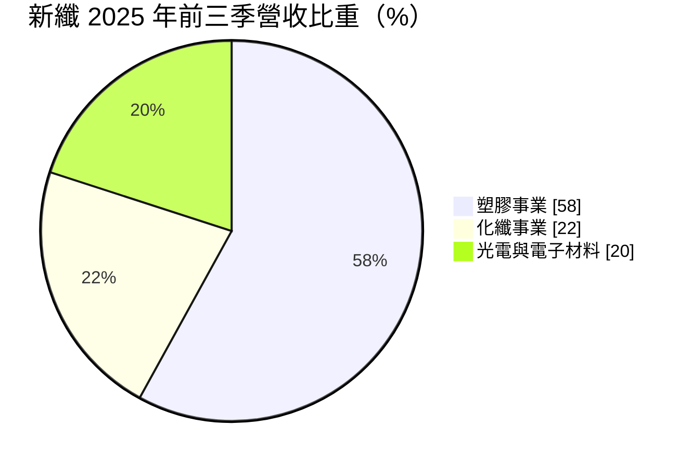
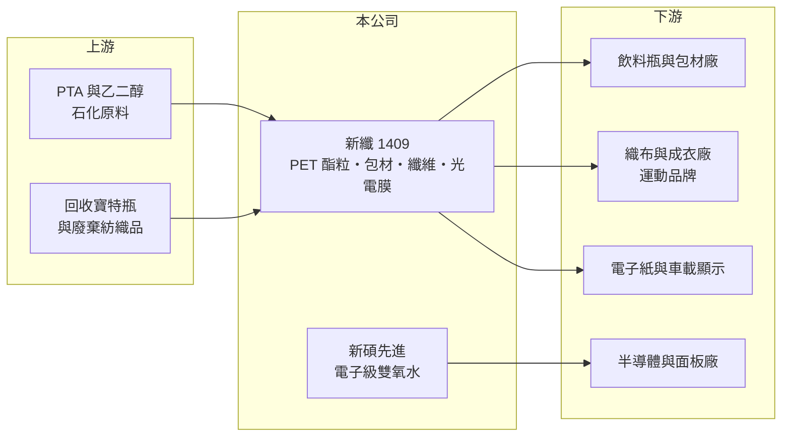

# 1409 新纖

> 上市｜[[產業索引-紡織纖維|紡織纖維]]｜上市（櫃）日期 1973/08/31

# 第一章：企業模式與商業藍圖

> [!info] 撰寫說明
> 精簡版，由 Claude 依公開資料整理，架構比照 [[2330台積電]]，資料截至 2026-10-08。來源：MoneyDJ 理財網財務比率年表（2021 至 2025 年）；富果研究 2025 年 11 月法說會摘要；nStock 公司簡介（2025 年營收）；證交所開放資料快照（基本資料、2025 年度股利、本益比殖利率）。證交所一般業財報快照未收錄新纖，資產負債細項未查得。#待校對

新光合成纖維成立於 1967 年 4 月、1973 年 8 月上市，董事長為新光集團的吳東昇，實收資本額約 161.8 億元。名稱雖是「合成纖維」，但今天新纖最大的事業是塑膠，公司正把傳統的聚酯本業轉向回收材料、電子化學品與光電膜等較高附加價值的領域。

- **核心業務：** 塑膠事業生產 PET 酯粒與包裝材料，應用涵蓋飲料瓶、醫療包材、AI 伺服器 GPU 包材，以及用 PET 取代 PVC 的建材；化纖事業生產[[聚酯]]衣著用纖維與安全帶、輪胎簾布、建築防護網等工業用紗；光電與電子材料事業生產電子紙與車載用膜，並透過子公司新碩先進生產[[電子級雙氧水]]。三個事業共用聚酯化學的核心技術，這讓新纖可以把同一套原料能力延伸到不同終端市場。
- **營收結構：** 依富果整理的 2025 年前三季法說內容，塑膠事業占營收 58%（前一年 65%）、化纖 22%、光電與電子材料 20%。塑膠比重下降、光電與電子材料比重上升，代表產品組合正往附加價值較高的方向移動，這也是 2025 年營收衰退、毛利率卻回升的原因之一（推估）。
- **營運據點：** 機械回收 PET（MR-PET）產能在台灣，泰國子公司泰新工業生產化學回收 PET，電子級雙氧水由新碩先進在台南生產，第二條產線預計 2027 年完工。依 2025 年 11 月法說內容，新纖投資美國 Ambercycle 1,000 萬美元，在印尼建置年產 3 萬噸的[[纖維對纖維回收]]（T2T）產能，預計 2027 年完工；與 Celanese 合作的 Neolast 彈性纖維年產能 600 噸，預計 2026 年投產。
- **長期方向：** 新纖的長期策略是發展[[rPET]]、T2T 回收纖維、生質材料等永續材料，搭上國際飲料與運動品牌的回收料使用目標；同時推動桃園約 11 公頃土地的「新光 InnovHub」資產活化案，並以轉投資收益平衡本業景氣循環。公司訂下以 2021 年為基準、2030 年減碳 28%、2050 年淨零的目標。

# 第二章：護城河深度與競爭優勢

新纖的競爭力來自完整的聚酯化學技術、回收材料的先行布局與集團資源，但大宗 PET 與化纖產品同質性高，本業護城河偏窄。

- **競爭優勢：** 回收聚酯要做到食品級或可紡成細纖維，需要清洗、除雜與再聚合的製程能力，新纖同時握有機械回收與化學回收技術，並與國外技術夥伴合作 T2T，這在台灣同業中屬於較早布局者。國際品牌要求回收料比例逐年提高，能穩定供應認證回收料的供應商具有議價空間。
- **主要對手：** PET 酯粒與回收聚酯的主要對手是 [[1402遠東新]] 以及中國大型聚酯廠；化纖方面有 [[1444力麗]]、[[1455集盛]] 等台灣廠商。中國聚酯產能龐大，一般規格產品價格常被壓低，台灣廠商只能靠特殊規格與回收認證取得溢價。
- **觀察重點：** 過去 5 年[[營業利益率]]介於 4% 至 15%，跟隨聚酯價差起伏。長期要觀察光電與電子材料（電子紙膜、電子級雙氧水）能否持續提高比重，以及 T2T 與 Neolast 新產能能否在 2026 至 2027 年順利放量，這決定新纖能否擺脫大宗化纖的價格循環。

# 第三章：財務體質與盈利規模

資料日期：2026-10-08，表格是撰寫當時的快照；最新月營收、毛利率、累計 EPS 由自動排程寫在本筆記的屬性欄位（月營收、毛利率、累計EPS 等）。#待校對

新纖營收規模約 400 億元，獲利隨聚酯景氣循環，2023 年為谷底，2024 至 2025 年緩步回升，資本報酬整體偏低。

| 年度 | 營收（億元） | [[毛利率]] | [[營業利益率]] | EPS（元） | [[ROE]] |
|---|---|---|---|---|---|
| 2021 | 約 435（推算） | 25.35% | 14.50% | 2.41 | 10.79% |
| 2022 | 約 444（推算） | 19.14% | 8.63% | 1.75 | 7.84% |
| 2023 | 約 387（推算） | 14.70% | 4.45% | 0.47 | 2.52% |
| 2024 | 約 447（推算） | 18.88% | 8.31% | 1.06 | 5.02% |
| 2025 | 393.3 | 21.19% | 8.22% | 1.19 | 4.83% |

註：2021 至 2024 年營收以 MoneyDJ 每股營業額乘以約 16.18 億股推算；2025 年取自 nStock。

- **長期指標：** 2021 至 2025 年營收年複合成長率約 -2.5%（推算），近 5 年平均 ROE 約 6.2%（推算）。2025 年度每股現金股利 0.9 元（證交所資料），約為 EPS 1.19 元的 76%。每股現金流量 2021 至 2025 年有 3 年為負（-1.59、-3.32、-4.06 元），顯示近年擴產與轉投資支出大，自由現金流並非長期為正。
- **[[ROIC]] 與 [[WACC]]：** 2025 年稅後營業利益約 25.9 億元（營業利益率 8.22% × 營收 393.3 億元 × 0.8）。2025 年底母公司股東權益約 417 億元（每股淨值 25.8 元 × 16.18 億股），有息負債這次未查得：只計股東權益時 ROIC 約 6.2%，若有息負債與權益相當則約 3.1%（推算區間）。WACC 約 5.6%（推算：無風險利率 1.75%、市場風險溢酬 6%、β 取化纖同業常見值 0.9，股東權益成本 7.15%；稅前負債成本 2.5%、稅率 20%，假設負債占資本 30%）。ROIC 大致落在 WACC 上下，景氣好時小幅創造價值、景氣差時則低於資金成本，長期而言本業並未穩定創造超額報酬。
- **財務特色：** MoneyDJ 列示新纖負債比率長年在 75% 至 77%，明顯高於一般化纖廠，加上證交所一般業財報快照未收錄新纖，推測合併報表中含有特殊行業子公司或大量長期負債，結構原因待校對。2026 年第二季毛利率 29.1%、營業利益率 17.8%（nStock），為近年高點，反映光電與電子材料比重提高。

# 第四章：總體風險與地緣政治

新纖的風險在於聚酯景氣循環、中國產能過剩，以及大量新投資能否如期回收。

- **產業週期：** 聚酯酯粒與纖維的價差跟隨原油、PTA 與乙二醇價格，以及中國產能擴張而波動，2023 年毛利率跌到 14.7% 就是低谷的寫照。國際品牌的庫存調整也會讓纖維訂單在短期內大起大落。
- **營運風險：** 2025 至 2027 年同時推動印尼 T2T、Neolast、電子級雙氧水二期與桃園 InnovHub，資本支出集中，若新產品放量不如預期，折舊與利息會侵蝕獲利。回收料成本受寶特瓶回收量與品牌搶料影響，價格未必比原生料低。
- **其他風險：** 外銷以美元計價，新台幣升值壓縮毛利；歐盟碳邊境調整機制（CBAM）與品牌碳足跡要求日益嚴格，減碳不力可能失去訂單；泰國、印尼據點則面臨當地政治與匯率風險。

# 專有名詞解析

## 金融

- **[[ROIC]]**：投入資本報酬率，稅後營業利益除以股東權益加有息負債，衡量本業運用資本的效率。
- **[[WACC]]**：加權平均資金成本，股東與債權人要求報酬率的加權平均，是 ROIC 要超越的門檻。

## 產業

- **[[聚酯]]**：以 PTA 與乙二醇聚合而成的合成纖維與塑膠原料，用於衣料、寶特瓶與工業用布。
- **[[rPET]]**：回收再生聚酯，由回收寶特瓶經清洗與再聚合製成，可再做成瓶子或纖維。
- **[[纖維對纖維回收]]**：把廢棄衣物等紡織品回收再製成新纖維的技術，英文簡稱 T2T，比瓶到纖維更難。
- **[[電子級雙氧水]]**：純度極高的過氧化氫，用於半導體與面板製程的清洗與蝕刻。

# 核心供應鏈

- 上游：PTA 與乙二醇供應商如 [[1326台化]]、[[1303南亞]]（是否為新纖供應商未查得）；回收寶特瓶來源；技術夥伴 Ambercycle、Loop、Celanese。
- 下游／客戶：飲料瓶與包材廠、織布與成衣廠、國際運動品牌、電子紙與車載顯示廠、半導體與面板廠（具體客戶名單未查得）。
- 同業：[[1402遠東新]]、[[1444力麗]]、[[1455集盛]]、[[1434福懋]]；同集團 [[1419新紡]]、[[2850新產]]（持股關係待校對）。

## 最新新聞
<!-- news:start（自動產生，請勿手動編輯此範圍） -->
- 2026-10-06 📰 媒體 13:51｜〈台北紡織展〉新纖NEOLAST新產線正式量產 首階段年產能600噸｜[鉅亨網](https://news.cnyes.com/news/id/6622647)

完整紀錄：[[1409新纖 新聞]]
<!-- news:end -->

## 相關連結
- [公開資訊觀測站](https://mopsov.twse.com.tw/mops/web/t05st03?step=1&firstin=1&co_id=1409)
- [Goodinfo](https://goodinfo.tw/tw/StockDetail.asp?STOCK_ID=1409)
- [Yahoo 股市](https://tw.stock.yahoo.com/quote/1409)
- [鉅亨網新聞](https://www.cnyes.com/twstock/1409/news)
