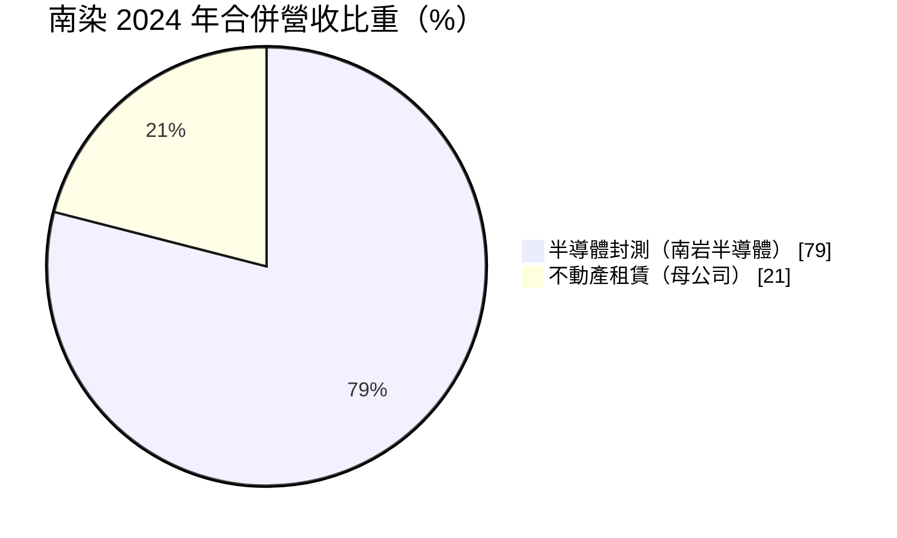
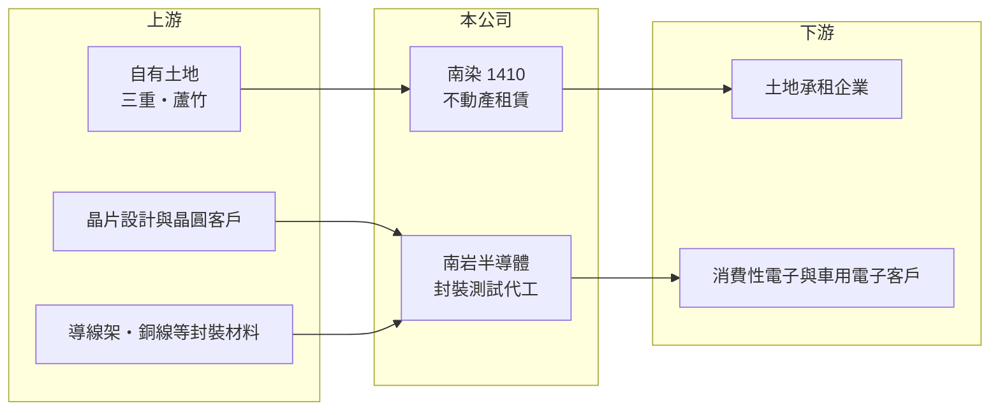

# 1410 南染

> 上市｜[[產業索引-紡織纖維|紡織纖維]]｜上市（櫃）日期 1973/10/18

# 第一章：企業模式與商業藍圖

> [!info] 撰寫說明
> 精簡版，由 Claude 依公開資料整理，架構比照 [[2330台積電]]，資料截至 2026-10-08。來源：MoneyDJ 理財網財務比率年表（2021 至 2025 年）；富果研究 2025 年 11 月法說會摘要（2024 年營收結構與事業說明）；證交所開放資料快照（基本資料、2026 年上半年資產負債、損益與營益分析、2025 年度股利）。#待校對

南洋染整成立於 1964 年 12 月、1973 年 10 月上市，董事長為何鈞，實收資本額 6.2 億元。公司名稱仍是「染整」，但依法說內容，南染已在 2022 年決議退出染整業務，今天的南染是一家「母公司收土地租金、子公司做半導體封測代工」的控股型公司，理解這個轉型是評估它的起點。

- **核心業務：** 母公司南染經營[[不動產租賃]]，持有新北市三重區土地（已簽長期租約）與桃園市蘆竹區的原染整廠土地，後者廠房已拆除、鄰近機場捷運 A10 站。子公司南岩半導體從事[[封裝測試]]代工與自產自銷，產品主要應用於消費性電子，近年取得 IATF 16949 車用品質認證，切入汽車電子。
- **營收結構：** 2024 年合併營收約 2.36 億元，其中半導體封測占 79%、不動產租賃占 21%。南岩 2024 年營收約 1.87 億元，封測代工勞務收入約占 76%、自產自銷約占 24%，後者銷售對象為中國大陸廠商。租金收入金額小但毛利高，是母公司獲利的穩定來源。
- **營運據點：** 土地資產集中在新北三重與桃園蘆竹，封測產能則屬子公司南岩（廠區位置未查得，待校對）。蘆竹土地原規劃興建物流倉，後因銀行放貸條件收緊與利率上升，改為純土地出租，以避免營建與資本支出風險。
- **長期方向：** 母公司的方向是以[[資產活化]]的方式運用自有土地、追求長期穩定租金；子公司則聚焦汽車電子、高頻等利基市場，培養射頻與靜電放電防護技術，並開發歐美客戶分散對中國的依賴。兩條路線一穩一動，長期價值主要取決於土地能否以合理租金長期出租。

# 第二章：護城河深度與競爭優勢

南染的長期競爭力不在紡織，而在於低成本取得的老土地與子公司在利基封測市場的定位，兩者都屬於窄護城河。

- **競爭優勢：** 南染的土地是早年以工業用地取得，帳面成本遠低於現值，出租時不必負擔高額購地成本，因此即使租金水準普通，帳面報酬仍可接受。蘆竹土地鄰近機場捷運與桃園航空城，物流與倉儲需求是長期潛在承租來源。
- **主要對手：** 租賃方面與周邊工業區、物流園區的出租土地競爭；封測方面，南岩規模遠小於 [[3711日月光投控]]、[[2441超豐]] 等大廠，只能在小批量、特殊應用的訂單中生存，並面對中國本土封測廠的價格競爭。
- **觀察重點：** 依法說內容，2024 年初簽訂的桃園租約在同年 7 月合議終止，南染認列約 4,700 萬元違約金收入，因此蘆竹土地能否重新簽下長期租約，是母公司獲利能否穩定的關鍵。子公司則要觀察車用訂單比重能否持續提高。

# 第三章：財務體質與盈利規模

資料日期：2026-10-08，表格是撰寫當時的快照；最新月營收、毛利率、累計 EPS 由自動排程寫在本筆記的屬性欄位（月營收、毛利率、累計EPS 等）。#待校對

南染退出染整後營收規模大幅縮小，本業利潤微薄，EPS 很大一部分來自租金、違約金與匯兌等收入，ROE 長期偏低。

| 年度 | 營收（億元） | [[毛利率]] | [[營業利益率]] | EPS（元） | [[ROE]] |
|---|---|---|---|---|---|
| 2021 | 約 4.78（推算） | 38.34% | 22.85% | 1.29 | 7.54% |
| 2022 | 約 3.96（推算） | 33.57% | 11.59% | 0.90 | 4.80% |
| 2023 | 約 2.22（推算） | 27.11% | -6.52% | 0.24 | 1.16% |
| 2024 | 約 2.36 | 34.06% | 7.26% | 0.57 | 3.27% |
| 2025 | 約 1.89（推算） | 29.46% | -3.17% | 0.58 | 2.64% |

註：2021 至 2023 年以 MoneyDJ 每股營業額乘以減資前約 6,300 萬股推算，2025 年以 6,200 萬股推算；2024 年取自法說摘要。2022 年以前營收包含已退出的染整業務。

- **長期指標：** 2021 至 2025 年營收年複合成長率約 -21%（推算），反映事業轉型；近 5 年平均 ROE 約 3.9%（推算）。2024 年度每股現金股利 0.5 元、2025 年度 0.2 元（證交所資料），配息率分別約 88% 與 34%。每股現金流量 2021 至 2025 年皆為正值。2024 年 5 至 7 月公司買回 100 萬股庫藏股並辦理減資。
- **[[ROIC]] 與 [[WACC]]：** 2025 年營業利益率 -3.17%，稅後營業利益為負，ROIC 為負值（推算）；以 2026 年上半年營業利益 0.053 億元年化，稅後約 0.085 億元，除以投入資本約 12.3 億元（2026 年第二季權益總計 10.84 億元，加上以非流動負債約 1.5 億元推估的有息負債），ROIC 約 0.7%（推算）。WACC 約 5.2%（推算：無風險利率 1.75%、市場風險溢酬 6%、β 取租賃與小型封測混合的 0.6，股東權益成本 5.35%；稅前負債成本 2.5%、稅率 20%，負債占資本約 12%）。ROIC 明顯低於 WACC，若以土地市價計算投入資本，差距會更大，代表土地目前的出租報酬還遠不足以反映其價值。
- **財務特色：** 2026 年第二季負債比率約 18%（負債 2.33 億元 ÷ 資產 13.18 億元），流動資產 6.57 億元、流動負債僅 0.55 億元，財務非常保守。2026 年上半年營業利益 0.053 億元、業外收入 0.049 億元，業外與本業貢獻相當。

# 第四章：總體風險與地緣政治

南染的風險一邊是土地出租的空窗期，另一邊是子公司封測業務的景氣與地緣政治。

- **產業週期：** 南岩的訂單以消費性電子為主，受手機、家電等終端需求循環影響明顯；中美貿易摩擦也讓銷往中國的自產產品面臨不確定性。租賃收入相對不受景氣影響，但空租期間收入會明顯下降。
- **營運風險：** 大塊土地只有少數承租人，單一租約終止就會讓母公司收入大減，2024 年桃園租約提前終止即是例證。子公司規模小、客戶集中，失去一兩家主要客戶就可能轉盈為虧。
- **其他風險：** 封測業務以美元計價訂單比重提高，匯率波動會影響損益；土地用途受都市計畫與工業用地法規限制，變更用途或開發都需要時間與成本；利率上升則會降低土地開發與出租案的可行性。

# 專有名詞解析

## 半導體

- **[[封裝測試]]**：把晶圓切割後的晶片封裝成可焊接的元件並測試功能，是半導體製造的後段製程。

## 金融

- **[[ROIC]]**：投入資本報酬率，稅後營業利益除以股東權益加有息負債，衡量本業運用資本的效率。
- **[[WACC]]**：加權平均資金成本，股東與債權人要求報酬率的加權平均，是 ROIC 要超越的門檻。

## 產業

- **[[不動產租賃]]**：把自有土地或建物出租收取租金的業務，收入穩定但成長有限，報酬率取決於土地取得成本。
- **[[資產活化]]**：把閒置或低度利用的土地廠房改作出租、開發或出售，以提高資產報酬。

# 核心供應鏈

- 上游：封裝材料與設備供應商、委託封測的晶片業者（名單未查得）。
- 下游／客戶：三重土地的長期承租企業、蘆竹土地的潛在承租廠商；南岩的消費性電子與汽車電子客戶，部分自產產品銷往中國大陸。
- 同業：封測同業 [[3711日月光投控]]、[[2441超豐]]；同樣由紡織轉向租賃收入的老紡織股 [[1423利華]]。

## 最新新聞
<!-- news:start（自動產生，請勿手動編輯此範圍） -->
- 2026-10-08 📰 媒體 16:20｜營收速報 - 南染(1410)9月營收2,027萬元年增率高達109.17％｜[鉅亨網](https://news.cnyes.com/news/id/6624895)

完整紀錄：[[1410南染 新聞]]
<!-- news:end -->

## 相關連結
- [公開資訊觀測站](https://mopsov.twse.com.tw/mops/web/t05st03?step=1&firstin=1&co_id=1410)
- [Goodinfo](https://goodinfo.tw/tw/StockDetail.asp?STOCK_ID=1410)
- [Yahoo 股市](https://tw.stock.yahoo.com/quote/1410)
- [鉅亨網新聞](https://www.cnyes.com/twstock/1410/news)
