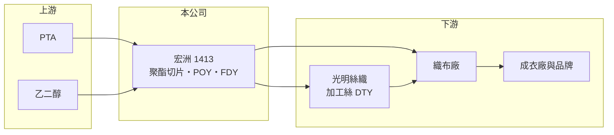

# 1413 宏洲

> 上市｜[[產業索引-紡織纖維|紡織纖維]]｜上市（櫃）日期 1975/12/23

# 第一章：企業模式與商業藍圖

> [!info] 撰寫說明
> 精簡版，由 Claude 依公開資料整理，架構比照 [[2330台積電]]，資料截至 2026-10-08。來源：MoneyDJ 理財網財務比率年表（2021 至 2025 年）；富果研究 2025 年 12 月法說會摘要（產品、產能與 2024 年財務）；證交所開放資料快照（基本資料、2026 年上半年資產負債、損益與營益分析、2025 年度股利）。產品營收比重與客戶名單未查得。#待校對

宏洲纖維工業成立於 1968 年 7 月、1975 年 12 月上市，董事長為詹正田，實收資本額約 13.2 億元。宏洲位在紡織產業鏈最上游的化纖段，把石化原料聚合、紡成聚酯絲，再賣給下游加工絲與織布廠，是典型的「賺價差」型大宗原料生意。

- **核心業務：** 宏洲以 PTA 與乙二醇為原料，生產[[聚酯]]切片、半延伸絲（[[POY]]）、全延伸絲直紡（FDY）與切片紡紗。POY 本身不能直接織布，要再經過假撚加工成為加工絲（DTY），這一段由同廠區的光明絲織負責，兩家公司形成從聚合、紡絲到加工絲的[[垂直整合]]。
- **營收結構：** 依法說內容，2024 年營業收入約 23.06 億元、2025 年前三季約 16.62 億元，各產品比重這次未查得。聚酯絲屬大宗產品，售價隨原料價格與市場供需每月調整，因此營收高低主要反映油價與價差，而非銷量的長期成長。
- **營運據點：** 生產集中在桃園龜山廠區。依法說資料，聚合設備每月產能 9,000 噸、實際月產量約 4,218 噸，紡絲設備每月產能 4,650 噸、實際約 3,240 噸，聚合產能利用率不到五成（推算），顯示產能明顯過剩，固定成本無法充分攤提。
- **長期方向：** 公司表示要深化紡織本業並整合集團上、中、下游資源，持續開發石墨烯纖維、可降解 BioPro 纖維、奈米銅抗菌纖維，並與國際品牌合作開發 37.5™ 等機能材料。母公司也推動多角化，包括不動產投資。從一般規格聚酯絲轉向機能與環保纖維，是宏洲提高毛利的唯一長期出路。

# 第二章：護城河深度與競爭優勢

宏洲的護城河很窄，主要依靠與下游加工絲廠的地緣整合和特殊纖維開發，一般規格產品則直接面對中國與東南亞的價格競爭。

- **競爭優勢：** 宏洲與光明絲織在同一廠區，POY 可以直接供應下游加工，省去運輸與庫存成本，交期也較有彈性。小批量的特殊纖維（抗菌、石墨烯、可降解）需要願意配合試產的上游廠，中小型聚酯廠在這類訂單上比大廠更靈活。
- **主要對手：** 台灣聚酯絲同業包括 [[1402遠東新]]、[[1409新纖]]、[[1444力麗]] 等規模更大的廠商；國際上則面對中國大型聚酯廠的龐大產能。中國廠商在一般規格 POY 上以低價出口，壓縮台灣中小廠的價差。
- **觀察重點：** 過去 5 年[[毛利率]]介於 -4% 至 7%，2023 年甚至出現毛損，說明一般規格聚酯絲幾乎沒有定價能力。長期要觀察機能與環保纖維能否提高比重、聚合產能利用率能否回升，以及不動產投資是否會改變公司的資產結構。

# 第三章：財務體質與盈利規模

資料日期：2026-10-08，表格是撰寫當時的快照；最新月營收、毛利率、累計 EPS 由自動排程寫在本筆記的屬性欄位（月營收、毛利率、累計EPS 等）。#待校對

宏洲是低毛利、高負債的大宗原料廠，獲利完全跟著聚酯價差走，過去 5 年有 2 年虧損，帳上仍有累積虧損。

| 年度 | 營收（億元） | [[毛利率]] | [[營業利益率]] | EPS（元） | [[ROE]] |
|---|---|---|---|---|---|
| 2021 | 約 29.7（推算） | 6.53% | 3.35% | 0.80 | 9.72% |
| 2022 | 約 31.5（推算） | 6.62% | 2.69% | 0.75 | 8.34% |
| 2023 | 約 19.9（推算） | -3.95% | -6.83% | -1.01 | -11.43% |
| 2024 | 約 23.06 | 1.88% | -0.22% | -0.17 | -2.10% |
| 2025 | 約 21.2（推算） | 5.28% | 3.07% | 0.45 | 5.44% |

註：營收以 MoneyDJ 每股營業額乘以約 1.32 億股推算，與各年營收成長率相符；2024 年取自法說摘要。

- **長期指標：** 2021 至 2025 年營收年複合成長率約 -8%（推算），近 5 年平均 ROE 約 2.0%（推算），波動極大。2025 年度未配發股利（證交所資料），2026 年第二季保留盈餘為 -1.57 億元，在彌補虧損前難以配息。每股現金流量 2024、2025 年連續為負（-0.89、-0.17 元），自由現金流不穩定。
- **[[ROIC]] 與 [[WACC]]：** 2025 年稅後營業利益約 0.52 億元（營業利益率 3.07% × 營收約 21.2 億元 × 0.8），投入資本約 21.5 億元（2026 年第二季權益總計 11.55 億元，加上以非流動負債 8.28 億元與部分流動負債推估的有息負債約 10 億元），ROIC 約 2.4%（推算）；2023、2024 年營業虧損時 ROIC 為負。WACC 約 5.1%（推算：無風險利率 1.75%、市場風險溢酬 6%、β 取大宗化纖常見值 1.0，股東權益成本 7.75%；稅前負債成本 2.5%、稅率 20%，負債占資本約 46%）。ROIC 長期低於 WACC，表示在目前的價差水準下，聚酯絲本業並未替股東創造價值。
- **財務特色：** 2026 年第二季負債比率約 55%（負債 14.21 億元 ÷ 資產 25.76 億元），非流動資產 17.68 億元占總資產近七成，以廠房設備與不動產為主（推估）。2026 年上半年毛利率 3.82%、營業利益 0.16 億元、業外收入 0.14 億元，業外貢獻接近本業。

# 第四章：總體風險與地緣政治

宏洲的風險集中在原料價格、中國產能過剩，以及高負債下的財務彈性。

- **產業週期：** 聚酯絲價格跟著原油、PTA 與乙二醇波動，下游品牌去化庫存時需求會突然萎縮，2023 年營收年減約 37% 並出現毛損就是典型的循環低谷。因產能利用率偏低，景氣轉弱時固定成本會迅速吞噬利潤。
- **營運風險：** 負債比率超過五成且帳上有累積虧損，若再遇到連續虧損，籌資與配息都會受限。產品以一般規格為主，客戶轉單成本低，價格稍高就可能被中國或東南亞貨源取代。
- **其他風險：** 中國聚酯產能擴張與低價出口，以及各國反傾銷措施的變化，都會影響台灣廠商的外銷空間；電價上漲與減碳法規增加生產成本；外銷以美元計價，新台幣升值會壓縮毛利。

# 專有名詞解析

## 金融

- **[[ROIC]]**：投入資本報酬率，稅後營業利益除以股東權益加有息負債，衡量本業運用資本的效率。
- **[[WACC]]**：加權平均資金成本，股東與債權人要求報酬率的加權平均，是 ROIC 要超越的門檻。

## 產業

- **[[聚酯]]**：以 PTA 與乙二醇聚合而成的合成纖維與塑膠原料，用於衣料、寶特瓶與工業用布。
- **[[POY]]**：半延伸絲，聚酯紡絲後尚未完全延伸的半成品，需再經假撚加工成加工絲才能織布。
- **[[垂直整合]]**：同一企業或集團同時經營上下游多個生產環節，以降低交易成本並掌握品質與交期。

# 核心供應鏈

- 上游：PTA 與乙二醇供應商，例如 [[1326台化]]、[[1303南亞]]（是否為宏洲供應商未查得）。
- 下游／客戶：同廠區的光明絲織（加工絲），以及織布廠與國際機能服飾品牌（名單未查得）。
- 同業：[[1402遠東新]]、[[1409新纖]]、[[1444力麗]]、[[1455集盛]]。

## 最新新聞
<!-- news:start（自動產生，請勿手動編輯此範圍） -->
- 2026-10-08 📰 媒體 17:22｜營收速報 - 宏洲(1413)9月營收2.02億元年增率高達46.17％｜[鉅亨網](https://news.cnyes.com/news/id/6624976)

完整紀錄：[[1413宏洲 新聞]]
<!-- news:end -->

## 相關連結
- [公開資訊觀測站](https://mopsov.twse.com.tw/mops/web/t05st03?step=1&firstin=1&co_id=1413)
- [Goodinfo](https://goodinfo.tw/tw/StockDetail.asp?STOCK_ID=1413)
- [Yahoo 股市](https://tw.stock.yahoo.com/quote/1413)
- [鉅亨網新聞](https://www.cnyes.com/twstock/1413/news)
