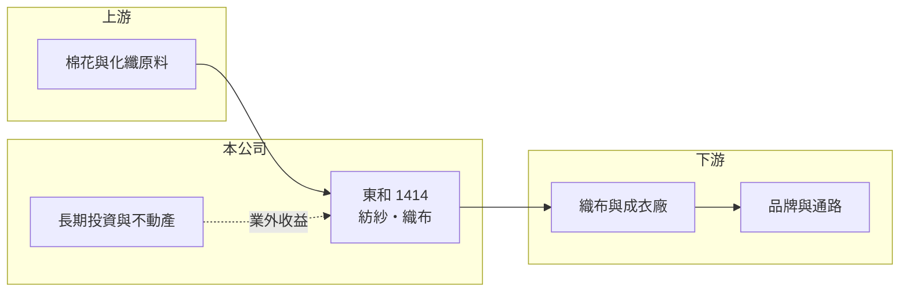

# 1414 東和

> 上市｜[[產業索引-紡織纖維|紡織纖維]]｜上市（櫃）日期 1976/02/02

# 第一章：企業模式與商業藍圖

> [!info] 撰寫說明
> 精簡版，由 Claude 依公開資料整理，架構比照 [[2330台積電]]，資料截至 2026-10-08。來源：MoneyDJ 理財網財務比率年表（2021 至 2025 年）；證交所開放資料快照（基本資料、2026 年上半年資產負債、損益與營益分析、2025 年度股利、2026 年 8 月營收）。公開資料有限，這次未查得產品比重、客戶與廠區資料，業務描述多為依財報結構的推估或憑記憶整理，已標「待校對」。#待校對

東和紡織成立於 1959 年 9 月、1976 年 2 月上市，董事長為蔡淑櫻，實收資本額 19.8 億元，是台灣歷史最悠久的紡織公司之一。從財報結構看，東和的本業規模已經很小，年營收不到 5 億元，但資產超過 40 億元，理解它的關鍵是把「縮小中的紡織本業」與「龐大的長期資產」分開來看。

- **核心業務：** 東和的本業是紡紗與織布，產品以棉紗、混紡紗與布料為主（產品細項待校對）。這類傳統紡織品屬於大宗中間材，技術成熟、同質性高，台灣廠商在一般規格產品上很難與中國、越南、印度等低成本產地競爭，這也是東和營收長期下滑的背景。
- **營收結構：** 依 MoneyDJ 每股營業額推算，2025 年營收約 4.7 億元（推算），2021 年約 7.3 億元，5 年間縮小約三成五。各產品與內外銷比重這次未查得。2026 年上半年營收 2.41 億元、[[毛利率]] 11.78%，本業處於營業虧損。
- **營運據點：** 廠區與海外據點這次未查得（待校對）。2024 年起財報改為合併報表，代表公司持有需合併的子公司；2026 年第二季其他權益為 -1.22 億元，可能包含海外子公司的換算差額或金融資產評價（推估）。
- **長期方向：** 東和非流動資產約 32.7 億元，占總資產近八成，遠大於本業營收所需，推估包含大量長期投資與不動產。2026 年上半年業外收入 0.87 億元，是營業虧損 0.15 億元的近 6 倍，顯示公司的獲利來源已轉向投資收益與[[業外收益]]。長期價值取決於這些資產能否轉為穩定現金流，或以[[資產活化]]方式提高報酬。

# 第二章：護城河深度與競爭優勢

東和的紡織本業缺乏明顯護城河，公司真正的「底氣」是長年累積的資產與低負債，而非產品競爭力。

- **競爭優勢：** 作為成立超過 60 年的老廠，東和擁有早年取得的土地與長期投資，帳面成本低、財務負擔輕，即使本業虧損也不至於危及公司存續。這種資產型的防禦力讓公司可以持續配發小額股利，但無法轉化為本業的定價能力。
- **主要對手：** 紡紗與織布同業包括 [[1440南紡]]、[[1451年興]] 等台灣廠商，以及中國、越南、印度的大型紡紗廠。東南亞新產能的人工與電力成本遠低於台灣，一般規格棉紗與布料的價格主導權在低成本產地。
- **觀察重點：** 2021 至 2022 年[[營業利益率]]還有 12% 左右，2023 年起連續 3 年營業虧損，說明本業已經失去獲利能力。長期要觀察公司是否進一步收縮紡織、轉向租賃或投資型經營，以及長期資產的運用是否能提高 ROE。

# 第三章：財務體質與盈利規模

資料日期：2026-10-08，表格是撰寫當時的快照；最新月營收、毛利率、累計 EPS 由自動排程寫在本筆記的屬性欄位（月營收、毛利率、累計EPS 等）。#待校對

東和營收逐年下滑、本業連年虧損，EPS 靠業外收入維持小幅正數，ROE 長期在 1% 至 5% 之間。

| 年度 | 營收（億元） | [[毛利率]] | [[營業利益率]] | EPS（元） | [[ROE]] |
|---|---|---|---|---|---|
| 2021 | 約 7.3（推算） | 22.82% | 12.63% | 0.65 | 4.50% |
| 2022 | 約 6.2（推算） | 24.07% | 11.74% | 0.47 | 3.30% |
| 2023 | 約 5.1（推算） | 7.18% | -6.58% | 0.15 | 1.05% |
| 2024 | 約 4.7（推算） | 12.80% | -3.05% | 0.26 | 1.80% |
| 2025 | 約 4.7（推算） | 13.14% | -3.40% | 0.19 | 1.39% |

註：營收以 MoneyDJ 每股營業額乘以 1.98 億股推算；2021 至 2023 年為個別報表、2024 年起為合併報表。2025 年 MoneyDJ 營收成長率（-10.66%）與每股營業額推算值不一致，以每股營業額推算為準，待校對。

- **長期指標：** 2021 至 2025 年營收年複合成長率約 -10.5%（推算），近 5 年平均 ROE 約 2.4%（推算）。2025 年度每股現金股利 0.2 元（證交所資料），略高於當年 EPS 0.19 元，配息率約 105%，屬於動用累積盈餘維持配息。每股現金流量 2021 至 2025 年皆為正值（0.26 至 1.00 元），現金流仍穩定。
- **[[ROIC]] 與 [[WACC]]：** 2025 年營業利益率 -3.40%，營業損失約 0.16 億元（營收約 4.7 億元 × -3.40%），投入資本約 35 億元（2026 年第二季股東權益 29.83 億元，加上以非流動負債推估的有息負債約 5 億元），ROIC 約 -0.5%（推算），為負值。WACC 約 5.4%（推算：無風險利率 1.75%、市場風險溢酬 6%、β 取紡織同業常見值 0.7，股東權益成本 5.95%；稅前負債成本 2.5%、稅率 20%，負債占資本約 14%）。ROIC 為負代表本業正在消耗資本；股東報酬全靠投資收益，若把長期資產以市價計算，資本效率會更低。
- **財務特色：** 2026 年第二季負債比率約 29%（負債 12.20 億元 ÷ 資產 42.03 億元），財務結構保守。2026 年上半年稅前純益率 30%，但營業利益率 -6%，業外收入與其他綜合損益（0.38 億元）才是盈餘與淨值的主要來源。

# 第四章：總體風險與地緣政治

東和的風險在於本業持續萎縮，以及獲利過度依賴業外收入的不穩定性。

- **產業週期：** 傳統紡紗織布受棉花價格、品牌庫存週期與東南亞新產能影響，2023 年毛利率跌到 7% 即反映需求低谷。即使景氣回升，台灣中小型紡紗廠能分到的利潤也有限。
- **營運風險：** 本業連續虧損且營收逐年縮小，固定成本難以攤提；若持續動用保留盈餘配息，長期會侵蝕淨值。業外收入可能來自股利、處分利益或租金，性質未必能年年重複（來源細節未查得）。
- **其他風險：** 外銷產品受匯率影響；海外子公司面臨當地匯率與政策風險；持有的金融資產與不動產價值受股市與房市波動影響，會反映在其他權益與淨值上。

# 專有名詞解析

## 金融

- **[[業外收益]]**：本業以外的收入，例如利息、股利、處分資產或匯兌利益，通常不具持續性。
- **[[ROIC]]**：投入資本報酬率，稅後營業利益除以股東權益加有息負債，衡量本業運用資本的效率。
- **[[WACC]]**：加權平均資金成本，股東與債權人要求報酬率的加權平均，是 ROIC 要超越的門檻。

## 產業

- **[[資產活化]]**：把閒置或低度利用的土地廠房改作出租、開發或出售，以提高資產報酬。

# 核心供應鏈

- 上游：棉花與聚酯短纖等原料供應商（名單未查得）。
- 下游／客戶：織布廠、成衣廠與服飾品牌（名單未查得）。
- 同業：[[1440南紡]]、[[1451年興]]、[[1419新紡]]。

## 最新新聞
<!-- news:start -->
<!-- news:end -->

## 相關連結
- [公開資訊觀測站](https://mopsov.twse.com.tw/mops/web/t05st03?step=1&firstin=1&co_id=1414)
- [Goodinfo](https://goodinfo.tw/tw/StockDetail.asp?STOCK_ID=1414)
- [Yahoo 股市](https://tw.stock.yahoo.com/quote/1414)
- [鉅亨網新聞](https://www.cnyes.com/twstock/1414/news)
