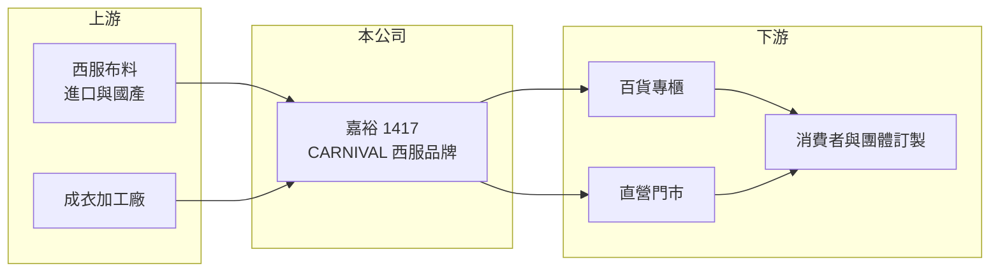

# 1417 嘉裕

> 上市｜[[產業索引-紡織纖維|紡織纖維]]｜上市（櫃）日期 1976/12/28

# 第一章：企業模式與商業藍圖

> [!info] 撰寫說明
> 精簡版，由 Claude 依公開資料整理，架構比照 [[2330台積電]]，資料截至 2026-10-08。來源：MoneyDJ 理財網財務比率年表（2021 至 2025 年）；證交所開放資料快照（基本資料、2026 年上半年資產負債、損益與營益分析、2025 年度股利）。公開資料有限，這次未查得營收比重、門市數與 2024 年營收大減的原因，品牌與業務描述憑記憶整理，已標「待校對」。#待校對

嘉裕股份有限公司成立於 1969 年 12 月、1976 年 12 月上市，董事長為陳陞、總經理為陳冠伸，實收資本額約 19 億元，英文簡稱 CARNIVAL。嘉裕以男士西服品牌為人所知，近年營收規模大幅縮小，獲利則常由[[業外收益]]與金融資產評價左右。

- **核心業務：** 嘉裕經營男士西服與正式服飾品牌 CARNIVAL（品牌與產品線細節待校對），透過百貨專櫃與門市銷售。2026 年上半年[[毛利率]]高達 63.6%，符合[[自有品牌]]零售的特徵：產品本身的製造成本不高，主要費用落在門市租金、人事與行銷。
- **營收結構：** 依 MoneyDJ 每股營業額推算，嘉裕 2021 至 2023 年營收約 13 億至 15 億元，2024 年驟降約六成至約 6 億元，2025 年再降至約 4 億元（推算）。如此大的落差不像單純零售衰退，推估與停止部分代工或非品牌業務、或不動產相關收入認列時點有關，原因待校對。
- **營運據點：** 銷售通路以台灣為主（門市與專櫃數量未查得），生產據點這次未查得（待校對）。2026 年第二季流動資產 16.23 億元，占總資產近六成，非流動資產 11.37 億元，資產結構顯示公司持有大量現金、存貨或可變現資產（推估）。
- **長期方向：** 正式西服市場受上班族穿著休閒化影響長期萎縮，嘉裕的長期課題是品牌年輕化與通路調整，並妥善運用帳上資產。2026 年第二季其他權益約 2.35 億元、上半年其他綜合損益 0.87 億元，代表持有的金融資產累積了可觀評價利益，資產運用對股東報酬的影響不亞於本業。

# 第二章：護城河深度與競爭優勢

嘉裕的競爭力來自老品牌知名度與通路經驗，但正式服飾市場萎縮，護城河正在變窄。

- **競爭優勢：** 西服需要量身修改與售後服務，長期經營的品牌在顧客信任與版型資料上有累積，老客戶回購率較高。高毛利的品牌零售模式，讓公司在營收規模不大的情況下仍能負擔通路成本，前提是單店營收維持一定水準。
- **主要對手：** 國際精品與快時尚品牌的西服線、百貨內其他國內外男裝品牌，以及線上訂製西服業者都在爭取同一批顧客。快時尚以低價搶入門市場，精品則占據高端，中價位國產品牌被兩頭擠壓。
- **觀察重點：** 過去 5 年只有 2021 年[[營業利益率]]為正（2.66%），2024 年更低到 -41.5%，本業長期無法獲利。長期要觀察門市調整後營業費用能否下降到營收可負擔的水準，以及業外收入是否有持續性。

# 第三章：財務體質與盈利規模

資料日期：2026-10-08，表格是撰寫當時的快照；最新月營收、毛利率、累計 EPS 由自動排程寫在本筆記的屬性欄位（月營收、毛利率、累計EPS 等）。#待校對

嘉裕營收快速縮小、本業連年營業虧損，EPS 在正負之間擺盪，主要由業外收入決定。

| 年度 | 營收（億元） | [[毛利率]] | [[營業利益率]] | EPS（元） | [[ROE]] |
|---|---|---|---|---|---|
| 2021 | 約 13.2（推算） | 48.37% | 2.66% | 0.51 | 3.39% |
| 2022 | 約 14.2（推算） | 29.73% | -13.60% | 0.56 | 3.65% |
| 2023 | 約 15.0（推算） | 33.38% | -5.36% | -0.37 | -2.50% |
| 2024 | 約 6.0（推算） | 22.74% | -41.46% | -0.81 | -6.30% |
| 2025 | 約 4.0（推算） | 53.54% | -3.79% | 0.62 | 5.03% |

註：營收以 MoneyDJ 每股營業額乘以約 1.9 億股推算，與各年營收成長率相符。

- **長期指標：** 2021 至 2025 年營收年複合成長率約 -26%（推算），近 5 年平均 ROE 約 0.7%（推算）。2025 年度每股現金股利 0.25 元（證交所資料），約為 EPS 0.62 元的 40%；2025 年本期淨利約 1.17 億元，而營業損失約 0.15 億元，推算業外收入約 1.3 億元，來源未查得（待校對）。每股現金流量 2021、2022 年為負，2023 至 2025 年轉正。
- **[[ROIC]] 與 [[WACC]]：** 2025 年營業利益率 -3.79%，營業損失約 0.15 億元（營收約 4.0 億元 × -3.79%），投入資本約 24.6 億元（2026 年第二季股東權益 23.65 億元，加上以負債結構推估的有息負債約 1 億元），ROIC 約 -0.6%（推算），為負值；2024 年營業損失更大，ROIC 約 -10%（推算）。WACC 約 6.4%（推算：無風險利率 1.75%、市場風險溢酬 6%、β 取服飾零售同業常見值 0.8，股東權益成本 6.55%；稅前負債成本 2.5%、稅率 20%，負債占資本約 4%）。ROIC 長期為負且遠低於 WACC，本業持續消耗資本，股東報酬來自業外與金融資產評價。
- **財務特色：** 2026 年第二季負債比率約 14%（負債 3.95 億元 ÷ 資產 27.60 億元），財務保守。2026 年上半年營收 1.45 億元、營業損失 0.13 億元、EPS -0.09 元，但其他綜合損益 0.87 億元使淨值增加，損益表與淨值變化方向相反。

# 第四章：總體風險與地緣政治

嘉裕的風險在於正式服飾需求的結構性萎縮，以及獲利依賴不穩定的業外收入。

- **產業週期：** 西服需求受景氣、婚喪喜慶與職場穿著文化影響，經濟轉弱時屬於可延後的消費。遠距與彈性工作普及後，正式服裝需求的長期趨勢向下，這不是短期循環能扭轉的。
- **營運風險：** 營收規模縮小後，門市租金與人事等固定費用比重上升，營業虧損容易擴大；品牌老化若未能吸引年輕客群，營收可能持續下滑。業外收入的性質未明，未必能年年重複。
- **其他風險：** 百貨通路抽成與租金調漲會壓縮利潤；布料多仰賴進口，匯率與原料價格影響成本；持有的金融資產價值隨市場波動，會直接反映在淨值上。

# 專有名詞解析

## 金融

- **[[業外收益]]**：本業以外的收入，例如利息、股利、處分資產或匯兌利益，通常不具持續性。
- **[[ROIC]]**：投入資本報酬率，稅後營業利益除以股東權益加有息負債，衡量本業運用資本的效率。
- **[[WACC]]**：加權平均資金成本，股東與債權人要求報酬率的加權平均，是 ROIC 要超越的門檻。

## 產業

- **[[自有品牌]]**：企業以自己的商標設計、行銷與銷售產品，掌握定價與通路，毛利通常高於代工。

# 核心供應鏈

- 上游：西服布料供應商與成衣加工廠（名單未查得）。
- 下游／客戶：百貨公司如 [[2903遠百]]（是否設櫃未查得）、直營門市與一般消費者。
- 同業：國際與國內男裝品牌；同為紡織轉品牌零售的 [[1419新紡]]。

## 最新新聞
<!-- news:start -->
<!-- news:end -->

## 相關連結
- [公開資訊觀測站](https://mopsov.twse.com.tw/mops/web/t05st03?step=1&firstin=1&co_id=1417)
- [Goodinfo](https://goodinfo.tw/tw/StockDetail.asp?STOCK_ID=1417)
- [Yahoo 股市](https://tw.stock.yahoo.com/quote/1417)
- [鉅亨網新聞](https://www.cnyes.com/twstock/1417/news)
