# 1418 東華

> 上市｜[[產業索引-紡織纖維|紡織纖維]]｜上市（櫃）日期 1977/02/14

# 第一章：企業模式與商業藍圖

> [!info] 撰寫說明
> 精簡版，由 Claude 依公開資料整理，架構比照 [[2330台積電]]，資料截至 2026-10-08。來源：MoneyDJ 理財網財務比率年表（2021 至 2025 年）；科技新報公司資料頁（營業項目、轉投資、2025 年各季營收與 2026 年第一季資產負債）；證交所開放資料快照（基本資料、2026 年上半年資產負債、損益與營益分析、2025 年度股利）。公開資料有限，開發案內容、土地位置與負債性質未查得，相關推論已標「推估」或「待校對」。#待校對

東華龍股份有限公司成立於 1970 年 3 月、1977 年 2 月上市，董事長為林壯儒、總經理為林壯燁，實收資本額約 5.7 億元。東華原本是壓克力纖維廠，如今紡織營收幾乎歸零，資產與負債規模卻高達數十億元，它實質上已是一家以不動產開發與租賃為主、仍在投入期的資產型公司。

- **核心業務：** 依公開資料，東華的營業項目包括壓克力纖維銷售、不動產租賃，以及住宅與大樓開發租售，營業登記另涵蓋工業廠房開發、都市更新重建等不動產相關項目。[[壓克力纖維]]是仿羊毛的合成纖維，台灣市場早已萎縮，東華目前只配合少數客戶的產線零星出貨（依 2026 年 8 月營收備註），本業重心已轉向不動產。
- **營收結構：** 2025 年全年營業收入僅約 533 萬元，2026 年上半年約 343 萬元，各業務比重未查得。營收規模與 55 億元的總資產完全不成比例，代表大部分資產仍在開發或持有階段，尚未產生營收；不動產開發的營收要到完工交屋時才一次認列，這是[[建案交屋]]型公司營收極不平均的原因。
- **營運據點：** 公司登記地址在台北市中正區，2013 年前登記在新竹縣竹北市（是否為原廠址待校對）。轉投資包括 100% 持有的山河壯股份有限公司（2026 年帳面金額約 4.48 億元）、100% 持有的東華租賃、90% 持有的東燁投資，以及持股 12.44% 的碳能科技。
- **長期方向：** 東華的長期價值取決於持有的土地與開發案能否順利完工、出售或出租，把帳上資產轉為現金與利潤。在此之前，公司靠借款支撐開發與持有成本，因此開發進度、融資條件與房市景氣是決定成敗的三個變數。

# 第二章：護城河深度與競爭優勢

東華的潛在優勢在於土地資產，但目前沒有可驗證的營運護城河，屬於高度依賴單一資產開發成果的轉型公司。

- **競爭優勢：** 老紡織公司的土地多半是早年以低成本取得，帳面價值可能遠低於市價（東華的土地位置與面積未查得）。若土地位於都市化區域，透過自建、合建或[[都更]]開發，可以實現遠高於紡織本業的價值，這是市場願意給東華接近淨值估值的主要理由（推估）。
- **主要對手：** 在不動產開發上，東華要與 [[2542興富發]]、[[2548華固]] 等專業建商，以及其他擁有土地的老紡織公司競爭購屋需求與承租客；在壓克力纖維上則面對國外大廠的低價產品，已無實質競爭力。
- **觀察重點：** 2024、2025 年每股現金流量分別為 -9.93 元與 -11.05 元，代表大量資金流出（推估用於開發或購置資產），同期負債比率由 66% 升到 78%。長期要觀察開發案何時開始認列營收，以及負債是否能在完工後明顯下降。

# 第三章：財務體質與盈利規模

資料日期：2026-10-08，表格是撰寫當時的快照；最新月營收、毛利率、累計 EPS 由自動排程寫在本筆記的屬性欄位（月營收、毛利率、累計EPS 等）。#待校對

東華目前幾乎沒有營收、營業持續虧損，負債比率接近八成，財務數字反映的是一家仍在投入期的不動產開發公司，而非紡織廠。

| 年度 | 營收（億元） | [[毛利率]] | [[營業利益率]] | EPS（元） | [[ROE]] |
|---|---|---|---|---|---|
| 2021 | 約 0.41（推算） | -300.35% | -625.14% | -3.10 | -20.87% |
| 2022 | 約 0.22（推算） | -34.52% | -386.00% | 0.40 | 1.79% |
| 2023 | 約 0.22（推算） | 19.01% | -362.24% | 0.74 | 3.20% |
| 2024 | 約 0.11（推算） | -62.49% | -503.43% | 0.47 | 2.00% |
| 2025 | 約 0.053 | 76.99% | -1403.87% | -1.29 | -5.52% |

註：2021 至 2024 年營收以 MoneyDJ 每股營業額乘以約 5,683 萬股推算；2025 年取自科技新報各季合計。營收極小，毛利率與營業利益率的百分比失去比較意義。

- **長期指標：** 2021 至 2025 年營收持續萎縮，年複合成長率約 -40%（推算）；近 5 年平均 ROE 約 -3.9%（推算）。依科技新報資料，2016 至 2025 年皆未配發現金或股票股利。每股現金流量 2021 至 2025 年皆為負值，自由現金流長期為負，資金缺口靠借款補足。2022 至 2024 年營業虧損但 EPS 為正，推估來自業外的處分或評價利益（來源未查得）。
- **[[ROIC]] 與 [[WACC]]：** 2025 年營業損失約 0.75 億元（營收約 0.053 億元 × -1403.87%），投入資本約 51 億元（2026 年第二季股東權益 11.40 億元，加上推估的有息負債約 40 億元，假設負債多為開發相關借款），ROIC 約 -1.5%（推算），為負值。WACC 約 3.5%（推算：無風險利率 1.75%、市場風險溢酬 6%、高槓桿下 β 取 1.2，股東權益成本 8.95%；稅前負債成本 2.5%、稅率 20%，負債占資本約 78%）。ROIC 為負代表目前資本仍在被消耗，價值能否創造完全取決於開發案完成後的銷售或租金收入能否超過累積的資金成本。
- **財務特色：** 2026 年第二季資產 55.21 億元、負債 43.81 億元，負債比率約 79%；保留盈餘 -9.07 億元，其他權益卻有 15.51 億元（性質未查得，待校對），淨值主要由其他權益支撐。2026 年上半年營業損失 0.43 億元、業外損失 0.49 億元（推估以利息費用為主），EPS -1.70 元。依科技新報資料，2025 年第一季長期負債約 34.4 億元、2026 年第一季流動負債約 38.3 億元，到了 2026 年第二季又以非流動負債為主，負債到期分類變動大，再融資安排是關鍵。

# 第四章：總體風險與地緣政治

東華的風險集中在高負債、無營收的財務壓力，以及開發案對房市與利率的高度敏感。

- **產業週期：** 不動產開發受房市景氣、央行信用管制與利率影響極大，銷售放緩或貸款成數收緊都會延後資金回收。開發期間每年的利息與持有成本會持續累積虧損，房市低迷拖得越久，股東權益被侵蝕得越多。
- **營運風險：** 負債比率近八成、保留盈餘為負，若銀行不願續貸或提高利率，公司可能面臨資金壓力；2026 年第一季流動比率僅約 42%（科技新報資料），短期償債能力薄弱。開發成果高度集中在少數資產，單一案件延誤就會影響整體財務。
- **其他風險：** 都市計畫、建照與都更審議的法規時程難以掌握；營建成本與工資上漲會壓縮開發利潤；公司資訊揭露有限，投資人難以評估資產的實際價值，屬於資訊不對稱較高的個股。

# 專有名詞解析

## 金融

- **[[ROIC]]**：投入資本報酬率，稅後營業利益除以股東權益加有息負債，衡量本業運用資本的效率。
- **[[WACC]]**：加權平均資金成本，股東與債權人要求報酬率的加權平均，是 ROIC 要超越的門檻。

## 產業

- **[[壓克力纖維]]**：以丙烯腈聚合製成的合成纖維，觸感類似羊毛，用於毛衣、毛毯與人造毛皮。
- **[[建案交屋]]**：建商在房屋完工、交付買方時才一次認列營收與利潤，使營收在交屋年度集中。
- **[[都更]]**：都市更新，把老舊建物整合重建，通常由地主與建商依權利價值分配新建房屋。

# 核心供應鏈

```mermaid
flowchart LR
    subgraph 上游
        A1["土地<br/>自有與開發用地"]
        A2["營造廠與建材"]
        A3["銀行融資"]
    end
    subgraph 本公司
        B["東華 1418<br/>不動產開發・租賃"]
        B2["子公司<br/>山河壯・東華租賃・東燁投資"]
    end
    subgraph 下游
        C1["購屋者"]
        C2["承租企業與住戶"]
        C3["壓克力纖維客戶<br/>零星出貨"]
    end
    A1 --> B
    A2 --> B
    A3 --> B
    B2 --> B
    B --> C1
    B --> C2
    B --> C3
```

- 上游：營造廠與建材供應商、融資銀行（名單未查得）；壓克力纖維原料丙烯腈。
- 下游／客戶：購屋者、承租企業與住戶，以及少數壓克力纖維客戶（名單未查得）。
- 同業：不動產開發 [[2542興富發]]、[[2548華固]]；同樣由紡織轉向不動產的 [[1410南染]]；轉投資碳能科技（未上市）。

## 最新新聞
<!-- news:start -->
<!-- news:end -->

## 相關連結
- [公開資訊觀測站](https://mopsov.twse.com.tw/mops/web/t05st03?step=1&firstin=1&co_id=1418)
- [Goodinfo](https://goodinfo.tw/tw/StockDetail.asp?STOCK_ID=1418)
- [Yahoo 股市](https://tw.stock.yahoo.com/quote/1418)
- [鉅亨網新聞](https://www.cnyes.com/twstock/1418/news)
