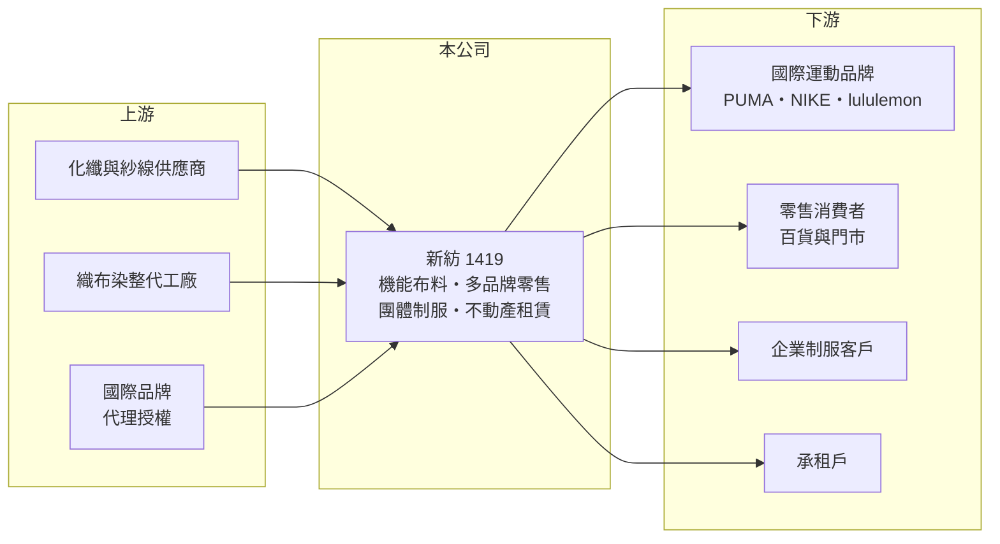

# 1419 新紡

> 上市｜[[產業索引-紡織纖維|紡織纖維]]｜上市（櫃）日期 1977/03/14

# 第一章：企業模式與商業藍圖

> [!info] 撰寫說明
> 精簡版，由 Claude 依公開資料整理，架構比照 [[2330台積電]]，資料截至 2026-10-08。來源：MoneyDJ 理財網財務比率年表（2021 至 2025 年）；富果研究 2026 年 9 月法說會摘要（事業部門、品牌與 2023 至 2026 年上半年財務）；證交所開放資料快照（基本資料、2026 年上半年資產負債、損益與營益分析、2025 年度股利）。各部門營收比重與 2026 年上半年業外收益內容未查得，轉投資明細憑記憶撰寫，已標「待校對」。#待校對

新光紡織成立於 1955 年 6 月、1977 年 3 月上市，是新光集團起家的事業，董事長為吳昕恩，實收資本額約 30 億元。今天的新紡已不是傳統紡織廠，而是由「機能布料貿易開發、多品牌零售、團體制服、不動產租賃」四塊業務，加上龐大轉投資組成的複合型公司。

- **核心業務：** 業務部開發並銷售內外銷複合性[[機能性布料]]，應用於運動、戶外與流行服飾，客戶包括 PUMA、NIKE、lululemon、THE NORTH FACE 等國際品牌；零售部經營 ARTIFACTS、ART HAUS、ASPORT、SUPERGOLF 等多個品牌；團體制服提供從企劃、設計、生產到售後的一站式服務；營建部以土地與建物出租為主要收入。這四塊業務分別對應 B2B 布料、B2C 零售、企業客戶與租金收入，彼此的景氣循環並不同步。
- **營收結構：** 依法說資料，合併營收由 2023 年 33.83 億元成長到 2025 年 47.33 億元，2026 年上半年 25.61 億元、年增 28%，各部門比重未查得。零售品牌與機能布料是成長主力（推估），營建部的租金收入金額不大但毛利高，法說中被定位為支撐其他部門發展的穩定現金來源。
- **營運據點：** 零售通路集中在台灣：依法說資料，ARTIFACTS 在台中有 6 家門市、ART HAUS 全台 5 家、ASPORT 設於微風廣場，SUPERGOLF 則有 15 個百貨專櫃、8 家 outlet 與 9 家品牌獨立門市。布料業務以「開發加委外生產」為主（推估），本身不需要大量廠房。
- **長期方向：** 公司的長期策略是持續研發複合機能布料、鞏固國際品牌合作，零售部引進更多國際品牌並整合線上線下通路，制服業務則以 100% 回收材料的 ISP 永續制服為起點發展環保產品。資產面，新紡持有大量金融資產，2026 年第二季其他權益高達 108.7 億元，代表轉投資累積了巨大的未實現評價利益（持股明細待校對）。

# 第二章：護城河深度與競爭優勢

新紡的優勢在於品牌客戶關係、零售品牌代理經驗與集團資源，但本業規模不大，股東價值更多來自轉投資與資產。

- **競爭優勢：** 機能布料要進入 NIKE、lululemon 等品牌的供應名單，需要長期的開發配合、品質認證與環保合規，一旦進入，訂單通常可延續多季。零售部以[[多品牌經營]]分散單一品牌的流行風險，SUPERGOLF 等高爾夫通路鎖定消費力較強的客群，毛利相對穩定。
- **主要對手：** 布料方面的對手包括 [[1460宏遠]]、[[1434福懋]]、[[1402遠東新]] 等台灣布廠，以及中國與東南亞布廠；零售方面則與其他代理國際品牌的通路商、百貨自營櫃位與品牌直營店競爭。制服市場有許多中小型廠商以價格競標。
- **觀察重點：** 2021 至 2025 年[[營業利益率]]由 7% 提升到 9% 至 11%，本業穩定改善。長期要觀察零售品牌能否持續展店並維持毛利、布料業務能否擴大國際品牌占比，以及公司如何運用龐大的轉投資資產（繼續持有、處分或再投資）。

# 第三章：財務體質與盈利規模

資料日期：2026-10-08，表格是撰寫當時的快照；最新月營收、毛利率、累計 EPS 由自動排程寫在本筆記的屬性欄位（月營收、毛利率、累計EPS 等）。#待校對

新紡本業營收穩定成長、營業利益率約一成，但淨利與淨值主要由轉投資驅動，資本報酬率因龐大的金融資產而被稀釋。

| 年度 | 營收（億元） | [[毛利率]] | [[營業利益率]] | EPS（元） | [[ROE]] |
|---|---|---|---|---|---|
| 2021 | 約 27.6（推算） | 26.52% | 7.28% | 1.51 | 4.72% |
| 2022 | 約 33.6（推算） | 27.41% | 8.96% | 6.92 | 19.04% |
| 2023 | 33.83 | 29.36% | 10.63% | 2.17 | 5.21% |
| 2024 | 42.14 | 29.27% | 10.87% | 2.90 | 6.07% |
| 2025 | 47.33 | 26.57% | 9.18% | 4.11 | 7.45% |

註：2021、2022 年營收以 MoneyDJ 每股營業額乘以約 3 億股推算；2023 至 2025 年取自法說摘要。2022 年 EPS 明顯偏高，推估含一次性業外收益（來源未查得）。

- **長期指標：** 2021 至 2025 年營收年複合成長率約 14%（推算），近 5 年平均 ROE 約 8.5%（推算，含 2022 年一次性收益）。2025 年度每股現金股利 1.8 元（證交所資料），約為 EPS 4.11 元的 44%。每股現金流量除 2021 年外皆為正值。每股淨值由 2021 年 33.46 元增加到 2025 年 58.55 元，主要來自轉投資評價上升。
- **[[ROIC]] 與 [[WACC]]：** 2025 年稅後營業利益約 3.48 億元（營業利益率 9.18% × 營收 47.33 億元 × 0.8），投入資本約 196 億元（2025 年底股東權益約 175.7 億元 = 每股淨值 58.55 元 × 3 億股，加上推估的有息負債約 20 億元），ROIC 約 1.8%（推算）。WACC 約 5.6%（推算：無風險利率 1.75%、市場風險溢酬 6%、β 取紡織零售同業常見值 0.7，股東權益成本 5.95%；稅前負債成本 2.5%、稅率 20%，負債占資本約 10%）。帳面 ROIC 低於 WACC，是因為權益中有大量金融資產評價利益放大了分母；若只計算本業實際使用的營運資產，本業報酬應明顯較高（推估），股東的總報酬則同時取決於轉投資的股利與市值。
- **財務特色：** 2026 年第二季資產 277.44 億元、負債 49.57 億元，負債比率約 18%；非流動資產 206.31 億元占總資產七成以上，以長期投資為主（推估）。2026 年上半年營業利益 2.33 億元，[[業外收益]]卻高達 32.75 億元，使 EPS 達 11.20 元，業外收益的內容這次未查得（待校對），屬於不宜外推的一次性成分。

# 第四章：總體風險與地緣政治

新紡的風險分為兩層：本業的品牌訂單與零售景氣，以及轉投資資產的市值波動。

- **產業週期：** 機能布料跟隨國際運動品牌的庫存週期，品牌去化庫存時會同步減少下單；零售品牌則受國內消費景氣與百貨人潮影響。兩者同時轉弱時，本業獲利會明顯下滑。
- **營運風險：** 轉投資資產占淨值比重極高，其市值與股利變動對 EPS 和淨值的影響遠大於本業；一次性處分或評價利益會讓單年 EPS 大幅跳動，投資人容易誤判長期獲利能力。代理國際品牌的零售業務，則有代理權到期或品牌收回自營的風險。
- **其他風險：** 外銷布料以美元計價，匯率影響毛利；國際品牌對回收材料、化學品管理與碳足跡的要求趨嚴；百貨通路租金與抽成上升會壓縮零售利潤。

# 專有名詞解析

## 金融

- **[[業外收益]]**：本業以外的收入，例如利息、股利、處分資產或匯兌利益，通常不具持續性。
- **[[ROIC]]**：投入資本報酬率，稅後營業利益除以股東權益加有息負債，衡量本業運用資本的效率。
- **[[WACC]]**：加權平均資金成本，股東與債權人要求報酬率的加權平均，是 ROIC 要超越的門檻。

## 產業

- **[[機能性布料]]**：具備吸濕排汗、防水透氣、抗紫外線等功能的布料，主要用於運動與戶外服飾。
- **[[多品牌經營]]**：同一家公司同時經營多個定位不同的品牌，分散單一品牌退流行的風險並擴大客群。

# 核心供應鏈

- 上游：化纖與紗線供應商、織布染整代工廠（名單未查得）；同集團化纖廠 [[1409新纖]]（是否為供應商未查得）。
- 下游／客戶：PUMA、NIKE、lululemon、THE NORTH FACE 等國際品牌；百貨與門市消費者；企業制服客戶。
- 同業：[[1460宏遠]]、[[1434福懋]]、[[1402遠東新]]；新光集團相關的 [[2887台新新光金]]、[[9925新保]]（持股關係待校對）。

## 最新新聞
<!-- news:start -->
<!-- news:end -->

## 相關連結
- [公開資訊觀測站](https://mopsov.twse.com.tw/mops/web/t05st03?step=1&firstin=1&co_id=1419)
- [Goodinfo](https://goodinfo.tw/tw/StockDetail.asp?STOCK_ID=1419)
- [Yahoo 股市](https://tw.stock.yahoo.com/quote/1419)
- [鉅亨網新聞](https://www.cnyes.com/twstock/1419/news)
