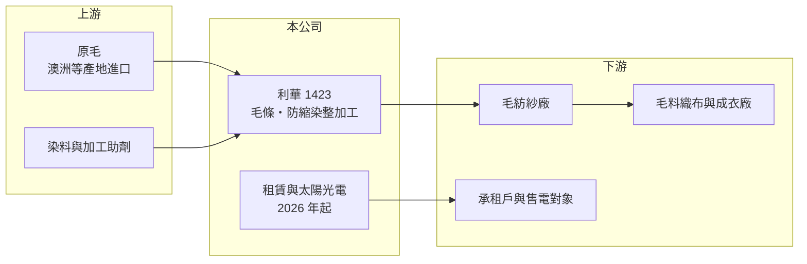

# 1423 利華

> 上市｜[[產業索引-紡織纖維|紡織纖維]]｜上市（櫃）日期 1979/04/02

# 第一章：企業模式與商業藍圖

> [!info] 撰寫說明
> 精簡版，由 Claude 依公開資料整理，架構比照 [[2330台積電]]，資料截至 2026-10-08。來源：MoneyDJ 理財網財務比率年表（2021 至 2025 年）；nStock 公司簡介（營業項目）；證交所開放資料快照（基本資料、2026 年上半年資產負債、損益與營益分析、2025 年度股利、2026 年 8 月營收備註）。公開資料有限，業外收益來源、廠區與轉投資明細未查得，已標「待校對」。#待校對

利華羊毛工業成立於 1964 年 7 月、1979 年 4 月上市，董事長為應柔爾，實收資本額約 9.96 億元。利華是台灣少數專做羊毛毛條的公司，但羊毛本業多年來處於毛損，公司價值與獲利越來越依賴持有的資產，理解它要同時看「萎縮中的羊毛加工」與「資產收益」兩條線。

- **核心業務：** 依公開資料，利華的營業項目包括[[毛條]]（含炭化羊毛）的製造與銷售、羊毛防縮與染整加工、相關進出口，以及附設的原料倉庫業務。毛條是把原毛洗淨、梳理後的長條狀半成品，下游紡紗廠再紡成毛紗，用於西服、毛衣等高級衣料，屬於紡織鏈最上游的原料加工。
- **營收結構：** 依 MoneyDJ 推算，2025 年營收僅約 0.86 億元，2021 年約 1.9 億元，5 年間縮小一半以上，各業務比重未查得。依證交所 2026 年 8 月營收備註，公司營收項目自 2026 年 7 月起增列租賃與[[太陽光電]]收入，代表利華正把部分資產轉為收租與售電，用穩定收入彌補羊毛本業的萎縮。
- **營運據點：** 公司登記地址在台北市忠孝東路，生產廠區位置這次未查得（待校對）。2026 年第二季非流動資產 26.87 億元，占總資產約三分之二，推估包含土地廠房與長期投資；其他權益約 14.95 億元，代表持有的金融資產累積了可觀的未實現評價利益。
- **長期方向：** 羊毛加工在台灣已是夕陽產業，利華的長期方向推估是縮小或維持羊毛本業，同時透過租賃、太陽光電與資產運用創造現金流。2023 年公司辦理現金減資退還股款（依 nStock 新聞標題），把多餘資本還給股東，顯示經營層傾向以減資與高配息回饋股東，而非擴大本業投資。

# 第二章：護城河深度與競爭優勢

利華的羊毛本業沒有實質護城河，真正支撐公司的是低負債與長年累積的資產，這屬於資產型而非營運型的防禦力。

- **競爭優勢：** 羊毛毛條需要洗毛、炭化與防縮等專門製程與環保處理設備，新進者不多，利華擁有長期累積的加工技術與老客戶。然而全球毛條加工已高度集中在中國、澳洲與歐洲的大型廠商，利華的規模優勢有限。
- **主要對手：** 主要對手是中國的大型毛紡與毛條廠，以及澳洲、義大利等羊毛產地與高級毛紡業者；台灣本地幾乎沒有同類上市公司。中國廠商在原毛採購量與人工成本上具壓倒性優勢，台灣毛條廠難以在價格上競爭。
- **觀察重點：** 2021 至 2025 年[[毛利率]]幾乎年年為負（-0.8% 至 -31%），代表羊毛本業連變動成本都難以完全回收。長期要觀察 2026 年起的租賃與太陽光電收入能否讓本業轉為正毛利，以及公司是否持續以減資與高股利回饋股東。

# 第三章：財務體質與盈利規模

資料日期：2026-10-08，表格是撰寫當時的快照；最新月營收、毛利率、累計 EPS 由自動排程寫在本筆記的屬性欄位（月營收、毛利率、累計EPS 等）。#待校對

利華本業長期毛損、營業虧損，EPS 完全由[[業外收益]]決定，2025 年因大額業外收益讓 EPS 跳升到 4.36 元並大幅配息。

| 年度 | 營收（億元） | [[毛利率]] | [[營業利益率]] | EPS（元） | [[ROE]] |
|---|---|---|---|---|---|
| 2021 | 約 1.91（推算） | -15.05% | -34.82% | 1.11 | 5.03% |
| 2022 | 約 1.77（推算） | -0.81% | -20.69% | 0.53 | 2.38% |
| 2023 | 約 1.25（推算） | -31.36% | -56.94% | 0.57 | 2.39% |
| 2024 | 約 1.05（推算） | -26.61% | -56.48% | 0.81 | 2.65% |
| 2025 | 約 0.86（推算） | -13.54% | -76.61% | 4.36 | 12.57% |

註：2024、2025 年營收以 MoneyDJ 每股營業額乘以約 9,965 萬股推算；2021 至 2023 年因 2023 年現金減資前股數較多，改以各年營收成長率回推，皆為推算值。

- **長期指標：** 2021 至 2025 年營收年複合成長率約 -18%（推算），近 5 年平均 ROE 約 5.0%（推算，其中 2025 年貢獻最大）。2025 年度每股現金股利 3.6 元（證交所資料），約為 EPS 4.36 元的 83%；2025 年本期淨利約 4.34 億元，而營業損失約 0.66 億元，推算業外收益約 5 億元，來源未查得（待校對），屬一次性成分的可能性高。每股現金流量 2021 至 2025 年皆為正值。
- **[[ROIC]] 與 [[WACC]]：** 2025 年營業損失約 0.66 億元（營業利益率 -76.61% × 營收約 0.86 億元），投入資本約 34.2 億元（2026 年第二季權益總計 34.16 億元，有息負債推估趨近於零），ROIC 約 -1.9%（推算），為負值，且過去 5 年皆為負。WACC 約 5.3%（推算：無風險利率 1.75%、市場風險溢酬 6%、β 取資產型小型股常見值 0.6，股東權益成本 5.35%；幾乎無負債，稅率 20%）。ROIC 長期為負，代表羊毛本業持續消耗資本；股東報酬來自資產收益與處分，並非本業創造的價值。
- **財務特色：** 2026 年第二季資產 39.91 億元、負債 5.76 億元，負債比率約 14%，財務非常保守。2026 年上半年營業損失 0.09 億元、業外收入 0.53 億元、其他綜合損益 0.64 億元，EPS 0.41 元，本業以外的收益仍是獲利主體。

# 第四章：總體風險與地緣政治

利華的風險在於本業持續萎縮與毛損，以及獲利對一次性業外收益的依賴。

- **產業週期：** 羊毛價格受澳洲等產地供給、天候與中國需求影響，加上服飾休閒化、合成纖維替代，羊毛衣料的長期需求偏弱。景氣循環對利華的影響已不如結構性衰退明顯。
- **營運風險：** 本業長期毛損，若無法縮減規模或轉型，會持續吞噬資產收益；2025 年的高 EPS 與高股利建立在一次性業外收益上，未來年度的 EPS 與配息很可能明顯回落。新增的租賃與太陽光電收入規模尚小，能否穩定成長仍待觀察。
- **其他風險：** 原毛多由國外進口，匯率影響成本；洗毛與染整涉及廢水處理，環保法規趨嚴會提高成本；太陽光電收入受躉購電價、日照與設備維護影響；持有的金融資產價值隨市場波動，會反映在淨值上。

# 專有名詞解析

## 金融

- **[[業外收益]]**：本業以外的收入，例如利息、股利、處分資產或匯兌利益，通常不具持續性。
- **[[ROIC]]**：投入資本報酬率，稅後營業利益除以股東權益加有息負債，衡量本業運用資本的效率。
- **[[WACC]]**：加權平均資金成本，股東與債權人要求報酬率的加權平均，是 ROIC 要超越的門檻。

## 產業

- **[[毛條]]**：原毛經洗淨、梳理後製成的長條狀羊毛半成品，是毛紡廠紡製毛紗的原料。
- **[[太陽光電]]**：利用太陽能板把陽光轉為電力，台灣多以躉購或綠電合約售電，收入穩定但受日照影響。

# 核心供應鏈

- 上游：澳洲等產地的原毛供應商、染料與助劑供應商（名單未查得）。
- 下游／客戶：毛紡紗廠、毛料織布與成衣廠（名單未查得）；2026 年起新增承租戶與售電對象。
- 同業：國外毛條與毛紡廠（中國、澳洲、義大利業者）；同樣由紡織轉向資產收益的老紡織股 [[1410南染]]、[[1414東和]]。

## 最新新聞
<!-- news:start -->
<!-- news:end -->

## 相關連結
- [公開資訊觀測站](https://mopsov.twse.com.tw/mops/web/t05st03?step=1&firstin=1&co_id=1423)
- [Goodinfo](https://goodinfo.tw/tw/StockDetail.asp?STOCK_ID=1423)
- [Yahoo 股市](https://tw.stock.yahoo.com/quote/1423)
- [鉅亨網新聞](https://www.cnyes.com/twstock/1423/news)
