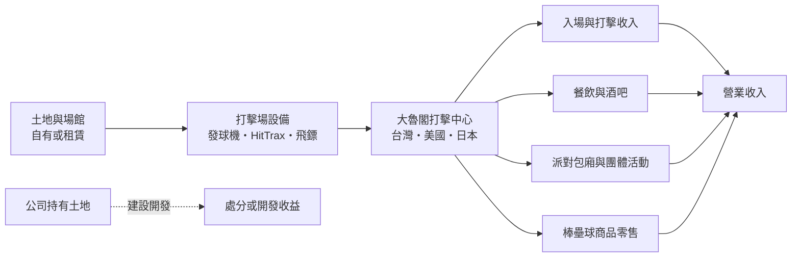
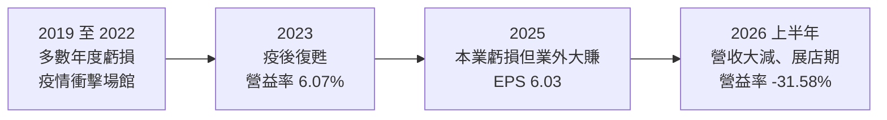
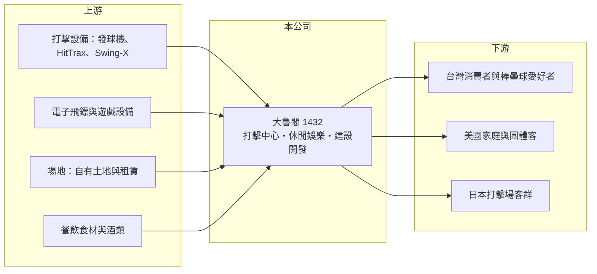

# 1432 大魯閣

> 上市｜[[產業索引-運動休閒|運動休閒]]｜上市（櫃）日期 1982/07/26

# 第一章：企業模式與商業藍圖

> [!info] 撰寫說明
> 本文由 Claude 依公開資料整理，架構比照 [[2330台積電]] 的四章研究，資料截至 2026-10-08。財務數字來源：Goodinfo 年度經營績效頁、中時新聞網 2026 年 7 月法說會報導（三大事業、美日展店）、證交所開放資料（基本資料、2026 年第二季資產負債與營益分析、股利、每月營收、本益比）；紡織起家與草衙道等沿革部分憑記憶整理，已標「待校對」。公開資料有限，各事業營收比重未查得。#待校對

在評估單一個股的長期投資價值時，首要步驟是拆解企業的底層獲利邏輯。本章針對大魯閣實業（股票代號：1432，以下簡稱大魯閣）的商業模式進行定性分析，說明一家紡織起家的公司，如何轉型為經營棒壘球打擊場的運動休閒品牌，並把這個模式複製到美國與日本。

## 一、核心定位：從紡織廠轉型的運動休閒營運商

大魯閣成立於 1973 年，1982 年上市，實收資本額約 10.8 億元，董事長為林曼麗。公司早年以紡織為本業（待校對），後來利用廠區土地與品牌經營休閒娛樂，目前在證交所的產業分類已是運動休閒業。

依 2026 年 7 月法說會的說明，大魯閣聚焦三大核心事業（中時新聞網）：

* **運動休閒：** 主力是棒壘球打擊場（公司稱為打擊中心），結合電子飛鏢、遊戲與餐飲，提供家庭與朋友聚會的休閒空間。
* **海外事業：** 把台灣的打擊場模式輸出到美國與日本。
* **建設開發：** 活化公司持有的土地資產，投入開發案（具體案件未查得）。

## 二、事業板塊與展店

* **台灣：** 經營多家棒壘球打擊場，2026 年 7 月在台北內湖開出首家「TOROKO HomeRun Lab」，占地 60 坪，結合棒壘球商品零售、客製化裝備選購，以及 HitTrax 與 Swing-X 等 AI 打擊教練系統，是新的小型店型。高雄的大型購物中心「草衙道」也與大魯閣品牌關係密切（經營權與目前角色待校對）。
* **美國：** 截至 2026 年 7 月已開出 4 家棒壘球打擊中心，第 5 家位於德州聖安東尼奧，面積 768 坪，是美國最大店，首度導入派對包廂與全尺寸酒吧，預計 2026 年 8 月開幕。
* **日本：** 已收購關東地區千葉與宇都宮兩家棒球打擊場，整修後導入 HitTrax 與電子飛鏢，預計 2026 年第三季以大魯閣品牌開幕。

## 三、資本轉化邏輯：場館型娛樂的固定成本生意

* **固定成本高：** 打擊場需要大面積場地、設備與人力，租金與折舊不論有沒有客人都要支付。來客數超過損益兩平點後，每多一位客人的利潤都很高；反之，新店開幕初期來客不足時，虧損會很明顯，這就是典型的[[營運槓桿]]。
* **[[租賃負債]]：** 若場館以租賃方式取得，依 IFRS 16 會在帳上認列租賃負債，讓負債比看起來偏高（大魯閣的租賃比例未查得）。
* **非本業收益：** 公司持有的土地透過建設開發或處分，會產生金額較大的一次性收益。

## 四、企業長期藍圖

公司的長期目標是發展「可複製、可輸出」的營運 know-how，依各區域市場特性彈性組合棒壘球體驗、商品零售、科技應用與餐飲服務。美國是棒球文化的發源地，市場規模大；日本棒球人口眾多；台灣則是品牌與營運模式的試驗場。如果海外店能夠穩定獲利，大魯閣將從一家台灣的資產股，轉變為跨國的運動娛樂連鎖品牌。

# 第二章：護城河深度與競爭優勢

本章分析大魯閣的競爭優勢，說明棒壘球打擊場這個利基市場的護城河，以及海外擴張的難度。

## 一、護城河的核心組成要素

* **營運經驗與品牌：** 大魯閣在台灣經營打擊場多年，累積了場館設計、設備維護、活動規劃與餐飲搭配的經驗，這些 know-how 是海外複製的基礎。
* **科技化體驗：** 導入 HitTrax 打擊數據分析、AI 打擊教練與電子飛鏢，讓打擊場從單純的運動場地升級為結合數據與娛樂的體驗，提高消費者的重遊率。
* **土地資產：** 公司持有的土地提供財務彈性，可以透過開發或處分支應海外擴張的資金（土地面積與位置未查得）。

整體而言，大魯閣的護城河仍在形成中：台灣市場有一定的品牌認知，但海外市場競爭者眾多，能否建立優勢還需要時間驗證。

## 二、主要競爭對手格局

| 競爭對手 | 主要市場 | 與大魯閣的比較 |
|---|---|---|
| Topgolf | 美國 | 以高爾夫打擊結合餐飲酒吧的娛樂場館龍頭，商業模式最接近 |
| 美國地方打擊場與[[家庭娛樂中心]] | 美國 | 數量多、規模小，以價格與地點競爭 |
| 日本地方打擊場與 Round1 | 日本 | 日本打擊場普及，Round1 等綜合娛樂場館是主要競爭者 |
| 台灣其他打擊場與室內娛樂業者 | 台灣 | 規模較小 |

## 三、優勢轉化：守得住、守不住與觀察重點

* **守得住：** 台灣的品牌與營運經驗。大魯閣在台灣棒壘球休閒市場有一定的知名度。
* **守不住：** 新店的初期獲利。海外新店需要時間累積客群，2026 年上半年營業利益率為 -31.58%（證交所營益分析），顯示擴張期的虧損壓力很大。
* **觀察重點：** 美國聖安東尼奧大店與日本兩店開幕後的來客數與單店損益；台灣新店型 HomeRun Lab 能否複製；以及土地開發的進度與收益。

# 第三章：財務體質與盈利規模

資料日期：2026-10-08。數字取自 Goodinfo 年度經營績效頁與證交所開放資料，表格是撰寫當時的快照；最新月營收、毛利率、累計 EPS 由自動排程寫在本筆記的屬性欄位（月營收、毛利率、累計EPS 等）。#待校對

財務報表是檢驗護城河是否真實存在的最終標準。本章用多年度的三率、ROE 與資本報酬，檢視大魯閣轉型期間的獲利品質，並區分本業與一次性收益。

## 一、獲利能力的基石：三率

| 年度 | 營收（新台幣） | [[毛利率]] | [[營業利益率]] | EPS（元） | [[ROE]] |
|---|---|---|---|---|---|
| 2019 | 11.7 億 | 85.4% | -17.6% | -3.04 | -55.2% |
| 2020 | 11.5 億 | 46.0% | -3.84% | 0.00 | 1.66% |
| 2021 | 7.78 億 | 32.8% | -18.3% | -2.05 | -19.9% |
| 2022 | 11.1 億 | 38.0% | -0.59% | -0.35 | -4.93% |
| 2023 | 13.2 億 | 43.3% | 6.07% | 0.67 | 7.24% |
| 2024 | 12.8 億 | 39.4% | -1.21% | -0.47 | -6.11% |
| 2025 | 13.4 億 | 41.5% | -7.96% | 6.03 | 42.4% |
| 2026 上半年 | 4.01 億 | 15.39% | -31.58% | -1.11 | 未查得 |

註：2019 年 85.4% 的毛利率明顯異常，可能與當年的會計分類或特殊收入有關（推估），以年報為準。

* **[[營業利益率]]：** 七年中只有 2023 年為正，打擊場與休閒娛樂本業長期難以穩定獲利。2021 年疫情期間場館停業，營業利益率降到 -18.3%。
* **2025 年的一次性收益：** 2025 年營業利益率為 -7.96%，稅後淨利卻有約 6.51 億元、EPS 6.03 元（證交所股利資料），獲利幾乎全部來自[[業外收益]]，推估為土地或資產處分利益（具體項目未查得），屬於[[一次性收益]]。
* **2026 年營收大減：** 2026 年 1 至 8 月累計營收約 5.49 億元，比去年同期的 9.08 億元減少約 40%（證交所每月營收），原因未查得，可能與事業組合調整有關（推估）。
* **營收趨勢：** 2021 至 2025 年營收從 7.78 億元增至 13.4 億元，年複合成長率約 14.6%（推算），但 2021 年是疫情低基期。

## 二、[[ROE]]：資本效率

2021 至 2025 年平均 ROE 約 3.7%（推算），但扣除 2025 年的一次性收益後，本業 ROE 為負值。2026 年第二季底權益總計約 15.09 億元、總負債約 22.08 億元，負債比約 59%；保留盈餘只剩約 0.38 億元（證交所開放資料），代表 2025 年的處分獲利多已透過股利發放出去。股價淨值比約 1.22 倍（2026 年 10 月初）。

## 三、資本支出、自由現金流與股利

海外展店（美國第 5 店、日本收購兩家打擊場）需要大量資本支出，擴張期間自由現金流預期為負（推估）。股利方面，2025 年度配發現金股利 2.0 元，以 EPS 6.03 元計算[[配發率]]約 33%（推算），但這是一次性收益支撐的配息，不代表本業的配息能力；過去多數年度虧損，股利紀錄並不穩定。

## 四、[[ROIC]] 與 [[WACC]]：價值創造利差

**ROIC 推算：** 2025 年營業虧損約 1.07 億元（13.4 億 × -7.96%），ROIC 為負。以 2026 年第二季底權益總計約 15.09 億元、總負債約 22.08 億元，假設其中約 60% 為有息負債與租賃負債（推估，約 13.2 億元），投入資本約 28.3 億元，ROIC 約 -3.8%（推算）。唯一獲利的 2023 年（營業利益約 0.80 億元，稅後約 0.64 億元），ROIC 約 2.3%（推算）。

**WACC 推算：** 假設台灣 10 年期公債殖利率 1.75%、市場風險溢酬 6%、β 取 0.9（休閒娛樂業常見值），股東權益成本約 7.15%。負債成本假設 2.8%，稅後約 2.2%；以帳面價值計，權益約占 53%，WACC 約 4.9%（推算）。

**結論：** 大魯閣的本業 ROIC 長期低於 WACC，多數年度為負值，股東報酬主要來自土地等資產的處分。海外擴張是公司試圖讓本業創造價值的關鍵一步，但在單店獲利模式被驗證之前，大魯閣仍應被視為「資產處分支撐獲利」的公司。

# 第四章：總體風險與地緣政治

任何企業都無法脫離宏觀環境獨立存在。本章分析大魯閣長期必須面對的海外擴張、消費景氣、財務與營運風險。

## 一、海外擴張風險

* **市場適應：** 美國與日本的消費習慣、人力成本與法規都與台灣不同，台灣的營運模式不一定能直接複製。
* **人力與租金：** 美國人力與租金成本高，大型店的損益兩平點也較高，新店若來客不如預期，虧損會很快擴大。
* **匯率：** 海外子公司以美元與日圓營運，匯率變動會影響合併損益與投資價值。

## 二、消費景氣與競爭

* **可支配所得：** 休閒娛樂屬於非必需消費，景氣衰退時最先被削減。
* **替代娛樂：** 消費者的休閒時間被串流影音、手機遊戲與其他體驗型娛樂分散，打擊場需要不斷更新內容與科技。
* **疫情等公共衛生事件：** 2020 至 2021 年疫情期間場館停業，顯示場館型娛樂對突發事件特別脆弱。

## 三、財務風險

* **獲利依賴一次性收益：** 近年 EPS 由資產處分決定，本業若持續虧損，可處分的資產終究有限。
* **負債與租賃：** 負債比約 59%，海外展店若以借款與長期租約支應，固定支出將持續增加。

## 四、治理與資訊揭露

* **資訊有限：** 公司各事業的營收比重、單店損益與土地開發細節公開資料有限，投資人難以獨立評估各事業的價值。

# 專有名詞解析

## 金融

- **[[營運槓桿]]**：固定成本占比高的企業，營收小幅變動就會讓營業利益大幅變動的現象。
- **[[租賃負債]]**：依 IFRS 16，企業把長期租約未來應付的租金折現後列為負債，常見於零售、餐飲與場館業者。
- **[[業外收益]]**：本業以外的收入，例如投資收益、處分資產利益或匯兌利益，通常不具持續性。
- **[[一次性收益]]**：處分資產、土地或投資等不會每年重複的收益，會讓單期 EPS 偏離本業實力。
- **[[配發率]]**：現金股利占每股盈餘的比例，代表公司把多少獲利以現金發給股東。
- **[[ROIC]]**：投入資本報酬率，稅後營業利益除以股東權益與有息負債的合計，衡量本業對所有資金提供者的報酬。
- **[[WACC]]**：加權平均資金成本，依股東權益與負債的比重加權計算的資金成本，ROIC 高於它才代表創造價值。

## 產業

- **[[家庭娛樂中心]]**：結合運動、遊戲與餐飲的室內休閒場館，以家庭與團體聚會為主要客群。

# 核心供應鏈

## 1. 上游：設備與場地
- 打擊設備與數據系統（HitTrax、Swing-X）、電子飛鏢與遊戲設備
- 場地：自有土地與租賃場館

## 2. 中游：大魯閣本身與同業
- 美國：Topgolf 與地方家庭娛樂中心
- 日本：Round1 與地方打擊場

## 3. 下游：消費者
- 台灣、美國、日本的家庭、團體與棒壘球愛好者

## 最新新聞
<!-- news:start -->
<!-- news:end -->

## 相關連結
- [公開資訊觀測站](https://mopsov.twse.com.tw/mops/web/t05st03?step=1&firstin=1&co_id=1432)
- [Goodinfo](https://goodinfo.tw/tw/StockDetail.asp?STOCK_ID=1432)
- [Yahoo 股市](https://tw.stock.yahoo.com/quote/1432)
- [鉅亨網新聞](https://www.cnyes.com/twstock/1432/news)
