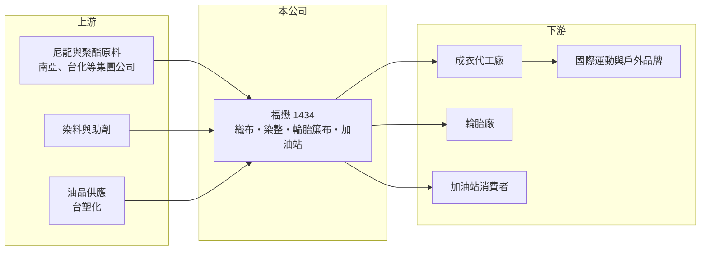

# 1434 福懋

> 上市｜[[產業索引-紡織纖維|紡織纖維]]｜上市（櫃）日期 1985/12/24

# 第一章：企業模式與商業藍圖

> [!info] 撰寫說明
> 精簡版，由 Claude 依公開資料整理，架構比照 [[2330台積電]]，資料截至 2026-10-08。來源：MoneyDJ 理財網財務比率年表（2018 至 2025 年）與季度財務比率；證交所開放資料快照（基本資料、2026 年上半年資產負債與損益、2025 年度股利）。營收比重這次未查得，產品結構與集團持股為整理性描述，憑記憶部分已標「待校對」。#待校對

福懋興業成立於 1973 年 4 月、1985 年 12 月上市，總部與主要工廠在雲林斗六，董事長由台塑集團的王文淵擔任，是台塑集團旗下的紡織公司。它的獲利由兩股力量組成：本業的織布與加油站提供穩定但偏薄的利潤，持有的集團上市公司股票則提供股利與評價收益。

- **核心業務：** 福懋以尼龍與聚酯長纖為原料，從織布、染整一路做到成品布，產品用於運動服、戶外服、包袋與工業用布；另生產作為輪胎骨架的[[輪胎簾布]]，並經營台塑石油體系的加油站（待校對）。運動與戶外用的[[機能性布料]]要求防水、透氣、輕量等功能，技術門檻比一般成衣布高，這是福懋在紡織業中相對能維持毛利的原因。
- **營收結構：** 依 MoneyDJ 每股營業額 16.37 元乘以約 16.85 億股推算，2025 年營收約 276 億元（推算），2026 年上半年證交所資料為 142.1 億元，兩者規模相符。各產品比重這次未查得，但加油站屬高營收、低毛利的通路生意，會拉低整體毛利率，因此福懋的毛利率長年只在 9% 至 13% 之間（推估原因）。
- **營運據點：** 生產集中在雲林斗六廠，海外在越南設有織布與染整據點（待校對）。斗六廠從紡絲、織布到染整的[[一貫作業]]，讓公司可以自己控制交期與品質，這對要求快速打樣、穩定色差的國際品牌很重要。
- **長期方向：** 公司的長期課題是把產品組合從一般布料往高機能、環保回收材質移動，並靠集團上游的尼龍與聚酯原料取得成本與供料穩定。投資層面，福懋持有台塑集團上市公司與 [[8131福懋科]] 等股權（持股明細待校對），2026 年第二季資產負債表上的其他權益約 110 億元，代表這些持股累積了可觀的未實現評價利益。

# 第二章：護城河深度與競爭優勢

福懋的優勢來自集團整合、機能布技術與穩定的品牌客戶關係，但紡織本業的護城河偏窄，長期 ROE 偏低的主因是大量資本放在低報酬的資產上。

- **競爭優勢：** 作為台塑集團一員，福懋可以就近取得 [[1303南亞]]、[[1326台化]] 等集團公司的聚酯與尼龍原料，原料供應穩定是中小型織布廠比不上的條件。國際運動品牌選擇布料供應商時重視產能規模、環保認證與長期配合紀錄，一旦進入品牌的核心供應名單，訂單通常能延續多季，這是福懋的主要護城河。
- **主要對手：** 機能布料的主要競爭者是 [[1402遠東新]]、[[1460宏遠]] 等台灣布廠，以及中國、韓國與東南亞的大型布廠。中國布廠在一般規格產品上以低價競爭，台灣廠商只能靠研發、環保材料與交期服務維持價格。
- **觀察重點：** 福懋近 5 年平均 [[ROE]] 只有約 3.1%（推算），而每股淨值卻隨持股市值大幅波動，2023 年 32.30 元、2024 年 21.94 元、2025 年 25.16 元。投資人應把福懋拆成「低利潤的紡織與加油站本業」加上「集團持股」兩部分評價，觀察本業[[營業利益率]]能否回到 4% 以上，以及股利收入是否穩定。

# 第三章：財務體質與盈利規模

資料日期：2026-10-08，表格是撰寫當時的快照；最新月營收、毛利率、累計 EPS 由自動排程寫在本筆記的屬性欄位（月營收、毛利率、累計EPS 等）。#待校對

福懋營收規模大但利潤薄，過去 5 年營業利益率介於 1% 至 5%，EPS 很大一部分來自業外的股利與投資收益。

| 年度 | 營收（億元） | [[毛利率]] | [[營業利益率]] | EPS（元） | [[ROE]] |
|---|---|---|---|---|---|
| 2021 | 約 328（推算） | 12.72% | 4.73% | 1.27 | 3.46% |
| 2022 | 約 348（推算） | 10.85% | 3.66% | 2.02 | 5.77% |
| 2023 | 約 285（推算） | 8.88% | 0.98% | 0.26 | 0.81% |
| 2024 | 約 288（推算） | 10.70% | 2.30% | 0.89 | 3.27% |
| 2025 | 約 276（推算） | 11.19% | 2.69% | 0.51 | 2.18% |

註：2025 年營收以每股營業額 16.37 元乘以約 16.85 億股推算，其他年度依 MoneyDJ 營收成長率回推。

- **長期指標：** 2021 至 2025 年營收年複合成長率約 -4.3%（推算），近 5 年平均 ROE 約 3.1%（推算）。公司章程規定每年至少分配可分配盈餘的五成並以現金為主，2025 年度擬配現金股利 0.5 元，約等於當年 EPS 0.51 元，配息率接近百分之百。每股現金流量 2018 至 2025 年皆為正值（1.45 至 4.01 元），本業現金流穩定。
- **[[ROIC]] 與 [[WACC]]：** 2025 年稅後營業利益約 5.9 億元（營業利益率 2.69% × 營收約 275.8 億元 × 0.8），投入資本約 565 億元（2026 年第二季股東權益 486.6 億元，加上以總負債 156.5 億元的一半推估的有息負債約 78 億元），ROIC 約 1.1%（推算），2021 至 2025 年平均約 1.3%（推算）。WACC 約 5.9%（推算：無風險利率 1.75%、市場風險溢酬 6%、β 取紡織同業常見值 0.8，股東權益成本 6.55%；稅前負債成本 2.5%、稅率 20%；權益比重約 86%）。本業 ROIC 長期低於 WACC，原因之一是權益中包含大量集團持股的評價利益，分母被放大；單看紡織本業並未創造超額報酬，股東的回報主要來自持股股利與市值變動。
- **財務特色：** 2026 年第二季負債比率約 24%（負債 156.5 億元 ÷ 資產 643.1 億元），財務結構保守。2026 年上半年營業利益 3.4 億元、業外收入 5.5 億元，業外大於本業，說明集團持股的股利是 EPS 的重要支柱。

# 第四章：總體風險與地緣政治

福懋的風險一半來自紡織與油品的景氣，另一半來自集團持股的市值波動。

- **產業週期：** 機能布料跟著國際品牌的庫存週期走，品牌去化庫存時會一次砍單，2023 年營收年減約 18%、營業利益率跌到 0.98% 就是例子。加油站業務則受國內油價政策與車用能源轉型影響，電動車普及後加油需求長期將緩慢下降。
- **營運風險：** 大量持有台塑集團石化股，石化景氣低迷時股利減少，同時其他權益的評價會下降，2024 年每股淨值由 32.30 元降到 21.94 元即反映這點。本業利潤薄，原料、電價或工資小幅上升都可能侵蝕獲利。
- **其他風險：** 外銷布料以美元計價，新台幣升值會壓縮毛利；歐美品牌對回收材料比例、化學品管理與碳足跡的要求日益嚴格，達不到標準就可能失去訂單；越南等海外據點則面臨當地工資上漲與貿易政策變化。

# 專有名詞解析

## 金融

- **[[ROIC]]**：投入資本報酬率，稅後營業利益除以股東權益加有息負債，衡量本業運用資本的效率。
- **[[WACC]]**：加權平均資金成本，股東與債權人要求報酬率的加權平均，是 ROIC 要超越的門檻。

## 產業

- **[[機能性布料]]**：具備吸濕排汗、防水透氣、抗紫外線等功能的布料，主要用於運動與戶外服飾。
- **[[輪胎簾布]]**：埋在輪胎橡膠內作為骨架的尼龍或聚酯布，決定輪胎的強度與耐久性。
- **[[一貫作業]]**：從原料、加工到成品在同一集團或廠區內完成的生產模式，可控制成本與交期。

# 核心供應鏈

- 上游：集團原料供應 [[1303南亞]]、[[1326台化]]；油品來源 [[6505台塑化]]（待校對）；母集團 [[1301台塑]]。
- 下游／客戶：成衣代工廠如 [[1476儒鴻]]、[[1477聚陽]] 等（是否為福懋客戶未查得），以及國際運動與戶外品牌；輪胎廠客戶名單未查得。
- 同業：[[1402遠東新]]、[[1460宏遠]]、[[1409新纖]]；轉投資 [[8131福懋科]]。

## 最新新聞
<!-- news:start -->
<!-- news:end -->

## 相關連結
- [公開資訊觀測站](https://mopsov.twse.com.tw/mops/web/t05st03?step=1&firstin=1&co_id=1434)
- [Goodinfo](https://goodinfo.tw/tw/StockDetail.asp?STOCK_ID=1434)
- [Yahoo 股市](https://tw.stock.yahoo.com/quote/1434)
- [鉅亨網新聞](https://www.cnyes.com/twstock/1434/news)
