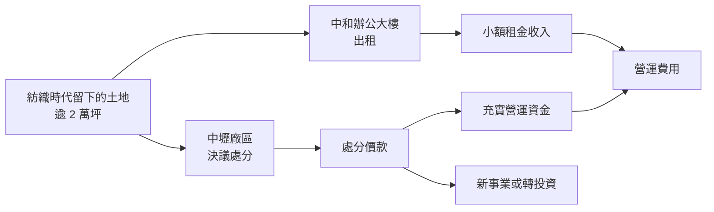
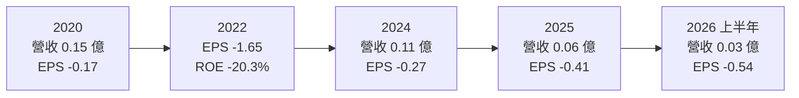
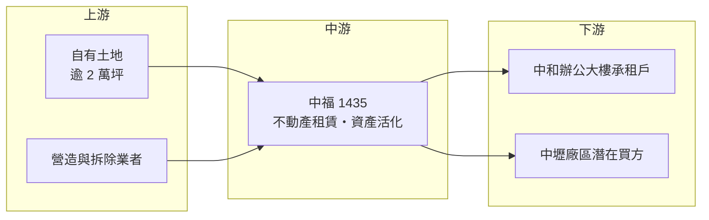

# 1435 中福

> 上市｜[[產業索引-其他業|其他業]]｜上市（櫃）日期 1987/12/28

# 第一章：企業模式與商業藍圖

> [!info] 撰寫說明
> 本文由 Claude 依公開資料整理，架構比照 [[2330台積電]] 的四章研究，資料截至 2026-10-08。財務數字來源：證交所開放資料（基本資料、2026 年第二季綜合損益與資產負債、2025 年度股利）、Goodinfo 經營績效與股利政策頁、富果研究 2025 年 11 月法說會整理、CMoney 2025 年 3 月報導、nStock 公司簡介。公司公開資料有限，營收結構與資產明細多未揭露；產業描述為整理性內容，尚未逐條比對原始文件。#待校對

在評估單一個股的長期投資價值時，首要步驟是拆解企業的底層獲利邏輯。本章針對中福國際（股票代號：1435，以下簡稱中福）的商業模式進行定性分析。中福的特殊之處在於，它幾乎沒有本業營收，公司價值主要取決於帳上的土地與建物能否被活化或處分，因此分析重點不在產品與市場，而在資產與經營層的資本配置。

## 一、核心定位：營收極小的資產型公司

依證交所基本資料，中福成立於 1971 年 1 月 15 日，1987 年上市，實收資本額約 13.98 億元，總部位於新北市中和區，董事長為陳建。nStock 公司簡介整理的沿革如下：公司以中福紡織起家，2000 年更名為中福振業，以反映業務擴展與重心轉移；2010 年再更名為中福國際；2011 年依證交所產業分類規定，由電子通路類改列為其他業。

公司登記的營業項目包括住宅及大樓開發租售、菸酒零售與倉儲，但從實際營收看，目前的收入幾乎都來自[[不動產出租]]。依 Goodinfo 經營績效頁，2020 至 2025 年每年營收只有 600 萬至 1,500 萬元，對一家資本額近 14 億元的公司而言，本業規模微乎其微。

富果整理的 2025 年 11 月法說資料，描繪了中福的資產輪廓：

* **土地：** 公司持有超過 2 萬坪土地，但各筆土地的位置與面積本次未查得完整明細。
* **中和辦公大樓：** 主要的收租資產是一棟位於新北市中和區、樓地板面積約 800 坪的四層樓辦公大樓，部分自用、其餘出租。公司指出該大樓位於萬大中和線與環狀線交會處，萬大中和線通車後，出租需求可望提升。
* **中壢廠區：** 依 CMoney 2025 年 3 月報導與法說資料，公司已決議處分桃園中壢廠的全部土地與建物，並已取得拆除執照、進行前置作業，目的是活化資產價值並充實營運資金。

## 二、終端應用／產品板塊：以租金為主

中福沒有揭露各業務的營收比重，因此本章不畫營收結構圖。依法說資料，目前收入來源可以分成兩類：

* **租賃：** 中和辦公大樓的租金收入，是目前主要的營收來源。這部分收入穩定，但規模受限於單一棟建物，每年只有數百萬元到一千多萬元，無法支應公司的營運費用。
* **投資：** 公司表示正在尋找能帶來穩定收益的投資標的，以補充整體收入，但本次未查得具體投資金額與成果。

換句話說，中福目前更接近一家「持有土地、等待活化」的公司，而不是一家有營運模式的企業。這類公司在台股常被稱為[[資產股]]，其投資價值取決於資產的真實價值，以及經營層能否把資產轉化為股東的報酬。

## 三、資本轉化邏輯（營運模式）：處分資產、等待轉型

* **收入不足以支應費用：** 依證交所資料，2026 年上半年營業收入約 299 萬元，營業費用卻約 7,430 萬元，營業損失約 7,238 萬元。營業費用是營收的二十多倍，代表公司目前處於「靠帳上資金與資產維持營運」的狀態。
* **處分是價值實現的關鍵：** 中壢廠區若順利出售，處分價款將是公司近年最大的一筆現金流入。這筆資金的用途，也就是還債、轉投資、發展新事業或回饋股東，將決定中福的長期方向。
* **帳面價值持續下滑：** 依證交所資料，2026 年第二季每股淨值 6.57 元，富果整理的 2025 年第三季資料則為 8.04 元，持續虧損與其他權益的變動使淨值逐步下降。

## 四、企業長期藍圖：資產活化與尋找新事業

* **中期：** 依法說資料，公司計畫完成中壢廠的處分，並視需要運用資金，讓股東受益，同時回饋地方。
* **長期：** 整合資源以提高資產報酬，並評估新事業或轉投資機會。公司也指出，台灣在全球科技產業的地位提升，帶動產業用地與商業用地的需求，這是持有土地的公司的潛在機會。
* **觀察的核心：** 中福未來的價值，取決於經營層能否把處分資產得到的資金，投入報酬率高於資金成本的事業。過去多年的虧損紀錄顯示，這一點目前還沒有被證明。

# 第二章：護城河深度與競爭優勢

在長期價值投資中，「護城河」指企業抵禦競爭、維持超額利潤的保護機制。本章分析中福有沒有護城河、與哪些同類公司比較，以及投資人應該觀察什麼。

## 一、護城河的核心組成要素

嚴格來說，中福目前沒有營運上的護城河。它的價值來源是資產本身：

* **1. 區位資產：** 中和辦公大樓位於捷運萬大中和線與環狀線交會處，交通條件佳。捷運路網完成後，周邊的商辦與租賃需求可能提高，資產價值也可能隨之上升。
* **2. 低帳面成本的土地：** 公司持有的土地多是紡織時代取得，帳面成本可能遠低於市價（推估，公司未揭露公允價值）。這種隱藏價值是資產股的主要投資邏輯，但只有在處分或開發時才會實現。
* **3. 無：營運能力。** 公司沒有具規模的本業、沒有品牌或客戶關係，也沒有持續的開發案。和有穩定租金收入的同類公司相比，中福在營運面處於明顯劣勢。

## 二、全球主要競爭對手格局

| 同類公司 | 定位 | 與中福的比較 |
|---|---|---|
| [[1437勤益控]] | 紡織轉型的控股與收租公司 | 已建立穩定的商辦、商場與物流租金，並持續配息 |
| [[1443立益物流]] | 紡織轉型的物流地產公司 | 把舊廠房改建為物流中心，營收與獲利穩定 |
| [[1438三地開發]]、[[1436華友聯]] | 轉型不動產開發與租賃的公司 | 有實際的開發或租賃業務 |
| 中和、中壢地區的商辦與廠房出租業者 | 地區型租賃市場 | 直接競爭承租戶與買方 |

這張表顯示，同樣是紡織轉型的公司，有些已成功把土地轉成穩定的現金流，中福則還停留在「持有資產、尚未活化」的階段。

## 三、優勢轉化：哪些守得住、哪些守不住

* **守得住：** 土地與建物的實體價值。只要不在低價時被迫出售，資產本身不會因為競爭而消失。
* **守不住：** 股東權益的帳面價值。每年營運費用遠大於收入，虧損會持續侵蝕淨值；2025 年度期初已有約 1.69 億元的待彌補虧損，2026 年第二季保留盈餘約為負 3.01 億元。
* **觀察重點：** 第一，中壢廠區的出售價格與時點；第二，處分價款的用途，是投入新事業、轉投資，還是減資或分配給股東；第三，營運費用能否下降到與租金收入相稱的水準。

# 第三章：財務體質與盈利規模

資料日期：2026-10-08。數字取自證交所開放資料、Goodinfo 經營績效與股利政策頁、富果研究與 CMoney 報導，表格是撰寫當時的快照；最新月營收、毛利率、累計 EPS 由自動排程寫在本筆記的屬性欄位（月營收、毛利率、累計EPS 等）。#待校對

財務報表是檢驗護城河是否真實存在的最終標準。對中福而言，財報的重點不是三率，而是虧損速度、淨值變化與資產處分的進度。

## 一、獲利能力的基石：三率

| 年度 | 營收（新台幣） | [[毛利率]] | [[營業利益率]] | EPS（元） | [[ROE]] |
|---|---|---|---|---|---|
| 2020 | 0.15 億 | 93.3% | -134% | -0.17 | -2.47% |
| 2021 | 0.14 億 | 91.8% | -238% | 0.05 | 0.65% |
| 2022 | 0.13 億 | 89.8% | -359% | -1.65 | -20.3% |
| 2023 | 0.08 億 | 90.5% | -619% | -0.30 | -3.54% |
| 2024 | 0.11 億 | 81.3% | -476% | -0.27 | -2.96% |
| 2025 | 0.06 億 | 64.7% | -1011% | -0.41 | -5.37% |
| 2026 上半年 | 0.03 億 | 64.1% | -2420% | -0.54 | 未查得 |

註：2020 至 2025 年取自 Goodinfo 經營績效頁；2026 上半年取自證交所開放資料（2026 年第二季累計）。

* **[[毛利率]]：** 租金收入的毛利率本來就高，但隨著營收縮小，毛利率由九成降到六成多，代表成本中有固定的部分（推估為折舊與維護）。
* **[[營業利益率]]：** 長期為大幅負值，而且隨著營收縮小越來越負。這不是經營效率變差的單一問題，而是營收規模太小，無法攤提上市公司的基本費用。2026 年上半年的虧損已超過 2025 年全年，費用有增加的跡象，原因本次未查得。
* **長期指標：** 2020 至 2025 年營收由 0.15 億元降到 0.06 億元，呈現衰退；2021 至 2025 年平均 ROE 約 -6.3%（推算）。2022 年的大額虧損原因本次未查得。

## 二、[[ROE]]：資本效率

依證交所 2026 年第二季資料，股東權益約 9.18 億元、每股淨值 6.57 元，低於每股面額 10 元；總負債約 1.86 億元，其中非流動負債約 1.78 億元，負債比約 17%（推算），財務槓桿不高。股東權益中，保留盈餘約為負 3.01 億元、其他權益約為負 3.04 億元，代表累積虧損與資產評價損失已侵蝕了相當比例的股本。過去六年只有 2021 年 ROE 為正，資本效率長期為負。

## 三、資本支出與自由現金流

* **[[CapEx]]：** 沒有查得重大資本支出計畫，中壢廠區的拆除屬於處分前的準備工作。
* **[[自由現金流]]：** 營業活動長期虧損，自由現金流推估長期為負（推估，完整現金流量表本次未查得）。公司的營運主要依賴帳上資金與資產處分。
* **股利：** 依證交所資料，2025 年度可分配盈餘為負值，未配發股利；Goodinfo 股利政策頁顯示長期平均現金股利為 0。在累積虧損彌補完畢之前，依法無法以盈餘配發股利。

## 四、[[ROIC]] 與 [[WACC]]：價值創造利差

* **ROIC（推算）：** 2025 年營業損失約 0.61 億元（營收 0.06 億元乘營益率 -1011%），稅後營業利益為負值。以股東權益約 9.2 億元加上非流動負債約 1.8 億元（作為有息負債的上限近似，推估）計算投入資本約 11 億元，ROIC 約 -5.5%（推算）。
* **WACC（推算）：** 無風險利率取 1.75%，市場風險溢酬 6%，β 取小型資產股常見值 0.8（本次未查得來源數字），股東權益成本約 6.55%；負債比重低，WACC 約 6%（推算）。
* **結論：** ROIC 為負、WACC 約 6%，利差約負 11 至 12 個百分點（推算），代表以目前的營運狀態，公司持續在消耗股東價值。中福的投資邏輯不能建立在本業報酬上，只能建立在「資產市價高於帳面價值」以及「處分後資金能被妥善運用」兩個假設上，而這兩點都需要時間驗證。

# 第四章：總體風險與地緣政治

任何企業都無法脫離宏觀環境獨立存在。本章分析中福未來必須面對的總體、市場、營運與法規風險。

## 一、地緣政治

* **台灣不動產市場：** 中福的資產全部在台灣，兩岸情勢若影響台灣經濟與房地產信心，土地與廠房的處分價格可能下修。
* **產業用地需求：** 公司認為台灣科技業的發展推升產業用地需求，若全球供應鏈重組使台灣製造投資放緩，產業用地的買方可能減少。

## 二、產業週期與市場結構

* **房地產週期：** 處分廠區或開發土地的價格，取決於出售當時的房市與土地市場。若在景氣低點被迫出售，資產價值無法充分實現。
* **[[信用管制]]：** 央行對土地融資、建商貸款的管制，會影響潛在買方的資金能力，進而影響處分價格與速度。
* **商辦租賃：** 中和辦公大樓的租金受當地商辦供需影響，萬大中和線通車是潛在利多，但通車時程與實際效益仍有不確定性。

## 三、營運環境的隱性風險

* **持續虧損：** 營運費用遠高於收入，若沒有資產處分或新收入，淨值會持續下降。
* **資本配置風險：** 處分價款若投入報酬率不佳的新事業或轉投資，可能重蹈虧損覆轍。經營層過去的資本配置紀錄，是評估這家公司最重要的依據。
* **法律訴訟：** 依法說資料，公司正透過法律途徑處理過去的股權交易與中壢廠區財物遭竊拆等爭議，訴訟結果與時程具不確定性。
* **資訊揭露有限：** 公司未揭露土地明細與公允價值，外部投資人難以獨立評估資產價值。

## 四、科技或法規演進

* **土地使用與都市計畫：** 工業用地變更、都市更新與容積獎勵等法規，會直接影響土地的開發潛力與價值。
* **房地產稅制：** 房地合一稅、囤房稅等稅制調整，會影響處分不動產的稅負與買方意願。
* **上市規範：** 每股淨值長期低於面額、持續虧損的公司，需留意證交所對財務狀況的相關監理規範（推估，具體適用條件需查證）。

# 專有名詞解析

## 金融

- **[[資產股]]**：市值主要由帳上土地或資產價值支撐，而非本業獲利的股票。
- **[[資產活化]]**：把閒置或低度利用的土地、廠房轉為出租、開發或出售，以提高資產報酬率。
- **[[信用管制]]**：央行限制購屋與建商貸款成數的政策，會影響房市成交與建商資金。
- **[[毛利率]]**：營收扣除銷貨成本後的毛利占營收比例，反映產品本身的獲利能力。
- **[[營業利益率]]**：營業利益占營收比例，反映扣除研發、管銷費用後的本業獲利能力。
- **[[ROE]]**：股東權益報酬率，稅後淨利除以股東權益，衡量股東投入資金的報酬。
- **[[ROIC]]**：投入資本報酬率，稅後營業利益除以股東權益與有息負債的合計，衡量本業資本效率。
- **[[WACC]]**：加權平均資金成本，股東權益成本與負債成本依資本結構加權的結果，是投資報酬的門檻。
- **[[自由現金流]]**：營業活動現金流減去資本支出，代表企業可自由用於配息、還債或併購的現金。

## 產業

- **[[不動產出租]]**：將自有土地或建物出租收取租金，收入穩定但規模受資產多寡限制。

# 核心供應鏈

## 1. 上游：資產與服務
- 自有土地與建物：中和辦公大樓、中壢廠區及其他土地（明細未揭露）
- 營造與拆除業者：名稱未揭露

## 2. 中游：中福本身
- 中和辦公大樓出租、中壢廠區處分、尋找新事業與轉投資

## 3. 下游：承租戶與買方
- 中和辦公大樓承租戶：名稱未揭露
- 中壢廠區潛在買方：尚未揭露

## 4. 同類公司
- 紡織轉型的收租與開發公司：[[1437勤益控]]、[[1443立益物流]]、[[1438三地開發]]、[[1436華友聯]]

## 最新新聞
<!-- news:start（自動產生，請勿手動編輯此範圍） -->
- 2026-10-12 🏛️ 重訊 19:23｜公告本公司接獲臺灣新北地方法院寄送力歐新能源股份有 限公司之民事撤回訴訟狀｜[觀測站](https://mops.twse.com.tw/mops/#/web/t05st01)

完整紀錄：[[1435中福 新聞]]
<!-- news:end -->

## 相關連結
- [公開資訊觀測站](https://mopsov.twse.com.tw/mops/web/t05st03?step=1&firstin=1&co_id=1435)
- [Goodinfo](https://goodinfo.tw/tw/StockDetail.asp?STOCK_ID=1435)
- [Yahoo 股市](https://tw.stock.yahoo.com/quote/1435)
- [鉅亨網新聞](https://www.cnyes.com/twstock/1435/news)
