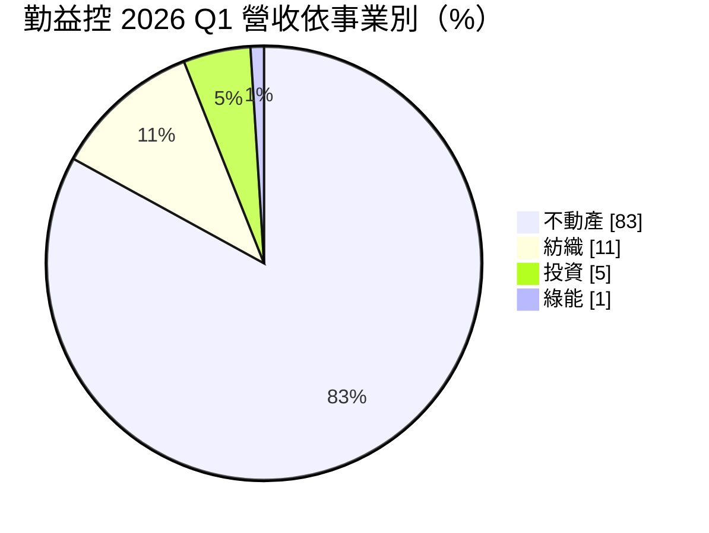
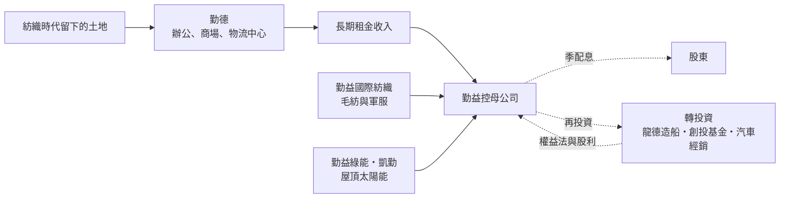
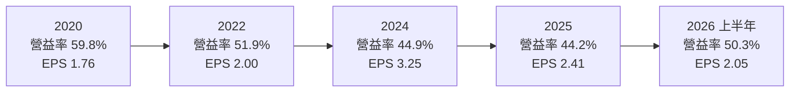
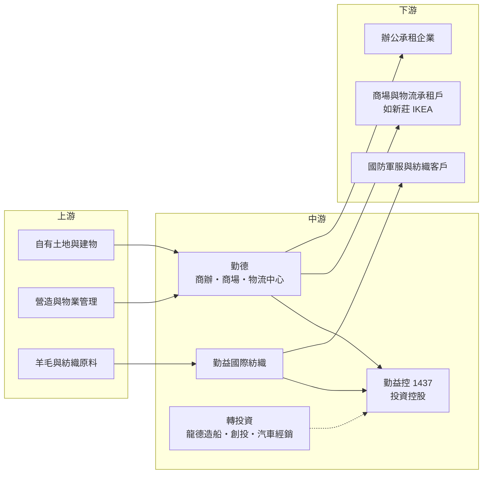

# 1437 勤益控

> 上市｜[[產業索引-其他業|其他業]]｜上市（櫃）日期 1988/11/10

# 第一章：企業模式與商業藍圖

> [!info] 撰寫說明
> 本文由 Claude 依公開資料整理，架構比照 [[2330台積電]] 的四章研究，資料截至 2026-10-08。財務數字來源：證交所開放資料（基本資料、2026 年第二季綜合損益與資產負債、季度股利決議）、Goodinfo 經營績效與股利政策頁、富果研究 2025 年 12 月法說會整理、poorstock 法說摘要；產業描述為整理性內容，尚未逐條比對原始文件。#待校對

在評估單一個股的長期投資價值時，首要步驟是拆解企業的底層獲利邏輯。本章針對勤益投資控股（股票代號：1437，以下簡稱勤益控）的商業模式進行定性分析，說明一家老牌毛紡廠如何轉型成以商用不動產租金為核心、再搭配多元轉投資的控股公司。

## 一、核心定位：以租金為底盤的投資控股公司

依證交所基本資料，勤益控成立於 1961 年 2 月 23 日，1988 年上市，實收資本額約 20.19 億元，董事長兼總經理為顧立楷。公司早年以毛紡織、針織、羊毛被與西服成衣為本業，富果整理的法說資料指出，公司在 2014 年轉型為投資[[控股公司]]，母公司本身只做一般投資，實際營運由子公司負責。

依 poorstock 與富果整理的法說資料，集團的事業可以分成四大支柱：

* **不動產：** 由 100% 持股的子公司勤德負責，從事辦公大樓、商場與物流中心的開發與出租，並兼做金融投資，是集團最主要、也最穩定的獲利來源。法說資料提到的承租案例包括新莊 IKEA。
* **紡織：** 由持股約 97% 的勤益國際紡織負責，銷售毛紡織品、承接代工、經營自有家飾品牌，並承作軍服供應。
* **投資：** 透過中勤（亞洲）與勤投投資進行國內外金融投資，並以[[權益法]]持有多家關聯企業，包括 [[6753龍德造船]]（約 17.6%）、投資台灣、日本與矽谷生技、數位經濟與半導體新創的達穎系列創投基金，以及保時捷代理商尚騰汽車（約 25%）等汽車經銷商股權。
* **綠能：** 子公司勤益綠能經營自用再生能源設備；另與凱瑞能源合資成立凱勤公司（持股約 40%），在勤德桃園大園二期約 6,000 坪的屋頂設置太陽能電廠。

這種結構的投資意義在於：勤益控不是一家「經營某個產業」的公司，而是一家「管理一組資產」的公司。股東持有的，是一個以穩定租金為底盤、再疊加股利收入與轉投資損益的資產組合。

## 二、終端應用／產品板塊：不動產占營收八成

依 poorstock 整理的法說資料，2026 年第一季營收約 1.74 億元，事業別結構如下：

* **不動產（約八成）：** 辦公大樓、商場與物流中心的租金收入。租約通常為多年期，收入穩定、毛利率高，是勤益控能長期維持五成以上毛利率的主因。
* **紡織（約一成）：** 毛紡織品與軍服供應。軍服屬於政府標案，需求與國防採購連動；毛紡與家飾品牌則是傳統本業的延續，規模已不大。
* **投資（約 5%）：** 列在營收中的股利與利息收入。需要注意的是，以權益法認列的關聯企業損益（例如龍德造船、汽車經銷商）多列在營業外，而不是營收，因此實際上投資對獲利的貢獻遠大於營收占比。富果整理的 2025 年第三季資料中，投資與其他占營收比重約 32%，也顯示這部分在不同季度波動很大。
* **綠能（約 1%）：** 太陽能發電收入，規模仍小，屬於長期布局。

## 三、資本轉化邏輯（營運模式）：租金養投資

* **租金是現金的源頭：** 不動產租金提供穩定且可預期的現金流，讓母公司可以按季配息，並有餘裕把資金投入其他事業與金融資產。富果整理的法說資料也明白表示，公司的策略是「以穩定的租金收入支撐其他事業與投資」。
* **投資放大獲利、也放大波動：** 依證交所資料，2026 年上半年營業利益約 2.06 億元，營業外收入及支出卻高達約 2.59 億元，稅前淨利約 4.65 億元。也就是說，業外收益已經大於本業獲利。這讓勤益控的 EPS 比單純的收租公司高，但也讓獲利更依賴轉投資標的的表現與金融市場。
* **按季配息：** 依證交所股利資料，勤益控採季配息，公司章程規定以不低於分派期間稅後淨利的 30% 分派股利，且現金股利不低於股利總額的 50%。2025 年第四季配發 0.48 元、2026 年第二季配發 0.62 元，股利跟著每季獲利浮動。

## 四、企業長期藍圖：多角化分散風險

* **不動產為核心：** 持續經營既有辦公、商場與物流資產，維持租金收入的穩定成長。物流中心受惠電商與供應鏈在地化需求，是三類資產中結構性需求較強的一塊（推估）。
* **轉投資布局新產業：** 透過創投基金接觸生技、數位經濟與半導體新創，透過龍德造船參與國防與海事造船，透過汽車經銷參與高端消費。這些投資讓勤益控在租金之外，有參與新產業成長的管道。
* **綠能：** 利用自有物流中心屋頂發展太陽能，同時降低自身碳排並取得售電收入，仍屬發展初期。
* **策略原則：** 法說資料指出，公司以多角化分散風險、尋找成長為原則，並未提供量化的財務目標。

# 第二章：護城河深度與競爭優勢

在長期價值投資中，「護城河」指企業抵禦競爭、維持超額利潤的保護機制。本章分析勤益控的護城河構成、主要競爭對手，以及它的優勢能守住多少。

## 一、護城河的核心組成要素

勤益控屬於「資產型窄護城河」，競爭優勢來自持有的資產，而不是營運技術：

* **1. 低成本的土地與建物：** 集團的不動產多由紡織時代的土地轉化而來，取得成本遠低於現在的市價，因此即使租金只是市場行情，以帳面成本計算的租金報酬率仍然不錯。這是轉型收租的傳產公司共同的優勢。
* **2. 長期租約與大型租戶：** 商場、物流中心的大型租戶（例如法說資料提到的新莊 IKEA）通常簽訂長期租約，並在場內投入大量裝修與設備，搬遷成本高，續租機率較高。
* **3. 資本配置的彈性：** 控股架構讓公司可以把租金現金流靈活配置到不同產業的投資上，而不受單一產業景氣綁定。這種彈性本身不是護城河，但讓公司能把穩定現金流轉為長期資產累積。
* **4. 軍服等政府標案經驗：** 紡織事業的軍服供應需要符合國防規格與採購程序，有一定的經驗門檻，但規模有限。

## 二、全球主要競爭對手格局

| 對手類型 | 代表 | 對勤益控的影響 |
|---|---|---|
| 轉型收租的傳產公司 | [[1438三地開發]]、[[1436華友聯]] 等 | 在辦公與商場租賃市場競爭租戶 |
| 國際物流地產商 | 普洛斯、安博 | 以大型現代化物流園區競爭物流租戶 |
| 壽險業與建商的商辦開發 | 各大壽險與建商 | 增加商辦供給，影響租金水準 |
| 國內毛紡與制服業者 | 中小型紡織廠 | 在軍服標案與毛紡產品競爭 |

## 三、優勢轉化：哪些守得住、哪些守不住

* **守得住：** 既有不動產的租金收入。只要資產維持良好出租狀態，這部分收入波動小，是勤益控長期配息的基礎。
* **守不住：** 紡織本業的規模與獲利，以及轉投資的穩定性。紡織已是小型業務，轉投資則隨景氣與金融市場起伏，2024 年稅後淨利約 6.61 億元、2025 年降到約 4.89 億元，就是業外波動的結果。
* **觀察重點：** 第一，主要租約到期時的續約與租金調整；第二，龍德造船、創投基金等轉投資的長期報酬；第三，公司是否有新的開發案，讓租金收入規模再上一個台階。

# 第三章：財務體質與盈利規模

資料日期：2026-10-08。數字取自證交所開放資料、Goodinfo 經營績效與股利政策頁、富果研究與 poorstock 法說整理，表格是撰寫當時的快照；最新月營收、毛利率、累計 EPS 由自動排程寫在本筆記的屬性欄位（月營收、毛利率、累計EPS 等）。#待校對

財務報表是檢驗護城河是否真實存在的最終標準。本章用多年度的三率、ROE、現金流與資本報酬，把勤益控的本業租金與轉投資收益分開檢視。

## 一、獲利能力的基石：三率

| 年度 | 營收（新台幣） | [[毛利率]] | [[營業利益率]] | EPS（元） | [[ROE]] |
|---|---|---|---|---|---|
| 2020 | 6.05 億 | 74.2% | 59.8% | 1.76 | 5.53% |
| 2021 | 6.98 億 | 68.1% | 52.7% | 2.25 | 6.95% |
| 2022 | 8.02 億 | 60.6% | 51.9% | 2.00 | 5.85% |
| 2023 | 8.64 億 | 62.3% | 51.5% | 2.82 | 7.79% |
| 2024 | 8.46 億 | 58.9% | 44.9% | 3.25 | 8.29% |
| 2025 | 9.27 億 | 54.5% | 44.2% | 2.41 | 5.91% |
| 2026 上半年 | 4.10 億 | 65.2% | 50.3% | 2.05 | 未查得 |

註：2020 至 2025 年取自 Goodinfo 經營績效頁；2026 上半年取自證交所開放資料（2026 年第二季累計）。

* **[[毛利率]]與[[營業利益率]]：** 毛利率長期在 55% 至 75% 之間、營益率在 44% 至 60% 之間，是典型租賃型收入的高利潤特性。2020 至 2025 年營益率逐步下滑，原因推估是紡織等毛利較低的業務比重變化，以及營收中的投資收入波動（推估）。
* **淨利高於營業利益：** 多數年度稅後淨利率高於營業利益率，例如 2024 年淨利率約 78%，代表業外的轉投資與金融收益貢獻很大。2026 年上半年稅後淨利率更超過 100%，業外收益已大於本業。
* **長期指標：** 2020 至 2025 年營收年複合成長率約 8.9%（推算），2021 至 2025 年平均 ROE 約 7.0%（推算）。

## 二、[[ROE]]：資本效率

勤益控的 ROE 長期在 5.5% 至 8.3% 之間，不高但相當穩定。依證交所 2026 年第二季資料，股東權益約 85.8 億元、每股淨值 42.57 元，總負債約 55.3 億元，其中非流動負債約 41.5 億元，負債比約 39%（推算）。ROE 偏低的原因有二：一是不動產以歷史成本入帳，資產規模大但租金占資產比例不高；二是帳上持有大量金融資產，報酬率取決於市場。以收租型控股公司而言，這個 ROE 水準屬於正常範圍。

## 三、資本支出與自由現金流

* **[[CapEx]]：** 近年沒有查得大型開發案的資本支出資料，推估以既有資產的維護與屋頂太陽能等小型投資為主（推估）。
* **[[自由現金流]]：** 租金收入穩定、資本支出不大，自由現金流長期為正的機率高（推估，完整現金流量表本次未查得）。
* **股利：** 依 Goodinfo 股利政策頁，2019 至 2025 年度現金股利分別為 1.1、0.7、0.9、0.8、1.13、1.35、約 0.97 元，2024 與 2025 年度配息率約四成（推算）。股利金額穩定但不高，公司保留了相當比例的盈餘用於再投資。近年採季配息（Goodinfo 列有 2025 年第二至第四季的季度股利），股利會跟著每季獲利浮動。

## 四、[[ROIC]] 與 [[WACC]]：價值創造利差

* **ROIC（推算）：** 2025 年營業利益約 4.10 億元（營收 9.27 億元乘營益率 44.2%），以稅率 20% 計算，稅後營業利益約 3.28 億元。官方快照沒有拆出有息負債，以非流動負債約 41.5 億元作為近似值（推估），投入資本約 127 億元，本業 ROIC 約 2.6%（推算）。若把轉投資收益一併計入，整體資本報酬接近 ROE 的 6% 至 8%。
* **WACC（推算）：** 無風險利率取 1.75%，市場風險溢酬 6%，β 取收租型資產股同業常見值 0.5（本次未查得來源數字），股東權益成本約 4.75%；負債成本假設 2%、稅後 1.6%，資本結構約權益 68%、負債 32%，WACC 約 3.7%（推算）。
* **結論：** 只看本業租金，ROIC 約 2.6%，略低於 WACC 約 3.7%（推算）；加上轉投資後，ROE 約 6% 至 8%，高於約 4.75% 的股東權益成本，整體小幅創造價值。換句話說，勤益控的超額報酬主要來自資本配置（投資眼光），而不是租金本身；評估這家公司，關鍵在於檢視經營層長期的投資績效。

# 第四章：總體風險與地緣政治

任何企業都無法脫離宏觀環境獨立存在。本章分析勤益控未來必須面對的地緣政治、產業週期、營運與法規風險。

## 一、地緣政治

* **台灣不動產與經濟風險：** 主要資產在台灣，兩岸情勢若影響台灣經濟與外資信心，商辦與商場的租金與資產價值都可能受到衝擊。
* **國防產業的雙面性：** 轉投資的龍德造船與紡織事業的軍服供應，都與國防採購相關。國防支出提高時受惠，但也受政策與預算變動影響。
* **海外投資：** 創投基金布局日本與矽谷，匯率與海外市場波動會影響投資損益，法說資料也提到公司需留意匯率變化對匯兌損益的影響。

## 二、產業週期與市場結構

* **商用不動產週期：** 商場出租率與零售消費景氣連動，辦公大樓租金與企業擴編需求連動。景氣下行時，租金調漲空間受限，空置可能增加。
* **金融市場週期：** 帳上金融資產與創投基金的價值隨股市起伏，獲利波動可能遠大於本業。
* **汽車經銷：** 轉投資的汽車經銷商受進口車市場、關稅與電動車轉型影響。

## 三、營運環境的隱性風險

* **獲利品質：** 業外收益大於本業時，EPS 的可預測性下降。投資人比較不同年度獲利時，應把租金本業與投資收益分開看。
* **利率：** 利率上升會增加借款成本，也會壓低不動產的評價；對以租金為底盤的公司而言，利率是最重要的總體變數之一。
* **租戶集中：** 大型商場與物流中心的主要租戶數量有限，單一大租戶退租或要求降租，會明顯影響營收。

## 四、科技或法規演進

* **零售型態改變：** 電商持續侵蝕實體零售，商場租戶結構可能需要調整；反過來，物流中心的需求則受惠電商成長。
* **建築與能源法規：** 綠建築、建物能效與消防法規加嚴，可能增加舊建物的改善成本；屋頂太陽能則讓公司在再生能源相關法規中取得一定的先機。
* **控股公司的資訊揭露：** 多層轉投資讓外部投資人不易掌握每項資產的真實價值，公司揭露的詳細程度會影響市場的評價。

# 專有名詞解析

## 金融

- **[[權益法]]**：持股 20% 至 50% 等具重大影響力的轉投資，按持股比例把被投資公司損益認列為本公司投資收益。
- **[[業外收益]]**：本業以外的收入，例如投資收益、處分利益或匯兌利益，通常較不穩定。
- **[[毛利率]]**：營收扣除銷貨成本後的毛利占營收比例，反映產品本身的獲利能力。
- **[[營業利益率]]**：營業利益占營收比例，反映扣除研發、管銷費用後的本業獲利能力。
- **[[ROE]]**：股東權益報酬率，稅後淨利除以股東權益，衡量股東投入資金的報酬。
- **[[ROIC]]**：投入資本報酬率，稅後營業利益除以股東權益與有息負債的合計，衡量本業資本效率。
- **[[WACC]]**：加權平均資金成本，股東權益成本與負債成本依資本結構加權的結果，是投資報酬的門檻。
- **[[CapEx]]**：資本支出，企業購買土地、廠房與設備的支出。
- **[[自由現金流]]**：營業活動現金流減去資本支出，代表企業可自由用於配息、還債或併購的現金。

## 產業

- **[[控股公司]]**：本身不直接經營，而是持有子公司股權並收取其獲利的公司型態。
- **[[物流地產]]**：以出租倉儲與物流設施為主的不動產業務，收入來自長期租約，性質介於物流業與不動產業之間。

# 核心供應鏈

## 1. 上游：資產與原料
- 自有土地與建物、營造與物業管理：名稱未揭露
- 羊毛與紡織原料：供應商未揭露

## 2. 中游：勤益控與子公司
- 不動產：勤德（100%）
- 紡織：勤益國際紡織（約 97%）
- 投資：中勤（亞洲）、勤投投資；關聯企業 [[6753龍德造船]]、達穎系列創投基金、尚騰汽車等
- 綠能：勤益綠能、凱勤（與凱瑞能源合資）

## 3. 下游：承租戶與客戶
- 商場、辦公與物流中心承租戶，法說資料提及新莊 IKEA
- 國防軍服採購與毛紡、家飾客戶

## 4. 同業
- 轉型收租的傳產公司：[[1438三地開發]]、[[1436華友聯]]

## 最新新聞
<!-- news:start（自動產生，請勿手動編輯此範圍） -->
- 2026-10-19 🏛️ 重訊 16:54｜公告本公司董事會決議第十七次買回庫藏股事宜｜[觀測站](https://mops.twse.com.tw/mops/#/web/t05st01)

完整紀錄：[[1437勤益控 新聞]]
<!-- news:end -->

## 相關連結
- [公開資訊觀測站](https://mopsov.twse.com.tw/mops/web/t05st03?step=1&firstin=1&co_id=1437)
- [Goodinfo](https://goodinfo.tw/tw/StockDetail.asp?STOCK_ID=1437)
- [Yahoo 股市](https://tw.stock.yahoo.com/quote/1437)
- [鉅亨網新聞](https://www.cnyes.com/twstock/1437/news)
