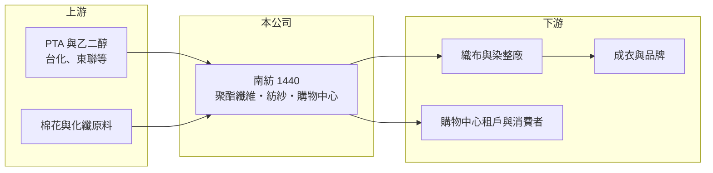

# 1440 南紡

> 上市｜[[產業索引-紡織纖維|紡織纖維]]｜上市（櫃）日期 1989/10/03

# 第一章：企業模式與商業藍圖

> [!info] 撰寫說明
> 精簡版，由 Claude 依公開資料整理，架構比照 [[2330台積電]]，資料截至 2026-10-08。來源：MoneyDJ 理財網財務比率年表（2021 至 2025 年）；證交所開放資料快照（基本資料、2026 年第二季資產負債與上半年損益、2025 年度股利）。這次未查得營收比重，事業結構與集團持股多為憑記憶整理，已標「待校對」。#待校對

臺南紡織（以下簡稱南紡）成立於 1955 年 3 月、1989 年 10 月上市，總部在台南市東區，董事長為侯博明，是「台南幫」企業群的起家公司之一。它的價值由三塊組成：利潤偏薄的聚酯與紡紗本業、以自有土地開發的購物中心，以及持有的集團上市公司股權。

- **核心業務：** 南紡的紡織本業以[[聚酯]]纖維與紗線為主，產品包括聚酯粒、聚酯長短纖與紡紗（待校對）。這類產品屬於大宗原料，規格標準化、價格跟著原油與 [[PTA]] 走，因此毛利率容易隨原料行情大起大落。
- **營收結構：** 依 MoneyDJ 每股營業額 8.70 元乘以約 16.57 億股推算，2025 年營收約 144 億元（推算），2026 年上半年證交所資料為 65.6 億元，規模相符。各事業比重這次未查得，但從營收連續三年下滑、營業利益率轉負來看，紡織本業正承受中國產能擴張帶來的價格壓力。
- **營運據點：** 總部與主要生產在台南，另以台南東區的自有土地開發「南紡購物中心」（2015 年開幕，待校對）。把工業用地轉為商場收租，是老牌紡織公司常見的[[資產活化]]方式，可以把低報酬的土地轉成較穩定的現金流。
- **長期方向：** 南紡的長期課題是紡織本業能否轉向差異化、回收材質等較高附加價值的產品，同時讓流通事業成為穩定的獲利來源。投資層面，南紡與 [[1216統一]] 同屬台南幫，彼此有持股關係（持股比例待校對），2026 年第二季其他權益約 12.7 億元，上半年其他綜合損益 12.4 億元，代表持股市值變動對淨值影響很大。

# 第二章：護城河深度與競爭優勢

南紡的優勢在於土地資產與集團關係，而不是紡織技術本身；紡織本業面對的是高度同質化、由價格決定勝負的市場。

- **競爭優勢：** 南紡在台南擁有早期取得、帳面成本低的土地，開發成購物中心後能創造本業以外的穩定收入，這是新進同業無法複製的條件。台南幫的人脈與集團持股則提供股利收入與融資上的支援，讓公司在紡織景氣低迷時仍有財務緩衝。
- **主要對手：** 聚酯纖維與紗線的主要競爭者是 [[1402遠東新]]、[[1409新纖]]、[[1326台化]] 等台灣大廠，以及中國的大型聚酯廠。中國業者產能規模大、成本低，2023 年起國際報價長期被壓低，台灣中小型聚酯廠很難單靠規模取勝。
- **觀察重點：** 南紡近 5 年平均 [[ROE]] 約 4.1%（推算），但 2023 年營業利益率為 -6.44% 時 ROE 仍有 7.59%，說明獲利主要靠[[業外收益]]而非本業。投資人應把南紡拆成「紡織本業」、「購物中心」與「集團持股」三塊分別評價，觀察本業[[營業利益率]]能否轉正。

# 第三章：財務體質與盈利規模

資料日期：2026-10-08，表格是撰寫當時的快照；最新月營收、毛利率、累計 EPS 由自動排程寫在本筆記的屬性欄位（月營收、毛利率、累計EPS 等）。#待校對

南紡的營收自 2022 年高點一路下滑，本業從 2023 年起連續虧損，EPS 的正負主要取決於業外的投資收益。

| 年度 | 營收（億元） | [[毛利率]] | [[營業利益率]] | EPS（元） | [[ROE]] |
|---|---|---|---|---|---|
| 2021 | 約 202（推算） | 16.27% | 6.03% | 1.77 | 11.15% |
| 2022 | 約 220（推算） | 10.98% | 1.66% | 0.70 | 4.27% |
| 2023 | 約 194（推算） | 3.09% | -6.44% | 1.27 | 7.59% |
| 2024 | 約 172（推算） | 5.11% | -5.05% | -0.34 | -1.74% |
| 2025 | 約 144（推算） | 7.32% | -4.12% | -0.15 | -0.68% |

註：2025 年營收以每股營業額 8.70 元乘以約 16.57 億股推算，其他年度依 MoneyDJ 營收成長率回推。

- **長期指標：** 2021 至 2025 年營收年複合成長率約 -8.1%（推算），近 5 年平均 ROE 約 4.1%（推算）。2025 年度虧損，但董事會仍以累積盈餘配發現金股利 0.3 元，章程規定現金股利不低於股利總額的 30%。每股現金流量除 2023 年外皆為正值（0.66 至 1.63 元），本業雖虧損，現金流尚稱穩定。
- **[[ROIC]] 與 [[WACC]]：** 2025 年營業損失約 5.9 億元（營業利益率 -4.12% × 營收約 144 億元，虧損不計稅），投入資本約 376 億元（2026 年第二季權益總計 289.8 億元，加上以總負債 172.5 億元的一半推估的有息負債約 86 億元），ROIC 約 -1.6%（推算）。WACC 約 5.5%（推算：無風險利率 1.75%、市場風險溢酬 6%、β 取紡織同業常見值 0.8，股東權益成本 6.55%；稅前負債成本 2.5%、稅率 20%；權益比重約 77%）。ROIC 為負且遠低於 WACC，代表紡織本業目前正在消耗價值；另一方面，權益裡有大量土地與集團持股，分母很大，即使本業轉盈，ROIC 也不容易高，這正是資產型公司 ROE 長期偏低的結構原因。
- **財務特色：** 2026 年第二季負債比率約 37%（負債 172.5 億元 ÷ 資產 462.3 億元），2021 年的 44% 逐年下降。2026 年上半年營業損失 1.1 億元、業外收入 3.7 億元，業外再次撐起淨利，股價淨值比約 0.78 倍，市場是以資產股的角度評價南紡。

# 第四章：總體風險與地緣政治

南紡的風險一半來自聚酯紡織的景氣，另一半來自零售與持股市值的變化。

- **產業週期：** 聚酯纖維價格跟著原油、PTA 與中國產能走，2023 年毛利率跌到 3.09% 就是中國低價產品大量出口的結果。這類大宗原料週期長、谷底深，產能過剩若持續，台灣廠商只能靠減產或轉型因應。
- **營運風險：** 本業連續三年營業虧損，若靠業外收益長期填補，紡織資產可能需要提列減損或進一步縮編。購物中心則面臨電商分流、周邊新商場競爭與租約續約的不確定性。
- **其他風險：** 集團持股的股價下跌時，淨值與股利收入會同時減少；外銷產品以美元計價，新台幣升值會壓縮毛利；歐美品牌對回收材質與碳排揭露的要求提高，達不到標準的大宗產品更難維持價格。

# 專有名詞解析

## 金融

- **[[業外收益]]**：本業以外的收入，例如投資收益、股利、利息與處分資產利益。
- **[[ROIC]]**：投入資本報酬率，稅後營業利益除以股東權益加有息負債，衡量本業運用資本的效率。
- **[[WACC]]**：加權平均資金成本，股東與債權人要求報酬率的加權平均，是 ROIC 要超越的門檻。

## 產業

- **[[聚酯]]**：以 PTA 與乙二醇聚合而成的合成纖維與塑膠原料，用於衣料、寶特瓶與工業用布。
- **[[PTA]]**：純對苯二甲酸，與乙二醇聚合成聚酯，是紡織與包裝用聚酯的基礎原料。
- **[[資產活化]]**：把閒置或低度利用的土地、建物透過開發、出租或出售，轉為收益或現金。

# 核心供應鏈

- 上游：聚酯原料供應如 [[1326台化]]、[[1303南亞]]（是否為南紡供應商未查得）。
- 下游／客戶：織布、染整與成衣廠，客戶名單未查得；購物中心的租戶與台南地區消費者。
- 同業：[[1402遠東新]]、[[1409新纖]]、[[1419新紡]]；台南幫關係企業 [[1216統一]]（持股關係待校對）；購物中心的零售同業參考 [[2903遠百]]。

## 最新新聞
<!-- news:start -->
<!-- news:end -->

## 相關連結
- [公開資訊觀測站](https://mopsov.twse.com.tw/mops/web/t05st03?step=1&firstin=1&co_id=1440)
- [Goodinfo](https://goodinfo.tw/tw/StockDetail.asp?STOCK_ID=1440)
- [Yahoo 股市](https://tw.stock.yahoo.com/quote/1440)
- [鉅亨網新聞](https://www.cnyes.com/twstock/1440/news)
