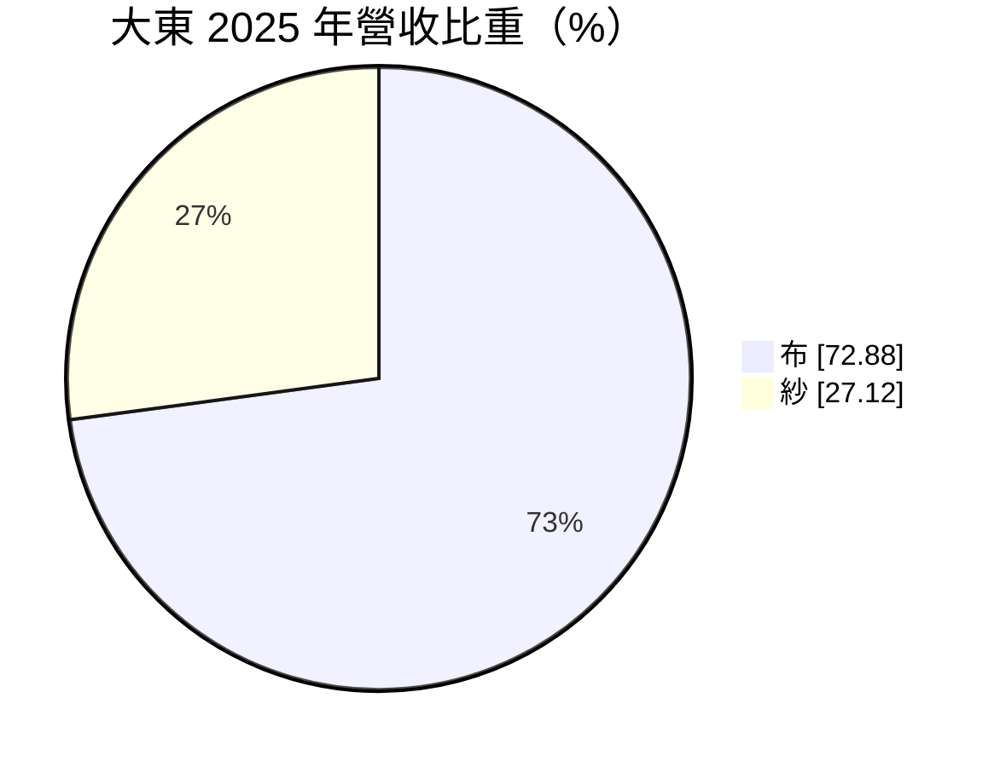
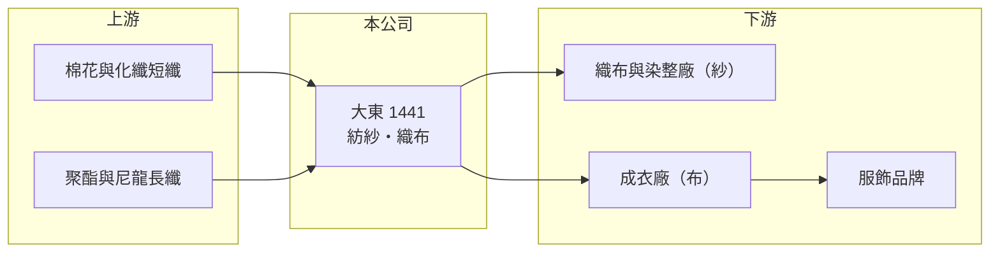

# 1441 大東

> 上市｜[[產業索引-紡織纖維|紡織纖維]]｜上市（櫃）日期 1989/10/27

# 第一章：企業模式與商業藍圖

> [!info] 撰寫說明
> 精簡版，由 Claude 依公開資料整理，架構比照 [[2330台積電]]，資料截至 2026-10-08。來源：MoneyDJ 理財網個股基本資料（2025 年營收比重）與財務比率年表（2021 至 2025 年）；證交所開放資料快照（基本資料、2026 年第二季資產負債與上半年損益、2025 年度股利）。公開資料有限，產品、據點與客戶多未查得。#待校對

大東紡織（以下簡稱大東）成立於 1958 年 3 月、1989 年 10 月上市，總公司設在台北市松山區，董事長為陳修忠。它是一家規模很小的傳統紡紗織布廠，2025 年營收約 13 億元（推算），近五年多數年度本業虧損，財務槓桿偏高，是紡織類股中體質較弱的一家。

- **核心業務：** 大東同時做[[紡紗]]與織布，2025 年布類占營收 72.88%、紗類占 27.12%。從紗做到布的垂直整合，理論上可以讓公司掌握原料品質與交期，但在規模很小的情況下，整合帶來的成本優勢有限。
- **營收結構：** 依 MoneyDJ 每股營業額 21.12 元與營收成長率推算，2025 年營收約 13.0 億元（推算），2026 年上半年證交所資料為 5.9 億元，規模相近。營收在 2023 年衰退 27%、2024 年又成長 40%，起伏很大，顯示訂單集中、容易隨少數客戶或單一產品線變動。
- **營運據點：** 生產廠區與海外據點這次未查得。紡紗織布屬於設備與人力密集產業，台灣工資與電價上升後，多數同業已把產能移往越南、中國等地，大東的產地配置是影響長期成本的關鍵，有待查證。
- **長期方向：** 大東的長期課題是先讓本業回到損益兩平，再談轉型。2026 年第二季證交所資料的股本約 7.17 億元，高於登記的實收資本額 6.17 億元，可能有增資進行中（待校對），顯示公司仍需要外部資金支撐營運。

# 第二章：護城河深度與競爭優勢

大東規模小、產品同質性高，目前看不出明確的護城河，競爭力主要取決於能否守住既有客戶與控制成本。

- **競爭優勢：** 大東經營超過 60 年，與下游客戶有長期往來關係，紗與布兩種產品可以互相支援接單。不過在中國與東南亞大廠以規模壓低報價的環境下，這類關係型優勢很難轉成較高的毛利，2022 至 2024 年毛利率甚至為負。
- **主要對手：** 紡紗同業如 [[1419新紡]]、[[1459聯發]]，織布同業如 [[1460宏遠]]、[[1467南緯]]，以及中國、越南的大量中小型紗廠與布廠。這些對手多半規模更大或產地成本更低，大東在價格上較難競爭。
- **觀察重點：** 2025 年毛利率回升到 6.61%，是近五年最好的一年，但營業利益率仍為 -3.32%。觀察重點是毛利率能否穩定在 10% 上下、讓營業利益轉正，以及負債比率能否從 70% 左右降下來。

# 第三章：財務體質與盈利規模

資料日期：2026-10-08，表格是撰寫當時的快照；最新月營收、毛利率、累計 EPS 由自動排程寫在本筆記的屬性欄位（月營收、毛利率、累計EPS 等）。#待校對

大東近五年只有 2024 年獲利，而且是靠業外收益；因為股東權益很小，ROE 的波動幅度遠大於一般公司。

| 年度 | 營收（億元） | [[毛利率]] | [[營業利益率]] | EPS（元） | [[ROE]] |
|---|---|---|---|---|---|
| 2021 | 約 13.3（推算） | 4.70% | -7.40% | -0.75 | -18.19% |
| 2022 | 約 13.7（推算） | -6.81% | -19.86% | -2.52 | -42.31% |
| 2023 | 約 10.0（推算） | -12.95% | -26.90% | -4.76 | -64.17% |
| 2024 | 約 14.0（推算） | -0.50% | -10.04% | 1.63 | 22.03% |
| 2025 | 約 13.0（推算） | 6.61% | -3.32% | -0.45 | -6.13% |

註：2025 年營收以每股營業額乘約 6.17 億元股本推算，其他年度依 MoneyDJ 營收成長率回推；期間股本可能有變動，各年營收僅供參考。

- **長期指標：** 2021 至 2025 年營收年複合成長率約 -0.5%（推算），近 5 年平均 ROE 約 -21.8%（推算）。2024 年營業利益率 -10.04%、稅後淨利率卻為 6.24%，獲利來自[[業外收益]]（來源未查得，推估為一次性收益）。近年沒有配發股利，每股淨值從 2021 年 7.40 元降到 2025 年 6.46 元，2026 年第二季約 5.07 元。
- **[[ROIC]] 與 [[WACC]]：** 2025 年營業損失約 0.43 億元（營業利益率 -3.32% × 營收約 13.0 億元，虧損不計稅），投入資本約 8.3 億元（2026 年第二季權益總計 3.6 億元，加上以總負債 9.3 億元的一半推估的有息負債約 4.6 億元），ROIC 約 -5.2%（推算）。WACC 依β 0.8、無風險利率 1.75%、市場風險溢酬 6%、稅前負債成本 2.5%、稅率 20%、權益比重約 44% 計算約 4.0%（推算），但大東負債比率高，實際的股東要求報酬與借款利率都應更高，合理的 WACC 推估在 5% 至 6%。ROIC 長期為負，代表本業持續侵蝕股東資本，尚未創造價值。
- **財務特色：** 2026 年第二季負債比率約 72%（負債 9.26 億元 ÷ 資產 12.89 億元），保留盈餘為 -3.19 億元，屬於累積虧損狀態。2026 年上半年營業損失 0.72 億元、每股虧損 1.45 元，財務結構仍是最需要留意的地方。

# 第四章：總體風險與地緣政治

大東的主要風險是本業長期虧損下的財務壓力，其次才是紡織景氣本身。

- **產業週期：** 紗與布的價格跟著棉花、化纖原料與國際品牌的庫存週期波動，品牌去化庫存時訂單會一次大幅縮減。2022 至 2023 年的毛利率轉負，就是需求下滑加上原料成本無法轉嫁的結果。
- **營運風險：** 負債比率約七成、累積虧損超過 3 億元，若虧損延續，可能需要再增資或處分資產；股東權益很小，任何一筆虧損都會明顯侵蝕每股淨值。營收起伏大，也代表客戶或產品集中度可能偏高。
- **其他風險：** 外銷產品以美元計價，匯率變動影響毛利；台灣電價與工資上升會持續墊高成本；中國低價紗布的出口壓力若延續，規模小的廠商最先受到衝擊。

# 專有名詞解析

## 金融

- **[[業外收益]]**：本業以外的收入，例如投資收益、處分資產利益或匯兌利益，通常不具持續性。
- **[[ROIC]]**：投入資本報酬率，稅後營業利益除以股東權益加有息負債，衡量本業運用資本的效率。
- **[[WACC]]**：加權平均資金成本，股東與債權人要求報酬率的加權平均，是 ROIC 要超越的門檻。

## 產業

- **[[紡紗]]**：把棉花或化學短纖維加撚成紗線的工序，是織布的前一道製程。

# 核心供應鏈

- 上游：棉花與化纖原料，供應商未查得；化纖原料業者如 [[1402遠東新]]、[[1409新纖]]（是否為大東供應商未查得）。
- 下游／客戶：織布、染整與成衣廠，客戶名單未查得。
- 同業：[[1419新紡]]、[[1459聯發]]、[[1460宏遠]]、[[1467南緯]]。

## 最新新聞
<!-- news:start（自動產生，請勿手動編輯此範圍） -->
- 2026-10-07 🏛️ 重訊 18:23｜公告本公司董事會依115年股東會授權決議辦理私募普通股 之定價及其他相關事宜｜[觀測站](https://mops.twse.com.tw/mops/#/web/t05st01)

完整紀錄：[[1441大東 新聞]]
<!-- news:end -->

## 相關連結
- [公開資訊觀測站](https://mopsov.twse.com.tw/mops/web/t05st03?step=1&firstin=1&co_id=1441)
- [Goodinfo](https://goodinfo.tw/tw/StockDetail.asp?STOCK_ID=1441)
- [Yahoo 股市](https://tw.stock.yahoo.com/quote/1441)
- [鉅亨網新聞](https://www.cnyes.com/twstock/1441/news)
