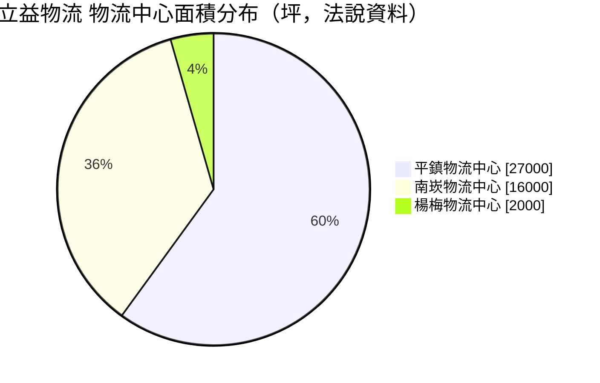
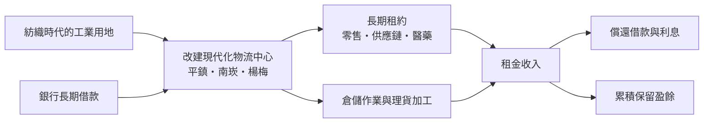
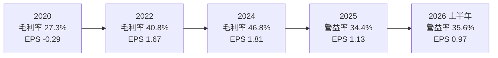
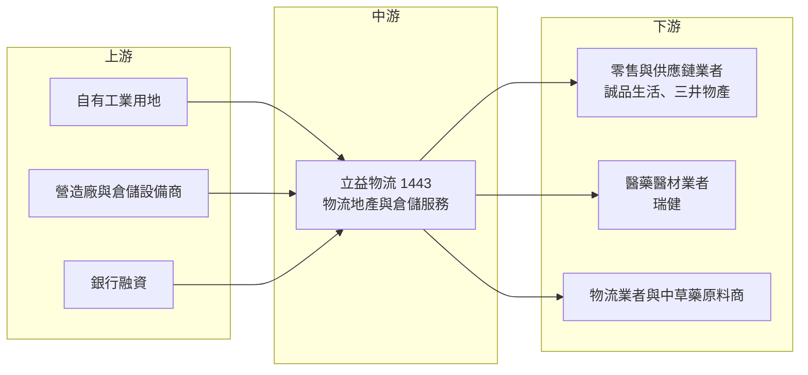

# 1443 立益物流

> 上市｜[[產業索引-其他業|其他業]]｜上市（櫃）日期 1990/04/21

# 第一章：企業模式與商業藍圖

> [!info] 撰寫說明
> 本文由 Claude 依公開資料整理，架構比照 [[2330台積電]] 的四章研究，資料截至 2026-10-08。財務數字來源：證交所開放資料（基本資料、2026 年第二季綜合損益與資產負債、2025 年度股利）、Goodinfo 經營績效與股利政策頁、poorstock 法說會摘要（2024 年與 2025 年法說）、nStock 公司簡介、旺得富 2023 年 1 月報導；產業描述為整理性內容，尚未逐條比對原始文件。#待校對

在評估單一個股的長期投資價值時，首要步驟是拆解企業的底層獲利邏輯。本章針對立益物流開發（股票代號：1443，以下簡稱立益物流）的商業模式進行定性分析，說明一家棉紡廠如何把桃園的廠房土地轉成物流中心，變成以「物流地產」為核心的收租型公司。

## 一、核心定位：桃園的物流地產業者

依證交所基本資料，立益物流成立於 1972 年 11 月 25 日，實收資本額約 13.53 億元。nStock 公司簡介指出，公司原名立益紡織，以棉紡為本業；2017 年 3 月董事會決議停止棉紡生產，把原有廠區改建為物流中心；2022 年 7 月更名為立益物流開發。旺得富 2023 年的報導說明了轉型的原因：東南亞低價紗線競爭加上部分工廠外移，棉紡事業持續虧損，公司判斷已無經濟效益，因此全力轉向物流。

轉型後的立益物流，核心是[[物流地產]]，也就是持有大型倉庫，把空間長期出租給零售、供應鏈管理與醫藥業者，同時提供部分[[第三方物流]]與[[理貨加工]]服務。nStock 簡介並指出，原本的棉花相關貿易、標售與代理業務仍以副業形式保留。

這個定位可以用兩點理解：

* **以土地換租金：** 紡織廠時代留下的工業用地，位於台灣物流最密集的桃園地區。把廠房改建為現代化物流中心，等於把低報酬的製造資產，轉成長期、穩定的租金收入。
* **以服務加值：** 單純收租的報酬率有上限，因此公司也提供倉儲作業、理貨加工與專業物流，希望在租金之外，賺取服務的附加價值。

## 二、終端應用／產品板塊：三座桃園物流中心

依 poorstock 整理的法說資料，立益物流在桃園地區有三處物流中心，合計逾 4.5 萬坪。以面積計算的分布如下：

* **平鎮物流中心：** 約 2.7 萬坪，2016 年起陸續啟用，是規模最大的據點。法說資料列出的承租戶包括誠品生活、三井物產台灣供應鏈與喜提達物流，客戶涵蓋零售與供應鏈管理。
* **南崁物流中心：** 約 1.6 萬坪，1994 年草創，現由醫藥醫材製造商瑞健整廠承租。整廠出租的好處是管理單純、租約穩定，缺點是單一租戶集中度高。
* **楊梅物流中心：** 約 2,000 坪，2012 年啟用，專營中草藥原料物流，屬於利基型的專業倉儲。

依法說資料，公司的服務類型分為第三方物流、物流地產、物流加工與專業物流四類，但各業務的營收占比本次未查得。從毛利率接近五成、營益率約三成五來看，營收結構應以租賃型收入為主（推估）。

## 三、資本轉化邏輯（營運模式）：工業地改建物流中心

* **高槓桿的資產開發：** 改建物流中心需要大量資金，立益物流以銀行借款支應。依證交所 2026 年第二季資料，總資產約 79.9 億元，其中非流動資產約 74.0 億元，總負債約 60.6 億元，權益總計只有約 19.3 億元。這是一個以負債撐起資產的模式：租金穩定時，槓桿放大股東報酬；利率上升或空置增加時，槓桿也會放大風險。
* **借款結構調整：** poorstock 整理的 2025 年法說資料指出，公司把部分短期借款轉為長期借款，以改善流動性；同期不動產、廠房及設備約 56.4 億元，較前一年增加約 7.7%，代表仍在持續投資倉儲設施。
* **不配息、保留現金：** 依 Goodinfo 股利政策頁，公司 2015 至 2025 年度都沒有配發股利，Goodinfo 並註記已連續多年未配發現金股利。公司章程的股利政策也寫明「配合業務規模拓展，考量公司資本支出及營運週轉所需」。在高負債、持續投資的階段，盈餘主要用於還債與再投資。

## 四、企業長期藍圖：往高附加價值的專業物流升級

* **醫藥醫材物流：** 法說資料顯示，公司規劃在 2026 年第一季完成符合 [[GDP]] 與 [[GMP]] 規範的醫藥醫材專用倉庫，提供溫控與安全管控服務。醫藥物流的規範嚴格，客戶一旦導入不易更換，租金與服務單價也較一般倉儲高。
* **電子業物流：** 公司規劃在 2026 年進入電子業物流市場，服務範圍包括 ICT、半導體、組裝代工與零組件供應商。桃園是電子業與航空貨運的重要聚落，這是延伸既有據點價值的方向。
* **經營哲學：** 法說資料指出，公司認為物流市場成長有限，需要靠效率、差異化服務與成本控制提升競爭力，而不是單純擴大規模。
* **ESG：** 2025 年發行永續報告書，並取得 ISO 45001、ISO 14001、ISO 27001 認證；2025 年 4 月獲得 ESG 物流永續獎。對國際品牌與醫藥客戶而言，供應商的 ESG 與資安認證已逐漸成為採購條件。

# 第二章：護城河深度與競爭優勢

在長期價值投資中，「護城河」指企業抵禦競爭、維持超額利潤的保護機制。本章分析立益物流的護城河構成、主要競爭對手，以及哪些優勢在物流地產市場中真正守得住。

## 一、護城河的核心組成要素

立益物流屬於「資產型窄護城河」，核心是區位與土地成本，而不是營運技術：

* **1. 桃園區位：** 桃園有機場、港口聯外道路與高速公路網，是北台灣倉儲物流的核心區。大型、合法的物流用地供給有限，既有業者的區位本身就是門檻。
* **2. 低土地取得成本：** 物流中心建在紡織時代取得的自有土地上，土地成本遠低於現在新購土地的開發商，因此在相同租金下，資產報酬率相對較高。
* **3. 長期租約與客戶黏著：** 大型租戶進駐倉庫需要投入貨架、自動化設備與系統整合，搬遷成本高，因此租約往往是長期且續約率較高。整廠出租給醫藥業者，更是高度客製化的關係。
* **4. 專業倉儲規範：** 醫藥醫材 GDP/GMP 倉、中草藥原料倉等專業物流，需要溫控、追溯與法規認證，進入門檻高於一般倉儲。

## 二、全球主要競爭對手格局

| 對手 | 定位 | 對立益物流的影響 |
|---|---|---|
| 普洛斯（GLP）、安博（Prologis）等國際物流地產商 | 大型現代化物流園區開發與出租 | 以規模與國際客戶網競爭大型租戶 |
| [[5607遠雄港]] | 自由貿易港區與物流園區 | 在桃園航空城與跨境物流競爭 |
| [[2608嘉里大榮]]、[[2642宅配通]] | 國內物流與配送業者 | 自建倉儲並提供第三方物流服務 |
| 壽險業與建商開發的物流地產 | 以長期資金投資物流倉 | 增加桃園地區倉儲供給，影響租金 |
| 其他轉型收租的傳產公司 | 以舊廠房改建倉庫出租 | 中小型倉儲市場的直接競爭者 |

## 三、優勢轉化：哪些守得住、哪些守不住

* **守得住：** 既有長約租戶與專業倉儲。醫藥、中草藥與整廠出租的客戶，更換倉庫的成本高，租金收入穩定。
* **守不住：** 一般倉儲的租金漲幅。桃園地區近年有大量新物流園區完工，若供給過多，一般倉儲的租金與出租率會面臨壓力。
* **觀察重點：** 第一，GDP/GMP 醫藥倉與電子業物流能否帶來較高單價的新客戶；第二，主要租約到期時的續約條件；第三，負債比能否隨著獲利累積逐步下降。這三點決定立益物流能否從高槓桿的收租公司，變成財務更穩健、能開始配息的物流地產公司。

# 第三章：財務體質與盈利規模

資料日期：2026-10-08。數字取自證交所開放資料、Goodinfo 經營績效與股利政策頁與 poorstock 法說整理，表格是撰寫當時的快照；最新月營收、毛利率、累計 EPS 由自動排程寫在本筆記的屬性欄位（月營收、毛利率、累計EPS 等）。#待校對

財務報表是檢驗護城河是否真實存在的最終標準。本章用多年度的三率、ROE、現金流與資本報酬，檢視立益物流轉型為物流地產後的獲利品質。

## 一、獲利能力的基石：三率

| 年度 | 營收（新台幣） | [[毛利率]] | [[營業利益率]] | EPS（元） | [[ROE]] |
|---|---|---|---|---|---|
| 2020 | 5.69 億 | 27.3% | 15.9% | -0.29 | -7.35% |
| 2021 | 8.67 億 | 29.7% | 21.0% | 1.65 | 20.7% |
| 2022 | 8.48 億 | 40.8% | 29.0% | 1.67 | 11.4% |
| 2023 | 7.81 億 | 46.3% | 33.7% | 1.29 | 9.7% |
| 2024 | 9.24 億 | 46.8% | 34.6% | 1.81 | 12.7% |
| 2025 | 9.80 億 | 48.5% | 34.4% | 1.13 | 8.63% |
| 2026 上半年 | 4.63 億 | 47.3% | 35.6% | 0.97 | 未查得 |

註：2020 至 2025 年取自 Goodinfo 經營績效頁；2026 上半年取自證交所開放資料（2026 年第二季累計）。

* **[[毛利率]]：** 由 2020 年的 27.3% 一路提升到 2025 年的 48.5%，這是轉型最清楚的證據。隨著平鎮物流中心陸續完工出租、低毛利業務比重下降，營收結構越來越接近收租型公司。
* **[[營業利益率]]：** 由 15.9% 提升到約 35%，且 2023 年以後穩定在 33% 至 36% 之間。租賃型收入的費用相對固定，營益率穩定是正常現象。
* **EPS 的波動來自業外：** 營業利益率穩定，但 EPS 在 1.1 元到 1.8 元之間波動。poorstock 整理的 2025 年法說資料指出，2025 年前三季歸屬母公司淨利年減約 66%，主因是營業外支出大增。利息費用等業外項目，是影響這家高負債公司獲利的重要變數。
* **長期指標：** 2020 至 2025 年營收年複合成長率約 11.5%（推算），2021 至 2025 年平均 ROE 約 12.6%（推算）。

## 二、[[ROE]]：資本效率

立益物流的 ROE 在 2021 年以後多在 9% 至 21% 之間，以一家收租公司而言偏高，原因是財務槓桿。依證交所 2026 年第二季資料，權益總計約 19.3 億元，其中歸屬母公司業主權益約 23.9 億元、非控制權益約為負 4.6 億元（代表有子公司累積虧損，細節未查得），總負債約 60.6 億元，負債比約 76%（推算）。用約兩成的自有資金撐起近 80 億元的資產，讓 ROE 被放大，但也代表利率與空置率的變化，會以數倍的幅度反映在股東報酬上。

## 三、資本支出與自由現金流

* **[[CapEx]]：** 物流中心的興建與設備更新是主要支出。poorstock 整理的資料顯示，2025 年第三季不動產、廠房及設備約 56.4 億元，較前一年增加約 7.7%，公司仍在持續投資（具體年度資本支出未查得）。
* **[[自由現金流]]：** 租金收入提供穩定的營業現金流，但在興建期需要大量資本支出，長期自由現金流是否為正本次未查得。從長期借款增加、短期借款減少的結構調整推估，公司仍以融資支應部分投資（推估）。
* **股利：** 2015 至 2025 年度均未配息。對股東而言，報酬主要來自淨值累積與資產價值，而不是現金股利；高負債與未分配盈餘不多，是限制配息的主要原因（推估）。

## 四、[[ROIC]] 與 [[WACC]]：價值創造利差

* **ROIC（推算）：** 2025 年營業利益約 3.37 億元（營收 9.80 億元乘營益率 34.4%），以稅率 20% 計算，稅後營業利益約 2.70 億元。官方快照沒有拆出有息負債，假設約為負債總額 60.6 億元的八成、約 50 億元（推估），投入資本約 69 億元，ROIC 約 3.9%（推算）。
* **WACC（推算）：** 無風險利率取 1.75%，市場風險溢酬 6%，β 取物流與資產型同業常見值 0.7（本次未查得來源數字），股東權益成本約 5.95%；負債成本假設 2.5%、稅後 2.0%，資本結構約權益 28%、負債 72%，WACC 約 3.1%（推算）。
* **結論：** ROIC 約 3.9%、WACC 約 3.1%，利差約 0.8 個百分點（推算），只是小幅創造價值。物流地產的 ROIC 本來就不高，價值創造很依賴低利率的融資環境；若借款利率上升 1 個百分點，利差就可能歸零。未來 GDP/GMP 醫藥倉等高單價業務能否提高資產報酬率，是擴大利差的關鍵。

# 第四章：總體風險與地緣政治

任何企業都無法脫離宏觀環境獨立存在。本章分析立益物流未來必須面對的地緣政治、產業週期、營運與法規風險。

## 一、地緣政治

* **國際貿易流向：** 物流需求與進出口貿易、跨境電商連動。全球關稅與供應鏈重組，可能改變桃園地區的進出口倉儲需求；台灣電子業供應鏈擴張則可能增加電子物流需求。
* **兩岸風險：** 營運據點全部在桃園，地緣政治若影響台灣整體經濟活動，倉儲需求與資產價值都會受到衝擊。

## 二、產業週期與市場結構

* **倉儲供給增加：** 桃園近年大量物流園區開發，國際物流地產商、壽險業與建商都投入，若供給成長快於需求，租金漲幅會放緩，新租約條件可能不如舊約。
* **零售與電商景氣：** 平鎮物流中心的租戶以零售與供應鏈業者為主，消費景氣轉弱時，租戶可能縮減倉儲面積。
* **物流市場成長有限：** 公司在法說中也承認物流市場成長有限，這代表未來成長更依賴差異化服務，而不是市場自然擴張。

## 三、營運環境的隱性風險

* **利率風險：** 負債比約七成五，利率上升會直接增加利息支出，侵蝕本來就不厚的 ROIC 與 WACC 利差，這是最重要的財務風險。
* **租戶集中：** 南崁物流中心整廠出租給單一租戶，三座物流中心的主要租戶數量有限，單一大租戶退租會明顯影響營收。
* **子公司虧損：** 非控制權益為負值，代表合併報表中有累積虧損的子公司，其營運狀況與對母公司的影響需要追蹤。
* **工安與火災：** 大型倉庫的火災風險高，一旦發生事故，除了財產損失，還可能面臨租戶求償與保險費上升。

## 四、科技或法規演進

* **倉儲自動化：** 自動倉儲、機器人揀貨等技術快速普及，租戶對樓高、承重、電力與消防規格的要求提高。較舊的倉庫若無法升級，可能在租金與出租率上落後新建物流園區。
* **醫藥物流法規：** GDP/GMP 規範持續提高，對溫控、追溯與資訊系統的要求越來越嚴格，進入後要持續投資才能維持資格；反過來說，這也是排除一般倉儲業者的門檻。
* **消防與建築法規：** 大型倉庫的消防法規在重大倉儲火災後常會加嚴，可能增加既有倉庫的改善成本。

# 專有名詞解析

## 金融

- **[[毛利率]]**：營收扣除銷貨成本後的毛利占營收比例，反映產品本身的獲利能力。
- **[[營業利益率]]**：營業利益占營收比例，反映扣除研發、管銷費用後的本業獲利能力。
- **[[ROE]]**：股東權益報酬率，稅後淨利除以股東權益，衡量股東投入資金的報酬。
- **[[ROIC]]**：投入資本報酬率，稅後營業利益除以股東權益與有息負債的合計，衡量本業資本效率。
- **[[WACC]]**：加權平均資金成本，股東權益成本與負債成本依資本結構加權的結果，是投資報酬的門檻。
- **[[CapEx]]**：資本支出，企業購買土地、廠房與設備的支出。
- **[[自由現金流]]**：營業活動現金流減去資本支出，代表企業可自由用於配息、還債或併購的現金。

## 產業

- **[[物流地產]]**：以出租倉儲與物流設施為主的不動產業務，收入來自長期租約，性質介於物流業與不動產業之間。
- **[[第三方物流]]**：由專業物流業者代替貨主處理倉儲與配送的外包服務，常見英文縮寫為 3PL。
- **[[理貨加工]]**：在倉庫內進行分揀、包裝、貼標等加值作業，再出貨給零售通路或消費者。
- **[[GDP]]**：優良運銷規範，規定藥品在倉儲與運輸過程中的溫控、追溯與品質管理要求。
- **[[GMP]]**：優良製造規範，規定藥品與醫材製造及相關作業環境的品質管理標準。

# 核心供應鏈

## 1. 上游：土地、營造與資金
- 自有工業用地（平鎮、南崁、楊梅）
- 營造廠、倉儲設備商與銀行融資：名稱未揭露

## 2. 中游：立益物流本身
- 平鎮、南崁、楊梅三座物流中心，合計逾 4.5 萬坪

## 3. 下游：承租戶與客戶（依法說資料）
- 零售與供應鏈：誠品生活、三井物產台灣供應鏈、喜提達物流
- 醫藥醫材：瑞健（南崁整廠承租）

## 4. 同業
- 國際物流地產商：普洛斯、安博
- 國內物流業者：[[5607遠雄港]]、[[2608嘉里大榮]]、[[2642宅配通]]

## 最新新聞
<!-- news:start -->
<!-- news:end -->

## 相關連結
- [公開資訊觀測站](https://mopsov.twse.com.tw/mops/web/t05st03?step=1&firstin=1&co_id=1443)
- [Goodinfo](https://goodinfo.tw/tw/StockDetail.asp?STOCK_ID=1443)
- [Yahoo 股市](https://tw.stock.yahoo.com/quote/1443)
- [鉅亨網新聞](https://www.cnyes.com/twstock/1443/news)
