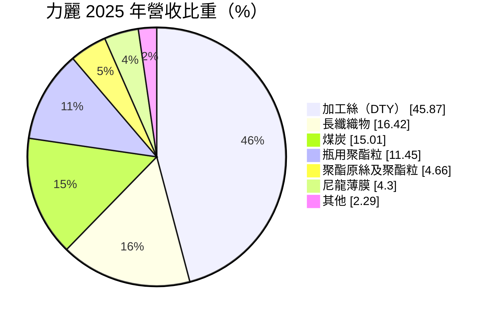
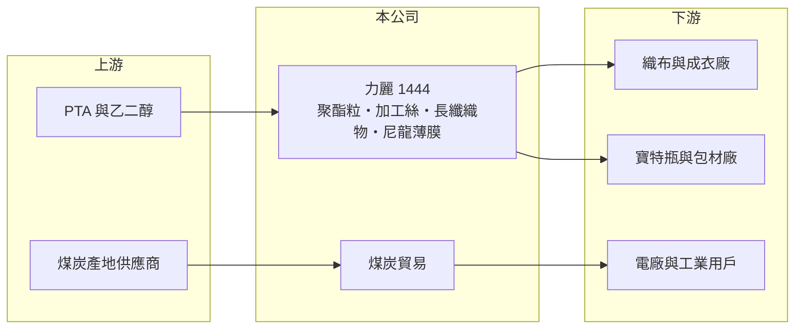

# 1444 力麗

> 上市｜[[產業索引-紡織纖維|紡織纖維]]｜上市（櫃）日期 1990/08/08

# 第一章：企業模式與商業藍圖

> [!info] 撰寫說明
> 精簡版，由 Claude 依公開資料整理，架構比照 [[2330台積電]]，資料截至 2026-10-08。來源：MoneyDJ 理財網個股基本資料（2025 年營收比重）與財務比率年表（2021 至 2025 年）；證交所開放資料快照（基本資料、2026 年第二季資產負債與上半年損益、2025 年度股利）。集團關係與據點為憑記憶整理，已標「待校對」。#待校對

力麗企業（以下簡稱力麗）成立於 1979 年 1 月、1990 年 8 月上市，總公司在台北市松江路，董事長郭紹儀，是力麗集團的核心公司，與 [[1447力鵬]] 同一位董事長。它從聚酯原料一路做到加工絲與織物，另外經營煤炭貿易，營收規模約 70 億元以上，但近年本業處於虧損。

- **核心業務：** 力麗最大的產品是[[加工絲]]（DTY），2025 年占營收 45.87%，其次是長纖織物 16.42%。加工絲是把[[聚酯]]原絲加熱、假撚後做成有彈性與蓬鬆感的紗線，是運動服、內衣與一般衣料的主要原料。公司自產聚酯粒與原絲，再加工成絲與布，屬於中游的一貫生產。
- **營收結構：** 依 MoneyDJ 每股營業額 7.23 元乘以約 9.96 億股推算，2025 年營收約 72 億元（推算），2026 年上半年證交所資料為 44.8 億元。除紡織外，煤炭貿易占 15.01%、瓶用聚酯粒 11.45%、尼龍薄膜 4.30%。煤炭貿易營收大但毛利薄，會拉低整體毛利率；瓶用聚酯粒則直接面對中國大廠的價格競爭。
- **營運據點：** 生產廠區主要在台灣（廠址待校對），集團另有轉投資的紡織、化纖與營建事業，2026 年第二季合併報表的非控制權益約 12.6 億元，代表有持股未達百分之百的子公司被納入合併。
- **長期方向：** 力麗的長期課題是收縮與中國同質的大宗產品，把資源集中在加工絲、機能織物等需要技術與交期服務的產品。集團層面，力麗與 [[1447力鵬]]、[[1457宜進]] 同屬力麗集團（持股關係待校對），集團內的原料、紗與布可以互相供應。

# 第二章：護城河深度與競爭優勢

力麗的優勢在於從酯粒到加工絲、織物的一貫生產與集團規模，但大宗聚酯產品沒有定價權，護城河偏窄。

- **競爭優勢：** 自產聚酯粒與原絲，再做成加工絲與布，讓力麗可以控制原料品質與交期，對需要穩定色差與手感的織布客戶有吸引力。加工絲產品規格多、需要依客戶要求調整丹尼數與功能，比純粹的聚酯粒更有差異化空間。
- **主要對手：** 加工絲的主要同業是 [[1455集盛]]、[[1452宏益]]、[[1454台富]]、[[1409新纖]]，聚酯粒則面對 [[1402遠東新]]、[[1326台化]] 與中國大型聚酯廠。中國聚酯產能占全球大半，報價常低於台灣廠商的成本，大宗產品幾乎只能跟價。
- **觀察重點：** 力麗近 5 年平均 [[ROE]] 只有約 0.2%（推算），2023 年起營業利益率連續為負。觀察重點是瓶用聚酯粒等低毛利產品的比重是否持續下降，以及加工絲與織物的[[毛利率]]能否回到 2021 年的 10% 以上水準。

# 第三章：財務體質與盈利規模

資料日期：2026-10-08，表格是撰寫當時的快照；最新月營收、毛利率、累計 EPS 由自動排程寫在本筆記的屬性欄位（月營收、毛利率、累計EPS 等）。#待校對

力麗的獲利高峰在 2021 年，之後營收與毛利率一起下滑，2023 年毛利率轉負，2025 年虧損擴大到每股 0.78 元。

| 年度 | 營收（億元） | [[毛利率]] | [[營業利益率]] | EPS（元） | [[ROE]] |
|---|---|---|---|---|---|
| 2021 | 約 110（推算） | 12.00% | 1.93% | 0.68 | 5.57% |
| 2022 | 約 124（推算） | 8.59% | 0.34% | 0.51 | 3.89% |
| 2023 | 約 83（推算） | -0.75% | -7.24% | -0.28 | -2.62% |
| 2024 | 約 84（推算） | 2.85% | -4.68% | 0.28 | 2.04% |
| 2025 | 約 72（推算） | 2.54% | -5.37% | -0.78 | -7.73% |

註：2025 年營收以每股營業額 7.23 元乘以約 9.96 億股推算，其他年度依 MoneyDJ 營收成長率回推。

- **長期指標：** 2021 至 2025 年營收年複合成長率約 -10.1%（推算），近 5 年平均 ROE 約 0.2%（推算）。2024 年營業利益率 -4.68%、稅後淨利率卻是 2.98%，獲利靠[[業外收益]]；2025 年度未配發股利。每股現金流量 2022 至 2024 年為正，2021 與 2025 年為負，現金流並不穩定。
- **[[ROIC]] 與 [[WACC]]：** 2025 年營業損失約 3.9 億元（營業利益率 -5.37% × 營收約 72 億元，虧損不計稅），投入資本約 159 億元（2026 年第二季權益總計 112.9 億元，加上以總負債 92.1 億元的一半推估的有息負債約 46 億元），ROIC 約 -2.4%（推算）。WACC 約 5.2%（推算：無風險利率 1.75%、市場風險溢酬 6%、β 取紡織同業常見值 0.8，股東權益成本 6.55%；稅前負債成本 2.5%、稅率 20%；權益比重約 71%）。ROIC 為負、低於 WACC 約 7.6 個百分點，代表目前的資本配置沒有創造價值，關鍵在於收縮虧損產品線。
- **財務特色：** 2026 年第二季負債比率約 45%（負債 92.1 億元 ÷ 資產 205.0 億元），保留盈餘只剩約 1.7 億元。2026 年上半年營業損失 0.63 億元、業外收入 1.9 億元，靠業外轉為每股盈餘 0.14 元；股價淨值比約 0.67 倍。

# 第四章：總體風險與地緣政治

力麗的風險集中在中國聚酯產能過剩與原料價格波動，煤炭貿易則帶來另一種商品價格風險。

- **產業週期：** 聚酯產品的價格由原油、[[PTA]] 與中國供需決定，中國大舉擴產後，台灣廠商的瓶用聚酯粒與一般加工絲長期承受低價競爭。紡織需求又跟著國際品牌庫存週期走，2023 年營收年減 33% 就是需求與價格同步下跌的結果。
- **營運風險：** 本業連續三年虧損，若持續，保留盈餘可能轉為累積虧損，影響配息能力。煤炭貿易營收雖大，但價格波動劇烈、毛利薄，也可能因電力業減煤政策而萎縮。
- **其他風險：** 外銷以美元計價，新台幣升值壓縮毛利；歐美品牌要求提高回收聚酯比例與碳排揭露，設備需要持續投資；台灣電價上漲會直接推高紡絲與加工成本。

# 專有名詞解析

## 金融

- **[[業外收益]]**：本業以外的收入，例如投資收益、處分資產利益或匯兌利益，通常不具持續性。
- **[[ROIC]]**：投入資本報酬率，稅後營業利益除以股東權益加有息負債，衡量本業運用資本的效率。
- **[[WACC]]**：加權平均資金成本，股東與債權人要求報酬率的加權平均，是 ROIC 要超越的門檻。

## 產業

- **[[加工絲]]**：把聚酯或尼龍原絲經加熱、假撚加工，使其具有彈性與蓬鬆感的紗線，英文簡稱 DTY。
- **[[聚酯]]**：以 PTA 與乙二醇聚合而成的合成纖維與塑膠原料，用於衣料、寶特瓶與工業用布。
- **[[PTA]]**：純對苯二甲酸，與乙二醇聚合成聚酯，是紡織與包裝用聚酯的基礎原料。

# 核心供應鏈

- 上游：聚酯原料業者如 [[1326台化]]、[[1303南亞]]（是否為力麗供應商未查得）；煤炭供應來源未查得。
- 下游／客戶：織布、成衣廠與包材廠，客戶名單未查得；煤炭客戶未查得。
- 同業與集團：[[1455集盛]]、[[1452宏益]]、[[1454台富]]、[[1409新纖]]；集團公司 [[1447力鵬]]、[[1457宜進]]。

## 最新新聞
<!-- news:start（自動產生，請勿手動編輯此範圍） -->
- 2026-10-13 📰 媒體 18:04｜力麗集團旗下天意能創整合四大戰隊 切入水資源、綠電與AI環工｜[鉅亨網](https://news.cnyes.com/news/id/6629504)

完整紀錄：[[1444力麗 新聞]]
<!-- news:end -->

## 相關連結
- [公開資訊觀測站](https://mopsov.twse.com.tw/mops/web/t05st03?step=1&firstin=1&co_id=1444)
- [Goodinfo](https://goodinfo.tw/tw/StockDetail.asp?STOCK_ID=1444)
- [Yahoo 股市](https://tw.stock.yahoo.com/quote/1444)
- [鉅亨網新聞](https://www.cnyes.com/twstock/1444/news)
