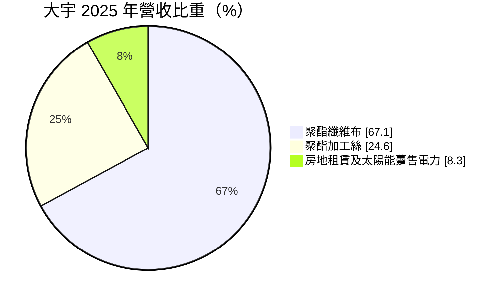
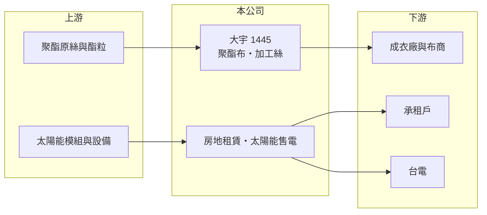

# 1445 大宇

> 上市｜[[產業索引-紡織纖維|紡織纖維]]｜上市（櫃）日期 1991/02/05

# 第一章：企業模式與商業藍圖

> [!info] 撰寫說明
> 精簡版，由 Claude 依公開資料整理，架構比照 [[2330台積電]]，資料截至 2026-10-08。來源：MoneyDJ 理財網個股基本資料（2025 年營收比重）與財務比率年表（2021 至 2025 年）；證交所開放資料快照（基本資料、2026 年第二季資產負債與上半年損益、2025 年度股利）。公開資料有限，據點、客戶與 2023 年大額業外收益的來源未查得。#待校對

大宇紡織（以下簡稱大宇）成立於 1969 年 9 月、1991 年 2 月上市，總公司在台北市大同區西寧北路，董事長陳曜銘、總經理楊任凱。它以聚酯布與加工絲為本業，另把部分不動產出租並經營太陽能售電，是一家「小型紡織本業加上資產收益」的公司。

- **核心業務：** 大宇的主力是[[聚酯]]纖維布，2025 年占營收 67.10%，其次是聚酯[[加工絲]] 24.60%。公司把自製的加工絲織成布，產品屬於一般衣料與運動休閒用布，規格同質性高，價格容易受中國同業影響。
- **營收結構：** 依 MoneyDJ 每股營業額 5.89 元乘以約 1.31 億股推算，2025 年營收約 7.7 億元（推算），2026 年上半年證交所資料為 3.1 億元。營收從 2022 年約 15 億元一路減半，紡織本業明顯收縮；房地租賃與太陽能售電占 8.30%，雖然金額不大，但毛利率較高、收入穩定。
- **營運據點：** 生產廠區與海外據點這次未查得。太陽能躉售電力代表公司在自有廠房屋頂或土地設置太陽能板，把電賣給台電，是紡織廠常見的[[資產活化]]方式。
- **長期方向：** 本業規模縮小的同時，大宇的資產面在 2023 年後出現大變化：2023 年稅後淨利率高達 72.98%、EPS 7.72 元，明顯來自本業以外的一次性收益（來源未查得，推估為資產處分）；2025 年負債比率又從 13% 跳升到 52.5%，2026 年第二季非流動負債約 19.8 億元（原因未查得）。這兩件事決定了大宇未來的資產與財務結構，需要查證公告內容。

# 第二章：護城河深度與競爭優勢

大宇的紡織本業沒有明顯的護城河，公司的價值較多來自土地與廠房等資產，以及其衍生的租金與售電收入。

- **競爭優勢：** 從加工絲到織布的一貫生產，讓大宇能自行控制紗的品質與交期，這對中小型織布廠是基本但必要的能力。租賃與太陽能收入不受紡織景氣影響，能在本業虧損時提供部分固定現金流。
- **主要對手：** 聚酯布與加工絲的同業包括 [[1454台富]]、[[1452宏益]]、[[1444力麗]]、[[1455集盛]]，以及中國、越南大量的織布廠。這些對手多半規模更大，大宇在價格與產能上都不佔優勢。
- **觀察重點：** 2025 年毛利率回到 11.30%，但營業利益率仍為 -12.21%，費用相對營收過高。觀察重點是公司是否繼續縮減紡織產能、把重心轉向資產收益，以及 2025 年大幅增加的非流動負債的用途與還款安排。

# 第三章：財務體質與盈利規模

資料日期：2026-10-08，表格是撰寫當時的快照；最新月營收、毛利率、累計 EPS 由自動排程寫在本筆記的屬性欄位（月營收、毛利率、累計EPS 等）。#待校對

大宇本業五年來都是營業虧損，2023 年的高獲利來自一次性業外收益，不代表本業好轉。

| 年度 | 營收（億元） | [[毛利率]] | [[營業利益率]] | EPS（元） | [[ROE]] |
|---|---|---|---|---|---|
| 2021 | 約 12.5（推算） | 6.70% | -3.81% | -0.19 | -1.56% |
| 2022 | 約 15.1（推算） | 7.88% | -2.24% | 0.08 | 0.67% |
| 2023 | 約 13.8（推算） | 13.44% | -5.48% | 7.72 | 46.61% |
| 2024 | 約 9.9（推算） | -1.37% | -19.74% | -1.52 | -7.80% |
| 2025 | 約 7.7（推算） | 11.30% | -12.21% | -0.87 | -5.01% |

註：2025 年營收以每股營業額 5.89 元乘以約 1.31 億股推算，其他年度依 MoneyDJ 營收成長率回推。

- **長期指標：** 2021 至 2025 年營收年複合成長率約 -11.5%（推算）。近 5 年平均 ROE 約 6.6%（推算），但扣除 2023 年的一次性收益後為負值，不能當作本業的獲利能力。2025 年度虧損仍配發現金股利 0.5 元，是用過去的保留盈餘支付；每股淨值從 2023 年 20.62 元降到 2026 年第二季 16.33 元。
- **[[ROIC]] 與 [[WACC]]：** 2025 年營業損失約 0.94 億元（營業利益率 -12.21% × 營收約 7.7 億元，虧損不計稅），投入資本約 32.8 億元（2026 年第二季權益總計 21.3 億元，加上以總負債 22.9 億元的一半推估的有息負債約 11.4 億元），ROIC 約 -2.9%（推算）。WACC 約 5.0%（推算：無風險利率 1.75%、市場風險溢酬 6%、β 取紡織同業常見值 0.8，股東權益成本 6.55%；稅前負債成本 2.5%、稅率 20%；權益比重約 65%）。ROIC 為負且低於 WACC，紡織本業並未創造價值；若新增負債是用於不動產開發，未來 ROIC 將取決於該開發案的回收。
- **財務特色：** 2026 年第二季負債比率約 52%（負債 22.9 億元 ÷ 資產 44.2 億元），其中流動負債只有 3.1 億元，多為長期性負債。其他權益約 2.0 億元，代表持有的金融資產有未實現評價利益；股價淨值比約 0.63 倍。

# 第四章：總體風險與地緣政治

大宇的風險在於本業持續萎縮，以及資產負債結構在 2025 年後的大幅改變。

- **產業週期：** 聚酯布與加工絲的需求跟著國際品牌庫存週期走，價格則受原油與中國產能影響。2024 年毛利率轉負、營收年減 28%，顯示小型布廠在景氣低迷時幾乎沒有議價空間。
- **營運風險：** 營收已降到 10 億元以下，固定費用難以攤提，營業虧損恐怕會延續。2025 年增加的長期負債若用於開發或投資，利率與開發時程都會影響未來獲利，資訊揭露需持續追蹤。
- **其他風險：** 太陽能售電收入受躉購費率與設備衰減影響；租賃收入受租約續約與地區租金行情影響；外銷布料以美元計價，匯率變動會影響毛利。

# 專有名詞解析

## 金融

- **[[ROIC]]**：投入資本報酬率，稅後營業利益除以股東權益加有息負債，衡量本業運用資本的效率。
- **[[WACC]]**：加權平均資金成本，股東與債權人要求報酬率的加權平均，是 ROIC 要超越的門檻。

## 產業

- **[[聚酯]]**：以 PTA 與乙二醇聚合而成的合成纖維與塑膠原料，用於衣料、寶特瓶與工業用布。
- **[[加工絲]]**：把聚酯或尼龍原絲經加熱、假撚加工，使其具有彈性與蓬鬆感的紗線，英文簡稱 DTY。
- **[[資產活化]]**：把閒置或低度利用的土地、建物透過開發、出租或出售，轉為收益或現金。

# 核心供應鏈

- 上游：聚酯原絲供應商如 [[1409新纖]]、[[1402遠東新]]（是否為大宇供應商未查得）。
- 下游／客戶：成衣廠與布商，客戶名單未查得；太陽能電力售予台電。
- 同業：[[1454台富]]、[[1452宏益]]、[[1444力麗]]、[[1455集盛]]。

## 最新新聞
<!-- news:start -->
<!-- news:end -->

## 相關連結
- [公開資訊觀測站](https://mopsov.twse.com.tw/mops/web/t05st03?step=1&firstin=1&co_id=1445)
- [Goodinfo](https://goodinfo.tw/tw/StockDetail.asp?STOCK_ID=1445)
- [Yahoo 股市](https://tw.stock.yahoo.com/quote/1445)
- [鉅亨網新聞](https://www.cnyes.com/twstock/1445/news)
