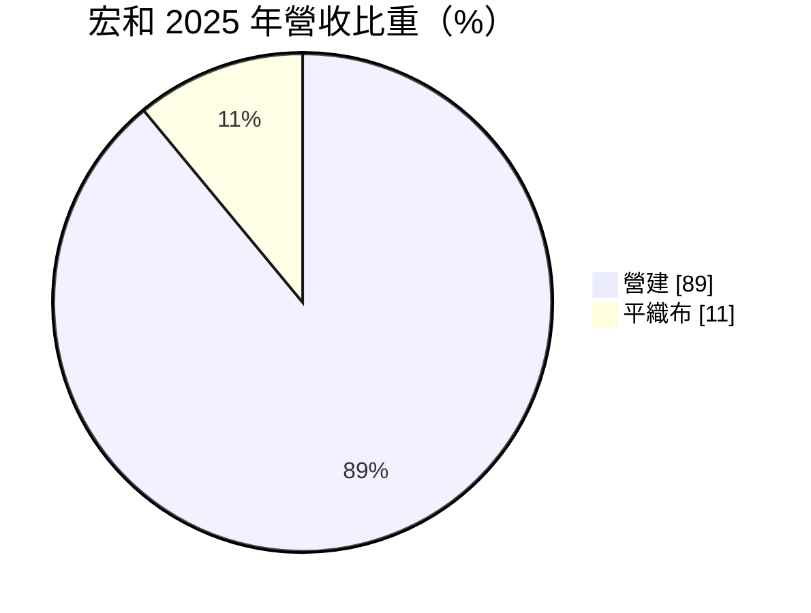
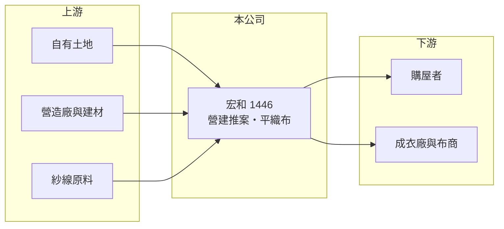

# 1446 宏和

> 上市｜[[產業索引-紡織纖維|紡織纖維]]｜上市（櫃）日期 1991/10/15

# 第一章：企業模式與商業藍圖

> [!info] 撰寫說明
> 精簡版，由 Claude 依公開資料整理，架構比照 [[2330台積電]]，資料截至 2026-10-08。來源：MoneyDJ 理財網個股基本資料（2025 年營收比重）與財務比率年表（2021 至 2025 年）；證交所開放資料快照（基本資料、2026 年第二季資產負債與上半年損益、2025 年度股利、2026 年 8 月營收備註）。公開資料有限，建案名稱與土地位置未查得。#待校對

宏和精密紡織（以下簡稱宏和）成立於 1978 年 6 月、1991 年 10 月上市，總公司在台南市永康區，董事長黃大功、總經理何天明。名稱雖是紡織公司，但 2025 年營收有 89% 來自營建，平織布只占 11%，實質上已轉為以自有土地推案的營建公司，紡織成為小規模的副業。

- **核心業務：** 宏和的營收主體是[[建案認列]]，也就是住宅或商辦完工交屋時一次認列銷售收入；紡織部分生產平織布，規模很小。營建收入只在交屋那幾年集中出現，所以營收與獲利呈現「有案大賺、沒案平淡」的跳躍型態。
- **營收結構：** 依 MoneyDJ 每股營業額推算，宏和 2021 與 2022 年營收不到 2 億元，2023 年約 5.7 億元、2024 年跳升到約 36.7 億元、2025 年回落到約 10.2 億元（皆為推算），2026 年上半年證交所資料為 3.3 億元。2026 年 8 月營收備註為「本期營建銷售戶數減少」，證實營收主要由建案交屋戶數決定。
- **營運據點：** 公司位於台南永康，推案主要在台南地區（建案位置待校對）。老牌紡織廠的工廠用地多在早年取得，土地帳面成本低，變更用途後推案，毛利率可以比一般建商高，宏和 2024 年毛利率達 49.94% 即反映這點。
- **長期方向：** 宏和的長期價值取決於還有多少可開發的土地，以及是否持續買地推案。若手上土地開發完畢又不再補地，公司將回到小型織布廠的規模；若持續推案，則會逐步成為台南地區的區域型建商。這是投資人最需要釐清的結構問題（土地庫存未查得）。

# 第二章：護城河深度與競爭優勢

宏和的競爭力來自低成本的自有土地，而不是紡織或營建技術；這種優勢可以帶來高毛利，但會隨土地用完而消失。

- **競爭優勢：** 早年取得的工業用地成本低，推案時土地成本占比遠低於向市場買地的建商，因此毛利率可達四到五成。公司負債比率在建案交屋後降到約 15%，財務保守，不必承擔高槓桿推案的風險。
- **主要對手：** 營建部分與台南地區的建商競爭，同樣列在紡織類股、營建收入占比高的上市公司包括 [[1449佳和]]、[[1436華友聯]]；全國性建商如 [[2501國建]]、[[5525順天]] 在南部也有推案。紡織部分則與眾多小型織布廠競爭，影響力有限。
- **觀察重點：** 宏和近 5 年平均 [[ROE]] 約 15.0%（推算），但其中 2024 年的 62.98% 來自單一建案，2021 與 2022 年則為負值。觀察重點是新建案的推出時程與銷售率，以及公司在土地用完後是否有明確的接續計畫。

# 第三章：財務體質與盈利規模

資料日期：2026-10-08，表格是撰寫當時的快照；最新月營收、毛利率、累計 EPS 由自動排程寫在本筆記的屬性欄位（月營收、毛利率、累計EPS 等）。#待校對

宏和的財務數字幾乎完全由建案交屋決定，2024 年是交屋高峰，2025 年後回落，但仍維持高毛利率與高配息。

| 年度 | 營收（億元） | [[毛利率]] | [[營業利益率]] | EPS（元） | [[ROE]] |
|---|---|---|---|---|---|
| 2021 | 約 1.9（推算） | 24.20% | -6.28% | -0.12 | -1.12% |
| 2022 | 約 1.6（推算） | 11.76% | -26.43% | -0.27 | -2.54% |
| 2023 | 約 5.7（推算） | 42.03% | 25.38% | 0.80 | 7.42% |
| 2024 | 約 36.7（推算） | 49.94% | 41.01% | 9.82 | 62.98% |
| 2025 | 約 10.2（推算） | 45.38% | 32.02% | 1.62 | 8.06% |

註：2025 年營收以每股營業額 7.40 元乘以約 1.38 億股推算，其他年度依 MoneyDJ 營收成長率回推。

- **長期指標：** 營收在 2021 至 2025 年間的年複合成長率約 52%（推算），但這是建案集中認列造成的，不代表持續成長；近 5 年平均 ROE 約 15.0%（推算），波動極大。2025 年度配發現金股利 1.5 元，接近當年 EPS 1.62 元，[[配息率]]約九成；每股淨值由 2023 年 11.05 元升到 2025 年 20.14 元，建案獲利大多留在公司或以股利分配。
- **[[ROIC]] 與 [[WACC]]：** 2025 年稅後營業利益約 2.6 億元（營業利益率 32.02% × 營收約 10.2 億元 × 0.8），投入資本約 29.1 億元（2026 年第二季股東權益 26.7 億元，加上以總負債 4.8 億元的一半推估的有息負債約 2.4 億元），ROIC 約 9.0%（推算）。WACC 約 6.2%（推算：無風險利率 1.75%、市場風險溢酬 6%、β 取紡織與營建同業常見值 0.8，股東權益成本 6.55%；稅前負債成本 2.5%、稅率 20%；權益比重約 92%）。2023 至 2025 年 ROIC 都高於 WACC，代表土地開發確實創造價值；但這份超額報酬來自一次性的低成本土地，無法視為長期護城河。
- **財務特色：** 2026 年第二季負債比率約 15%（負債 4.8 億元 ÷ 資產 31.5 億元），2023 年還在 67%，建案交屋後把建融還清。流動資產 27.4 億元占總資產近九成，主要是待售房地與現金（明細未查得）。2026 年上半年營業利益率 21.29%、EPS 0.77 元，殖利率約 11%，市場較像以[[資產股]]的角度看待宏和。

# 第四章：總體風險與地緣政治

宏和的風險主要來自房地產景氣與土地庫存，紡織本業的影響已經很小。

- **產業週期：** 營建收入受房市景氣、利率與央行信用管制影響，房市降溫時銷售速度放慢，交屋與認列也會延後。台南房市近年受科學園區帶動，但若需求轉弱，區域型建案的去化壓力會比北部大。
- **營運風險：** 營收高度依賴少數建案，沒有新案接續時營收可能一年內縮小七成以上，2025 年營收較 2024 年減少 72% 就是例子。若要持續推案而必須在市場上買地，土地成本上升後毛利率會明顯下降。
- **其他風險：** 營建原物料與工資上漲會壓縮未完工建案的利潤；房地合一稅、囤房稅等法規變化影響買方需求；紡織平織布部分則持續面對中國低價布料競爭。

# 專有名詞解析

## 金融

- **[[配息率]]**：現金股利占每股盈餘的比例，反映公司把多少獲利分給股東。
- **[[ROIC]]**：投入資本報酬率，稅後營業利益除以股東權益加有息負債，衡量本業運用資本的效率。
- **[[WACC]]**：加權平均資金成本，股東與債權人要求報酬率的加權平均，是 ROIC 要超越的門檻。

## 產業

- **[[建案認列]]**：建商在建案完工、交屋並移轉所有權時，才一次認列銷售收入與利潤的會計方式。
- **[[資產股]]**：主要價值來自土地、建物或轉投資等資產，而非本業獲利成長的股票，常以股價淨值比評價。

# 核心供應鏈

- 上游：營造廠與建材供應商未查得；紗線供應商未查得。
- 下游／客戶：台南地區購屋者；平織布客戶未查得。
- 同業：紡織類股中兼營或專營營建的 [[1449佳和]]、[[1436華友聯]]；建商 [[2501國建]]、[[5525順天]]。

## 最新新聞
<!-- news:start（自動產生，請勿手動編輯此範圍） -->
- 2026-10-08 📰 媒體 18:21｜營收速報 - 宏和(1446)9月營收8,519萬元年增率高達654.35％｜[鉅亨網](https://news.cnyes.com/news/id/6625142)

完整紀錄：[[1446宏和 新聞]]
<!-- news:end -->

## 相關連結
- [公開資訊觀測站](https://mopsov.twse.com.tw/mops/web/t05st03?step=1&firstin=1&co_id=1446)
- [Goodinfo](https://goodinfo.tw/tw/StockDetail.asp?STOCK_ID=1446)
- [Yahoo 股市](https://tw.stock.yahoo.com/quote/1446)
- [鉅亨網新聞](https://www.cnyes.com/twstock/1446/news)
