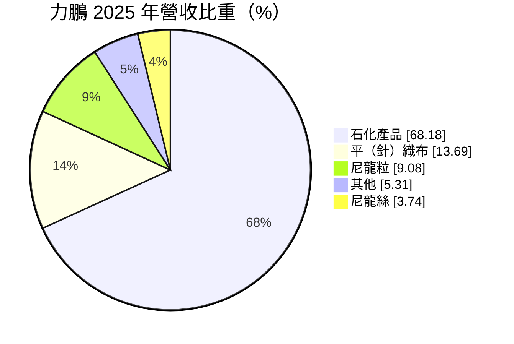
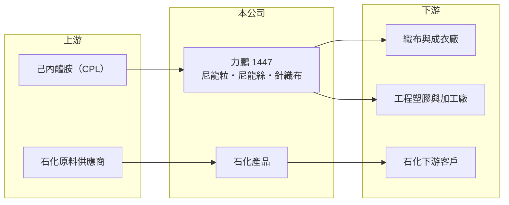

# 1447 力鵬

> 上市｜[[產業索引-紡織纖維|紡織纖維]]｜上市（櫃）日期 1992/01/28

# 第一章：企業模式與商業藍圖

> [!info] 撰寫說明
> 精簡版，由 Claude 依公開資料整理，架構比照 [[2330台積電]]，資料截至 2026-10-08。來源：MoneyDJ 理財網個股基本資料（2025 年營收比重）與財務比率年表（2021 至 2025 年）；證交所開放資料快照（基本資料、2026 年第二季資產負債與上半年損益、2025 年度股利）。石化產品的實際內容、集團持股與據點為推估或憑記憶整理，已標「待校對」。#待校對

力鵬企業（以下簡稱力鵬）成立於 1975 年 8 月、1992 年 1 月上市，總公司在台北市松江路，董事長郭紹儀，與 [[1444力麗]] 同屬力麗集團。力鵬的營收規模約 300 億元，是集團內最大的公司，但近七成營收來自毛利極薄的石化產品，尼龍紡織本業的比重反而不到三成。

- **核心業務：** 力鵬的紡織本業是[[尼龍]]一貫生產：用[[己內醯胺]]聚合成尼龍粒，再紡成尼龍絲、織成平針織布，用於運動服、內衣與機能布料。石化產品 2025 年占營收 68.18%，從整體毛利率不到 2% 判斷，這部分以低毛利的石化原料買賣為主（推估，待校對）。
- **營收結構：** 依 MoneyDJ 每股營業額 33.03 元乘以約 9.10 億股推算，2025 年營收約 301 億元（推算），2026 年上半年證交所資料為 160.7 億元，規模相符。營收大但利潤極薄，2021 至 2025 年毛利率從 4.71% 一路降到 0.72%，代表石化貿易放大了營收，卻沒有增加多少獲利。
- **營運據點：** 生產廠區主要在台灣（廠址待校對），2026 年第二季合併報表的非控制權益約 9.6 億元，代表有持股未達百分之百的子公司被納入合併。
- **長期方向：** 力鵬的長期課題是尼龍紡織本業能否擺脫中國低價尼龍粒與尼龍絲的壓力，轉往高附加價值的機能布料；同時，石化貿易規模龐大但利潤微薄，資本與營運資金的使用效率需要重新檢視。

# 第二章：護城河深度與競爭優勢

力鵬的優勢在尼龍一貫生產與集團資源，但大宗尼龍粒與石化貿易都缺乏定價權，護城河偏窄。

- **競爭優勢：** 從尼龍粒、尼龍絲到織布的垂直整合，讓力鵬能控制原料品質並縮短交期，對需要穩定供貨的織布與成衣客戶有吸引力。與 [[1444力麗]] 同集團，聚酯與尼龍產品線可互補，對客戶提供較完整的化纖選擇。
- **主要對手：** 尼龍粒與尼龍絲的主要同業是 [[1455集盛]]、[[1466聚隆]]、[[1402遠東新]]，以及中國快速擴產的尼龍業者；石化產品則面對眾多貿易商與中國石化廠，幾乎只能跟隨市場報價。
- **觀察重點：** 力鵬近 5 年平均 [[ROE]] 約 -2.1%（推算），2022 年起營業利益率多為負值。觀察重點是尼龍本業毛利率能否回升，以及石化產品比重是否下降、讓整體營業利益轉正。

# 第三章：財務體質與盈利規模

資料日期：2026-10-08，表格是撰寫當時的快照；最新月營收、毛利率、累計 EPS 由自動排程寫在本筆記的屬性欄位（月營收、毛利率、累計EPS 等）。#待校對

力鵬營收在 2024 年接近 376 億元的高點，但毛利率長期不到 2%，營收成長並沒有帶來獲利，2025 年虧損擴大到每股 0.97 元。

| 年度 | 營收（億元） | [[毛利率]] | [[營業利益率]] | EPS（元） | [[ROE]] |
|---|---|---|---|---|---|
| 2021 | 約 262（推算） | 4.71% | 1.46% | 0.31 | 2.62% |
| 2022 | 約 308（推算） | 1.78% | -1.18% | -0.04 | -0.17% |
| 2023 | 約 320（推算） | 0.78% | -2.02% | -0.51 | -4.27% |
| 2024 | 約 376（推算） | 1.11% | -1.18% | 0.05 | 0.74% |
| 2025 | 約 301（推算） | 0.72% | -1.79% | -0.97 | -9.26% |

註：2025 年營收以每股營業額 33.03 元乘以約 9.10 億股推算，其他年度依 MoneyDJ 營收成長率回推。

- **長期指標：** 2021 至 2025 年營收年複合成長率約 3.5%（推算），近 5 年平均 ROE 約 -2.1%（推算）。2025 年度未配發股利，每股淨值從 2021 年 11.45 元降到 2025 年 8.89 元。每股現金流量 2021 至 2024 年為正、2025 年轉負，營運資金需求隨石化貿易規模波動。
- **[[ROIC]] 與 [[WACC]]：** 2025 年營業損失約 5.4 億元（營業利益率 -1.79% × 營收約 301 億元，虧損不計稅），投入資本約 132 億元（2026 年第二季權益總計 90.7 億元，加上以總負債 82.4 億元的一半推估的有息負債約 41 億元），ROIC 約 -4.1%（推算）。WACC 約 5.1%（推算：無風險利率 1.75%、市場風險溢酬 6%、β 取紡織與化纖同業常見值 0.8，股東權益成本 6.55%；稅前負債成本 2.5%、稅率 20%；權益比重約 69%）。ROIC 長期低於 WACC，代表龐大的營收規模並沒有轉成資本報酬，公司尚未為股東創造價值。
- **財務特色：** 2026 年第二季負債比率約 48%（負債 82.4 億元 ÷ 資產 173.1 億元），保留盈餘為 -4.7 億元，處於累積虧損。2026 年上半年營業利益率 0.28%、業外收入 1.0 億元，每股盈餘 0.12 元；股價淨值比約 0.66 倍。

# 第四章：總體風險與地緣政治

力鵬的風險來自尼龍與石化原料的價格波動，以及薄利模式下的財務壓力。

- **產業週期：** 尼龍粒價格跟著己內醯胺與原油波動，中國尼龍產能大幅擴張後，台灣業者的尼龍粒與尼龍絲長期承受低價競爭。紡織需求又受國際品牌庫存週期影響，需求與價格可能同時下跌。
- **營運風險：** 石化產品毛利極薄，原料價格急跌時庫存跌價損失可能吃掉整年利潤；營收規模大，營運資金與借款需求也高。累積虧損若持續，配息能力與財務彈性都會受限。
- **其他風險：** 外銷與原料採購以美元計價，匯率變動同時影響成本與售價；台灣電價上漲推高聚合與紡絲成本；歐美品牌對回收尼龍與碳排的要求，需要額外的設備投資。

# 專有名詞解析

## 金融

- **[[ROIC]]**：投入資本報酬率，稅後營業利益除以股東權益加有息負債，衡量本業運用資本的效率。
- **[[WACC]]**：加權平均資金成本，股東與債權人要求報酬率的加權平均，是 ROIC 要超越的門檻。

## 產業

- **[[尼龍]]**：以己內醯胺或己二胺聚合而成的合成纖維與塑膠，強度高、耐磨，用於衣料、漁網與工程塑膠。
- **[[己內醯胺]]**：生產尼龍 6 的單體原料，簡稱 CPL，製程副產品為硫酸銨肥料。

# 核心供應鏈

- 上游：己內醯胺國內生產者為 [[1314中石化]]，另有海外業者，力鵬的實際供應商名單未查得；石化原料業者如 [[1326台化]]（是否為供應商未查得）。
- 下游／客戶：織布、成衣廠與塑膠加工廠，客戶名單未查得。
- 同業與集團：[[1455集盛]]、[[1466聚隆]]、[[1402遠東新]]；集團公司 [[1444力麗]]、[[1457宜進]]。

## 最新新聞
<!-- news:start -->
<!-- news:end -->

## 相關連結
- [公開資訊觀測站](https://mopsov.twse.com.tw/mops/web/t05st03?step=1&firstin=1&co_id=1447)
- [Goodinfo](https://goodinfo.tw/tw/StockDetail.asp?STOCK_ID=1447)
- [Yahoo 股市](https://tw.stock.yahoo.com/quote/1447)
- [鉅亨網新聞](https://www.cnyes.com/twstock/1447/news)
